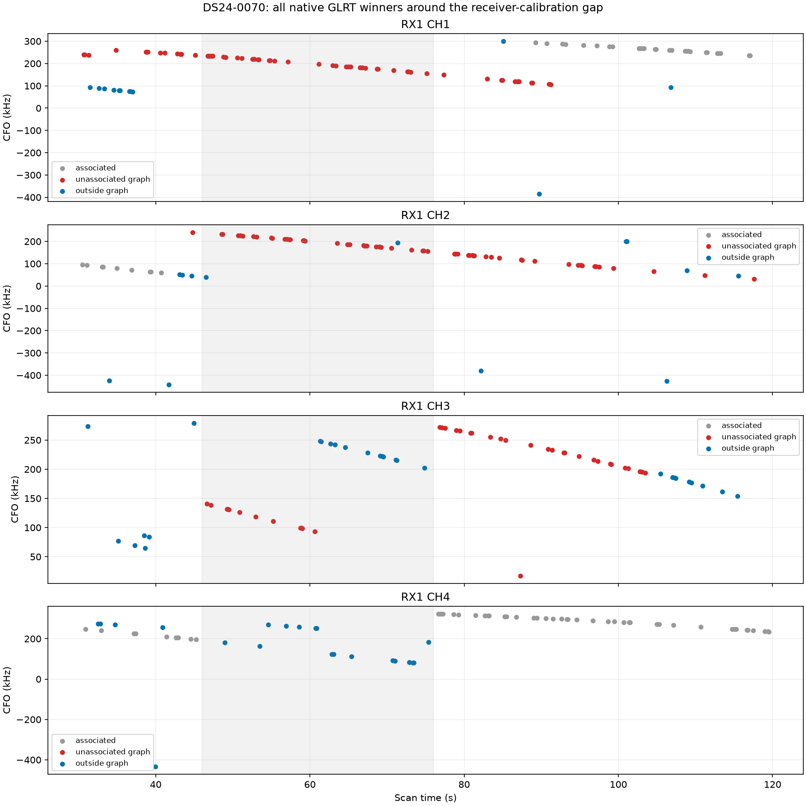
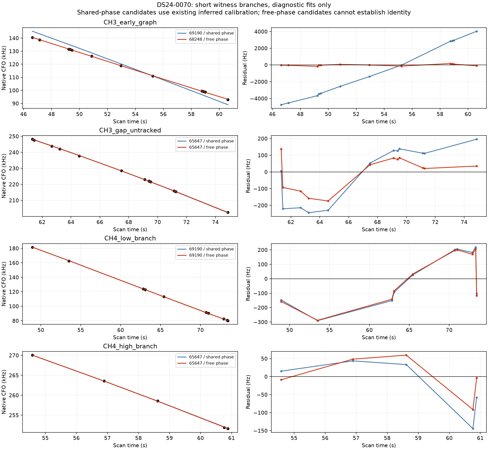
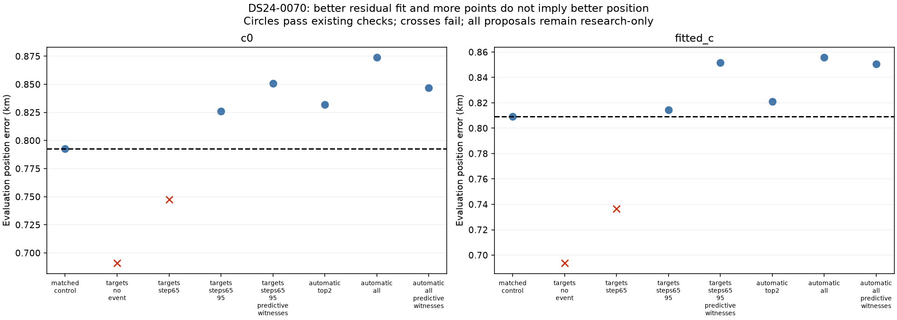
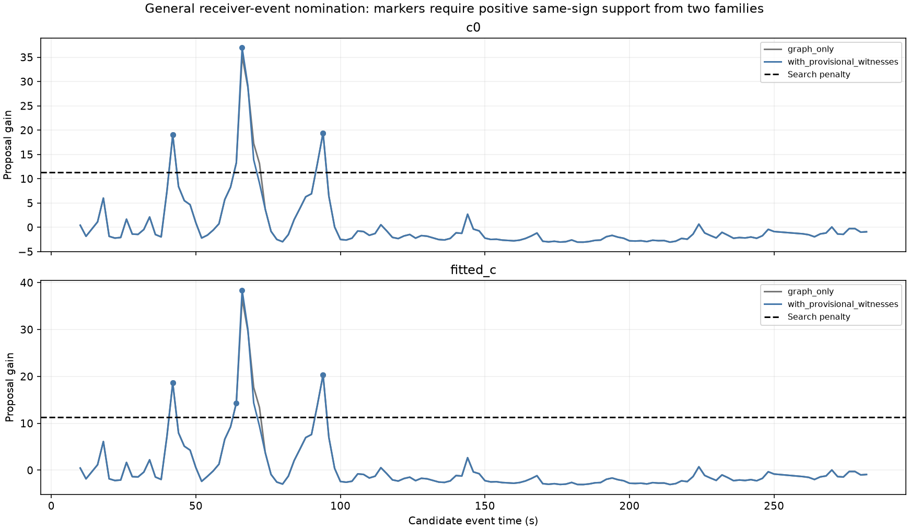
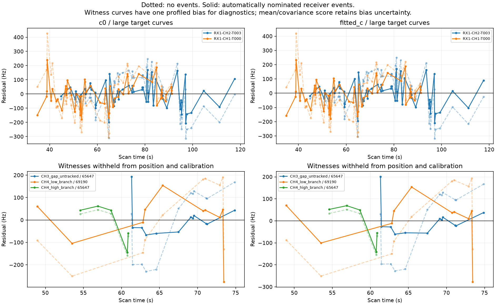

# DS24-0070: native witnesses resolve a calibration coverage gap

The [previous investigation](../2026_10_29_distinct_track_validation/README.md) found two large curves consistently nominating satellite 67906 but failing residual checks. This iteration finds additional native GLRT branches in the missing RX1 interval and tests shared receiver corrections. Two automatic event proposals allow both large curves to pass the existing checks with **131 proposed additional points in each c arm and no old losses**. This is a research retention result: position error does not improve, and the short witness labels and event-selection procedure are not independently validated for production.

## Evidence outside the original graph

DS24-0070 is the same recording as DS25-0051. Its source export has 1758 GLRT winners. The shaded interval has no retained other-family RX1 calibration observations, but it is not empty of measurements. Gray points are associated, red unassociated graph points, blue outside the graph.

Four branches were explicitly delineated from this plot before the causal catalogue screen. Their time/frequency windows and exact observation IDs are archived. This manual discovery step is not yet a systematic branch finder. The early CH3 graph fragment nominates a new family and is excluded from witness use. Three other branches, 27 points total, agree between an existing shared-family prediction and a complete-causal-catalogue/free-phase screen: CH3 during 61–76 s and CH4 during 54–62 s nominate 65647; the lower CH4 branch nominates 69190. Both families already have support elsewhere in this scan. Short arcs can still be ambiguous; these are provisional identities, not confirmed satellites.

| branch | arm | points | existing_family | shared_RMS_hz | shared_offset_hz | free_phase_family | free_phase_RMS_hz | free_phase_s |
| --- | --- | --- | --- | --- | --- | --- | --- | --- |
| CH3_early_graph | c0 | 12 | 69190 | 3292.609 | -44035.331 | 68248 | 99.458 | -1.159 |
| CH3_gap_untracked | c0 | 12 | 65647 | 164.613 | -172.568 | 65647 | 100.118 | -0.643 |
| CH4_low_branch | c0 | 10 | 69190 | 174.212 | 183.292 | 69190 | 170.422 | -0.327 |
| CH4_high_branch | c0 | 5 | 65647 | 76.280 | -561.412 | 65647 | 52.182 | 0.030 |
| CH3_early_graph | fitted_c | 12 | 69190 | 3292.192 | -44122.402 | 68248 | 100.462 | -1.174 |
| CH3_gap_untracked | fitted_c | 12 | 65647 | 164.456 | -140.205 | 65647 | 99.778 | -0.657 |
| CH4_low_branch | fitted_c | 10 | 69190 | 176.971 | 191.625 | 69190 | 173.073 | -0.365 |
| CH4_high_branch | fitted_c | 5 | 65647 | 74.049 | -438.638 | 65647 | 53.559 | -0.012 |

## Controlled receiver hypotheses

Start with the same 25 × 25 km regional box and existing inferred priors, at the regional center (37.906, -122.545). Keep causal TLEs, fixed aliases and satellite nominations, original noise weights, five phase refreshes, 48 position iterations, and matched c=0/fitted-c arms. Add an RX1 step proportional to RF frequency with Gaussian prior SD 200 Hz at 11.5 GHz. Initial diagnostic times were 65 and 95 s, read from residuals, not from evaluation error. The evaluation-only site is 37.849061591561885, -122.48574968092912.

Short witnesses never enter calibration normal equations. The first tests withhold them from position fitting too, then evaluate their joint conditional density with shared calibration covariance. Separate variants let them influence position through predictive likelihood only. At a fixed endpoint, the maximum recorded calibration-coefficient change when attaching witnesses is 0.0; moving position can still change the curved-data posterior. The unchanged control and no-event target fit replay earlier objectives within 1e-5. An initial trial stopped on missing legacy graph indices for appended native observations; the corrected implementation restricts legacy postfit extension to the original graph, with witnesses counted only through explicit predictive entries. The failed execution receipt is archived.

| method | arm | error_km | added | lost | proposed_percent | passes |
| --- | --- | --- | --- | --- | --- | --- |
| matched_control | c0 | 0.793 | 0 | 0 | 54.608 | True |
| matched_control | fitted_c | 0.809 | 0 | 0 | 54.608 | True |
| targets_no_event | c0 | 0.691 | 113 | 0 | 61.035 | False |
| targets_no_event | fitted_c | 0.694 | 113 | 0 | 61.035 | False |
| targets_step65 | c0 | 0.747 | 113 | 0 | 61.035 | False |
| targets_step65 | fitted_c | 0.737 | 131 | 0 | 62.059 | False |
| targets_step65_predictive_witnesses | c0 | 0.769 | 140 | 0 | 62.571 | False |
| targets_step65_predictive_witnesses | fitted_c | 0.772 | 158 | 0 | 63.595 | False |
| targets_steps65_95 | c0 | 0.826 | 113 | 0 | 61.035 | True |
| targets_steps65_95 | fitted_c | 0.815 | 131 | 0 | 62.059 | True |
| targets_steps65_95_predictive_witnesses | c0 | 0.851 | 140 | 0 | 62.571 | True |
| targets_steps65_95_predictive_witnesses | fitted_c | 0.852 | 158 | 0 | 63.595 | True |
| automatic_all | c0 | 0.874 | 131 | 0 | 62.059 | True |
| automatic_all | fitted_c | 0.856 | 131 | 0 | 62.059 | True |
| automatic_all_predictive_witnesses | c0 | 0.847 | 158 | 0 | 63.595 | True |
| automatic_all_predictive_witnesses | fitted_c | 0.851 | 158 | 0 | 63.595 | True |
| automatic_top2 | c0 | 0.832 | 131 | 0 | 62.059 | True |
| automatic_top2 | fitted_c | 0.821 | 131 | 0 | 62.059 | True |

“Added” and coverage are proposal memberships, including proposals rejected by checks. Even passing proposals are not deployed or added to production totals. GPS at the previously confirmed site is used only for this error table. The two automatic events give fitted-c error about 0.821 km versus 0.809 km for the matched control. The no-event target fit has smaller error but fails residual checks; choosing it because of GPS would be invalid.

## General event nomination

The reusable array-only detector scans 10–290 s at 2 s spacing for both receivers. It removes a per-curve affine component for proposal scoring only, requires at least three points on each side, uses fixed 150 Hz observation noise and a 200 Hz event prior, and applies a search penalty 2 log(number of time/receiver opportunities). A proposal requires positive same-sign marginal support from at least two distinct satellite families, not merely two channels of one family. The proposal does not calibrate from those removed affine terms.

The c0 proposals, shared unchanged across both arms, nominate 66 s, 94 s and 42 s in descending gain with 10 s minimum separation. We test the top two and all three (predeclared maximum three). Without the new branches, 66 s fails the two-family rule; with the provisional 65647 witness it becomes a candidate. No evaluation position or error enters this selection. The generic driver exactly replays the original nomination arrays.

**Cross-family evidence is suggestive, not strong identification of a physical receiver step.** The supporting family at 66 s has only about 0.21 marginal gain under this affine-eliminated proposal score; 67906 supplies most of the gain. Supporting families at 42 and 94 s contribute about 1.7 and 1.45. The positive-gain rule is deliberately a discovery filter, not an acceptance confidence threshold or calibrated probability. Events, branches and identities were investigated on this scan; the witness test is conditional and not a blind end-to-end validation. Timing errors or other common RX1 discrepancies remain alternative explanations.

| arm | time_s | norad | gain | amplitude_hz | supports_common_step |
| --- | --- | --- | --- | --- | --- |
| c0 | 42.000 | 67906 | 15.554 | -304.254 | True |
| c0 | 42.000 | 69190 | 1.709 | -173.699 | True |
| c0 | 66.000 | 67906 | 35.269 | 320.724 | True |
| c0 | 66.000 | 65647 | 0.208 | 134.096 | True |
| c0 | 66.000 | 69190 | -0.350 | 94.391 | False |
| c0 | 94.000 | 58219 | 1.450 | -120.261 | True |
| c0 | 94.000 | 67906 | 20.432 | -334.433 | True |
| fitted_c | 42.000 | 67906 | 15.055 | -299.903 | True |
| fitted_c | 42.000 | 69190 | 1.737 | -174.473 | True |
| fitted_c | 66.000 | 67906 | 36.607 | 326.328 | True |
| fitted_c | 66.000 | 65647 | 0.207 | 133.994 | True |
| fitted_c | 66.000 | 69190 | -0.294 | 99.147 | False |
| fitted_c | 94.000 | 58219 | 1.492 | -120.914 | True |
| fitted_c | 94.000 | 67906 | 21.656 | -343.399 | True |

## Transfer to the separate-satellite witnesses

The first step improves the conditional witness score by about 19–20 units relative to the no-event target fit even when witness points are excluded from position and calibration. This uses the full covariance and log determinant, not only RMS. Lower scores are better within these matched observations. Scores for variants using witnesses in position are in-sample for position and explicitly marked.

| method | arm | witness_score | used_in_position |
| --- | --- | --- | --- |
| matched_control | c0 | 361.574 | False |
| matched_control | fitted_c | 360.548 | False |
| targets_no_event | c0 | 357.802 | False |
| targets_no_event | fitted_c | 356.455 | False |
| targets_step65 | c0 | 338.178 | False |
| targets_step65 | fitted_c | 337.451 | False |
| targets_step65_predictive_witnesses | c0 | 338.177 | True |
| targets_step65_predictive_witnesses | fitted_c | 337.446 | True |
| targets_steps65_95 | c0 | 337.710 | False |
| targets_steps65_95 | fitted_c | 337.149 | False |
| targets_steps65_95_predictive_witnesses | c0 | 337.708 | True |
| targets_steps65_95_predictive_witnesses | fitted_c | 337.144 | True |
| automatic_all | c0 | 338.688 | False |
| automatic_all | fitted_c | 338.318 | False |
| automatic_all_predictive_witnesses | c0 | 338.683 | True |
| automatic_all_predictive_witnesses | fitted_c | 338.317 | True |
| automatic_top2 | c0 | 339.060 | False |
| automatic_top2 | fitted_c | 338.384 | False |

This explains how shared receiver discrepancies can cause apparently good satellite curves to be dropped. It does not demonstrate a more accurate location: additional fitted freedom can recover observations while weakening or shifting the position constraint. The next validation should nominate events using one set of whole families or random guarded blocks, evaluate untouched families/blocks, and compare receiver-frequency versus timing-error models with the same candidate budget. A scan-wide automatic native-branch extractor is still needed to replace the four diagnostic windows.

## Systematic inventory progress

The inventory contains 1630 large graph tracks, with 679 explicit annotation outcomes in this snapshot. A new 24-case bounded batch uses the distinct timestamp-only schedule directly. It preserves existing claims and recordings. If three distinct usable target holdouts cannot be found in the frozen 67-seed pool, it records insufficient support before satellite fitting; it does not weaken temporal guards or label a timeout as a valid identity. Existing protocols remain unchanged, and the new per-attempt policy is recorded explicitly.

Batch execution snapshot: {'complete': 21, 'pending_or_running': 3}. The full goal remains active; a coherent untracked native curve is still outside the graph-track inventory until explicitly inventoried. No ALGO version or production model is promoted here.

The real-data preflight check on DS24-0015 track b7bed1110f091b43184e returns insufficient geometry in 3.19 seconds, with zero satellite-fit folds. Its previous execution reached the 600-second cap under the older schedule. These are different validation schedules, not a matched inference-speed benchmark. Twenty-nine focused tests passed, including synthetic multi-family events, opposite-sign counterexamples, witness non-calibration/duplicate-ID checks and timestamp-only partition scheduling.

Reproduction tools: `investigate_receiver_gap_witnesses.py`, `nominate_shared_receiver_events.py`, `probe_receiver_gap_recovery.py`, and `report_receiver_gap_recovery.py`. The exact input paths, observation IDs, frozen hypotheses, commands and execution receipts are archived. See [position trials](position_trials.csv), [target checks](target_checks.csv), [family event evidence](event_family_evidence.csv), [ledger](annotation_ledger.csv), [batch](inventory_batch.csv), [source hashes](sources.json), and [compressed evidence](evidence.json.gz).
