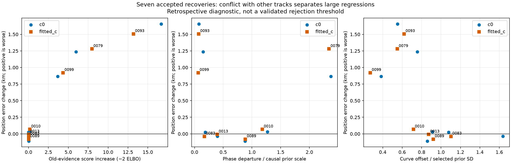
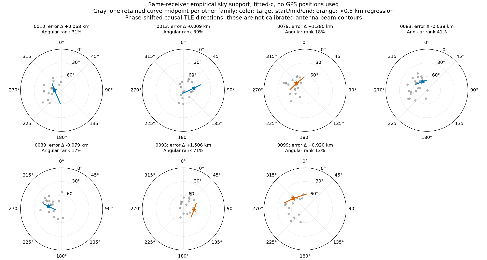
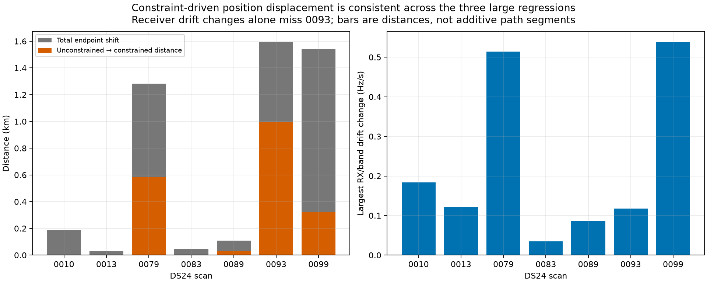

# Warning signals for harmful satellite-family recovery — 2026-10-29

**The most useful measured warning is conflict with the other retained tracks, not a large final RMS or an unusual sky angle.** In the seven accepted recoveries from the frozen 24-scan study, the three large localization regressions increase the preceding evidence's fitted-c −2 ELBO by **4.339–13.208**. The four other recoveries cost only **0.016–0.153**. Both `c` arms show this separation. This is a retrospective finding on seven proposals, not a validated cutoff or proof of wrong satellite identity.

No algorithm, association decision, prior or production setting was changed. The underlying 24-scan comparison remains as [previously reported](../2026_10_29_combined_family_reentry/README.md).

## Measured comparison

| Scan | Fitted-c error before → after km | Old-evidence score cost c=0 / fitted-c | Constraint movement km | Phase scale units | Offset scale units | Midpoint elevation | Sky angular rank |
|---|---:|---:|---:|---:|---:|---:|---:|
| DS24-0010 | 1.246 → 1.314 | 0.162 / 0.153 | 0.000 | 1.180 | 0.716 | 74.7° | 31.2% |
| DS24-0013 | 0.406 → 0.397 | 0.047 / 0.016 | 0.000 | 0.396 | 0.873 | 66.1° | 38.9% |
| DS24-0079 | 1.131 → 2.411 | 3.676 / 7.974 | 0.583 | 2.342 | 0.550 | 65.7° | 17.6% |
| DS24-0083 | 0.346 → 0.308 | -0.009 / 0.020 | 0.000 | 0.172 | 1.101 | 68.7° | 40.9% |
| DS24-0089 | 2.205 → 2.126 | 0.021 / 0.016 | 0.032 | 0.885 | 0.921 | 60.5° | 16.7% |
| DS24-0093 | 0.766 → 2.272 | 16.665 / 13.208 | 0.996 | 0.073 | 0.620 | 66.5° | 70.6% |
| DS24-0099 | 0.602 → 1.522 | 5.961 / 4.339 | 0.322 | 0.063 | 0.272 | 55.3° | 13.3% |



The table's before position is the qualified support-backoff endpoint. Its after position is the accepted combined-recovery endpoint. The diagnostic tools do not load GPS; evaluation coordinates enter only this report to label outcomes. Those labels cannot be used as inference features. The 0083 `c=0` error worsens slightly while fitted-c improves, so the other four proposals should not all be described as unconditionally beneficial.

## Sky geometry does not explain these three failures



0079, 0093 and 0099 have target midpoint elevations of about **65.7°, 66.5° and 55.3°**. Relative to the empirical same-receiver family centroid, their angular-distance ranks are **18%, 71% and 13%**: none is an extreme angular outlier. The candidate 0093 is farther from the centroid than most peers, but several retained families are farther still.

Each peer is the first retained curved component of a distinct other satellite family on the same receiver. Its midpoint is evaluated at the preceding RF position. The target uses its recovered RF endpoint. Directions use the scan's causal TLE bank with fitted phase, at observed start, median and end times; tiny fitted orbital perturbations are not applied to this display. Rankings compare unit-vector angular distances, avoiding azimuth wrap and near-zenith coordinate artifacts. The peer sample is conditional on existing associations, at different observed times, and is not exposure-normalized or independently verified. This is an empirical descriptive check, not a physical field-of-view rejection test.

The current reentry nomination requires nonnegative elevation, but does not apply a calibrated antenna boresight/beam constraint. A useful physical check would compare the complete predicted path to measured receiver orientation and frequency-dependent antenna gain, including pointing uncertainty and sidelobes. Relative receiver separation alone is insufficient to establish absolute sky visibility. This audit does not establish calibrated pointing metadata for these recordings, so it makes no outside-beam claim.

## Nuisance outliers catch some cases, but miss others

- **0079:** phase differs from its causal prior mean by 2.342 prior-scale units. That is relatively unusual among this scan's retained components and is a useful warning, but not decisive under the heavy-tailed phase prior.
- **0093:** phase is −4.234 s, but the prior mean is −3.529 s and scale is 9.612 s. The departure is only **0.073 scale units**. A large phase in seconds is not necessarily a prior outlier. Its accepted curve constant is about 620 Hz, **0.620** of the selected 1,000 Hz scale.
- **0099:** phase is only **0.063 scale units** from its mean, and its curve constant is **0.272** prior standard deviations. Both look ordinary despite a 0.920 km fitted-c error regression.
- Conversely, helpful fitted-c recovery 0083 uses a roughly −1,101 Hz constant, **1.101** prior standard deviations. A universal absolute offset threshold would risk discarding useful evidence.

The phase values are departures divided by the causal prior's scale, not Gaussian significance probabilities; the actual model permits heavy tails. The receipts also contain effective phase prior precision and within-scan percentile ranks. Curve-constant units use the selected 300 or 1,000 Hz prior. These seven restored families have no active orbital-correction modes in this configuration, so their orbital coefficient norms are zero by construction and cannot diagnose these cases. Receiver drift changes are recorded per RX/band: they are substantial for 0079/0099, but small for harmful 0093. No single nuisance magnitude separates all three.

## A stronger RF-only diagnostic: conflict with the evidence already retained

For each proposed recovered position, remove the new family's observations and use exactly the preceding retained observations, candidate identities, priors and likelihood weights. Hold position fixed, but recompute receiver/orbital nuisance posteriors and refresh phase five times. Do the same at the preceding position. Define:

`conflict = old_evidence_cost(recovered_position) − old_evidence_cost(preceding_position)`

Here cost is the existing negative twice ELBO, including its uncertainty and prior terms. No new target points enter either score. All final phase changes are below 0.01 s. Small negative values can occur because the saved preceding solution is approximate; 0083's `c=0` cost is −0.009. This score is not a calibrated p-value, Bayes factor, or posterior odds of a wrong association.

It asks whether the new track requires the rest of the scan to become less plausible after their allowed nuisance adjustments. That is more informative than measuring the new track's own fit, which improves when the optimizer accommodates it. It is also safer than comparing raw joint costs before/after adding points, because those costs use different observations.

The score is still conditional on the preceding associations and model. A correct new family could legitimately overturn a biased group of old families. Therefore a large conflict should trigger **quarantine and competing-hypothesis evaluation**, not automatic deletion. In particular, it is not evidence that the old endpoint is ground truth.

## Gate boundaries and influence add context



The three large regressions move another **0.583, 0.996 and 0.322 km** during constrained fitting in the fitted-c arm, respectively. Their final target slope, autocorrelation or step statistic lands at the acceptance boundary. The other four proposals move at most **0.032 km** in that constrained stage. Boundary contact alone is insufficient: useful 0089 also has an active gate on an older track, with only a small position adjustment.

These measurements identify a conflict/model-sensitivity pattern. They do not prove an incorrect satellite ID. A correct satellite with a missed transmitter drift, wrong covariance or bad graph join can produce the same symptom. Small in-sample residuals after a large joint adjustment should not be treated as independent evidence of identity or location.

## Recommended next diagnostics

1. **Whole-family deletion and prediction:** remove a suspect satellite across every receiver/channel, estimate position and receiver calibration from other families, then predict the complete held family. Include calibration uncertainty. Repeat for competing satellite identities under the same causal catalogue, priors and budgets. Measure whether several independent families agree on the displacement, rather than letting one family determine it.
2. **Candidate ambiguity:** record the best and runner-up held predictive scores, not only the best catalogue RMS. A small gap warrants retaining multiple hypotheses. This audit did not run a new runner-up catalogue search.
3. **Residual attribution:** compare simultaneous residuals across RX/bands/families. Shared receiver residuals suggest calibration; the same satellite discrepancy across receivers suggests satellite/orbit modeling; a single fragment or abrupt transition suggests a join or measurement problem. The current receipts include changes in every retained curve's RMS, but no new full attribution experiment is claimed here.
4. **Predictive stability:** test held time blocks, independent full curves and small measurement perturbations. In the preceding study, even an accepted 5 Hz perturbation moved 0089 by 807 m, while the baseline control moved 778 m. This points to model sensitivity beyond the new recovery itself.
5. **Geometry and information:** use calibrated sky visibility when available; separately assess whether position information is well-conditioned after nuisance marginalization. A strong track can constrain only one position direction. A large deletion shift alone is leverage, not proof of an outlier.

A parsimonious first prototype would retain a track's association provisionally, but prevent it from changing the production position when it strongly conflicts with other evidence or needs substantial constraint-driven displacement. Freeze an RF-only rule before a separate validation cohort, retain matched `c=0`/fitted-`c` controls, and report both missed useful recoveries and avoided regressions. Do not choose a production threshold from the seven GPS-labeled outcomes here. More diverse independent scans and receiver orientations are needed to establish generalization.

## Reproduction and limits

`tools/audit_reentry_warning_signals.py` replays accepted endpoints, computes prior and geometry diagnostics, and evaluates old-evidence scores at fixed positions. `tools/report_reentry_warning_signals.py` adds evaluation-only errors and plots. The angular-distance helper has a unit test covering azimuth wrap and rigid rotation invariance. All fourteen accepted endpoint replays (seven scans × two arms) match stored objectives to 1e-5. No new RF, post-scan TLE, localization retuning or production deployment occurred.

```bash
export PYTHONPATH=src:tools OPENBLAS_NUM_THREADS=1 OMP_NUM_THREADS=1
.venv/bin/python tools/audit_reentry_warning_signals.py --root /path/to/corpus --study /path/to/combined-reentry --case DS24-0093 --output /new/audit/DS24-0093.json
.venv/bin/python tools/report_reentry_warning_signals.py --audit /path/to/audit --study /path/to/combined-reentry --output /new/report
```

See [metrics CSV](metrics.csv), [metrics JSON](metrics.json) and [provenance](provenance.json). Per-scan diagnostic JSON files include the matched arms, nuisance scales, three-sample sky paths, peer sky directions, residual changes on old evidence and final gate values. The complete preceding benchmark receipts remain in the linked combined-reentry report.
