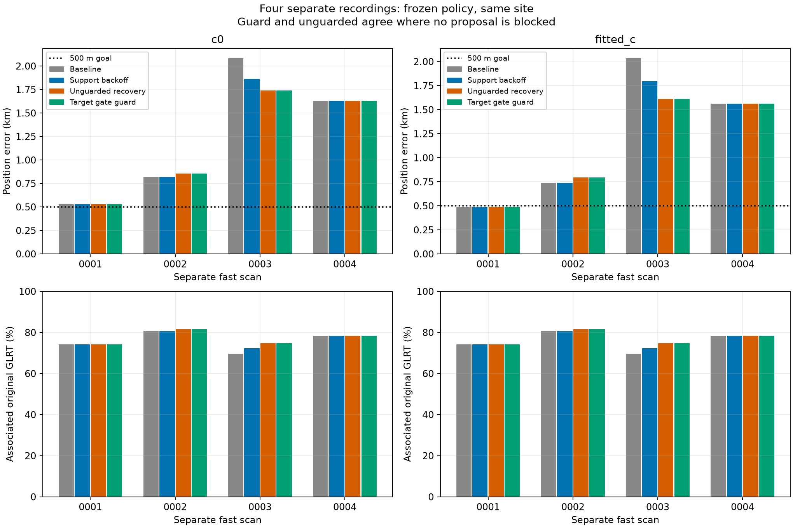
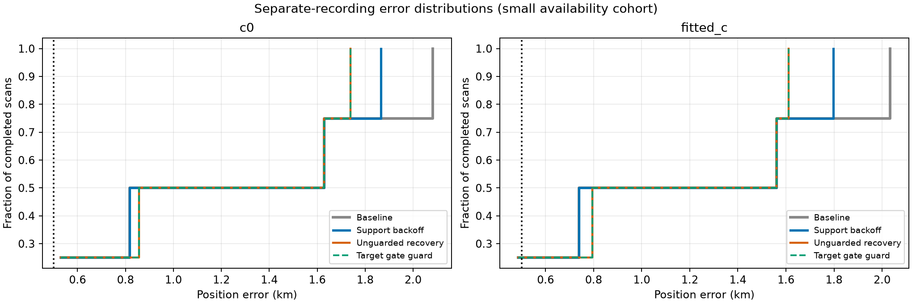

# Separate fast-scan validation of the target-gate guard — 2026-10-29

The frozen guard and its preceding recovery stack were rerun on four prepared 10 MS/s fast recordings with no recording-ID overlap with the development corpus. All localization results were computed afresh from the copied GLRT/graph inputs and strictly causal orbital inputs. Evaluation coordinates were used only after every inference decision was sealed. Production remains unchanged.

## Interpretation


For c0, the complete guarded stack adds 199 points over baseline (79 from support backoff and 120 from family reentry). Mean error changes 1.265 → 1.189 km; median changes 1.224 → 1.243 km; worst changes 2.082 → 1.739 km.


For fitted_c, the complete guarded stack adds 199 points over baseline (79 from support backoff and 120 from family reentry). Mean error changes 1.205 → 1.113 km; median changes 1.149 → 1.177 km; worst changes 2.034 → 1.610 km.


LATER4-0002: fitted-c error 0.739 → 0.739 → 0.794 km (baseline → support → guarded), a 55.8 m regression; 46 additional confirmed points.


LATER4-0003: fitted-c error 2.034 → 1.797 → 1.610 km (baseline → support → guarded), a 423.6 m improvement; 153 additional confirmed points.


2 family proposals qualified for the original recovery policy; 0 were blocked by the target guard. The guarded and unguarded outputs therefore coincide: this cohort shows that these recoveries survive the guard, but provides no new example testing its ability to reject a harmful proposal.


Recommendation: retain this as a research candidate and do not promote a new production ALGO version yet. The sample is small and same-site; one additional clean target can still increase position error. Passing residual gates is a compatibility check, not a probability of correct identity or a guarantee of useful position information. The next experiment should keep this rule frozen on additional disjoint scans and diagnose the accepted regression using independent-family prediction and old-evidence conflict, without selecting a rejection threshold using its known GPS error.


## Matched position and coverage results

| Arm | Policy | GLRT associated | % | Mean km | Median km | Worst km |
|---|---|---:|---:|---:|---:|---:|
| c0 | Baseline | 12,343/16,167 | 76.35 | 1.265 | 1.224 | 2.082 |
| c0 | Support backoff | 12,422/16,167 | 76.84 | 1.211 | 1.224 | 1.866 |
| c0 | Unguarded recovery | 12,542/16,167 | 77.58 | 1.189 | 1.243 | 1.739 |
| c0 | Target gate guard | 12,542/16,167 | 77.58 | 1.189 | 1.243 | 1.739 |
| fitted_c | Baseline | 12,343/16,167 | 76.35 | 1.205 | 1.149 | 2.034 |
| fitted_c | Support backoff | 12,422/16,167 | 76.84 | 1.146 | 1.149 | 1.797 |
| fitted_c | Unguarded recovery | 12,542/16,167 | 77.58 | 1.113 | 1.177 | 1.610 |
| fitted_c | Target gate guard | 12,542/16,167 | 77.58 | 1.113 | 1.177 | 1.610 |



| Scan | Arm | Baseline error km | Support error km | Guarded error km | Baseline → guarded GLRT % |
|---|---|---:|---:|---:|---:|
| LATER4-0001 | c0 | 0.531 | 0.531 | 0.531 | 74.25 → 74.25 |
| LATER4-0001 | fitted_c | 0.487 | 0.487 | 0.487 | 74.25 → 74.25 |
| LATER4-0002 | c0 | 0.818 | 0.818 | 0.857 | 80.58 → 81.52 |
| LATER4-0002 | fitted_c | 0.739 | 0.739 | 0.794 | 80.58 → 81.52 |
| LATER4-0003 | c0 | 2.082 | 1.866 | 1.739 | 69.69 → 74.80 |
| LATER4-0003 | fitted_c | 2.034 | 1.797 | 1.610 | 69.69 → 74.80 |
| LATER4-0004 | c0 | 1.630 | 1.630 | 1.630 | 78.43 → 78.43 |
| LATER4-0004 | fitted_c | 1.560 | 1.560 | 1.560 | 78.43 → 78.43 |



## Decisions and scope

| Scan | Support recovery | Family reentry | Guard accepts | Target | Prior Hz |
|---|---|---|---|---|---:|
| LATER4-0001 | no_eligible_curve | no_eligible_removed_family | False | none | — |
| LATER4-0002 | no_eligible_curve | accepted | True | 66577: 38 points, 35.1 s | 1000 |
| LATER4-0003 | accepted | accepted | True | 62959: 34 points, 29.4 s | 300 |
| LATER4-0004 | no_eligible_curve | no_eligible_removed_family | False | none | — |

The restored target's **unconstrained** residual checks are below. These are the checks used by the guard, before any constrained fallback. The full profile, alias and all-old-track checks remain in the receipts. ACF is dimensionless, and z values use the existing model's uncertainty normalization.

| Scan | Arm | Target RMS Hz | Mean z | Slope z | Maximum step z | Lag-1 ACF | Pass |
|---|---|---:|---:|---:|---:|---:|---|
| LATER4-0002 | c0 | 93.35 | 0.049 | 0.705 | 1.892 | 0.277 | True |
| LATER4-0002 | fitted_c | 93.32 | 0.047 | 0.678 | 1.882 | 0.277 | True |
| LATER4-0003 | c0 | 22.79 | 0.083 | 0.400 | 0.811 | 0.167 | True |
| LATER4-0003 | fitted_c | 23.32 | 0.130 | 0.630 | 0.988 | 0.199 | True |

This is a four-recording, same-site availability cohort, not validation at a new location or a random sample of the full dataset. Failure statuses are reported explicitly; aggregate metrics include only completed paired cases. The full requested denominator is four scans. Frequencies, residual RMS and negative twice ELBO are in [the per-scan CSV](per_scan.csv), separate from position error. Methods have different accepted observation sets, so lower in-sample frequency RMS is not evidence of better localization.

The guard requires an already accepted full-data recovery proposal and a restored target that passes the existing **unconstrained** residual/profile/alias gates in both `c=0` and fitted-`c` arms. Existing final gates and preservation of preceding accepted observation IDs still apply. Old tracks can still use the existing constrained refinement. Blocked target IDs remain provisional and do not affect position or confirmed coverage. This tests the identical narrow rule from [the development report](../2026_10_29_provisional_family_recovery/README.md).

The recovery stack first attempts active-support backoff. It then nominates at most one largest wholly unassociated curved track with at least 20 points and 24 seconds and no active family evidence. Its original family must win the bounded full causal catalogue screen in both arms, satisfy RMS ≤450 Hz, absolute bias ≤3,000 Hz and elevation ≥0°. The target constant prior is selected between 300 and 1,000 Hz using the existing randomized 12-second block predictive selector at the preceding RF endpoint. The wider prior requires total held-density improvement above `2 log(2)` in both arms. Full recovery uses five phase-refresh rounds of up to 48 iterations, with the existing constrained fallback of five rounds of up to 20 iterations. No threshold, nominee, prior, or guard decision is selected using evaluation error.

## Reproducibility and limits

| Label | Recording |
|---|---|
| LATER4-0001 | `fast8-auto-20261024-224359-7249fa17-1-upper` |
| LATER4-0002 | `fast8-auto-20261024-233414-efe03d6d-1-lower` |
| LATER4-0003 | `fast8-auto-20261025-002429-895cc487-1-upper` |
| LATER4-0004 | `fast8-auto-20261025-020456-a88a5971-1-upper` |

These four recordings were selected because their existing preparation was complete and disjoint from the development corpus; they were not selected by position error. Fresh baselines include the causal signed-phase prior and the current family-comparison stage. This is an end-to-end localization replay from existing graph/GLRT inputs, not a new IQ acquisition or a reconstruction of GLRT extraction. Original input hashes, source hashes, exact manifests and all decision receipts are retained.

Both arms use matched input observations, candidate catalogues, other priors, regional box and search budgets. Fits start at the established 25×25 km regional box centered at 37.906, −122.545. The reporting-only evaluation site is 37.849061591561885, -122.48574968092912, explicitly confirmed by the user for these recordings. Distances use the same 6371 km spherical metric as previous reports. No post-scan TLE or new RF collection is used. Four isolated workers use one BLAS thread each; per-stage caps are 360 s for initial localization, 360 s for family comparison and 240 s for recovery. All inference decisions precede this report's evaluation.

Source files: `tools/validate_fast_target_guard.py`, `tools/report_fast_target_guard_validation.py`. Tests cover paired-arm acceptance, rejection of missing or failing target gates, original-proposal acceptance, duplicate/overlapping recordings and the 10 MS/s fast-recording restriction. Runtime checks verify preparation input hashes, frozen algorithm source hashes, baseline qualification and old-point preservation.

```bash
export PYTHONPATH=src:tools OPENBLAS_NUM_THREADS=1 OMP_NUM_THREADS=1
.venv/bin/python tools/validate_fast_target_guard.py freeze --prepared /prepared/four --development /development/corpus --output /new/study
.venv/bin/python tools/validate_fast_target_guard.py run --output /new/study
.venv/bin/python tools/report_fast_target_guard_validation.py --study /new/study --output /new/report
```

See [summary](summary.json), [provenance](provenance.json), and [compressed decision receipts](receipts.json.gz). Large frozen input banks and original observations remain in the existing corpus and are referenced by digest. Receipt hash strings are losslessly interned: replace `{"$sha256": i}` with `sha256_strings[i]`.
