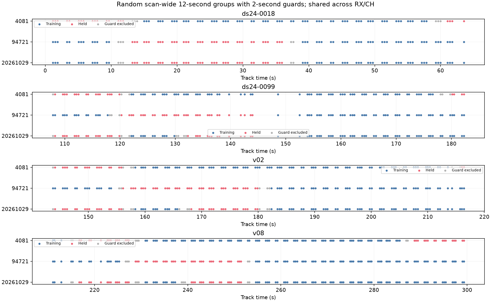
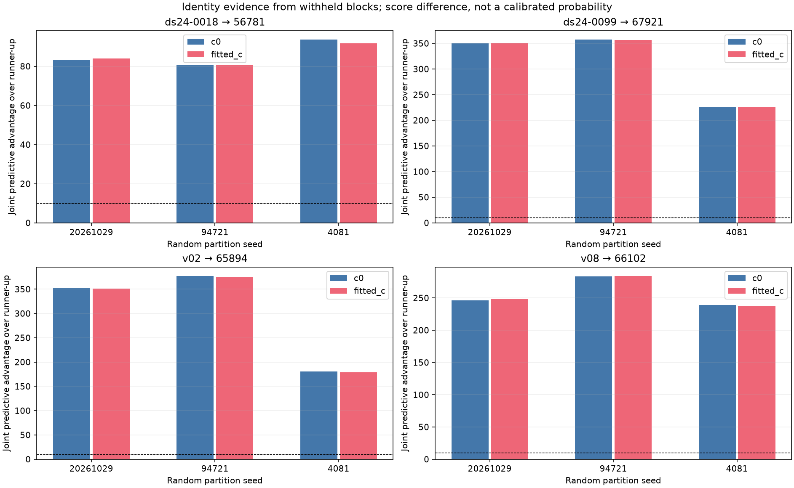
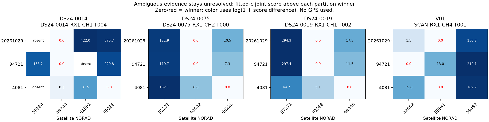
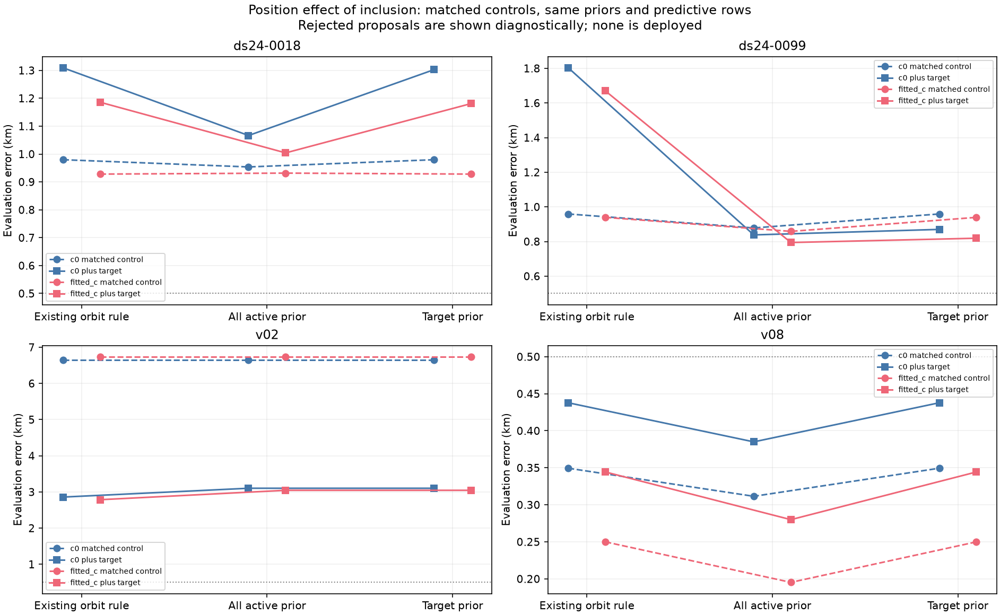
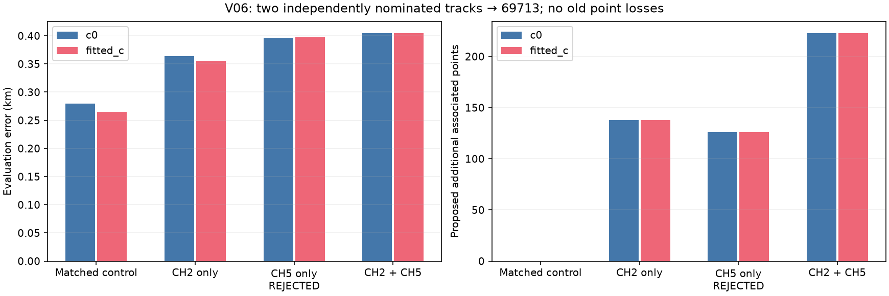
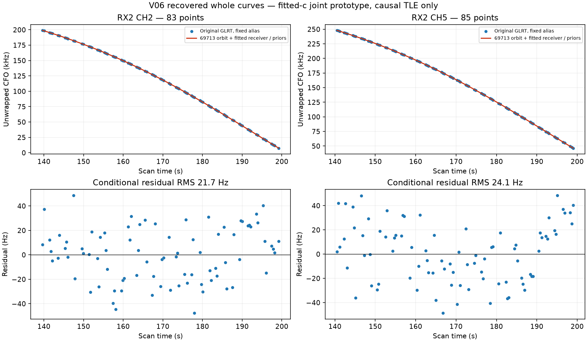
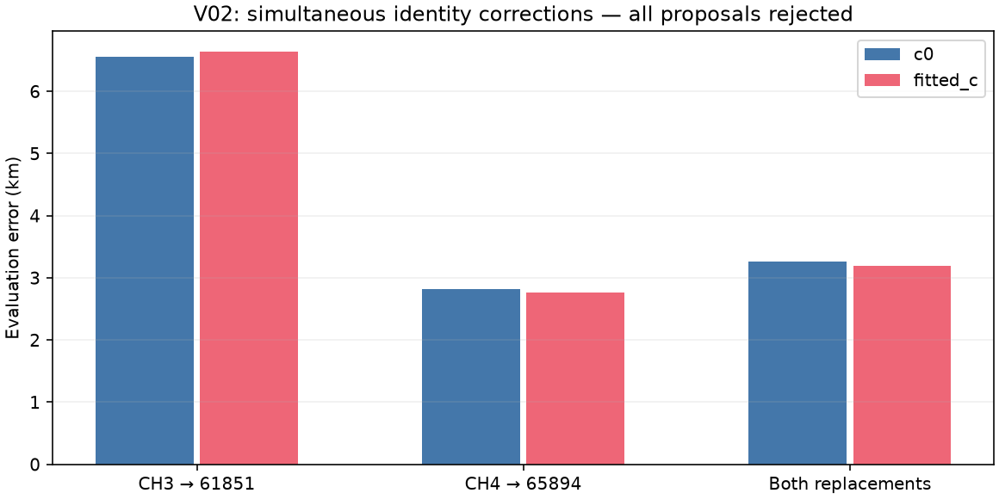

# Systematic annotation: randomized joint prediction, then controlled inclusion

The [preceding inventory](../2026_10_29_all_large_track_inventory/README.md) found 1,630 large tracks in the union of c arms. This iteration adds a reusable annotation procedure, a queue that preserves every track, and controlled inclusion experiments. **The full goal is still active.** A conditionally supported identity is not a confirmed label or permission to use a track for position.

## Coverage at this snapshot

| State | Tracks |
|---|---:|
| conditionally_supported_identity | 32 |
| unstable_identity | 11 |
| ambiguous_identity | 5 |
| prediction_mismatch | 2 |
| insufficient_partitions | 2 |
| queued | 1304 |
| needs_predictive_only_model | 274 |

The [complete ledger](annotation_ledger.csv) includes every available inventoried track across 277 recordings. DS24 revision 2 contains 103 members: nine lack the exports needed for a GLRT inventory, and DS24-0056 / DS25-0037 has no active curvature (its four graph tracks also fail the large-track size threshold). These limitations are retained from the preceding inventory. Coherent points outside existing graph tracks remain a separate task.

The 274 tracks absent from the curved calibration design need a predictive-only implementation; they are not silently dropped or used to calibrate receivers. Queued tracks have not passed validation. [Execution receipts](execution_receipts.json) distinguish completed, failed and timed-out attempts. Counts are a snapshot, not a promise that an unobserved process is still running.

## Reproducible annotation procedure

1. Keep the graph, original point IDs and incumbent family hypotheses frozen. Remove the target from calibration. Partition the **entire scan** into randomly selected 12-second blocks, shared across receivers and channels. Ensure target training/held support, and purge training points within two seconds of held-block boundaries. Seeds are 20261029, 94721 and 4081.
2. Refit receiver, phase and position using training data only, starting at the regional center of the existing 25 × 25 km box. Use fixed 150 Hz measurement scales and unit family weights, so full-data RF confidence/noise selection does not enter the validation fit. Pre-scan TLE priors remain unchanged. Predictive linear rows are excluded from this first validation prototype.
3. Nominate satellites from the full existing causal bank using only training target points and training receiver correction. Search both training endpoints and a nine-point regional grid with phase ±15 s. Union nominations across c arms, retain three distinct candidates, and explicitly challenge against the incumbent nominee. Instantiate missing priors from the same pre-scan TLE mechanism.
4. Jointly refit each hypothesis on the same training observations with five phase-refresh rounds and 48 position steps per round. Fit aliases from training data and keep them matched across c arms. Score the same held target and existing curved points under their joint Gaussian predictive covariance. This propagates coefficient uncertainty; fitted position and learned noise precision remain plug-in approximations.
5. Annotate an identity as *conditionally supported* only if the same satellite wins every partition and both c arms, has a score margin ≥10 against the tested runner-up, predicts held target points within 450 Hz RMS, remains visible and converges in phase. Preserve ambiguous, unstable and mismatch states. These margins are **not calibrated probabilities**.
6. Refit all data separately to test inclusion. Report old-point losses, every residual gate, c=0/fitted-c, and position error separately. Compare against a no-target control with the same noise, weights, priors and predictive rows. Never select the model using evaluation coordinates.

The graph and incumbent identities were constructed using the full recording. These are therefore conditional validation experiments, not a blind acquisition-to-position holdout. Random partitions overlap in information and are not independent datasets. Future validation needs withheld scans and synthetic false-identity/merge controls.

## Identity results

| Track | NORAD | Minimum held-score margin |
|---|---:|---:|
| ds24-0018 | 56781 | 80.6 |
| ds24-0099 | 67921 | 226.0 |
| v02 | 65894 | 178.9 |
| v08 | 66102 | 237.1 |

V02's large CH4 track supports 65894, absent from the old association model. On the first partition its held RMS is 140–144 Hz, versus about 28 kHz for 62750. Other cases support their existing candidate identities even though the full-data residual checks had rejected those curves. This separates an identity problem from a residual-model problem. [All fold/candidate scores](predictive_scores.csv) retain target and existing-evidence scores separately.

Several unresolved tracks change winners even though the same competitors were tested in every partition. They need stronger independent evidence or a better discrepancy model; forcing the most frequent winner would conceal this ambiguity. In DS24-0014's largest tested CH1 curve, two partitions strongly prefer 59733 but the third barely favors 69186 (less than one score unit). That is insufficient for the declared consensus rule.

## Inclusion is a separate problem

| Case | Model | c0 matched control → target km | Fitted-c matched control → target km | Paired qualification |
|---|---|---:|---:|---|
| ds24-0018 | original | 0.980 → 1.309 | 0.928 → 1.186 | Pass |
| ds24-0018 | all_active_prior | 0.954 → 1.066 | 0.932 → 1.004 | Pass |
| ds24-0018 | target_prior | 0.980 → 1.303 | 0.928 → 1.181 | Pass |
| ds24-0099 | original | 0.959 → 1.803 | 0.939 → 1.670 | Pass |
| ds24-0099 | all_active_prior | 0.878 → 0.838 | 0.858 → 0.794 | Pass |
| ds24-0099 | target_prior | 0.959 → 0.870 | 0.939 → 0.819 | Pass |
| v02 | original | 6.651 → 2.858 | 6.738 → 2.785 | Reject |
| v02 | all_active_prior | 6.651 → 3.102 | 6.738 → 3.045 | Reject |
| v02 | target_prior | 6.651 → 3.102 | 6.738 → 3.045 | Reject |
| v08 | original | 0.349 → 0.438 | 0.250 → 0.344 | Reject |
| v08 | all_active_prior | 0.311 → 0.385 | 0.195 → 0.280 | Reject |
| v08 | target_prior | 0.349 → 0.438 | 0.250 → 0.344 | Reject |

With the existing orbital rule, DS24-0018 and DS24-0099 can pass the paired gates with their full tracks restored under the fixed-noise/unit-weight prototype. Nevertheless, their position errors worsen relative to matched controls. The apparent DS24-0018 improvement against the old production model disappears once the model-only change is controlled. This is why neither better coverage nor a better self-fit establishes better localization. Control qualification is recorded separately in the machine-readable results; a rejected control is diagnostic, not a deployable baseline.

V02's other retained-track failure is narrowly a step-statistic failure (roughly 4.0–4.1 versus the 4.0 cutoff), rather than a gross RMS discrepancy. V08 loses old postfit points from another satellite. A rule that checks only the newly added track would overlook these effects.

## Orbital-uncertainty ablation

The code previously omitted the three physical orbit-error modes when a family had only one owner. DS24-0018/56781 and DS24-0099/67921 were such families. A lack of multiple observations does not establish zero orbit error, so two opt-in hypotheses were tested: causal prior variance for all active families, and adding it only for the new target while preserving incumbent modes. Both use the existing pre-scan TLE difference scales, with no position-error tuning.

An initial evaluation mistakenly subjected newly added prior-only modes to the incumbent rule requiring two accepted receiver/channel owners. That rejects the single-owner experiment by construction. The corrected evaluation preserves the incumbent owner requirements and distinguishes added prior uncertainty from learned multi-owner support. It changes no numeric residual threshold. Every fit was replayed at its saved parameters, with RMS and objective equality checked; the table uses those corrected results. The `replayed_from` receipts preserve the initial failed evaluations.

DS24-0099 is a useful lead: target-only uncertainty passes the checks, adds 151 points without losses, and improves the matched fixed-noise control from 0.959 to 0.870 km in c0 and 0.939 to 0.819 km with fitted-c. Its old production fitted-c error was approximately 0.602 km, so this is **not an improvement over production**. DS24-0018 still worsens relative to its matched control. V02 and V08 remain rejected. These tests therefore do not establish a general inclusion rule. The engineering covariance scales are not calibrated forecasts; they were not widened based on GPS error.

## Independent cross-band nominations: V06

The 83-point RX2 CH2 and 85-point RX2 CH5 curves independently nominate **69713** under all three randomized partitions and both c arms, replacing their old 67664 hypotheses. Their joint full-data fit uses the original production noise/weights, with a matched no-target rerun and single-track ablations. The combined proposal adds 223 points: 168 target points plus 55 postfit associations. Association rises from 3,367 / 5,372 (**62.68%**) to 3,590 / 5,372 (**66.83%**) in each arm. It loses no old points and passes the existing checks. CH5 alone fails, so corroboration is useful here.

| Trial | c0 error km | Fitted-c error km | Added points (both arms) | Paired checks |
|---|---:|---:|---:|---|
| matched_no_target | 0.279 | 0.265 | 0 / 0 | Pass |
| ch2_only | 0.364 | 0.355 | 138 / 138 | Pass |
| ch5_only | 0.397 | 0.398 | 126 / 126 | Reject |
| both_tracks | 0.405 | 0.405 | 223 / 223 | Pass |

CH5 alone fails lag-one autocorrelation (0.468 in fitted-c versus 4/√85 ≈ 0.434), despite only 27 Hz RMS. Joint recovery reduces its RMS to 24 Hz and autocorrelation to 0.328, passing the unchanged criterion. The matched control exactly reproduces the original endpoint. Despite the recovered signal and lower frequency RMS, joint fitted-c position error rises from 0.265 to 0.405 km. Both are below 500 m in this scan, but the recovery is not a demonstrated accuracy gain. No promotion or deployment follows from these results.

## V02: two simultaneous corrections do not resolve the conflict

The new annotation queue also supports 61851 for the 81-point RX1 CH3 T001 curve. A bounded follow-up tested it alone and together with the 102-point CH4 → 65894 correction, using the original model, causal catalogue and identical c-arm budgets. Both remain rejected. The joint proposal would add 196 points but loses 12 old points; its fitted-c error is 3.189 km, versus 2.760 km for the earlier CH4-only proposal and 6.768 km for the incumbent.

In the combined fit, the old retained CH5 family passes, but the new CH3 curve fails: 226 Hz RMS, slope 6.74σ, quadratic BIC gain 56.9, step 6.53σ and lag-one correlation 0.608. The target's identity evidence is therefore not a certificate that its full curve is modeled adequately. No points were trimmed or gates relaxed to rescue this result. This is a documented unresolved case; further work should compare shared receiver versus satellite-specific discrepancy, alongside progress on other queued tracks.

## Remaining work toward the full goal

- Complete annotation of all queued large tracks and implement predictive-only handling for the 274 tracks outside the calibration design.
- Validate identity confidence against incorrect satellites, merged curves, structured residuals and unused scans. The currently tested runner-ups do not exhaust every joint association configuration.
- Combine independently supported same-family tracks, then verify that joint inclusion preserves other evidence or identifies a demonstrably wrong incumbent association.
- Calibrate receiver/orbit model discrepancy without using location truth. Use the training-selected polynomial reference only to measure unexplained signal shape, never as a satellite identity or receiver calibration.
- Demonstrate position benefit on matched controls and broader datasets before promotion. Production remains unchanged.

The [results](results.json) and [compressed evidence](evidence.json.gz) contain failed and successful diagnostics. Repetitive observation-ID lists and optimizer histories are represented by count/SHA-256 receipts; complete original files remain in the recorded study paths. Research tools are `annotate_track_predictively.py` and `run_annotation_inventory.py`; the queue is `/srv/bulk/leo/research/ch78-qualified-cohort-20261029/systematic-annotation-v1`. Twenty-four focused numerical and policy tests passed, including actual retention of a clean prior-only curve and rejection of a 300 Hz step. The orbital gate replay verified identical fitted RMS/objectives before applying the corrected qualification rule. This report does not mark the goal complete.

## Reproduction

Run from the repository with `PYTHONPATH=src:tools`, `OPENBLAS_NUM_THREADS=1` and `OMP_NUM_THREADS=1`, using its virtual environment. Corpus access uses the read-authorized `leo` account. All output directories must be new; existing results are never overwritten.

- One annotation: `tools/annotate_track_predictively.py --inventory INVENTORY_JSON --track TRACK_ID --output NEW_DIRECTORY` (three partitions, three nominated competitors plus incumbent).
- Inclusion: the same command with `--validation ANNOTATION_DIRECTORY`; matched control: `--control`. Add `--orbital-policy active_uncertainty` or `--orbital-policy target_uncertainty` for the controlled prior hypotheses.
- Resume a bounded queue batch: `tools/run_annotation_inventory.py run --output QUEUE_DIRECTORY --limit 16`. Eight workers, 600-second cap per track, terminal receipts; failed attempts require diagnosis before rerunning.
- Report: `tools/report_systematic_annotation.py --study STUDY_DIRECTORY --output NEW_REPORT_DIRECTORY`. Evaluation coordinates enter only reporting code.
- Tests: `pytest tests/analysis/test_grouped_prediction.py tests/analysis/test_orbital_support.py tests/analysis/test_track_recovery_diagnostics.py tests/analysis/test_polynomial_satellite_diagnostics.py tests/analysis/test_algo02_scan_tool.py`.
