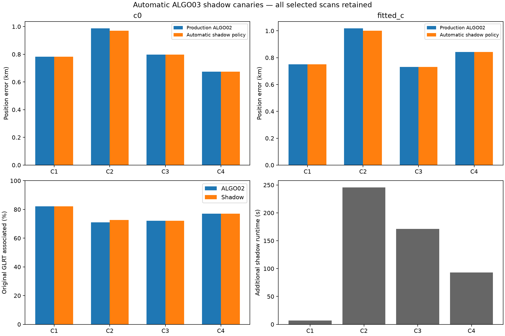
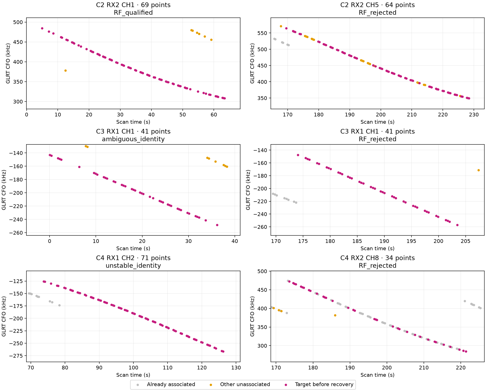

# ALGO03 automatic production shadow adapter: bounded canaries

This is an integration qualification of `algo03-shadow-top2-v1`, built on frozen `ALGO03-2026-10-30-r1`. It automatically discovers recovery targets in verified completed production ALGO02 analyses. Production still publishes `algo02-causal-family-v1`; no service default or public position contract changed. These four canaries do not establish full-cohort ALGO03 superiority.

Mean fitted-c error is **0.836 → 0.832 km** across all four selected scans. The exact decisions, failures and rejected targets are retained below. Additional associated observations are not evidence of better localization by themselves.

| Canary | Shadow decision | Associated GLRT | Associated % | Fitted-c error, km | Added runtime, s |
| --- | --- | --- | --- | --- | --- |
| C1 | ALGO02_fallback | 3451 → 3451 | 82.09 → 82.09% | 0.752 → 0.752 | 6.9 |
| C2 | ALGO03_single | 2963 → 3032 | 70.99 → 72.64% | 1.019 → 1.001 | 245.4 |
| C3 | ALGO02_fallback | 3819 → 3819 | 72.08 → 72.08% | 0.732 → 0.732 | 171.0 |
| C4 | ALGO02_fallback | 3672 → 3672 | 76.96 → 76.96% | 0.843 → 0.843 | 92.9 |

## Selection and leakage controls

The cohort contains the first four job hashes among 95 completed, digest-verified fast 10 MS/s captures from October 26–29 available at discovery. Selection did not inspect RF trial outcomes or GPS error. Original acquisition manifests establish fast mode: the public tracking compatibility label says `adaptive` for these fast exports and must not be used as acquisition truth. [The frozen cohort](cohort.json) records recording names and provenance.

The existing store exports validated, content-hashed private copies through a new narrow `export_analysis` port. Source GLRT identity and terminal identity must match; symbolic links, changed files and exports into the production namespace are rejected. Downstream inference reads only its isolated copy and its current run artifacts. Every Python process must leave a read receipt; missing receipts or unrelated reads force fallback. Frozen ALGO03 implementation hashes are checked before launch. No future TLE or evaluation-coordinate read is authorized. The copied production catalogue and causal priors are reused rather than refreshed with later elements.

Evaluation coordinates (37.849061591561885, -122.48574968092912) enter only this report generator. Inference uses the original 25 × 25 km regional box centered at (37.906, -122.545); position additions and controls cold-start at its center. The saved ALGO02 endpoint is an incumbent for replay and annotation, not a GPS initialization. This assesses downstream recovery conditional on the previously completed production graph and causal catalogue; it does not repeat acquisition or GLRT extraction.

## Automatic decision procedure

1. Replay the completed ALGO02 family solution and inventory all graph observations. A large unused track has at least 20 original IDs spanning 20 seconds.
2. Select at most two wholly unused native tracks, identically unused in both c arms, ranked by point count then stable track ID. Partial tracks remain visible in the inventory but are deferred by this first adapter.
3. Directly nominate up to twelve causal satellite candidates. Use three distinct randomized 12-second physical-block holdouts with 2-second guards and shifted block origins. Targets do not calibrate receiver nuisance variables during annotation. These overlapping folds are not independent replications. This direct-cap-twelve route differs operationally from the research workflow's three-candidate-then-twelve replay.
4. Require predictive identity consensus and existing separation/physical gates. Run the matching existing-family or new-family inclusion with paired c=0/fitted-c controls, then exact orbit and ownership audits. A new family uses 0.025-second phase integration. Do not count unscored incidental extensions.
5. If two distinct new families qualify individually, jointly fit them with shared receiver covariance, both c arms, matched controls and local quadrature/physical audits. Otherwise choose the first qualifying individual in the predetermined ranking. Separate individual solutions are never summed. Same-family or mixed-route combinations are deferred.
6. Retain ALGO02 if no candidate qualifies or the final read audit fails. Every stage is capped at 600 seconds, with a 1,200-second total recovery budget. This first adapter omits numerical retries; research ALGO03 includes bounded matched Powell retries, which still need runtime integration. Original ALGO02 processing time is additional to the reported recovery runtime.

## Matched c ablation

| Canary | Arm | ALGO02 error, km | Shadow error, km |
| --- | --- | --- | --- |
| C1 | c0 | 0.782 | 0.782 |
| C1 | fitted_c | 0.752 | 0.752 |
| C2 | c0 | 0.988 | 0.970 |
| C2 | fitted_c | 1.019 | 1.001 |
| C3 | c0 | 0.798 | 0.798 |
| C3 | fitted_c | 0.732 | 0.732 |
| C4 | c0 | 0.674 | 0.674 |
| C4 | fitted_c | 0.843 | 0.843 |

All arm observations, candidates, other priors and search budgets are matched. Raw negative twice evidence is retained in [results.csv](results.csv), but objectives with different observation sets are not directly comparable fit improvements. Position accuracy is reported separately.

## Disposition of automatically selected curves

| Canary | Component | Points | Outcome |
| --- | --- | --- | --- |
| C2 | SCAN-RX2-CH1-T000-RF10940312500.000000 | 69 | RF_qualified |
| C2 | SCAN-RX2-CH5-T000-RF11940312500.000000 | 64 | RF_rejected |
| C3 | SCAN-RX1-CH1-T000-RF10709687500.000000 | 41 | ambiguous_identity |
| C3 | SCAN-RX1-CH1-T004-RF10709687500.000000 | 41 | RF_rejected |
| C4 | SCAN-RX1-CH2-T000-RF10959687500.000000 | 71 | unstable_identity |
| C4 | SCAN-RX2-CH8-T004-RF12459687500.000000 | 34 | RF_rejected |

Gray means already associated; orange means other unassociated points; magenta highlights the target before recovery. Rejected targets remain unassociated. Plotting a coherent curve is not sufficient evidence for a unique satellite identity.

## Implementation, validation and promotion decision

New files: `tools/algo03_shadow_worker.py` (automatic bounded recovery), `tools/run_algo03_shadow.py` (validated export and guarded execution), and `tools/report_algo03_shadow.py` (evaluation only). The existing storage component gains `export_analysis`; production processing and persisted position contracts are unchanged. Component tests cover snapshot isolation and identity, symbolic links, paired target selection, scoped observation credit, missing/denied read receipts and corrupt-input fallback. Existing production and scientific regression tests remain required.

This adapter is ready for further bounded shadow qualification, not default promotion. Remaining work includes numerical-only retry integration, coverage of partial tracks and mixed/shared-family combinations, fresh positive joint-route integration tests, a larger frozen matched cohort with tail/error/runtime acceptance criteria, and continuous shadow service packaging. Four canaries cannot justify replacing ALGO02. Preserve every regression and failure in subsequent comparisons.

Full sealed decisions and exact per-track evidence references are in [evidence.json](evidence.json); [sources.json](sources.json) and [sources_with_figures.json](sources_with_figures.json) pin local inputs. These are shadow results, not deployed output changes.
