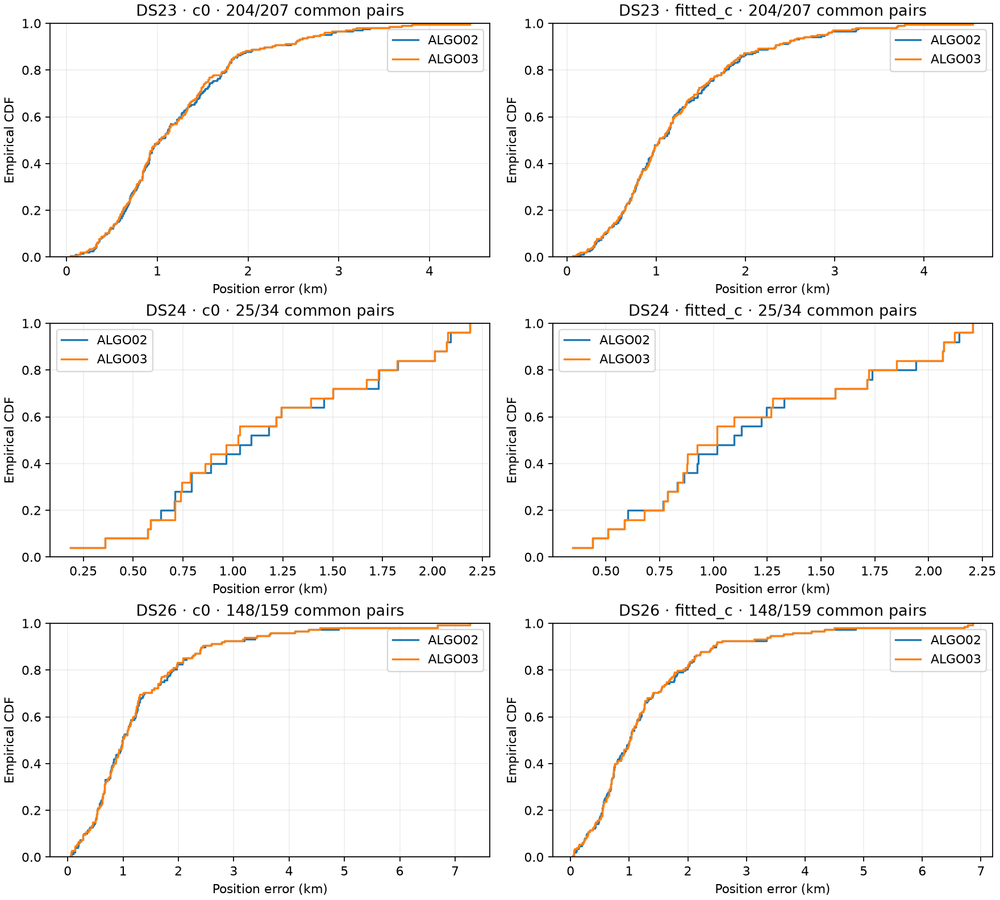
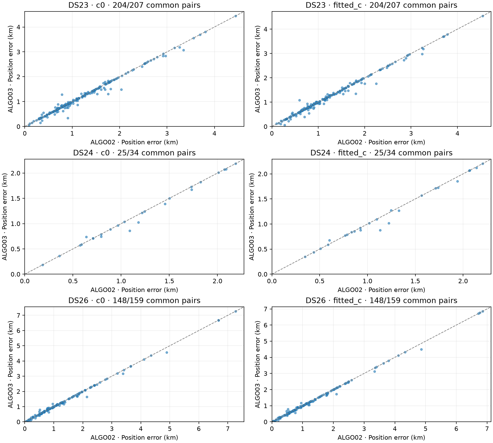
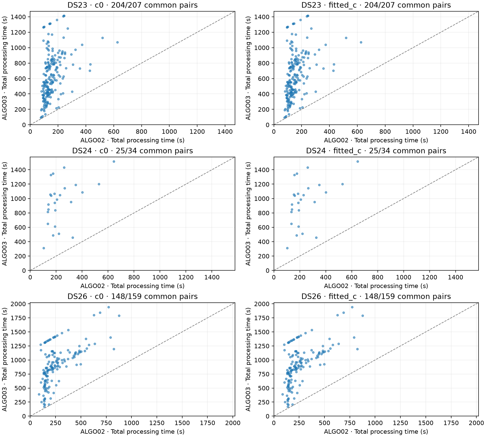

# ALGO03 versus production ALGO02: fast-scan evaluation

Promotion criteria: **not met**. All 400 acquisitions remain in the denominator; both c arms are reported. Adaptive recordings are excluded by explicit user instruction; original dataset manifests are unchanged.

The run is complete: 377 paired qualified positions and 23 unavailable positions.
Of the unavailable cases, 13 lack public GLRT inputs, DS26-0160 has an input but
no qualified ALGO02 pair, and nine have failed baseline executions. The published
execution summary corrects the original reporting aggregation that grouped all
14 unavailable baseline results as missing inputs; no inference result changed.
ALGO02 remains the production algorithm because the total-runtime gate failed.

| Dataset | Arm | ALGO02 / ALGO03 qualified | ALGO02 mean / median km | ALGO03 mean / median km |
| --- | --- | --- | --- | --- |
| DS23 | c0 | 204 / 204 of 207 | 1.234 / 1.021 | 1.219 / 1.028 |
| DS23 | fitted_c | 204 / 204 of 207 | 1.240 / 1.031 | 1.227 / 1.030 |
| DS24 | c0 | 25 / 25 of 34 | 1.182 / 1.090 | 1.163 / 1.025 |
| DS24 | fitted_c | 25 / 25 of 34 | 1.203 / 1.096 | 1.179 / 1.017 |
| DS26 | c0 | 148 / 148 of 159 | 1.335 / 0.988 | 1.325 / 0.993 |
| DS26 | fitted_c | 148 / 148 of 159 | 1.317 / 1.010 | 1.307 / 1.010 |

Mean, median and tails use common qualified pairs. Coverage uses every acquisition. Missing inputs and execution failures have no invented position error. ALGO03 fallback positions equal their ALGO02 comparator; recovery time is still added to original ALGO02 runtime.

Geographic truth enters only this reporting tool. Frequency RMS and raw objectives remain in positions.csv; objectives from different observation sets are not treated as localization improvements.

Association counts use each published arm's explicit observation identities. Percentages use all unique GLRT observations in the hash-verified paired public export; an unavailable export leaves the denominator and percentage blank.

[Exact figure denominators](figure-denominators.json)

The evaluation reference is [37.849061591561885, -122.48574968092912]. All datasets are from that user-confirmed site; these results do not establish accuracy at a different site.

[All positions and failures](positions.csv) · [Exact rows and provenance](evidence.json) · [Predeclared qualification criteria and every failed gate](qualification.json)

The sole failed promotion gate is total runtime P95: ALGO03 takes **1360.918 s**, exceeding the predeclared **1045.448 s** limit (2 × ALGO02 P95 of 492.724 s + 60 s). Recovery P95 is 1170.144 s. Accuracy, coverage and provenance gates passed; this release is **not eligible for deployment under the declared criteria**.

Pooled fitted-c position errors are 1.267831 → 1.255250 km mean and 1.029163 → 1.018050 km median. P95 stays at 2.936708 km and worst error at 6.857982 km. These are finite-cohort, same-site results.

Both c arms publish 1,051,906 → 1,058,760 associated points out of 1,490,555 hash-verified original GLRT observations across the 377 qualified acquisitions: 70.571% → 71.031%. The other 23 acquisitions retain unavailable positions and no invented observation denominator. There are 147 single-family selections, 12 joint selections and 218 complete exact ALGO02 fallbacks. Twenty-seven bounded recovery timeouts caused incomplete child-process receipts and conservative baseline fallback; no unverified recovered endpoint was published.

[Controlled c0 / fitted-c fit and position effects](c-ablation.json) reports frequency RMS and objective deltas separately from geographic error; frequency fit does not establish improved localization. [Execution details and association denominators](execution-summary.json) retain all failed optional stages.

[Final source, baseline and scientific-proof audit](final-integrity-audit.json) · [400 candidate receipt hashes](candidate-final-inventory.json) · [Source commit and runtime freeze](candidate-source-freeze.json)

[Retained baseline failure audit](baseline-failure-audit.md) · [Retained 400 baseline receipt hashes](baseline-final-inventory.json). Byte-identical copies are bundled here; paths inside the forensic audit refer to `/srv/bulk/leo/research/algo03-full-evaluation-20261030`. [Evidence locations and hashes](retained-evidence.json) records that context.
