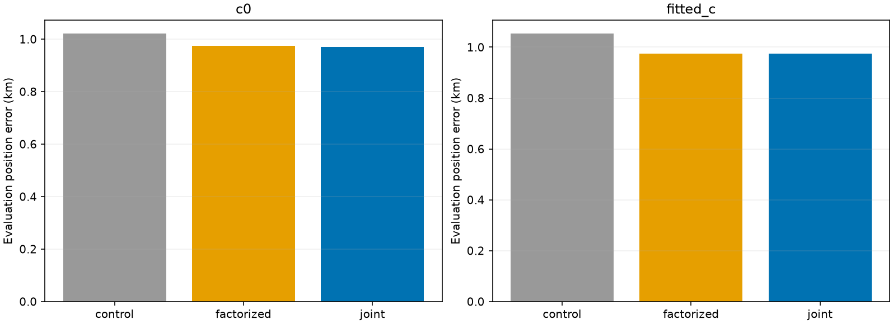
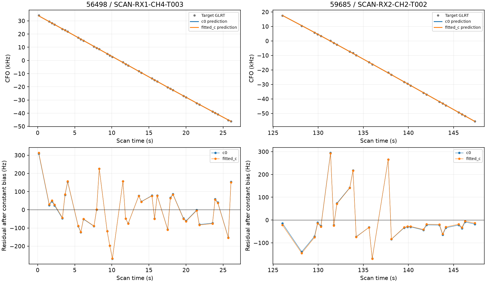

# ALGO03: a second joint-family inclusion and inventory batch six

The next eligible pair in the frozen ledger, **AUTO-ff2429e3**, passes the ALGO03 joint-inclusion checks in both c arms: **True**. It adds **63 original points** without dropping incumbent points. This is a replication on a second studied same-site scan, not a full-cohort result. The frozen [ALGO03 release](../ALGO03/README.md), its source hashes and production service are unchanged.

## Selection and causal identities

| norad | component | points | minimum_identity_margin |
| --- | --- | --- | --- |
| 56498 | SCAN-RX1-CH4-T003-RF11459687500.000000 | 36 | 104.013 |
| 59685 | SCAN-RX2-CH2-T002-RF10959687500.000000 | 27 | 76.622 |

These two curves were individually qualified in shifted batches one and five. Both retain identity support after candidate-cap-twelve causal competition. Among native new-family trials with current `RF_verified_research_candidate` status and a supported predictive recheck, they form the only additional untested same-scan pair of distinct families in the input ledger after excluding the previous joint-tested scan. This eligibility rule does not exhaust older qualification labels or shared-family routes. Selection used qualification, immutable IDs and common scan ownership, not GPS error. Original graph membership, measurements, aliases and priors remain unchanged. The catalogue shortlist remains bounded and the three randomized physical held sets overlap; identity margins are not correctness probabilities.

The first curve is RX1 CH4 and the second is RX2 CH2, so this case exercises cross-receiver prediction. In contrast, the first joint example used two RX1 channels. Current broader-competition receipts, original individual trials and the source ledger are hashed in the frozen selection protocol.

## Matched position results

| method | arm | position_error_km | associated_points | associated_percent | RF_qualified_arm | seconds |
| --- | --- | --- | --- | --- | --- | --- |
| control | c0 | 1.021 | 2409 | 68.089 | True | 5.325 |
| control | fitted_c | 1.053 | 2409 | 68.089 | True | 6.977 |
| factorized | c0 | 0.974 | 2472 | 69.870 | True | 13.406 |
| factorized | fitted_c | 0.976 | 2472 | 69.870 | True | 13.680 |
| joint | c0 | 0.971 | 2472 | 69.870 | True | 59.264 |
| joint | fitted_c | 0.974 | 2472 | 69.870 | True | 64.854 |

The denominator is **3538 original GLRT winners**. Association changes from 2,409/3,538 (68.09%) to 2,472/3,538 (69.87%). Joint inclusion improves c=0 error from 1.021 to 0.971 km and fitted-c from 1.053 to 0.974 km. The remaining error is still close to one kilometer. The factorized comparison also qualifies, with slightly different endpoints. No endpoint was chosen using its evaluation error.

All six fits start at the center of the existing 25 × 25 km region centered at 37.906, -122.545. Both c arms use the same observations, causal candidates, priors and budgets. Five phase-refresh rounds use L-BFGS-B, at most 48 iterations and nominal 240 evaluations per round, with a 600-second cap per process. All six optimizers and audits complete; no Powell retry is needed in this replication. GPS 37.849061591561885, -122.48574968092912 is accessed only by reporting.

The joint likelihood retains receiver cross-covariance once, analytically integrates independent physical orbital modes and sums over the two causal phase grids. The factorized comparison sums separate family likelihoods with the same priors. Neither target updates the stored receiver calibration at fixed position. Likelihood scores and incumbent fit effects are archived separately from position error; better in-sample fit is not used as a localization claim.

## Shared uncertainty and residual checks

| arm | largest_cross_correlation | joint_minus_factorized |
| --- | --- | --- |
| c0 | 0.075 | 0.016 |
| fitted_c | 0.087 | 0.016 |

The whitened cross-family correlation is about 0.075–0.087, larger than 0.006–0.016 in the first pair. This is a measured property of these two conditional covariance matrices, not a universal receiver correction. Joint and factorized fits remain close in this case. The observed recovery benefit is primarily the additional evidence, not a large correction caused by covariance coupling.

| arm | norad | RMS_hz | bias_hz | phase_s | mean_z | slope_z | quadratic_bic_gain | maximum_step_z | lag1_acf |
| --- | --- | --- | --- | --- | --- | --- | --- | --- | --- |
| c0 | 56498 | 116.478 | 85.894 | -0.411 | 0.030 | 0.738 | -7.617 | 2.092 | -0.026 |
| c0 | 59685 | 107.567 | -30.191 | 0.564 | 0.013 | 0.736 | -8.370 | 1.637 | -0.074 |
| fitted_c | 56498 | 117.003 | 93.346 | -0.448 | 0.033 | 0.864 | -7.274 | 2.189 | -0.020 |
| fitted_c | 59685 | 107.253 | -41.206 | 0.586 | 0.018 | 0.584 | -8.530 | 1.507 | -0.082 |

Both targets pass the unchanged residual structure, RMS, constant bias, alias and horizon checks at grid and continuously refined joint phases. Every incumbent family's physical orbit is replayed. Old ownership, numerical convergence, phase refresh, boundary mass and local integration agreement must pass in both arms. The 0.0625 s grid is checked against 0.03125 and 0.015625 s at the endpoint and four 25 m offsets. All individual family likelihoods replay in the joint geometry probe, and target evaluation leaves the receiver coefficients unchanged. [Check results](qualification.csv), exact diagnostics, source hashes and terminal receipts are retained.

## Inventory progress and limits

[Shifted batch six](../2026_10_30_shifted_annotation_batch6/README.md) assesses **32** more curves. Its initial annotation outcomes are **{'conditionally_supported_identity': 7, 'ambiguous_identity': 9, 'unstable_identity': 9, 'prediction_mismatch': 7}**. Every initially supported identity receives broader causal competition before inclusion. It produces **4 qualified curves / 103 points** in separate matched trials; these gains cannot be summed into simultaneous scan accuracy. The batch contains {'adaptive': 3, 'fast': 29} acquisitions, established from capture provenance rather than compatibility labels. The batch report preserves every accepted and rejected trial, both c arms and figures.

The two jointly tested scans are selected development/replication examples, not a representative error distribution. The 63 points here overlap earlier individual recoveries and must not be added again to inventory totals. The complete all-large-track objective remains unfinished: **242 shifted-origin assessments and 817 older-role reassessments remain**, with overlapping queues. The updated ledger preserves the first joint result and all previous ambiguity, native-IQ and competition withholdings.

Next, return to the largest pending older-role curves (about 65 points at the current queue head), apply predictive-only annotation and broader competition, and test additional mutually consistent recoveries together. Keep ALGO03's frozen settings while collecting cohort evidence; do not tune to these two evaluation positions. Production remains ALGO02.
