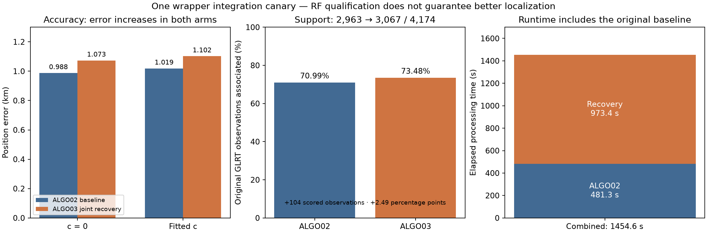

# ALGO03 wrapper integration canary: joint recovery, accuracy regression

The bounded production wrapper completed a valid `ALGO03_joint` result, adding
**104 explicitly scored observations** with **31/31 clean process read audits**.
Position error nevertheless increased in both matched c arms: **0.988 → 1.073 km
for c = 0**, and **1.019 → 1.102 km for fitted c**. This passes this canary's
wrapper/RF integration checks; it does not demonstrate better localization,
full-cohort qualification, or production activation. The frozen candidate was
not retuned after evaluating its position.

| Measure | Original ALGO02 | ALGO03 joint recovery |
| --- | --- | --- |
| c = 0 position error | 0.987624 km | 1.073156 km (+85.532 m) |
| Fitted-c position error | 1.018926 km | 1.102144 km (+83.218 m) |
| Associated original GLRT observations, both arms | 2,963 / 4,174 (70.9871%) | 3,067 / 4,174 (73.4787%) |
| Original baseline processing | 481.2691 s | Included unchanged |
| Additional recovery processing | — | 973.3667 s |
| Combined processing | 481.2691 s | 1,454.6359 s |

Association increases by 2.4916 percentage points. The 104 additions are exactly
the union of 69 observations assigned to NORAD **66803** and 35 assigned to
NORAD **67053**. Their joint solution was fitted and audited together; separate
individual alternatives were not added together. Incumbent observation owners
are preserved and unscored incidental extensions receive no credit.

| Recovered component | NORAD | Added observations |
| --- | --- | --- |
| `SCAN-RX2-CH1-T000-RF10940312500.000000` | 66803 | 69 |
| `SCAN-RX1-CH3-T003-RF11440312500.000000` | 67053 | 35 |

Eight targets were attempted: two RF-qualified, two RF-rejected, two ambiguous
identities, one prediction mismatch and one unstable identity. Rejected and
ambiguous targets remain unassociated. Exact attempts, votes, source support,
endpoints, joint proof receipts and all six passing RF checks are retained in
the byte-preserving [terminal](evidence/terminal.json).

## Controlled c ablation and interpretation

The c = 0 and fitted-c comparisons retain matched final observation IDs and
owners, candidate sets, other priors and search budgets. Both arms regress in
geographic error, even though additional families satisfy the declared RF and
physical gates. More associated observations do not guarantee greater position
accuracy, and these RF identities remain conditional on the graph, causal
catalogue, candidate search and model assumptions.

Frequency-fit quantities are recorded separately in [results.csv](results.csv).
Baseline frequency RMS is 72.8094 Hz for c = 0 and 72.7368 Hz for fitted c; the
selected wrapper terminal does not publish a comparable RMS, so it remains
unavailable. Raw negative twice evidence changes from 26,658.2138 to 27,904.7009
and from 26,662.6012 to 27,909.1486 respectively. Those ALGO02/ALGO03 objectives
use different observation sets and are not a direct fit-improvement or
localization-improvement comparison. No score is used to overwrite the observed
geographic regression.

The evaluation coordinate **(37.849061591561885, -122.48574968092912)** enters
only the report generator, after inference was sealed. Inference retains the
original causal TLE inputs, a 25 × 25 km search box centered at
(37.906, -122.545), and the original center initialization; no GPS or future TLE
is admitted. The terminal records `reference_usage=none`, `future_TLE_used=false`
and `matched_c_inputs=true`.

## Execution identity and scope

This canary reuses completed production ALGO02 job
`05cfff53feb591b22673ec72e80f6d7b`, session
`fast-3cbada0067f79f96df7e105338d53e41`, public input digest
`sha256:703bec768d15302a2cf9e0b648b7e3cc6c22b2df079daf469d6584a0ae5505ce`.
It is the same recording previously called C2 in the
[four-canary adapter report](../2026_10_30_algo03_automatic_shadow/README.md),
now exercising the bounded eight-target/joint wrapper route. Repeated execution
of the same recording is not an independent accuracy sample.

The wrapper began before final source freeze
`e67f67484c4f54316b33dfd8e12f6e68d09d1e13` and its later production-wrapper
PID-metadata reporting fix. Its [launch receipt](evidence/launch.json) pins the
actual adapter hashes. Three of four pinned adapter files match final source;
`algo03_production_worker.py` differs. The exact launch and final hashes are
preserved in [sources.json](sources.json); this execution is not relabeled as an
exact-final-revision installed canary. All **29 frozen scientific members** and
manifest SHA-256
`6dd58bbbe5e7d1f881c820edf0bee0345952a365553afaf37f457dfcec189545`
were checked unchanged. The archived [scientific manifest](evidence/scientific-manifest.json)
identifies those members.

The separately frozen DS23/DS24/DS26 fast-only comparison has 400 acquisitions,
including its independent final-wrapper execution for DS26-0183. That execution
was still running when this report was prepared. This integration canary is
outside that frozen comparison's result rows and must not be counted again as
an additional acquisition or substituted for its frozen execution. No complete
400-case candidate result or promotion decision is claimed here. No service,
API model selector, acquisition service or radio state was activated or changed.

## Retained provenance and baseline failures

The original sealed local canary is
`/srv/bulk/leo/research/algo03-production-shadow-20261030/wrapper-v1-05cfff53`.
[sources.json](sources.json) binds its terminal, launch, descriptor, inventory,
scientific members, nine selected/support proof files and the source-support
receipts to their actual SHA-256 bytes. All referenced proof hashes were checked
against those local files. These are content-hash receipts, not a claim of
cryptographic signatures. Large numerical proof files remain at their recorded
local locations; their paths are evidence locations, not repository hyperlinks.
The terminal, launch, scientific manifest and all 31 process read receipts are
archived here without modification. Read receipts contain no denied paths, and
the sealed terminal reports every launched process accounted for.
The report generator also reconstructs the unique root/supervisor pair from the
archived process tree and confirms 31 distinct receipts equal one root plus all
recorded Python spawns. These reconstructed IDs are report-only metadata in
`summary.json`; the older sealed terminal remains unchanged.

The copied [baseline failure audit](baseline-failure-audit.md) explains the nine
fresh ALGO02 failures in the separate 400-case study: four out-of-bank phase
requests, two previous-TLE propagation assertions, two family-calibration
nonconvergence failures and one whole-job timeout. All paths inside that copied
audit, including `cases/...`, `runtime-baseline-production/...` and
`baseline-final-inventory.json`, refer to the original local study root
`/srv/bulk/leo/research/algo03-full-evaluation-20261030`, not this report
directory. The original audit was preserved byte-for-byte.

ALGO03 recovery requires a qualified completed ALGO02 baseline with its paired
c arms, support and calibration. When ALGO02 has no qualified position, this
release cannot publish recovery or invent a baseline fallback. Those cases
remain in the frozen denominator with explicit unavailable candidate results;
this positive integration canary does not resolve their coverage loss.

Reproduce the figure and summary from the archived evidence using
`python reports/2026_10_30_algo03_wrapper_integration/generate_report.py` in an
environment with NumPy and Matplotlib. The generator verifies archived hashes,
rechecks exact support accounting and reads evaluation truth only for reporting.
It launches no inference. [summary.json](summary.json) retains full-precision
metrics; [results.csv](results.csv) separates error, support and frequency scores.
