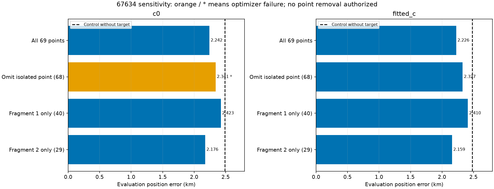
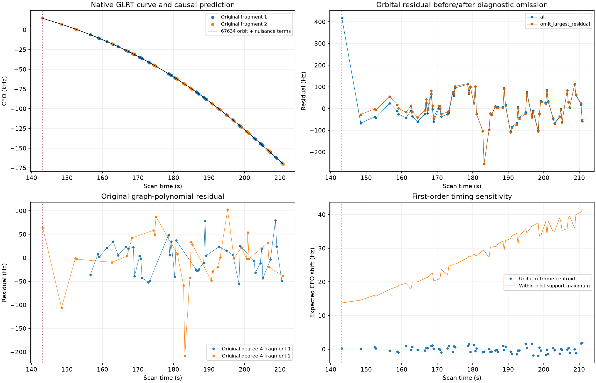
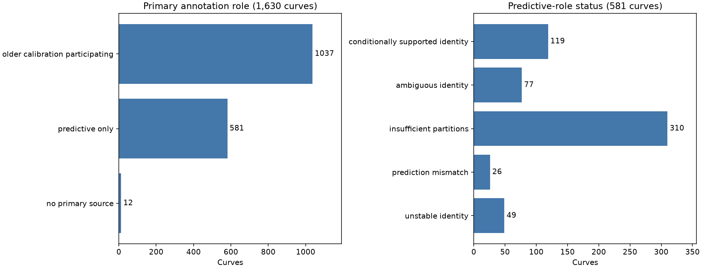

# 67634 recovery sensitivity and the full annotation-role audit

The 69-point 67634 recovery is **not solely driven by its isolated early residual**. In the fitted-c arm, error changes from **2.479 km without this family to 2.226 km with all points**, and **2.327 km after omitting the isolated point**. Each original fragment also improves fitted-c error by itself. The point moves the fitted position by **101.7 m**, so its influence is material. This is a diagnostic sensitivity result, not permission to delete it, a new association, or an ALGO promotion.

Capture metadata says **adaptive, 10 MS/s**, despite the `fast8-auto` recording name. This result must not be counted as a new fast-scan validation gain. It belongs to the broader research inventory.

## Controlled position experiment

We reconstruct the immutable validated graph bundle and reproduce its all-point endpoint **exactly in both c arms**. Every diagnostic starts at the same regional center, uses the same causal catalogue, physical priors, 25 × 25 km bounds, five phase-refresh rounds, L-BFGS-B budget and 0.025-second phase integration. The target remains predictive evidence: it does not update receiver calibration at a fixed position. Both c arms receive identical subsets. GPS appears only in report-time error calculation.

The suspect is selected by largest absolute residual in the previously saved c=0 trial. Variants retain all points, omit that point, omit its fixed scan-time 12-second block, or retain each original fragment separately. This is **targeted influence analysis, not randomized validation**. The earlier randomized identity tests remain unchanged. The isolated point is the only target observation in its block, so point and block omission are exactly the same experiment; they are not independent corroboration.

| variant | points | c0_error_km | fitted_c_error_km | both_optimizers_success |
| --- | --- | --- | --- | --- |
| all | 69 | 2.242 | 2.226 | True |
| omit_largest_residual | 68 | 2.341 | 2.327 | False |
| member_0_only | 40 | 2.423 | 2.410 | True |
| member_1_only | 29 | 2.176 | 2.159 | True |

The c=0 omission optimizer reports abnormal termination; its 2.341 km result is provisional, not a validated endpoint. The fitted-c omission optimizer succeeds. All ten diagnostic arm outputs pass target residual and phase-grid checks, but no fresh full ownership/exact-incumbent qualification was run for the altered subsets. They cannot replace the previously qualified all-point trial. Scores and position errors are reported separately in [position_sensitivity.csv](position_sensitivity.csv); raw objective magnitudes across different point counts are not a fair measure of localization quality. Lower target RMS (about 80 to 63 Hz after omission) accompanies worse evaluation position error.

The first fragment alone has 40 points and no isolated early point; fitted-c error is 2.410 km. The second has 29 points including the suspect; fitted-c error is 2.159 km. Both support a position pull in this case, but these conditional fits share the same incumbent calibration and are not independent location measurements. Their gains cannot be summed.

## Native evidence and what remains unexplained

Exact winner replay verifies every target CFO and timestamp against archived acquisition output. Graph values differ from native measurements only by integer alias lifts; there is no frequency smoothing or accidental numeric mutation. The suspect at **143.141 s** has GLRT margin **0.200** and candidate rank 0. It is the only exported candidate passing the fractional-margin gate for that probe. This establishes detection evidence, not a proven satellite identity for that individual point. [Its archived candidate list](suspect_native_point.json) is retained.

Its original degree-4 polynomial residual is only **64.9 Hz**, while its saved orbital residual is roughly 410–430 Hz across c arms. Thus a visually smooth polynomial is insufficient to establish orbital consistency, especially at an isolated endpoint. The other fragment starts about 13.5 seconds later, providing no simultaneous fragment witness at this point. This does not establish that the point is false or that the full join is wrong.

The within-pilot timestamp-support bound at this point is **13.7 Hz**, and the uniform-frame centroid shift is **0.26 Hz**. These are first-order sensitivities from the graph polynomial, not raw-IQ weighted timing estimates or absolute-clock validation. Ordinary within-probe centroid placement is far too small to explain a roughly 400 Hz discrepancy under that local slope. No extra LNB drift or orbital parameter is justified by this point alone. A bounded remeasurement of its existing IQ and adjacent probes, with frame consistency and a continuous CFO estimate, is the next direct measurement test.

## Audit of all 1,630 annotation records

The complete first assessment pass was real, but it did **not** establish that every curve had been validated in its eventual inclusion role. We read and hash each primary source rather than interpreting the ledger's original `state` column as an accepted association. Explicit predictive reassessment sources take precedence over original sources; filesystem modification times are not used. Separate fragment, bundle, partition and inclusion records remain distinct.

Primary sources comprise **1,037 older calibration-participating annotations**, **581 predictive-only annotations**, and **12 records whose assessment is recorded through separate fragment evidence** rather than a primary whole-curve source. The 581 predictive primary assessments comprise 119 supported, 77 ambiguous, 49 unstable, 26 prediction mismatches and 310 insufficient-partition results. These counts describe the primary-source audit, not all historical research or production ownership.

The audit flags **985 records needing predictive-role review in the primary ledger** and **63 supported predictive identities without a recorded inclusion source**. These are **reconciliation queues, not claims that 1,048 curves have never been tested anywhere**. Older manual and cohort research may contain relevant trials not linked in the primary ledger; those must be reconciled before rerunning or crediting a recovery. Another 89 rows have recorded inclusion sources and 34 require separate-role/fragment reconciliation. No missing field is treated as a failed satellite test, and no old supported label is promoted automatically.

The full [role audit](annotation_roles.csv) and [summary with source hashes](ledger_summary.json) make this limitation explicit. The original ledger and trials remain unchanged. Next work should reconcile these sources, take the largest genuinely pending curves through predictive-role validation, and then run matched position inclusion for supported identities. That is a broader path than repeatedly tuning the same geometric fragment groups.

## Status

This iteration adds no association credit and makes no production change. It strengthens the evidence for the existing 69-point recovery while identifying one influential measurement that still deserves raw-IQ checking. The full goal remains incomplete. The five diagnostic variants completed in 208.7 seconds; the focused regression suite passed 18 tests. [Source hashes](sources.json), [compact evidence](evidence.json.gz), native candidate metadata and all per-arm metrics accompany this report.
