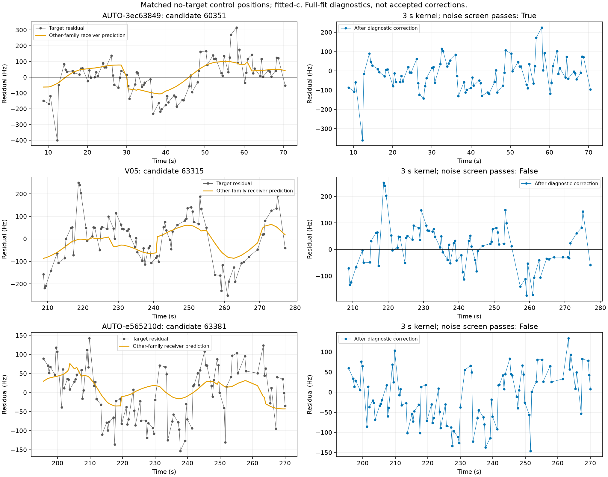
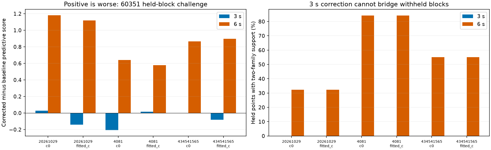
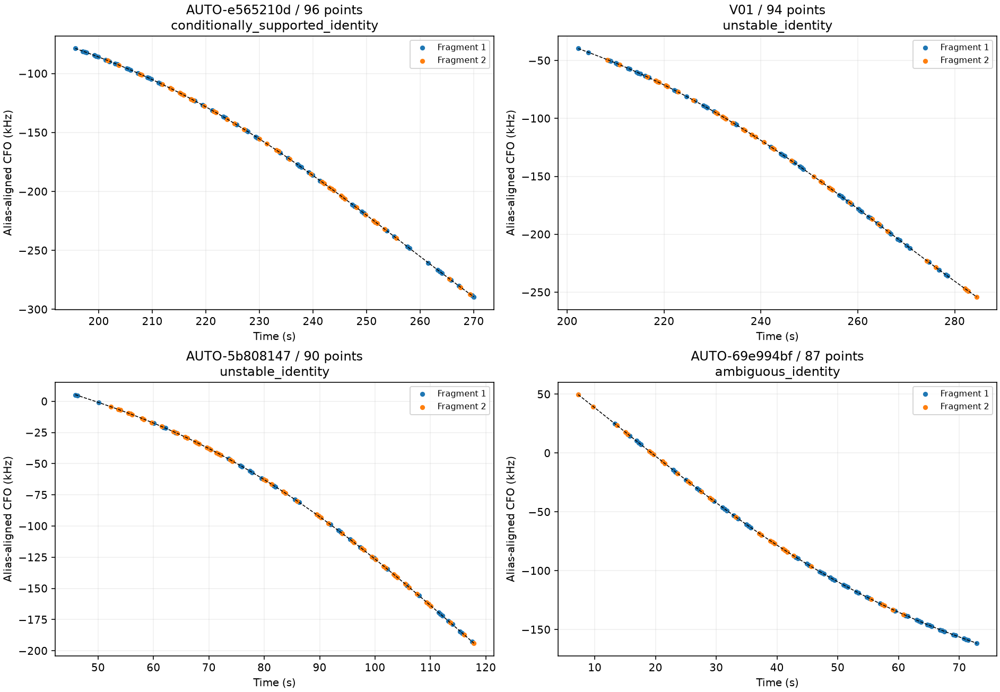
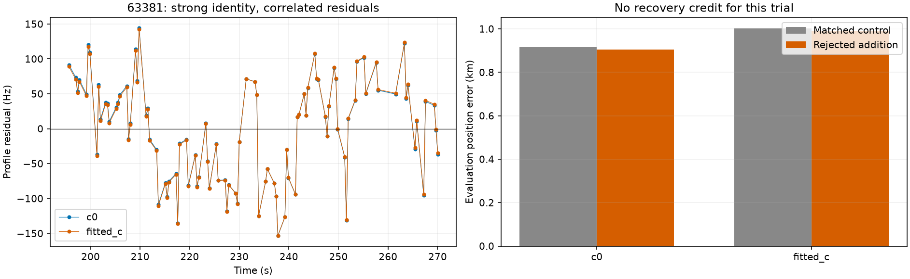

# Independent residual witnesses and the next large-fragment batch

This iteration adds a **96-point, strongly supported 63381 group** to the annotation evidence, but its position-inclusion trial remains rejected for correlated residuals. It also finds a same-receiver correction that passes a descriptive noise screen on the previously ambiguous AUTO-3ec63849 curve. That correction has **not** passed predictive validation. No additional hard-associated points or production changes are credited.

## Receiver witnesses: a partial explanation

The two previous triples and the new supported pair are evaluated at saved matched-control positions: target observations never enter the control position or receiver calibration. Incumbent residuals use exact causal orbit replay at those positions. Every witness retains physical observation IDs; a witness sharing any target observation is rejected. Receiver groups exclude the target's proposed satellite family, with at least two other families required locally. Predictions average within each family, then equally across available families, so duplicated channels do not gain extra family votes. Kernel widths 3, 6 and 12 seconds and Hz/fractional scaling are fixed before evaluation; insufficient support yields zero correction. No amplitude is fitted to the target.

The original primary check is same receiver, 6 seconds, Hz scaling. The 3-second sensitivity produces the promising AUTO-3ec63849 result; it must not be silently promoted to a preselected primary. Same-band, other-receiver, same-satellite and same-satellite/other-receiver checks are retained in [all transfer results](witness_transfers.csv). These are full-incumbent-fit diagnostics, not independent holdout evidence. For the ambiguous triples, target phase/orbit fitting still uses the target; 63381 instead uses its incumbent shared posterior.

| scan | arm | norad | width_s | supported_points | baseline_RMS_hz | corrected_RMS_hz | noise_pass |
| --- | --- | --- | --- | --- | --- | --- | --- |
| AUTO-3ec63849 | c0 | 60351 | 3.000 | 86 | 112.034 | 81.794 | True |
| AUTO-3ec63849 | c0 | 60351 | 6.000 | 87 | 112.034 | 100.969 | False |
| AUTO-3ec63849 | fitted_c | 60351 | 3.000 | 86 | 114.750 | 82.570 | True |
| AUTO-3ec63849 | fitted_c | 60351 | 6.000 | 87 | 114.750 | 101.296 | False |
| V05 | c0 | 63315 | 3.000 | 81 | 109.803 | 83.028 | False |
| V05 | c0 | 63315 | 6.000 | 81 | 109.803 | 106.556 | False |
| V05 | fitted_c | 63315 | 3.000 | 81 | 109.987 | 83.325 | False |
| V05 | fitted_c | 63315 | 6.000 | 81 | 109.987 | 106.567 | False |
| AUTO-e565210d | c0 | 63381 | 3.000 | 96 | 71.225 | 63.511 | False |
| AUTO-e565210d | c0 | 63381 | 6.000 | 96 | 71.225 | 70.150 | False |
| AUTO-e565210d | fitted_c | 63381 | 3.000 | 96 | 71.152 | 63.758 | False |
| AUTO-e565210d | fitted_c | 63381 | 6.000 | 96 | 71.152 | 70.321 | False |

AUTO-3ec63849's 3-second same-receiver correction passes the noise screen in both c arms; the 6-second primary does not. Other-receiver evidence is much weaker. V05's preferred 63315 hypothesis improves only slightly with same-receiver witnesses and still fails. Its alternative 59770 has stronger same-satellite similarity on the same receiver, but weaker transfer from the other receiver and still fails. The conditional identity weights are not full-catalogue satellite probabilities.

One first execution refused to extend AUTO-3ec63849 to ±30-second phase support because that would leave the existing causal orbit bank. The failed receipt is preserved. A new output directory reruns it at its original ±15-second support; V05 retains the separately tested ±30-second diagnostic. No extrapolated or post-observation orbit bank is introduced.

## Randomized scanwide-block challenge: what it tests

The promising AUTO-3ec63849 case reuses its three saved randomized 12-second partitions with 2-second guards. Every held/guard observation is removed from receiver fitting and witness construction across the scan. Target training points condition phase/orbit/bias uncertainty, while held target points only evaluate prediction. Both c arms share candidates, priors, fixed 150 Hz noise, unit family powers and budgets. The same 0.025-second phase grid is used for uncorrected, 3-second and 6-second variants. Candidates and partitions were selected during previous RF development; this is a conditional challenge, not fresh unbiased model selection. Correction-estimation uncertainty is not integrated, so favorable scores alone could not authorize inclusion.

The 3-second predictor has **zero directly supported held points in every fold/arm**. Its kernel truncation and two-family requirement cannot bridge these removed blocks. Small score/RMS changes arise through changed target-training conditioning, not a directly predicted correction inside the held blocks. The 6-second predictor supports 11/34, 16/19 and 11/20 held points but worsens the 60351 predictive score in all six fold/arm checks (about +0.58 to +1.18 negative-twice-log-density units). Thus a correction is not validated. This test challenges temporal interpolation across missing blocks; it does not disprove a contemporaneous common receiver fluctuation when independent measurements are available at the same time. No independent-point holdout or gate relaxation is substituted.

## Four largest untested pair groups

To keep progressing through the inventory, the four largest two-fragment groups not previously group-annotated were selected, one per scan, without GPS or satellite labels. This tests 96, 94, 90 and 87 points. All remain conditional on frozen graph geometry and bounded causal candidate search.

| scan | points | status | norad | minimum_margin | member_pass |
| --- | --- | --- | --- | --- | --- |
| AUTO-e565210d | 96 | conditionally_supported_identity | 63381 | 116.925 | True |
| V01 | 94 | unstable_identity | None | 3.742 | False |
| AUTO-5b808147 | 90 | unstable_identity | None | 567.834 | False |
| AUTO-69e994bf | 87 | ambiguous_identity | 61525 | 1.128 | False |

AUTO-e565210d supports **63381** across all folds and both c arms, with minimum pooled margin 116.92. Each fragment also survives a separate-label competitor challenge: all 12 member/arm/partition checks favor 63381, with minimum margin **87.43** against 10 required. Competitor nomination deliberately uses each member's held frequencies to search for counterexamples, while predictive fitting uses training only; this is adversarial screening, not unbiased validation. The other groups remain ambiguous or inconsistent across partitions. A smooth polynomial alone cannot establish a common satellite identity.

## Strong 63381 identity does not yet authorize position inclusion

The shared-family inclusion trial starts both matched variants at the regional center of the 25×25 km box, preserves existing priors and receiver calibration equations, and compares c=0 with fitted-c. The true site is used only to report error. Incumbent ownership is preserved. Exact orbit replacement is audited one family at a time. The trial retains all 96 target observations as a proposal, but fails the target's lag-one residual gate in both arms; these are **zero credited new associations**.

| arm | control_km | proposal_km | target_RMS_hz | lag1 | baseline_percent | proposed_percent | credited_new_points | accepted |
| --- | --- | --- | --- | --- | --- | --- | --- | --- |
| c0 | 0.917 | 0.905 | 71.212 | 0.646 | 71.589 | 73.583 | 0 | False |
| fitted_c | 1.002 | 0.991 | 71.138 | 0.646 | 71.589 | 73.583 | 0 | False |

RMS is about 71 Hz, but residual correlation is about 0.646 against `4/sqrt(96) = 0.408`. Mean, slope, quadratic and step screens pass in the nominal target diagnostic. Exact replay still rejects the target; all negative replay slacks are retained in [failed_gates.csv](failed_gates.csv). The error reductions are only about 11–12 metres and are not accepted gains. The proposed coverage column is hypothetical, not delivered coverage.

At the no-target control position, other-satellite same-receiver correction reduces this curve to about 64 Hz RMS; same-satellite correction reduces it to about 62 Hz. Neither passes the noise screen. Same-satellite evidence from the other receiver has limited support and much smaller effect. This points toward some same-receiver structure, but does not uniquely distinguish receiver hardware, estimator bias, shared fitting effects, or remaining satellite/model errors.

## Recovery state and next work

There are now **8 annotated group hypotheses out of 35**, leaving **27 untested groups** in this frozen grouping pass. [group_status.csv](group_status.csv) records the group state separately from the unchanged 1,630-curve [individual ledger](annotation_ledger.csv). Supported identity and position qualification remain separate states.

The next bounded work should continue down that untested queue and investigate fast residual structure using independent observations. A principled shared receiver covariance or CFO-estimator correction would need a witness-supported timescale/amplitude, uncertainty propagation, and held-block/whole-scan validation. The present short-kernel subtraction is not ready to deploy. For 63381, revisit correlated estimation error and native GLRT peak geometry before broadening orbital freedom: identity is already strongly supported and flexible phase fitting alone would not explain the oscillatory residual evidence. Do not infer better position from extra association count or lower in-sample RMS.

## Reproduction and checks

New tools are `diagnose_soft_bundle_witnesses.py` and `validate_soft_bundle_witnesses.py`. Existing bundle annotation, split-identity challenge, shared-family inclusion and exact-owner replay tools produced the pair results. Twenty-six targeted tests pass, covering physical-ID exclusion, no target amplitude fitting, minimum family support, held/guard exclusion, conditional covariance, mixtures, bundle reconstruction, ownership and family routing. All raw outputs use exclusive directories and terminal receipts. [sources.json](sources.json), [evidence.json.gz](evidence.json.gz), [executions.csv](executions.csv) and the CSV tables preserve provenance, including the refused phase expansion. To reproduce witness diagnostics with the final CLI, explicitly set `--phase-limit` to the saved case protocol: 30 for V05 and 15 for AUTO-3ec63849; the first prototype hardcoded 30 before the bounded-range refusal prompted this option. Use `--shared` for the 63381 case. No production or ALGO version is changed.
