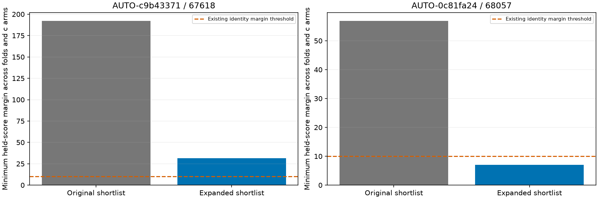

# Causal candidate competition before model correction

Expanding the shortlist changes one previously supported identity to **ambiguous**. Both targets were already withheld after shared-family consistency failures. The expansion does not authorize either target for localization, and does not prove that the runner-up is the true satellite.

The two targets are all shared-family failures from shifted batch one, chosen without GPS ranking. Candidate budget increases from three to twelve; actual eligible counts remain smaller. The algorithm still nominates from its existing causal catalogue using training-only geometry at the regional centre, training-derived positions and regional grid points. It retains the top three geometry offers at each location/arm before deduplicating and applying the enlarged cap. This is a wider shortlist, **not exhaustive catalogue likelihood evaluation**, and it remains conditional on the incumbent graph, receiver model and training positions.

| Scan | Preferred NORAD | Minimum margin, original → expanded | Reviewed status | Actual candidates in three folds |
| --- | --- | --- | --- | --- |
| AUTO-c9b43371 | 67618 | 192.36 → 31.40 | conditionally_supported_identity | 5 4 6 |
| AUTO-0c81fa24 | 68057 | 56.93 → 7.05 | ambiguous_identity | 5 6 5 |

For RX1 CH8 / 67618, new competitor **50805** reduces the minimum held-score margin from about 192.36 to 31.40, while 67618 remains preferred in all three folds and both c arms. For RX1 CH3 / 68057, competitor **55951** reduces the margin from about 56.93 to 7.05, below the existing threshold of ten. The leading identity remains 68057 in every fold; its separation from alternatives is insufficient. A score margin is not a calibrated probability of correct identity.

The experiment exactly replays original candidates' held scores (within numerical tolerance), aliases, c arms and physical random partitions. Observations, 12-second blocks, two-second guards, priors and position-training budgets are unchanged. The three partitions overlap and are not independent replications. No GPS, future TLE or raw-IQ modification enters candidate selection. [Full candidate scores](candidate_scores.csv) preserve all tested alternatives and both c arms. Terminal receipts and source hashes accompany the evidence.

## Implication for systematic recovery

The previous [measurement and shared-family investigation](../2026_10_30_shifted_family_challenges/README.md) found no joined-fragment seam, only small local IQ CFO corrections, and no fully qualified shared correction. The present result identifies a concrete additional limitation: a narrow geometry shortlist can overstate separation from competing satellites. It would be premature to attribute the entire discrepancy to LNB or orbital errors.

For [shifted batch three](../2026_10_30_shifted_annotation_batch3/README.md), all **11** initially supported identities receive the same expansion **before** position inclusion. **0** lose conditional support. The resulting batch has **7 curves / 209 points** passing matched RF, residual, ownership and numerical checks in separate position trials. Position gains and regressions remain in that report; additional associations alone are not evidence of improved localization.

The ledger now records 68057 as ambiguous and retains both targets' failed-inclusion history. **338 shifted-origin cases and 839 older-role cases remain; these queues overlap.** No production change or new ALGO promotion follows from this result.

Next, apply the broader competition check to previously qualified recoveries before joint/cohort promotion. Where satellite competition remains inconclusive, seek independent same-satellite evidence across channels/receivers or native alternative-peak evidence. Any extra receiver/orbit flexibility must predict held family data, rather than merely lower in-sample RMS. Do not use known GPS error to choose an identity or rescue a failed fit.
