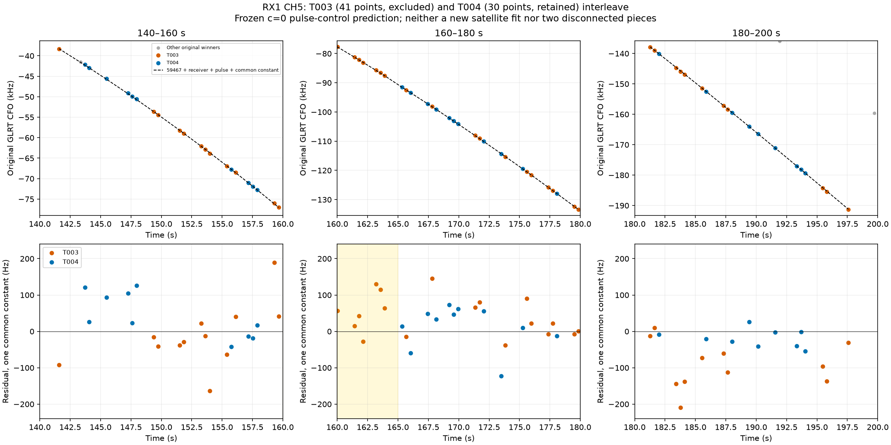
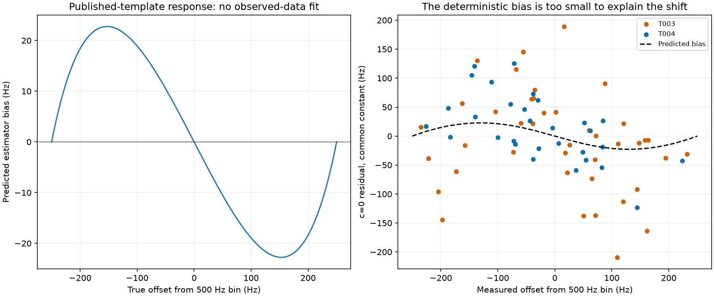
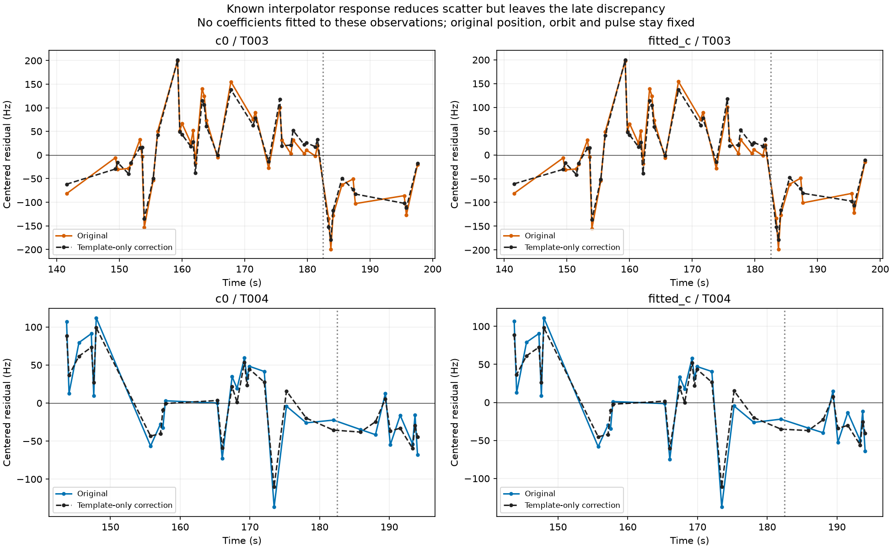
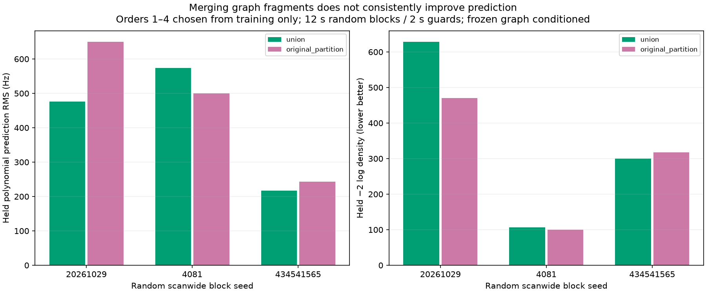

# CH5 graph partition and native CFO investigation

The [preceding position experiment](../2026_10_30_pulse_position_recovery/README.md) recovered a 42-point CH2 curve after modeling a shared 160–165 s excursion, but adding the overlapping 41-point CH5 curve worsened the position. This iteration traces that CH5 curve to original GLRT candidates and tests two proposed explanations. **It is not a multi-piece join, and a known CFO interpolation bias is too small to explain its remaining discrepancy.** A common polynomial does not consistently predict the two overlapping graph fragments better. The full CH5 curve remains an unresolved, supported satellite-identity candidate; no measurements are discarded and no production recovery is promoted.

## What was traced

The recording is `fast8-auto-20261026-021217-3c1e1fc4-1-upper` (AUTO-f4b54f0c). T003 has 41 points over 141.58–197.59 s, and retained T004 has 30 over 143.71–194.05 s. Each is **one fourth-order polynomial**. Their measurements interleave on RX1 CH5 at the same RF. The nominal satellite is 59467. This excludes a join between separate stored polynomial pieces; it does not prove that every point came from one physical emitter or that the graph partition is unbiased.

| component | points | pieces | degrees | polynomial_RMS_hz | calibration_points | rank0_points | minimum_margin |
| --- | --- | --- | --- | --- | --- | --- | --- |
| SCAN-RX1-CH5-T003-RF11940312500.000000 | 41 | 1 | [4] | 77.483 | 0 | 35 | 0.322 |
| SCAN-RX1-CH5-T004-RF11940312500.000000 | 30 | 1 | [4] | 44.582 | 30 | 25 | 0.346 |

All **90 original winning observations** in the lane and target extent ±5 s were replayed against eligible fractional-margin candidates and then against the original archived native GLRT products. Ranking uses maximum fractional margin, with the original rank tie break. No nearest-orbit peak selection was used. All 90 archived fractional CFO values equal their acquired CFO; the recorded fractional residual correction is zero. The analysis release is `fast-1f3a91c6a882b6e7eac8827fbb95f215`. This establishes archived measurement semantics, **not the exact capture/execution binary identity**. Native products, manifest and original observation authorities are hashed in [sources.json](sources.json).

The dashed prediction uses the previously fitted c=0 receiver/orbit/pulse model and one descriptive common constant for the union. The lower panels preserve the relative offset between fragments. A distant third curve is present in the extracted lane but outside the zoom's CFO range. T003's previously reported satellite identity was supported in three distinct random block partitions and both c arms; that conditional identity evidence is not proof of useful location information.

## Fixed template correction: a limited measurement effect

The native fine-acquisition source samples a 500 Hz frequency grid and interpolates three magnitudes with a parabola. Its true pilot-template response is not parabolic. Reuse the existing deterministic response model from the [earlier clock/measurement study](../2026_10_19_ds23_clock_measurement_controls/README.md): compute the Fourier magnitude of template energy on the alternating pilot symbols, then invert its monotone interpolation response. This predicts the correction without fitting any coefficient to this scan, GPS, satellite identity or residual curve. Apply it to **canonical GLRT CFO before alias lifting**, excluding near-DC and search-boundary cases.

The largest correction here is only **22.76 Hz**. At frozen position/calibration it reduces scatter on both fragments, but T003's late mean shift hardly changes. Each table row profiles only a constant; slopes and steps are not removed. The 182.5 s split is the previously identified descriptive discrepancy, not a validation partition or optimized correction boundary.

| arm | track | method | RMS_hz | late_shift_hz |
| --- | --- | --- | --- | --- |
| c0 | T003 | original | 85.070 | -129.760 |
| c0 | T003 | template_only | 79.930 | -125.980 |
| c0 | T004 | original | 55.820 | -46.390 |
| c0 | T004 | template_only | 47.440 | -44.370 |
| fitted_c | T003 | original | 84.200 | -126.260 |
| fitted_c | T003 | template_only | 79.090 | -122.480 |
| fitted_c | T004 | original | 55.330 | -42.630 |
| fitted_c | T004 | template_only | 46.880 | -40.620 |

This is an exploratory fixed-endpoint measurement diagnostic. The exact executing binary, noise, multipath and peak-switch behavior remain unqualified for this correction. No position optimization used corrected CFO, and the reduction in frequency scatter is **not a claimed position improvement**. The correction cannot account for the roughly 126–130 Hz late T003 discrepancy. Another uncorroborated receiver step or a target-only fitted correction would risk absorbing model error without resolving its source.

## Does one graph curve predict better?

Fit orders 1–4 to the original alias-lifted measurements, selecting order by training BIC with a 40 Hz noise floor. Compare one polynomial for the 71-point union against separate polynomials for the original fragments. Prediction integrates linear-coefficient uncertainty. Use three distinct **random scanwide 12 s block assignments with 2 s training guards**. Geometry alone selects usable seeds; both fragments share the same held blocks. Coefficients, noise and order use training values only. Graph membership and alias lifts were determined earlier using the full dataset, so this is a conditional diagnostic, not blind graph-construction validation. These are polynomial predictions, not orbital fits, and have no learned c coefficient.

| seed | grouping | held_points | held_RMS_hz | negative_twice_log_density | orders |
| --- | --- | --- | --- | --- | --- |
| 20261029 | union | 32 | 475.751 | 628.113 | [3] |
| 20261029 | original_partition | 32 | 649.582 | 470.631 | [4, 3] |
| 4081 | union | 8 | 574.036 | 106.262 | [4] |
| 4081 | original_partition | 8 | 500.312 | 100.457 | [4, 4] |
| 434541565 | union | 20 | 216.594 | 300.244 | [4] |
| 434541565 | original_partition | 20 | 242.770 | 317.429 | [4, 3] |

The union has lower held RMS in two partitions, but lower predictive loss in only one. Both models have large errors in some withheld blocks, including extrapolation-sensitive blocks. Thus neither the existing split nor a forced merge is established as the correct physical model. Separate fits can score better despite worse RMS because they express larger uncertainty; this is why both quantities are shown. A fourth-order in-sample fit and residual gates alone do not establish predictive adequacy.

## Position status and next discriminating experiment

No new position fits were run in this iteration. The matched prior experiment remains: original error **0.499 / 0.572 km** (c=0 / fitted-c); pulse + CH2 **0.451 / 0.518 km**; pulse + CH2 + CH5 **0.524 / 0.588 km**. Proposed association with the pulse was **3,181 / 4,031 = 78.91%**; this is a research proposal, not production acceptance. The extra CH5 likelihood caused regression despite residual-gate passage. GPS was used only for those previously reported errors; this iteration does not read GPS or future TLEs.

The next discriminating test is a bounded existing-IQ replay of **both full interleaved fragments**, including early and late points. Independently refine CFO and code timing against known pilots and compare independent frame subsets. No satellite or GPS should enter that measurement fit. If the discrepancy persists across independently supported pilot estimates, investigate physical frequency/beam effects with corroborating curves. If it disappears, propagate the qualified measurement correction and its uncertainty through matched c arms. Do not select a target-only correction, truncate the tail, or merge fragments because GPS error improves. Other inventory cases can advance while this case awaits measurement-level evidence.

## Inventory and reproducibility

Attempt 31 completed: `{'conditionally_supported_identity': 14, 'insufficient_partitions': 7, 'unstable_identity': 7, 'execution_timeout': 1, 'prediction_mismatch': 1, 'ambiguous_identity': 2}`. The cumulative ledger now contains **1212 / 1630 completed assessments**, plus 149 historical separate phase audits. These counts include rejected, ambiguous, unstable and insufficient-partition assessments; they are not accepted point coverage. One job reached the 600 s cap; its terminal receipt and claim are preserved. All 32 jobs have terminal receipts.

Reproduce with `diagnose_pulse_graph_partition.py`, then `analyze_pulse_graph_measurements.py`, then `report_pulse_graph_measurements.py`, using `PYTHONPATH=src:tools`, one BLAS thread, and the recorded source paths. [Raw compact evidence](evidence.json.gz), [measurement metrics](measurement_metrics.csv), [polynomial folds](polynomial_folds.csv), [graph provenance](graph_provenance.csv), [batch](annotation_batch.csv), [ledger](annotation_ledger.csv), and [executions](executions.csv) preserve all outcomes. Three component-owned tests cover exact candidate replay, canonical correction boundaries/bin translation and preserving slopes/steps when centering. Production policy, persisted measurement contracts and golden fixtures are unchanged.
