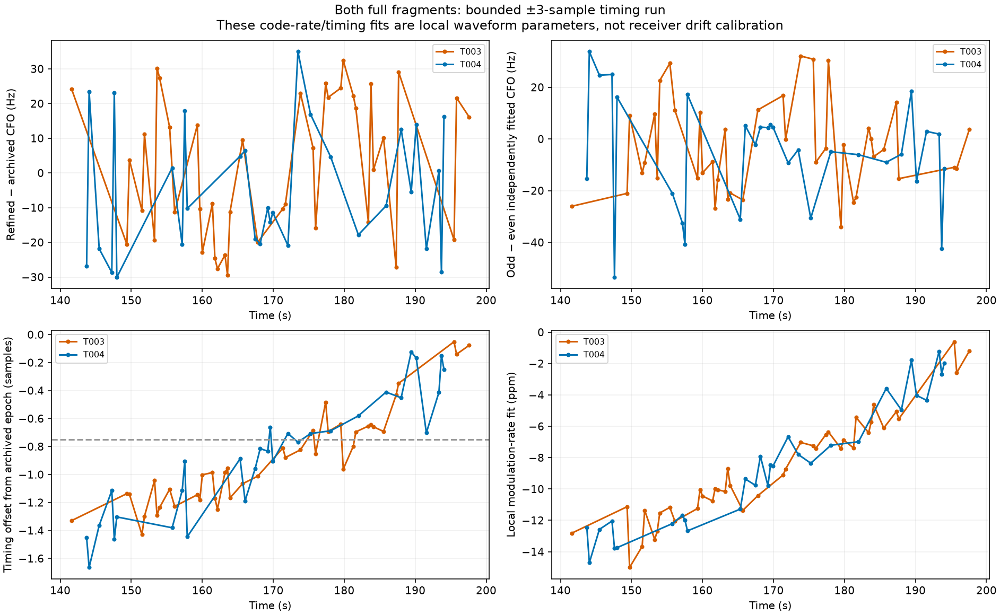
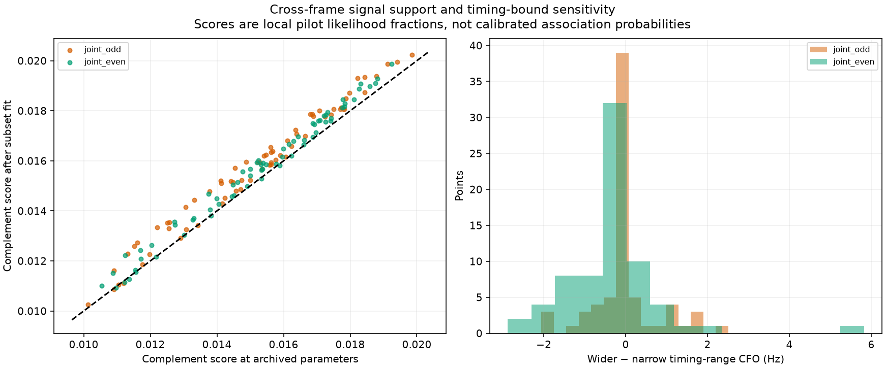
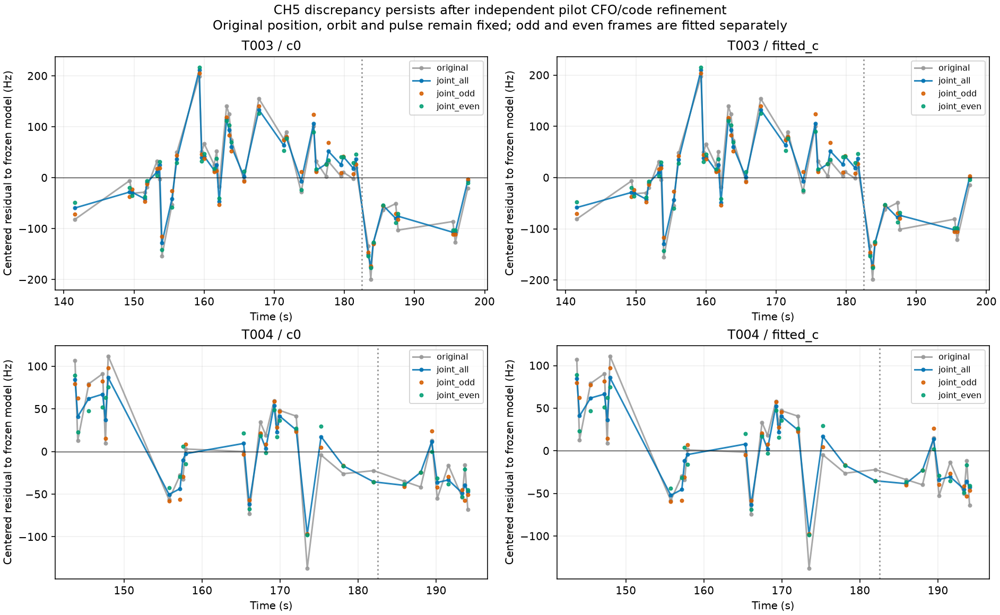

# CH5 raw-IQ pilot refinement: repeatable discrepancy remains

This follows the [graph/native provenance investigation](../2026_10_30_ch5_graph_measurements/README.md) on AUTO-f4b54f0c, recording `fast8-auto-20261026-021217-3c1e1fc4-1-upper`. All **71 original observations** from the 41-point RX1 CH5 T003 and retained 30-point T004 were remeasured from existing IQ. Independent pilot fits reduce residual scatter but preserve T003's late discrepancy: approximately **−126 Hz** in both disjoint frame subsets. This is evidence against a simple interpolator error or random measurement noise being the main cause. It does **not** establish which remaining satellite, transmitter, receiver, propagation or recording-time effect is responsible. No position fit or production inclusion changed.

## Measurement authority and bounded replay

The original native products identify each IQ window by digest, receiver, hardware sample counter and archived peak. The deployed immutable multirate reader verified **1536 windows across three selected recording segments**, including complete chunk hashes. It exported the 71 requested receiver windows. Each local array was hashed again before fitting. The older research checkout's reader supports only the older 2.5 MS/s contract; it was not changed to reinterpret these 10 MS/s recordings. The deployed reader and V2 contract source hashes are retained. Raw recordings are read-only; no new RF was collected.

The measurement-only plan contains canonical CFO, epoch, receiver/visit and raw-IQ authorities. It contains no GPS, orbit, TLE, satellite identity, pulse amplitude or residual target. Selection is both complete original fragments; no late points are removed. Four worker processes, each capped at 900 s, complete both runs. The [execution table](executions.csv) records every terminal status. The IQ arrays remain local replay prerequisites, not published payloads.

## What the pilot model fits

Use the existing known-pilot variable-projection model with a separate complex gain and DC term per frame. It fits CFO, fractional epoch adjustment and modulation-rate adjustment. The initial peak and epoch come from the archived GLRT; this is a local peak refinement, **not an independent blind acquisition**. The frequency scout is ±600 Hz in 100 Hz steps; local CFO bounds are ±800 Hz and code-rate bounds ±40 ppm, with one selected start and 16 optimization iterations. These engineering search bounds are not calibrated physical priors.

Run all-frame, odd-frame and even-frame fits. The odd/even scouts, gradients, coefficients and code adjustments each use only their named subset. Evaluate each subset's fitted parameters on its complementary frames without refitting. The subsets share the full-window archived nomination, waveform model and recording, so they are not fully independent measurements or a scanwide association-validation split. The ongoing annotation workflow continues to use random scanwide 12 s blocks with 2 s guards.

The initial ±0.75-sample epoch range often reached its negative bound. Preserve that complete run, then change **only** the epoch bound to ±3 samples (±300 ns at 10 MS/s), keeping the same observations and search iteration budget. All **213** joint fits in the wider run (71 × three frame subsets) finish inside all three bounds. The full-frame epoch adjustments range from about −1.66 to −0.05 samples. Removing the bound changes the CFO little: odd/even wide-versus-narrow RMS differences are below 1.2 Hz. Thus the initial timing-bound issue was real, but does not explain the large frequency discrepancy.

The local waveform score improves on complementary frames in **69/71 odd-trained** and **62/71 even-trained** cases relative to archived parameters. All decreases are retained in the evidence. Positive score differences do not prove absolute CFO accuracy. Code-rate estimates here are local waveform fits, not new receiver drift estimates.

## Residual evidence, with c arms kept separate

Keep the original pulse-control position, receiver calibration and causal orbit model frozen. That control excludes T003 and includes the retained T004 in calibration. Add the measurement change to the original residual, then profile one constant per displayed fragment. No slope or step is removed. Both c=0 and fitted-c use exactly the same refined observations; there is no new c fit or location search in this diagnostic. The 182.5 s split is the previously identified descriptive discrepancy, not a validation holdout.

| arm | track | method | RMS_hz | late_shift_hz |
| --- | --- | --- | --- | --- |
| c0 | T003 | original | 85.070 | -129.760 |
| c0 | T003 | joint_all | 79.470 | -126.010 |
| c0 | T003 | joint_odd | 79.960 | -125.870 |
| c0 | T003 | joint_even | 80.060 | -126.380 |
| fitted_c | T003 | original | 84.200 | -126.260 |
| fitted_c | T003 | joint_all | 78.660 | -122.510 |
| fitted_c | T003 | joint_odd | 79.130 | -122.360 |
| fitted_c | T003 | joint_even | 79.270 | -122.880 |
| c0 | T004 | original | 55.820 | -46.390 |
| c0 | T004 | joint_all | 45.830 | -43.740 |
| c0 | T004 | joint_odd | 50.150 | -45.390 |
| c0 | T004 | joint_even | 43.950 | -42.680 |
| fitted_c | T004 | original | 55.330 | -42.630 |
| fitted_c | T004 | joint_all | 45.260 | -39.990 |
| fitted_c | T004 | joint_odd | 49.620 | -41.640 |
| fitted_c | T004 | joint_even | 43.360 | -38.930 |

For c=0, T003 RMS falls from ~85 to ~79 Hz, but the late shift remains ~126 Hz. T004 RMS falls from ~56 to ~46 Hz. Odd/even estimates have median absolute differences of **13.2 Hz for T003** and **13.4 Hz for T004**, considerably smaller than the persistent T003 shift. Shared nomination/model errors could still affect both; this is evidence of repeatability within this local pilot model, not proof that every selected point or satellite label is correct.

The frequency factor uses the 20 ms probe midpoint. The model-derived effective times of the all-frame estimates are around 9–12 ms after probe start. A first-order diagnostic using each original graph polynomial's local derivative changes predicted CFO by at most **4.02 Hz**. Its complete residual metrics are included as `joint_all_time_adjusted`; it cannot explain a ~126 Hz shift. This is a local centroid-sensitivity calculation, not validation of the recording's absolute hardware/UTC timing or a production timestamp correction.

## Interpretation and next action

Three explanations have now been tested: multi-piece joining (not how T003 was constructed), deterministic CFO interpolation bias (small contribution), and local carrier/code/timing refinement (scatter improves, late discrepancy persists). This makes relaxing residual gates or applying a target-only correction unjustified. The record still supports 59467 conditionally, while useful position information remains unproven. Another satellite or peak outside this local search is not excluded by this measurement experiment.

The next model-level test should compare the **combined 71-point evidence** with independent same-satellite and other-family receiver/band witnesses. Ask whether a frequency correction learned from other curves predicts this curve under scanwide grouped validation. If the discrepancy follows only one carrier/beam, represent that uncertainty without allowing it to freely pull position; if it follows receiver/time across unrelated satellites, test a shared instrument correction. Require matched c arms and separate frequency-score versus position-error reporting. Preserve the entire curve and do not choose bounds, weight or truncation using GPS. Continue through other inventory cases instead of treating this one unresolved discrepancy as a reason to stop the systematic work.

No new position-error gain is claimed. The prior controlled results remain original **0.499 / 0.572 km**, pulse + CH2 **0.451 / 0.518 km**, and pulse + CH2 + CH5 **0.524 / 0.588 km** (c=0 / fitted-c). The last result is why a supported identity and passing residual gates alone are insufficient for promotion.

## Systematic progress and reproduction

Attempt 32 states: `{'conditionally_supported_identity': 22, 'insufficient_partitions': 8, 'ambiguous_identity': 2, 'unstable_identity': 12, 'prediction_mismatch': 4}`. The cumulative ledger now records **1260 / 1630 completed assessments**, with 149 historical separate phase audits. Assessments include negative, ambiguous and insufficient-partition outcomes; they are not accepted-GLRT coverage. Timeouts retain their claims and terminal receipts. No production acceptance count increases in this report.

Run `refine_pulse_iq_panel.py prepare`, then `export_pulse_iq_panel.py` with the recorded immutable deployed reader on PYTHONPATH. Run the research fitter with `PYTHONPATH=src:tools`, BLAS/OMP threads 1. The wider run reuses the exact hashed panel and verifies every point's measurement authority. `report_pulse_iq_refinement.py` builds this report. [Sources](sources.json), [compact evidence](evidence.json.gz), [metrics](measurement_metrics.csv), [point residuals](point_residuals.csv), [bounds](fit_bounds.csv), [frame repeatability](frame_repeatability.csv), [ledger](annotation_ledger.csv) and [batch](annotation_batch.csv) preserve all outcomes. The narrow-run source snapshot preserves its exact implementation before the bound parameter was added.

**Eight component-owned tests pass:** synthetic recovery on both sample rates, independently fitted frame carriers/code/rate, immunity to changing omitted frames, unchanged default all-frame behavior, subset analytic gradients versus finite differences/reference scores, recovery beyond the old timing bound, and rejecting reused panels with altered measurement authority. Synthetic tests do not qualify every real multipath or transmitter waveform. Public contracts, original measurements, golden fixtures and production policy are unchanged.
