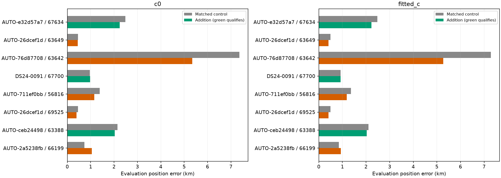
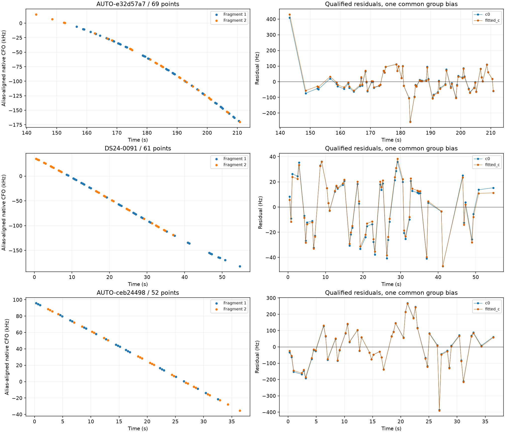
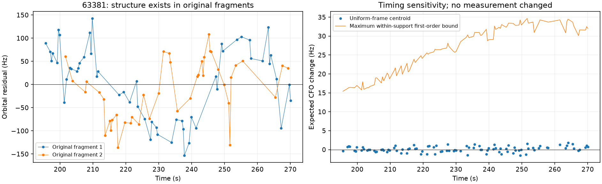

# Completed fragment-group annotation pass and qualified position additions

All **35 frozen geometric groups** now have an annotation result. The remaining 27-group batch produced eight supported identities; all eight survived the separate-fragment satellite challenge. **Three position trials pass** pooled and member residual checks, phase-grid checks, exact orbit replay and ownership preservation. They contain 182 points: **130 newly qualified points**, plus the already-qualified 52-point 63388 recovery tested here as one common-bias group. These are research inclusions, not a production rollout or ALGO promotion. Completing this grouping pass does not complete the full 1,630-curve objective.

## Systematic selection and identity safeguards

Every remaining group in the frozen inventory was evaluated, ordered by point count, with eight workers and 600-second case limits. Selection uses no GPS or satellite label. Each group keeps all native observations and integer alias lifts. Three timestamp-selected randomized scanwide 12-second partitions with two-second guards assess pooled and member-specific identity. Six bounded causal candidate nominations are used per fold. Both c arms use the same candidate set, priors and budgets.

New-batch outcomes: **{'prediction_mismatch': 2, 'bundle_member_support_failed': 6, 'unstable_identity': 9, 'conditionally_supported_identity': 8, 'ambiguous_identity': 2}**. Six groups fail member-specific support even when pooling appears convincing; nine switch identity between partitions. The 35-group inventory is in [group_status.csv](group_status.csv), and new results are in [new_annotations.csv](new_annotations.csv). Annotation outcomes include unresolved and rejected hypotheses; they are not 35 confirmed satellites.

For the eight supported groups, each fragment is challenged with independently nominated competing satellites. This adversarial search may use held frequencies to nominate counterexamples; fitting still uses training observations. It is conditional model checking, not an unbiased full-catalogue posterior. All eight pass every available member check, with coverage for both members and both c arms. [split_identity.csv](split_identity.csv) retains the individual margins.

## Position inclusion, with matched c ablation

All eight candidates use the new/uncalibrated-family causal phase-mixture route. Each has one satellite identity and one shared curve constant, with physical orbital and receiver uncertainty integrated. They do not alter receiver calibration equations at a fixed position. Each control/addition starts at the same center of a 25×25 km box; both c arms have five phase-refresh rounds and matching optimizer budgets. A predeclared 0.025-second phase grid avoids the earlier coarse-grid issue; local score/gradient checks compare half and quarter spacing. All 16 addition-arm numerical audits pass. Future TLEs and true GPS are excluded from inference; the supplied true site is used only for error reporting.

After fitting, every member is checked with the **same fitted group bias**, without per-member rebiasing. Mean, trend, quadratic, step, correlation, RMS and physical gates remain unchanged. Nominal and continuously refined phase predictions must pass for every member in both arms. Exact incumbent-family replay and ownership checks must also pass. A good fragment cannot conceal a weak neighbor, and a member pass cannot override whole-group failure.

| scan | norad | points | qualified | c0_control_km | c0_addition_km | fitted_c_control_km | fitted_c_addition_km |
| --- | --- | --- | --- | --- | --- | --- | --- |
| AUTO-e32d57a7 | 67634 | 69 | True | 2.487 | 2.242 | 2.479 | 2.226 |
| AUTO-26dcef1d | 63649 | 65 | False | 0.454 | 0.448 | 0.497 | 0.408 |
| AUTO-76d87708 | 63642 | 63 | False | 7.363 | 5.346 | 7.288 | 5.266 |
| DS24-0091 | 67700 | 61 | True | 0.966 | 0.970 | 0.923 | 0.925 |
| AUTO-711ef0bb | 56816 | 57 | False | 1.386 | 1.158 | 1.362 | 1.186 |
| AUTO-26dcef1d | 69525 | 54 | False | 0.454 | 0.392 | 0.497 | 0.407 |
| AUTO-ceb24498 | 63388 | 52 | True | 2.145 | 2.034 | 2.100 | 2.025 |
| AUTO-2a5238fb | 66199 | 45 | False | 0.736 | 1.046 | 0.853 | 0.927 |

The five rejections retain structured target residuals. Two also report an optimizer failure in one arm; these are not numerical-only failures, so no optimizer retry is used to disguise the physical discrepancy. Some rejected trials improve evaluation error substantially; GPS improvement does not determine acceptance. The 56816 group passes separate member checks but fails pooled correlation/step checks, demonstrating why both levels are needed.

## Qualified recoveries and coverage

| scan | norad | points | c0_control_km | c0_addition_km | fitted_c_control_km | fitted_c_addition_km |
| --- | --- | --- | --- | --- | --- | --- |
| AUTO-e32d57a7 | 67634 | 69 | 2.487 | 2.242 | 2.479 | 2.226 |
| DS24-0091 | 67700 | 61 | 0.966 | 0.970 | 0.923 | 0.925 |
| AUTO-ceb24498 | 63388 | 52 | 2.145 | 2.034 | 2.100 | 2.025 |

| scan | baseline_points | proposed_points | total_GLRT | baseline_percent | proposed_percent |
| --- | --- | --- | --- | --- | --- |
| AUTO-e32d57a7 | 2964 | 3033 | 3881 | 76.372 | 78.150 |
| DS24-0091 | 3183 | 3244 | 4297 | 74.075 | 75.495 |
| AUTO-ceb24498 | 2871 | 2923 | 3909 | 73.446 | 74.776 |

AUTO-e32d57a7 adds 69 points assigned to 67634, improving error by about 244–253 metres. DS24-0091 adds 61 points assigned to 67700, with error essentially unchanged and slightly worse (about 2–5 metres). This is a valid association recovery without a demonstrated localization gain. AUTO-ceb24498's 52-point 63388 group reproduces previously qualified measurements; exact ID-set equality against the earlier joint trial prevents double counting. Its common-bias grouping is a different model from two independently biased fragments, so small endpoint differences are expected. The totals are across separate scans and cannot be treated as one joint position fit.

The 67634 plot retains an isolated roughly 430 Hz residual near the start. It passes the predeclared group/member screens, but qualification is not proof that every point has the correct source. No outlier is clipped or hidden. The maximum residual is recorded in the physical-check table; native-point and influence checks remain appropriate before promoting this research recovery.

[qualified_recoveries.csv](qualified_recoveries.csv) distinguishes newly qualified from repeated points. The 1,630-row [individual ledger](annotation_ledger.csv) keeps previous single-fragment results and adds separate group-inclusion fields for the six members of qualified groups. Position and annotation statuses remain separate. This research state must still be integrated and evaluated scan-wide before production promotion.

## 63381: native provenance, fragment structure and timing

The earlier 96-point 63381 group remains rejected. Every exported observation is replayed from the original tracking contract's gated maximum-margin candidate. Each graph value equals that native GLRT CFO plus an integer alias; timestamps and observation order match exactly. No polynomial-smoothed replacement values entered the position trial. Both original fragments have one polynomial piece, so this is not a hidden many-piece construction.

| arm | member | points | polynomial_RMS_hz | orbital_RMS_hz | orbital_lag1 |
| --- | --- | --- | --- | --- | --- |
| c0 | 0 | 54 | 38.180 | 77.206 | 0.763 |
| c0 | 1 | 42 | 45.746 | 62.668 | 0.646 |
| fitted_c | 0 | 54 | 38.180 | 76.786 | 0.761 |
| fitted_c | 1 | 42 | 45.746 | 63.139 | 0.652 |

Orbital residual structure exists in both original fragments separately. This excludes joining as the sole source of that structure, but does not prove the common-satellite model is complete. Near-time one-to-one pairs (25 pairs within 1.5 seconds) have only about 0.26 residual correlation and about 78 Hz difference RMS, so neither a perfectly shared receiver fluctuation nor a single smooth orbital correction explains all the discrepancy.

Using each archived epoch and the GLRT's pilot-symbol/frame sample support, the uniform-frame centroid sensitivity changes expected CFO by at most **1.78 Hz**. The maximum first-order change anywhere within the sampled pilot support is **34.67 Hz**. These use the original polynomial derivative; actual IQ frame weights are unknown. They are sensitivity bounds, not a timestamp calibration or absolute-clock audit. The ordinary probe-midpoint approximation is therefore not supported as the sole explanation for the roughly 71 Hz pooled residual scatter.

The current GLRT implementation uses a discrete CFO search, but the exported winning-candidate contract lacks the acquired-CFO/scout values needed to attribute this track's residual to a particular frequency bin. A native-IQ remeasurement would be needed to test that mechanism here. Earlier raw-pilot work on a different scan found only a partial scatter reduction, so it should not be assumed to solve 63381.

## Remaining work

This pass establishes a reproducible route from full-inventory geometric groups through guarded identity checks to position inclusion. It does not resolve every large curve: ambiguous identities, insufficient member evidence and systematic residuals remain. Continue with independent receiver/satellite evidence and bounded native-pilot diagnostics for those failure classes. Keep the new 67634 and 67700 recoveries in the research inclusion registry, evaluate them alongside existing per-scan recoveries without duplicate observations, and validate aggregate behavior before promotion. Do not relax residual gates or use GPS to choose which associations survive.

## Validation and provenance

All 27 annotation cases and all eight split/inclusion/replay pipelines finish. Twenty-one targeted tests pass, including the new pilot-support geometry and exhaustive member-qualification tests, plus bundle, alias and conditional-likelihood tests. Raw trials remain immutable. [executions.csv](executions.csv), [sources.json](sources.json), [evidence.json.gz](evidence.json.gz), [physical_checks.csv](physical_checks.csv) and [member_checks.csv](member_checks.csv) retain the receipts and evidence. The report generator verifies source hashes, all 35 group statuses, target ownership and exact overlap with the earlier 63388 recovery. No RF was collected or recording modified.
