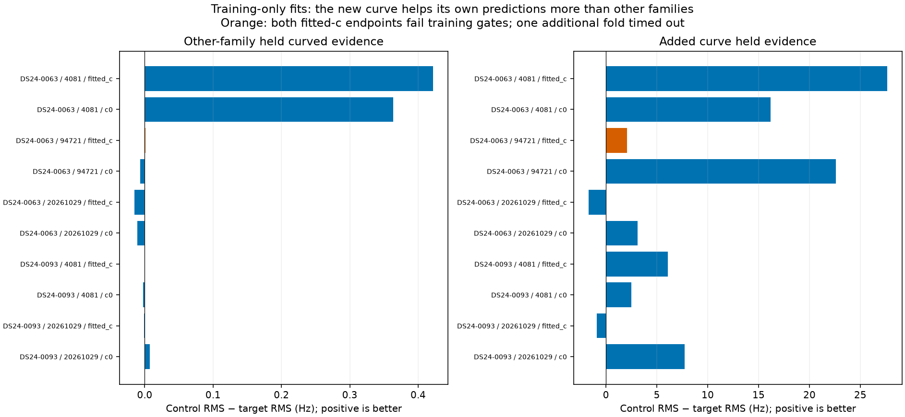
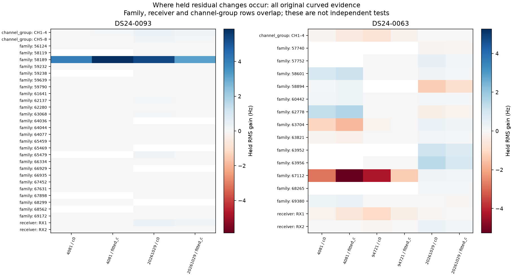
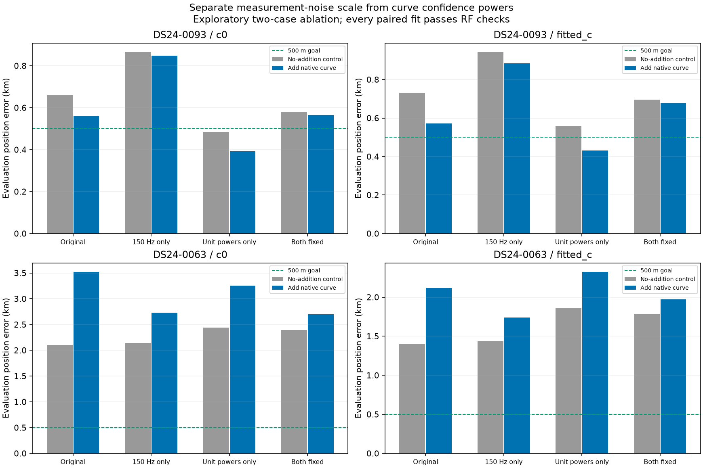
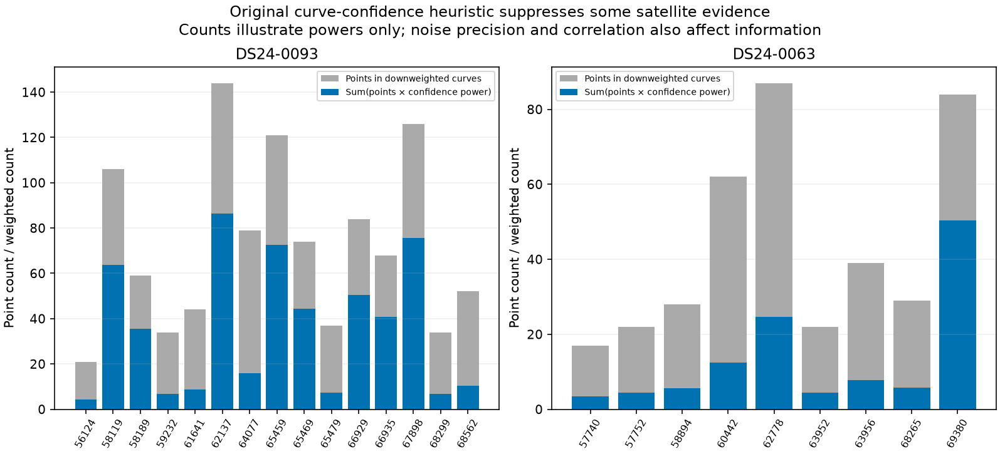
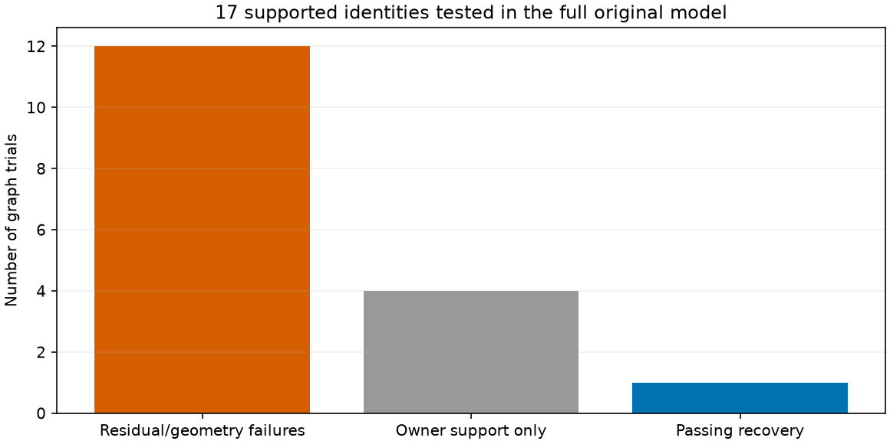

# Cross-family prediction, evidence weighting, and large-curve recovery

We can now retain some previously rejected curves without relaxing their gates or changing old satellite ownership. That is not yet a reliable localization improvement rule. The two native curves still separate those questions: **DS24-0093 improves, DS24-0063 worsens**, across all four evidence-weight policies tested. New training-only validation finds little corroborating improvement in held observations from other satellite families.

One of **17** newly tested original graph recoveries passes: AUTO-f7f4de11's 47-point RX1 CH2 curve, **NORAD 68607**, from 247.589 to 298.411 seconds. Its refit adds **63 points total**, comprising the target's 47 and 16 additional points qualified by the refit. It preserves every old satellite owner and improves both matched position errors modestly. This remains a research candidate; neither production nor retained cohort totals change.

This continues the [explicit shared-phase inclusion report](../2026_10_30_explicit_phase_inclusion/README.md). All inference uses causal TLEs, and GPS is used only to calculate reported error. The c=0 and fitted-c arms share observations, candidate identities, prior policies and budgets. No new RF data were collected.

## 1. What the held-block test says

We reused three recorded randomized **12-second block** partitions per scan, with **2-second guards**, across every receiver and channel simultaneously. This is not random individual-point withholding. All position, phase, receiver and predictive-constant fitting uses training observations. The frozen graph, satellite identities, earlier guard decisions and prior choices remain conditioning assumptions: this is **conditional model validation**, not an independent end-to-end identity test.

Each fold first fits original curved training evidence from the center of the 25 × 25 km region (37.906, −122.545), then starts the matched control and native-addition models at that same RF-only endpoint. Each uses 81 phase-start candidates over ±0.2 s and five phase-refresh rounds of 48 optimizer iterations. The shared satellite phase is an explicit optimizer coordinate; other satellite and receiver parameters retain the existing conditional treatment.

Training uses fixed 150 Hz measurement noise and unit curve powers, avoiding reuse of full-data RF confidence estimates. Predictive measurements use twice that variance and the original 300 Hz constant prior. Original predictive entries receive appended training-only views; original geometry and observation IDs are preserved. Curved calibration groups with fewer than four training points are excluded and recorded. At least eight target training points are required. Held predictions use exact orbit means and constants learned only from training observations; no held constant is refitted.

**Five of six fold jobs completed; DS24-0093 seed 94721 timed out at 360 seconds.** It is an unresolved execution, not a successful validation or scientific rejection. Nine of the ten complete arm comparisons pass training gates in both variants. Both fitted-c endpoints for DS24-0063 seed 94721 fail; they are shown in orange and are not acceptance evidence.

| scan | seed | status |
| --- | --- | --- |
| DS24-0093 | 20261029 | complete |
| DS24-0093 | 94721 | timeout |
| DS24-0093 | 4081 | complete |
| DS24-0063 | 20261029 | complete |
| DS24-0063 | 94721 | complete |
| DS24-0063 | 4081 | complete |

| scan | seed | arm | control_qualified | target_qualified | other_family_points | other_family_RMS_gain_hz | native_RMS_gain_hz | position_shift_km |
| --- | --- | --- | --- | --- | --- | --- | --- | --- |
| DS24-0093 | 20261029 | c0 | True | True | 823 | 0.007 | 7.753 | 0.009 |
| DS24-0093 | 20261029 | fitted_c | True | True | 823 | -0.001 | -0.895 | 0.003 |
| DS24-0093 | 4081 | c0 | True | True | 926 | -0.002 | 2.511 | 0.005 |
| DS24-0093 | 4081 | fitted_c | True | True | 926 | 0.001 | 6.064 | 0.001 |
| DS24-0063 | 20261029 | c0 | True | True | 185 | -0.011 | 3.104 | 0.149 |
| DS24-0063 | 20261029 | fitted_c | True | True | 185 | -0.015 | -1.703 | 0.089 |
| DS24-0063 | 94721 | c0 | True | True | 169 | -0.007 | 22.596 | 0.007 |
| DS24-0063 | 94721 | fitted_c | False | False | 169 | 0.001 | 2.068 | 0.000 |
| DS24-0063 | 4081 | c0 | True | True | 191 | 0.364 | 16.195 | 0.224 |
| DS24-0063 | 4081 | fitted_c | True | True | 191 | 0.422 | 27.639 | 0.280 |

Positive gain means lower held RMS after adding the native curve. The primary witness consists of **original curved points from other satellite families**, with at least four training points in their curve. The gain is generally tiny (the largest is about 0.42 Hz); native held predictions change much more. This does not establish an independent position benefit. It also does not prove the curve is false: position and phase may compensate, and the fixed-noise validation policy gives the native evidence less weight than the original fit.

The partitions overlap and are not independent replicates. These are plug-in mean residuals, not calibrated predictive probabilities: position, phase and noise uncertainty are not integrated. A few training-only endpoints reach a region boundary, so these folds also expose weak or unstable geometry. There is no claim of global convergence or precise location from this validation.

All **20 completed control/target arm endpoints** were rebuilt from saved phase-round histories without rerunning optimization. Objectives and held residuals reproduce exactly. Perturbing every excluded curved value by **1,000,000 Hz** leaves the final fitted objective unchanged in every replay, conditional on the fixed graph and prior choices. This narrowly checks excluded-value dependence; it does not undo full-data identity or graph selection. Future receipts now save the final phase reference directly.

The following plot breaks down held original curved residuals by satellite, receiver and channel group. These rows overlap and cannot be combined as independent evidence. It includes the same-family curves as a secondary diagnostic. Channel groups here mean CH1–4 versus CH5–8, not an assumed physical band mapping.

[Held metrics](held_predictions.csv), [all strata](held_residual_strata.csv), [execution receipts](validation_executions.csv), [full validation and candidate receipts](candidate_and_validation_receipts.json.gz).

## 2. Separating noise scale from confidence weighting

The validation changes both noise and curve powers relative to the full-data prototype. A controlled 2 × 2 ablation separates those effects. The original noise model and original curve powers form one corner; fixed 150 Hz noise, unit curve powers, and both together form the others. Within each policy, the no-addition control and native-addition fit use the same data, priors, candidate identities, starts and search budget, apart from the explicitly added target. Existing receiver/orbit/constant prior widths and gates are unchanged. All **32** full-data endpoints pass exact selected-family orbit gate replay and preserve old ownership.

| scan | policy | arm | RF_qualified | control_error_km | target_error_km | added_points | control_native_RMS_hz | target_native_RMS_hz |
| --- | --- | --- | --- | --- | --- | --- | --- | --- |
| DS24-0093 | original | c0 | True | 0.660 | 0.561 | 49 | 66.493 | 63.296 |
| DS24-0093 | original | fitted_c | True | 0.731 | 0.572 | 49 | 74.354 | 66.487 |
| DS24-0093 | fixed_noise_only | c0 | True | 0.865 | 0.847 | 49 | 61.468 | 60.783 |
| DS24-0093 | fixed_noise_only | fitted_c | True | 0.943 | 0.885 | 49 | 70.629 | 65.943 |
| DS24-0093 | unit_weights_only | c0 | True | 0.484 | 0.393 | 49 | 74.269 | 64.821 |
| DS24-0093 | unit_weights_only | fitted_c | True | 0.556 | 0.432 | 49 | 82.362 | 67.815 |
| DS24-0093 | annotation_fixed | c0 | True | 0.580 | 0.565 | 49 | 65.150 | 62.792 |
| DS24-0093 | annotation_fixed | fitted_c | True | 0.696 | 0.677 | 49 | 74.839 | 69.014 |
| DS24-0063 | original | c0 | True | 2.103 | 3.520 | 44 | 177.859 | 141.253 |
| DS24-0063 | original | fitted_c | True | 1.401 | 2.115 | 44 | 154.504 | 138.010 |
| DS24-0063 | fixed_noise_only | c0 | True | 2.141 | 2.733 | 44 | 157.942 | 139.836 |
| DS24-0063 | fixed_noise_only | fitted_c | True | 1.441 | 1.741 | 44 | 137.385 | 131.037 |
| DS24-0063 | unit_weights_only | c0 | True | 2.442 | 3.256 | 44 | 169.593 | 138.843 |
| DS24-0063 | unit_weights_only | fitted_c | True | 1.859 | 2.323 | 44 | 146.272 | 132.882 |
| DS24-0063 | annotation_fixed | c0 | True | 2.394 | 2.698 | 44 | 152.581 | 139.211 |
| DS24-0063 | annotation_fixed | fitted_c | True | 1.786 | 1.973 | 44 | 132.433 | 127.714 |

For DS24-0093, unit curve powers with the original noise model yield **0.484 → 0.393 km (c=0)** and **0.556 → 0.432 km (fitted c)**. This crosses the 500 m goal in this one case, but is an exploratory result, not a promoted algorithm. Fixed noise alone makes its control worse; the two changes are not interchangeable. DS24-0063 still worsens when its 44-point curve is added under every policy. A better target frequency fit therefore cannot substitute for external geometric confirmation.

The target noise scales explain why the fixed-noise validation gives weaker feedback: DS24-0093's original median native base sigma is **57.66 Hz**, versus **101.06 Hz** for DS24-0063. Replacing these with 150 Hz reduces their median predictive precision by **6.77×** and **2.20×**, respectively. These are precision ratios, not changes in measured SNR or sample rate.

| scan | arm | native_sigma_median_hz | fixed150_precision_reduction | old_effective_sigma_median_hz |
| --- | --- | --- | --- | --- |
| DS24-0093 | c0 | 57.660 | 6.768 | 63.299 |
| DS24-0093 | fitted_c | 57.660 | 6.768 | 63.320 |
| DS24-0063 | c0 | 101.060 | 2.203 | 139.261 |
| DS24-0063 | fitted_c | 101.060 | 2.203 | 139.252 |

The existing `cross_rx_support` rule assigns power 1 when a family has support on two receivers, 0.6 when it has at least two receiver/channel owners and the curve's competitor confidence is ≥0.95, and 0.2 otherwise. DS24-0093's active old curves of the recovered family 58189 have power 0.6. **Mixed powers within a family do not by themselves demonstrate a bug**, because the rule also uses per-curve confidence. Family-replacement experiments intentionally preserve the original powers for matched comparisons; the downstream loader carries them forward. Whether those frozen weights remain calibrated after recovery is a testable concern, not an established offset or wavelength error.

Source: [weight rule](../../tools/evaluate_ds23_family_weighting.py), [initial application](../../tools/algo02_scan.py), [family replacement preservation](../../tools/probe_ds23_family_cavity_position.py), [downstream replay](../../tools/benchmark_graph_covariance.py). [Noise scale CSV](noise_scales.csv), [downweighted curve CSV](downweighted_curves.csv), [factorial positions](factorial_positions.csv), [all endpoint audits](factorial_audit.csv).

## 3. A new original-model graph recovery, and all failures

| scan | arm | target_curve_points | added_vs_incumbent | lost_vs_incumbent | exact_and_owner_verified | before_error_km | after_error_km |
| --- | --- | --- | --- | --- | --- | --- | --- |
| AUTO-f7f4de11 | c0 | 47 | 63 | 0 | True | 1.629 | 1.531 |
| AUTO-f7f4de11 | fitted_c | 47 | 63 | 0 | True | 1.807 | 1.760 |

AUTO-f7f4de11 goes from **1,291/2,321 (55.62%) to 1,354/2,321 (58.34%)** associated points. The old nominal identity of the target was already 68607; this is recovery of rejected evidence, not a satellite replacement. Three randomized block nominations agree in both c arms, with minimum joint-score margin 74.92 over the runner-up. Identity support is conditional on the graph and candidate search. A full original-model refit from the regional center then passes all gates, including an exact selected-family orbit replay and preservation of every incumbent and matched-control satellite owner. No new nuisance parameter or gate relaxation is used for this graph case.

The other **16** trials fail: **12** have residual/geometry failures, and **4** fail only the multiple-orbital-owner support requirement. The latter are not interchangeable with proven wrong identities; the model requires independent owners before trusting physical orbital corrections. Failures on an old curve count too. Provisional point gains in failed fits are not accepted associations. The complete gate audit covers rejected fits; a separate ownership/exact-orbit audit covers the passing control and target.

[Every trial's CFO and residual plot](graph_gallery.md), [all graph results](graph_trials.csv), [every failing component and gate](graph_gate_failures.csv).

## 4. Inventory coverage and next decision

The bounded annotation batch finishes **29** of 32 jobs, with three 600-second timeouts. The original 1,630-entry graph inventory now has **929 completed annotations**. This inventory spans DS24 and the day's automatic analyses; it must not be described as 1,630 DS24-only tracks. Annotation completion is not accepted association. The three new timeouts and all earlier unresolved entries remain visible in the ledger.

Batch classifications: `{'conditionally_supported_identity': 12, 'prediction_mismatch': 3, 'ambiguous_identity': 4, 'unstable_identity': 10, 'execution_timeout': 3}`. [Full ledger](annotation_ledger.csv), [this batch](annotation_batch.csv).

The next bounded experiment should estimate confidence/noise using training data only, then compare original, refreshed-support and unit-power policies using the same held cross-family observations. Keep DS24-0063 as a counterexample, and require a GPS-blind criterion that distinguishes it from beneficial additions. For owner-only failures, test jointly supported family evidence before loosening orbital priors. For residual failures, compare shared receiver structure against shared satellite structure using independently supported curves. Do not select whichever policy gives the best GPS error on each scan.

This iteration adds evidence for three distinct bottlenecks: optimization over a shared satellite phase can recover feasible curves; confidence powers materially alter geometry; and a curve can satisfy all residual gates while moving position in the wrong direction. It does not establish sample rate, receiver separation, or a channel-frequency offset as the cause. No new ALGO promotion, production deployment, accepted-cohort change, or full-DS24 accuracy claim is made.

## Reproduction and validation

Run `tools/run_explicit_phase_validation.py` on the two diagnostic directories recorded in the source receipts, then `tools/audit_explicit_phase_validation.py`. The latter reconstructs final references from saved histories and evaluates the excluded-value perturbation check without optimization. Full-data runs use `tools/run_explicit_phase_inclusion.py --constrained --noise-policy` with each of `original`, `fixed_noise_only`, `unit_weights_only`, and `annotation_fixed`; the complete arguments, source IDs, partitions and file hashes are archived. Replay all eight run directories with `tools/audit_explicit_phase_endpoint.py`.

The original-model graph batch uses `tools/run_supported_graph_inclusions.py` on annotation attempt 21; the new annotation ledger consumes attempt 22. Audit rejected graphs with `tools/audit_receiver_ramp_gates.py --graph` and the passing graph with `tools/audit_graph_inclusion_owners.py`. Generate this report with `tools/report_cross_family_prediction.py --study <study-root> --previous reports/2026_10_30_explicit_phase_inclusion --output reports/2026_10_30_cross_family_prediction`.

**13 targeted tests pass**, covering training-view exclusion and immutability, evidence-policy factor isolation, explicit phase normalization and conditional coefficients, fixed-coordinate prediction, and identical held-point accounting. Scientific endpoint audits cover 32 full-data native fits, 20 completed training endpoints, and four passing graph endpoints. Timeouts and failed fits remain reported rather than being silently dropped.

[Summary](summary.json), [source hashes](sources.json), [compact evidence](evidence.json.gz), [full candidate/validation receipts](candidate_and_validation_receipts.json.gz).
