# Every graph inclusion trial

## AUTO-b5002270 / 5bab0a89df2011c41046

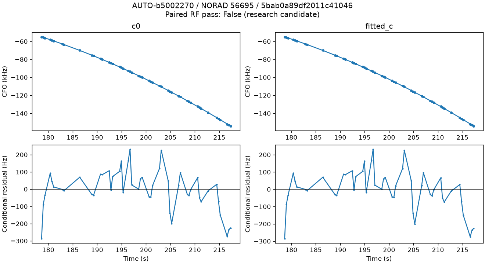

## AUTO-51b666f4 / 8d61b9bec7c2631db03a

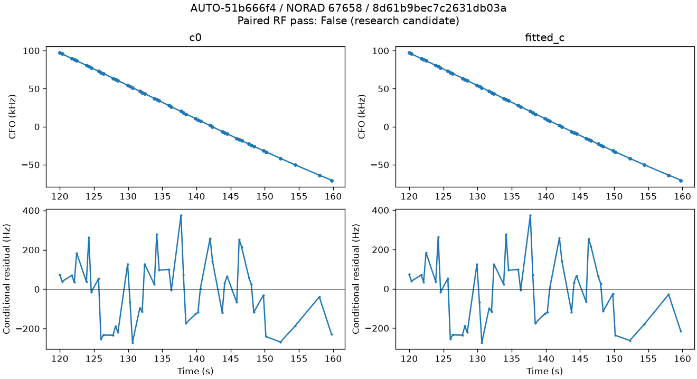

## AUTO-76d87708 / 940498543bcbcd0329cb

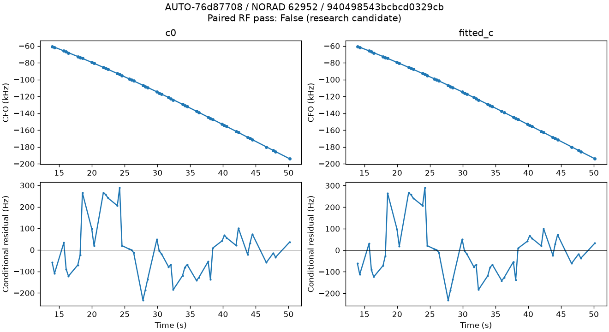

## AUTO-69e994bf / c21ec7eca9892097e95c

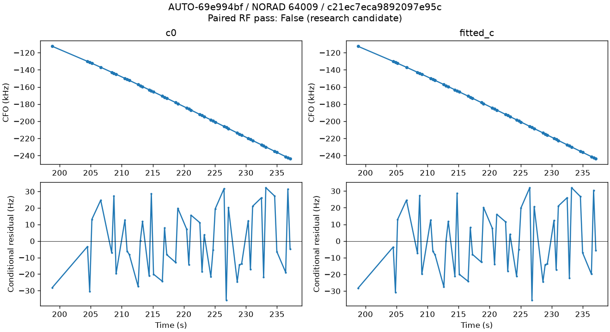

## AUTO-c5ca3407 / fdd80eb144c9a1ea67e0

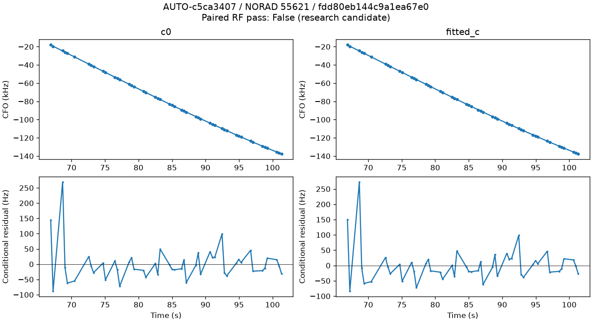

## AUTO-1ee2d79a / 3b57d2a86f831aa40d6f

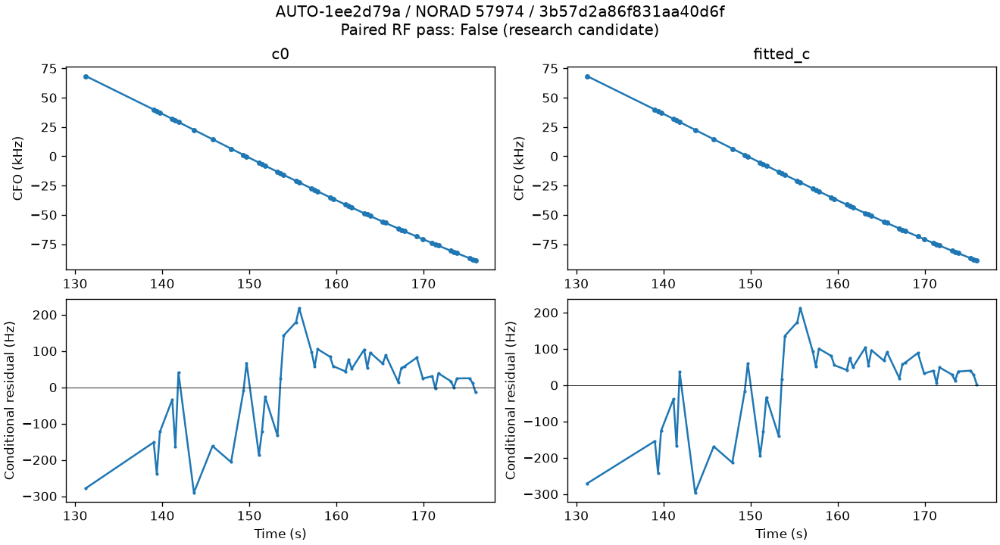

## AUTO-ce535751 / 76d8248a897b82a49f96

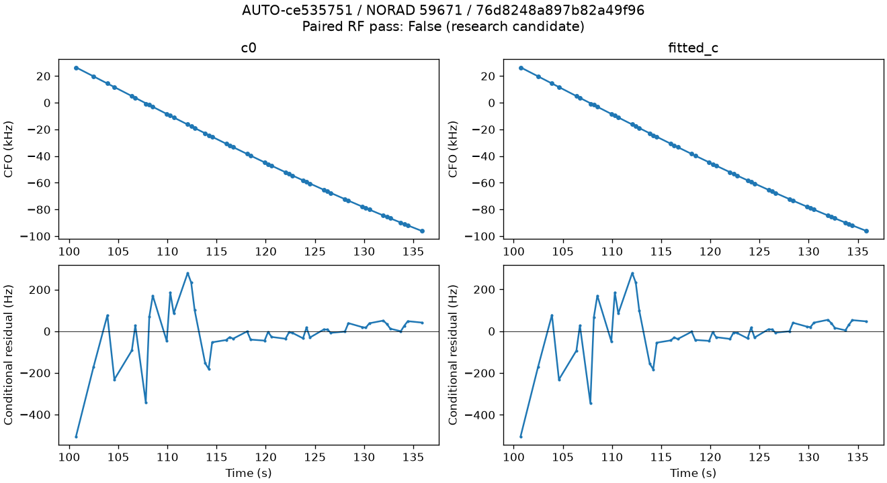

## AUTO-baa1e5f3 / 77eb610602a56d3a0d27

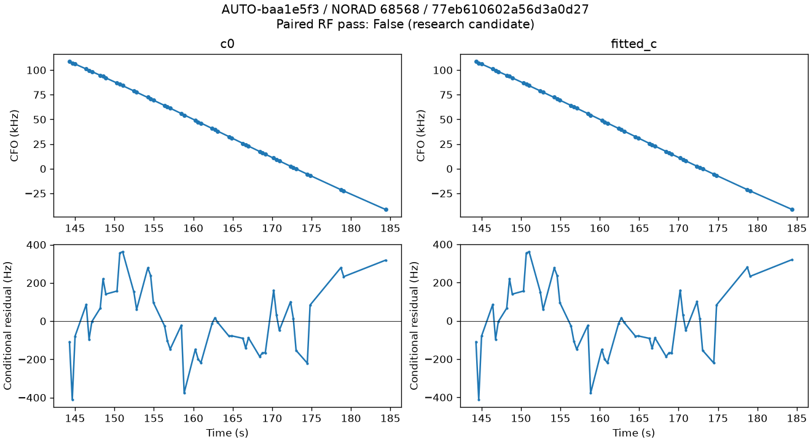

## AUTO-1b0bc73a / 84d1c0b61a0bd19f3d91

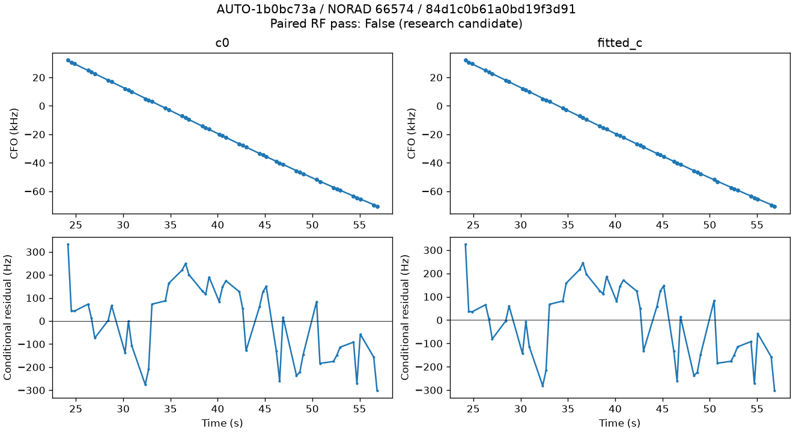

## AUTO-f7f4de11 / 93011b4437c32b34b691

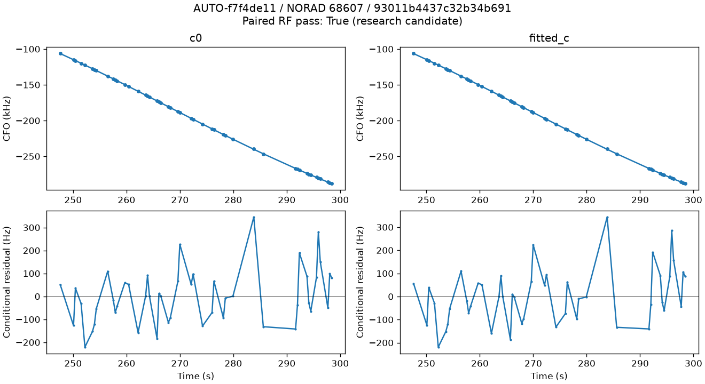

## AUTO-69e974e6 / aa5f95f690d68b42c264

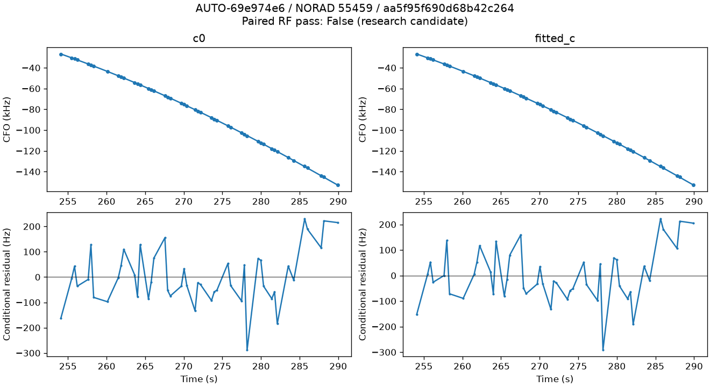

## AUTO-d969e15a / bae0b75dda9626d93217

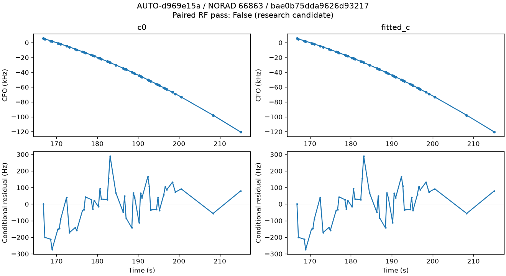

## AUTO-1c50d90f / d485f6ae2f3e66ecfe7f

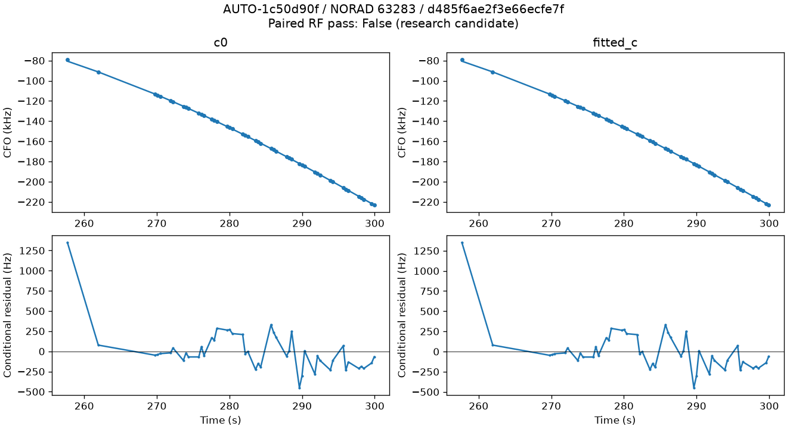

## AUTO-d969e15a / e0b434a4585eac2cfe3e

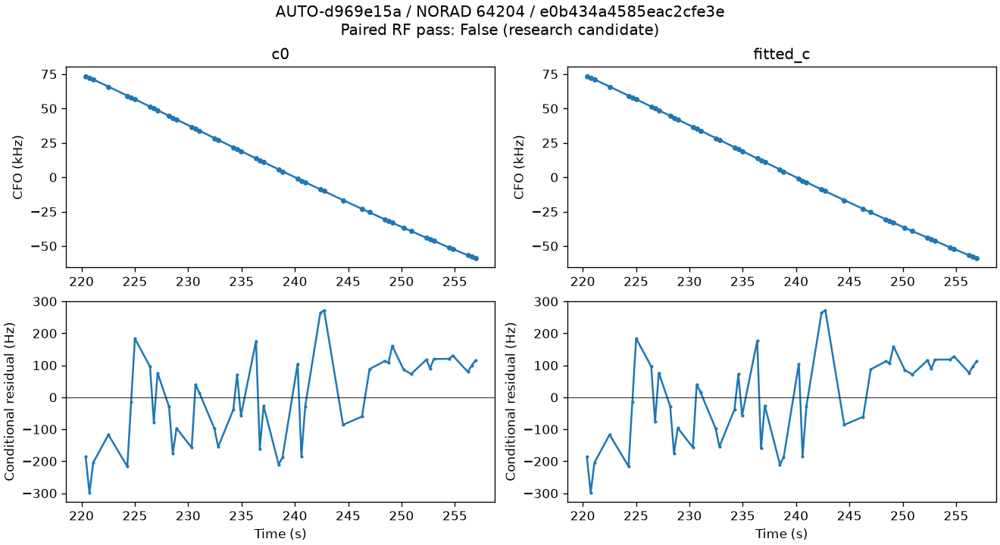

## AUTO-ceb24498 / 609142f387bf372dfd0a

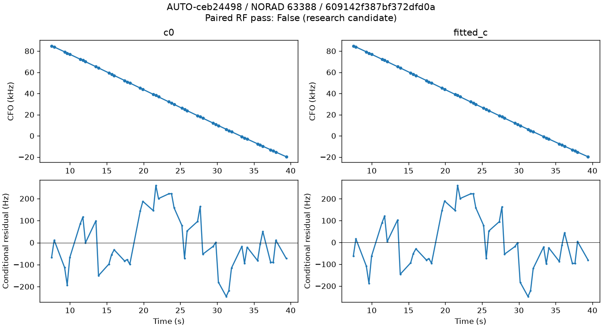

## AUTO-e565210d / 76c8af2c9d577016fe1d

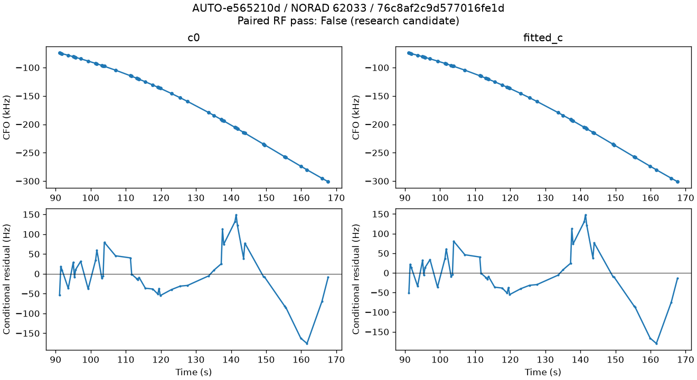

## AUTO-c0dd2487 / 9e579bc54bf270e9b2cf

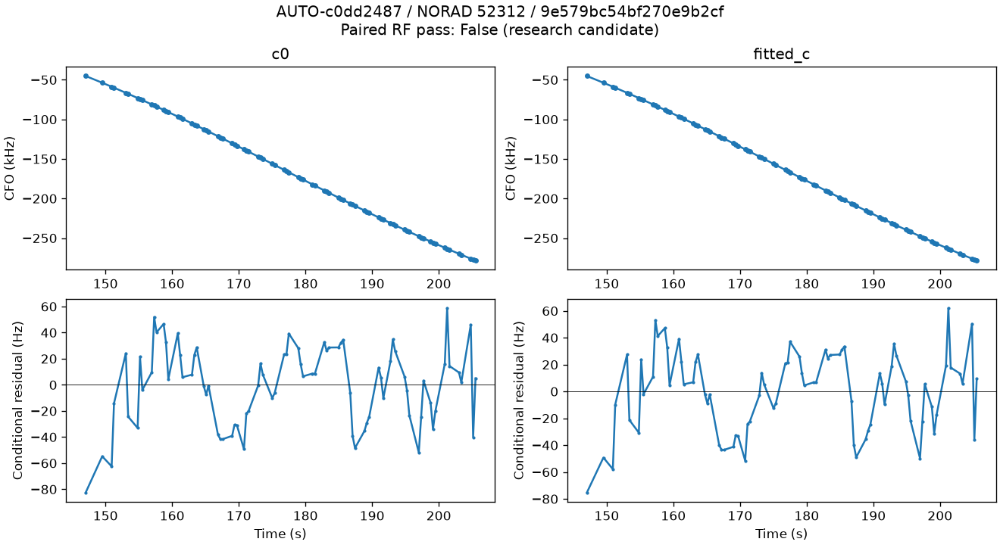
