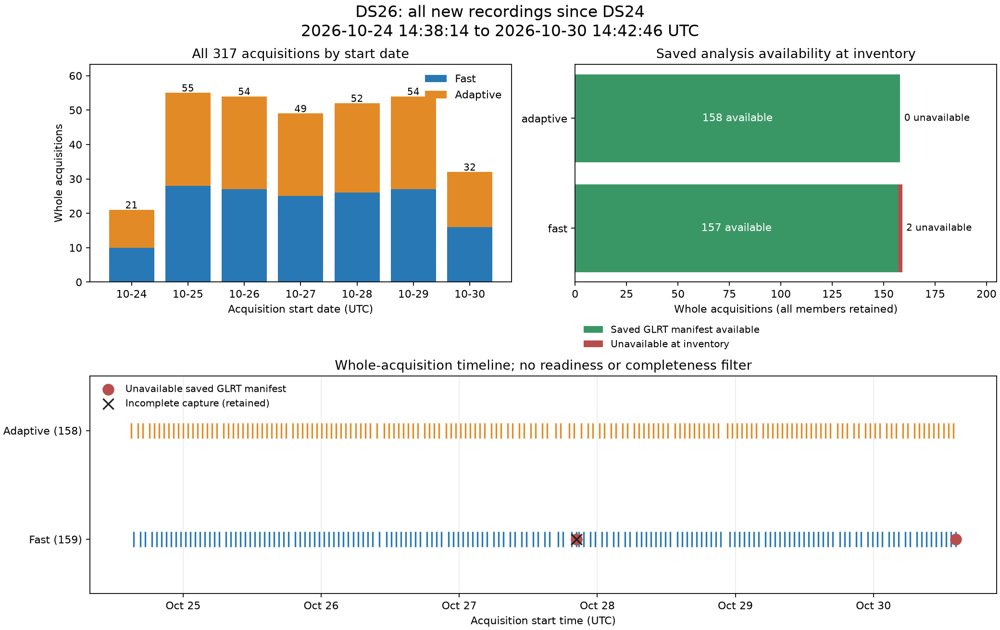

# DS26: all new recordings since DS24

DS26 contains **317 whole acquisitions: 159 fast and 158 adaptive**. Membership
includes every discovered acquisition starting in **[2026-10-24 14:38:14 UTC,
2026-10-30 14:42:46.099491067 UTC)**. All sample rates were eligible; every member
in this frozen interval happens to have actual **10 MS/s** capture metadata.
Existing DS25 membership and results remain unchanged.

**Current evaluation scope: fast recordings only.** The user subsequently
restricted the ALGO02/ALGO03 comparison and deployment gate to all **159 fast
members**, with evaluation inputs available for **158/159**. The separate
[fast-only-evaluation-membership.json](fast-only-evaluation-membership.json)
pins those case IDs and input-availability flags to the exact full-manifest hash.
DS26-0317 is included with its late public input; unavailable DS26-0172 remains
in the denominator. All 158 adaptive members are excluded from this comparison
and gate. The sealed **317-member recording authority**, adaptive metadata, and
completed public exports are preserved. The inventory figure below describes
that complete authority, rather than the narrower current evaluation scope.



[PDF figure](figures/dataset_inventory.pdf).

| Inventory item | Count |
|---|---:|
| Whole acquisitions | 317 |
| Fast / adaptive | 159 / 158 |
| Complete / incomplete | 316 / 1 |
| Recorded fast windows or retained adaptive visits | 1,422,953 |
| Referenced compressed IQ bytes | 3,814,437,106,151 |
| Available saved GLRT manifests at inventory | 315 |
| Fast public tracking contracts / adaptive metrics manifests | 157 / 158 |
| Detected metadata/index/payload-size integrity errors | 0 |

Membership does not depend on channel coverage, signal quality, completeness,
GLRT availability, localization success, or position error. Whole acquisitions
are selected by their start; later segments of an admitted acquisition are
retained. Storage copies are deduplicated using recorded content identities.
The membership authority contains no evaluation GPS. No RF collection or IQ
reprocessing was performed.

The lower boundary is the cutoff of **DS24 revision 2**, whose exact manifest
SHA-256 is recorded in the new authority. This dataset has no shared content
identity with that parent. Labels DS26-0001 through DS26-0317 follow acquisition
time. The earliest included acquisition starts at 2026-10-24 14:56:59.523875 UTC;
the latest starts at 2026-10-30 14:16:52.824893 UTC.

The complete authority is [manifest.json.gz](manifest.json.gz), a lossless gzip
of the local full manifest. The SHA-256 in [manifest.sha256](manifest.sha256)
applies to the **decompressed bytes**:
`5b13587575ced423a7879cc272c1454dc4474bd6167328cb2021939845b8bb55`.
[membership-summary.json](membership-summary.json) provides a compact listing;
[sample.json](sample.json) supplies every evaluation row, including unavailable
inputs; [evaluation-units.json](evaluation-units.json) binds the 317 case IDs to
the full authority. These compact views do not replace it.

Discovery checked 19 recording, spool, and historical qualification roots.
[discovery.json](discovery.json) records every checked root, resolved location,
manifest count and selected source hash. Permission failures encountered under
the ordinary corpus account were reconciled with a read-only root census.
Permission failures were not treated as empty roots.

The inventory verifies raw manifest hashes, fast index hashes, IQ payload
sizes, and recording completion metadata. Selected source and tracking hashes
were checked again after enumeration. Adaptive availability uses the public
capture and analysis stores with the existing 120 ms probe binding. An available
metrics manifest does not certify that every visit product was loaded: the
subsequent public tracking export performs that check. IQ content hashes are
pinned from source manifests; payloads were neither copied nor fully rehashed.
The filesystem snapshot is not atomic. Availability is the state observed during
inventory, independently of the frozen acquisition-start boundary.

Two fast members lacked a saved tracking contract at inventory:

- **DS26-0172**: the incomplete October 27 20:23 UTC acquisition,
  `fast8-auto-20261027-202259-4b766129-1-lower`.
- **DS26-0317**: the complete latest acquisition,
  `fast8-auto-20261030-141646-6d39d521-1-lower`, session
  `fast-1af5ae75f7d35e23895a2737a37fe481`.

Both remain members and must remain in evaluation coverage ledgers. A later
public input may be recorded in a separate evaluation input map without changing
the dataset. Inventory counts are not counts of successful position solutions.
ALGO02/ALGO03 results belong to the separate evaluation report.

Subsequent public-port preparation successfully exported **all 158 adaptive
tracking inputs, with zero unavailable or failed exports**. Each export must
agree with the frozen session, capture digest, and analysis digest; every saved
export hash was checked. [adaptive-input-map.json](adaptive-input-map.json) records
those inputs and local payload paths; the payloads remain on local storage.

During a final bounded public listing check, **DS26-0317 gained a saved public
tracking contract**. [late-fast-input-check.json](late-fast-input-check.json)
records that publication and its exact input hash. The public list had 779 files,
one more than the earlier 778-file input map; only that new file required a full
read and hash. [evaluation-input-map.json](evaluation-input-map.json) combines the
158 adaptive exports with this one late fast input. Together with the original
157 fast inputs, **316/317 members of the full authority have available inputs**.
Under the user's amended fast-only evaluation scope, the applicable count is
**158/159 fast members**. The incomplete DS26-0172 remains unavailable. The figure
and sealed membership retain their truthful **315-at-inventory** availability
counts. Adaptive availability and exports do not admit adaptive members to the
current comparison or deployment gate.

The user explicitly confirmed the reference latitude/longitude
**37.849061591561885, -122.48574968092912** for every new acquisition, including
October 30. [evaluation-site.json](evaluation-site.json) records that confirmation
as separate evaluation metadata. It does not modify the sealed membership and
must not be supplied to inference or used to choose RF models.

[publication.json](publication.json) binds every published capsule file and the
decompressed full-manifest hash. Twelve component-owned tests pass, covering
membership, export authority, and figure denominators. The inventory figure was
visually inspected in both time and readiness views.

The full local capsule, exact parent bytes, source snapshots, and 14-file seal
are under `/srv/bulk/leo/research/ds26-20261030/dataset`. The seal and source copy
were verified after freezing. [source/freeze_post_ds24_dataset.py](source/freeze_post_ds24_dataset.py)
preserves the exact executed script, with its three pinned metadata adapters in
`source/support/`. The repository tool has equivalent formatting for ongoing
maintenance. Five owned membership tests cover the half-open interval, retaining
incomplete/unavailable cases, physical-copy deduplication, parent overlap,
capture-rate conflicts, and observed timing. Five public export tests require
the frozen session, capture, analysis, and mode to agree.

To reproduce membership in a new output directory with read access to the same
corpus and the pinned DS24 parent, use the archived script:

```bash
PYTHONPATH=src:tools .venv/bin/python -B \
  reports/2026_10_30_ds26_all_new_recordings/source/freeze_post_ds24_dataset.py \
  --output /path/to/new-output \
  --parent /srv/bulk/leo/research/ds24-20261024-extension/manifest.json \
  --support reports/2026_10_30_ds26_all_new_recordings/source/support \
  --dataset-id DS26 --cutoff-ns 1793371366099491067
```

The script refuses to overwrite frozen membership. A later enumeration may
observe additional publications or moved storage; the sealed bytes here define
this dataset.
