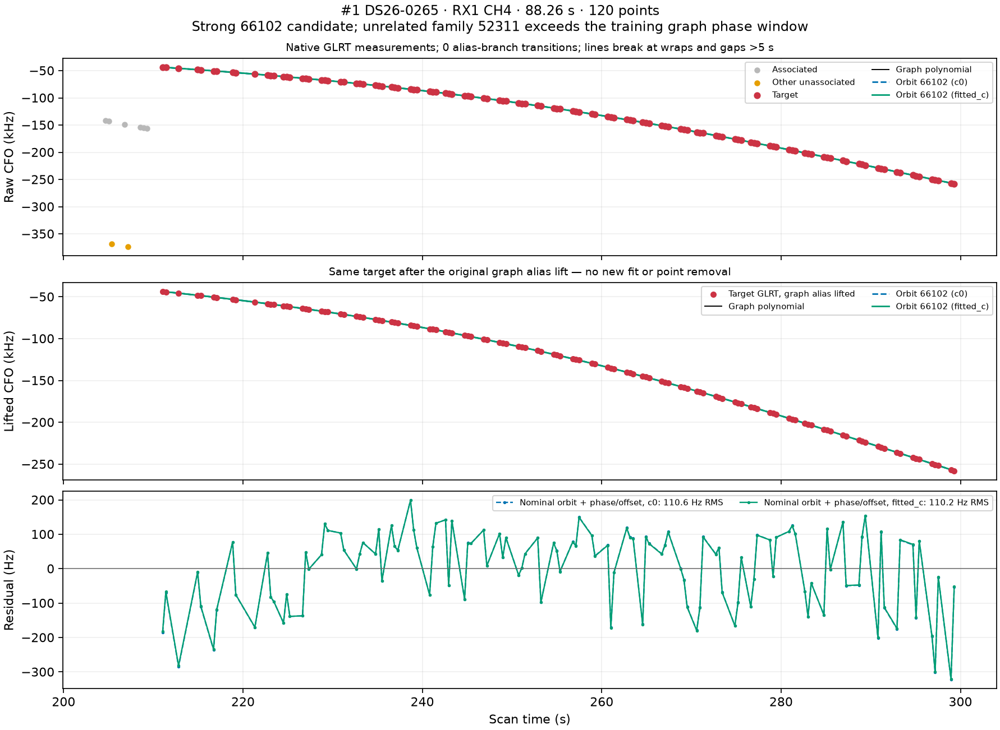
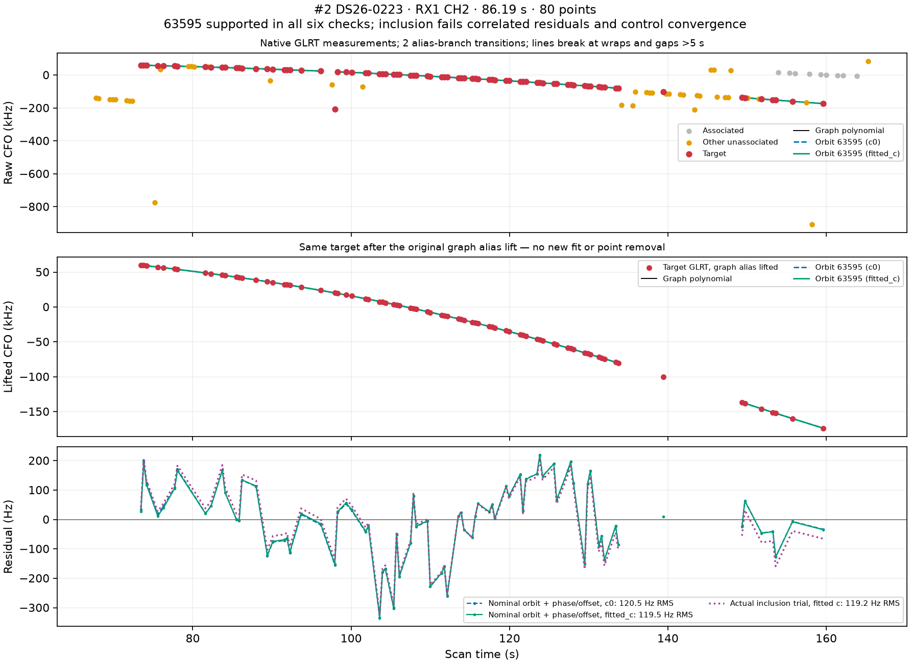
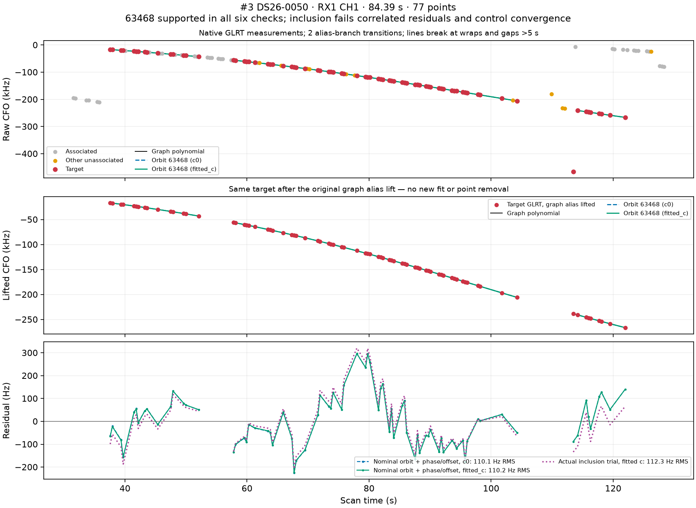
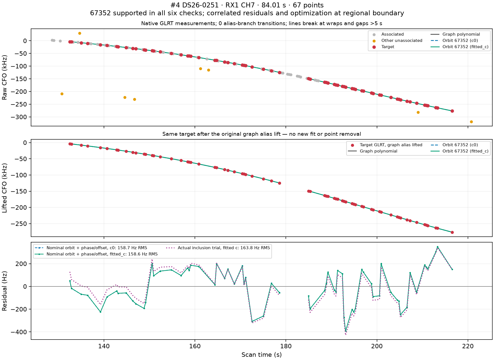
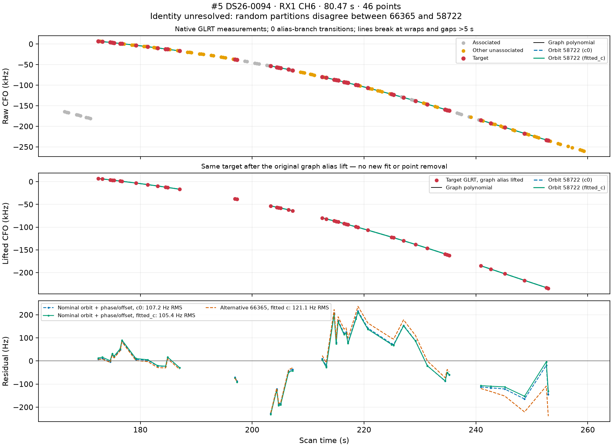
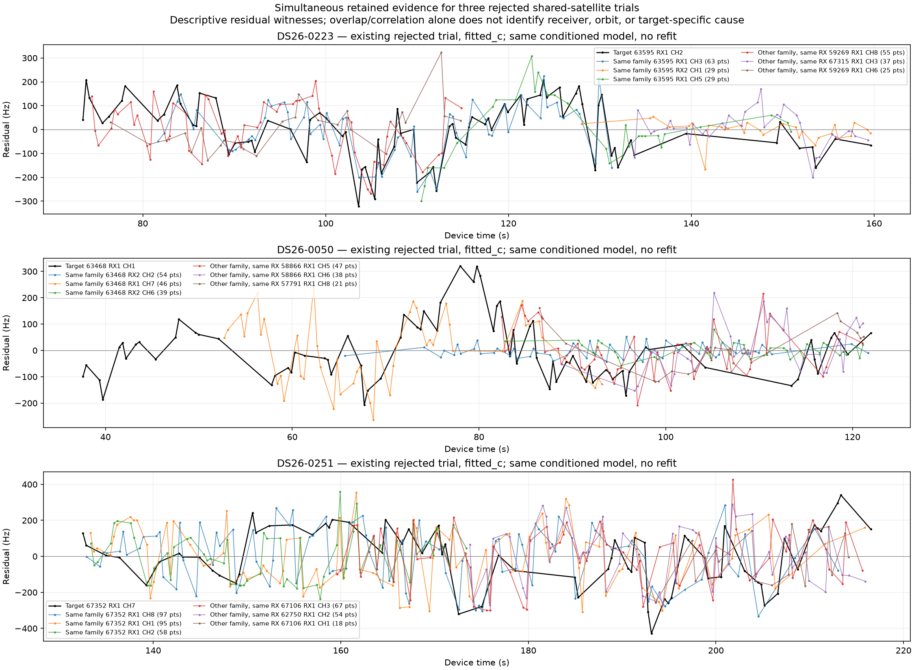

# DS26: the five longest GLRT tracks left unassociated by ALGO03

Four of the five tracks have strong conditional satellite candidates. The
fifth remains ambiguous. **All five were searched by ALGO03**: none was missed
by its eight-target limit. The blockers are an unrelated satellite's phase
boundary, correlated residuals, optimizer completion, and identity ambiguity.
This investigation changes no production association or acceptance threshold.

The most concrete new finding is DS26-0265: its 120-point CH4 track consistently
favors **STARLINK-35599 / NORAD 66102**, but the training graph's **52311**
family is clipped at a −15-second phase reference. That unrelated failure
blocks annotation of 66102. Ten extra phase-refresh rounds do not resolve it.

## Exhaustive inventory and ranking

All **159 fast DS26 entries** in the frozen ALGO03 evaluation are accounted for.
The 148 completed scans contain 19,374 graph tracks and 650,404 GLRT points.
Published ALGO03 results associate 461,708 points; 188,696 remain unassociated.
Of those, 113,195 belong to 5,451 residual graph tracks and 75,501 lie outside
the graph. There are 4,995 wholly unassociated tracks and 456 partially
associated tracks. Both published c arms have identical membership in all
148 completed scans.

The inventory subtracts **published** associated IDs, rather than extra points
in internal replay fits. This correctly retains 6,409 replay-only IDs as
unassociated. All residual timestamps and observation IDs pass duplicate checks.
Ranking uses first-to-last remaining-point duration, then point count. It does
not count interpolation across gaps as measurements.

Ten failed/unqualified scans retain 1,225 graph tracks, which were also
inspected. Their longest raw graph spans 77.641 seconds, below the fifth-ranked
80.472 seconds: even treating every point in those failed scans as unassociated
cannot change this top five. **DS26-0172 has no public GLRT input**, so its curves
cannot be examined. This is a ranking of the available evidence, not a claim
about unprocessed RF in that recording.

| Rank | Scan / receiver / channel | Scan time (s) | Span (s) | Points | Maximum gap (s) | Longest run with gaps ≤5 s |
| ---: | --- | ---: | ---: | ---: | ---: | --- |
| 1 | 0265 / RX1 / CH4 | 211.05–299.31 | 88.261 | 120 | 2.129 | 88.261 s / 120 points |
| 2 | 0223 / RX1 / CH2 | 73.45–159.64 | 86.190 | 80 | 9.933 | 60.301 s / 72 points |
| 3 | 0050 / RX1 / CH1 | 37.58–121.97 | 84.388 | 77 | 9.224 | 46.450 s / 53 points |
| 4 | 0251 / RX1 / CH7 | 132.51–216.51 | 84.006 | 67 | 6.377 | 46.076 s / 34 points |
| 5 | 0094 / RX1 / CH6 | 172.48–252.95 | 80.472 | 46 | 9.928 | 22.692 s / 19 points |

All five are wholly unassociated. The first four original graph quality flags
are `no_structure_detected`; 0094 is `insufficient_support`. Graph polynomial
RMS values are in the inventory and must not be confused with satellite RMS.
See [all residual tracks](residual_tracks.csv), [per-scan counts](per_scan.csv),
[top-ten IDs and source paths](top10.json), and the
[inventory methodology](INVENTORY.md).

## How to read the figures and satellite claims

Red points are the target; gray points are published satellite-associated
GLRT; orange points are other unassociated GLRT. The first panel uses measured
CFO. The second shows the same target with the original graph's alias lift,
so an alias branch change is not mistaken for a physical discontinuity. No
points are removed. Lines break at alias transitions or gaps greater than
five seconds. The third panel magnifies the residuals that are visually tiny
on a hundreds-of-kHz CFO plot.

Blue and green orbit curves use matched c=0 and fitted-c diagnostics. These
hold baseline receiver calibration fixed, search causal satellite trajectories
with phase and constant offset, and optionally test a small additional rate.
Purple curves, where present, are the **actual rejected pipeline inclusion
trial**, including the pipeline's orbital uncertainty model. Those trial
endpoints are not the published selected position. Nominal diagnostic residual
gates and exact pipeline gates are reported separately.

Satellite names come from the frozen causal element provenance. No future
TLE or evaluation GPS enters this investigation. Catalogue nomination searched
1,357–1,606 satellites per case, both baseline c-arm endpoints and a shared
±10 km regional grid, with phase in ±15 seconds. Exact checks use all target
points and the same nominated identities, positions, phase windows and budgets
in both c arms. Existing annotation nominees are retained as explicit
hypotheses, even if the new shortlist ranks differently. All five leading fits
are at their baseline endpoint, not a newly optimized regional position.

The random-block evidence uses three saved whole-group partitions and both c
arms, conditional on the previously selected graph and incumbent associations.
Score margins are **not identity probabilities**. A best-fitting catalogue
entry is not verified transmitter ground truth. Visibility below means above
the horizon over the target; it does not establish antenna-beam acceptance.

## 1. DS26-0265 RX1 CH4: strong 66102 hypothesis, blocked by another family

**STARLINK-35599 / 66102** wins all six partition/c-arm comparisons, with minimum
conditional score advantage **686.742**. Held target RMS is 86.18–178.42 Hz,
below the 450 Hz limit. The independent full-track nominal diagnostic gives
110.2 Hz RMS, versus 1,318.5 Hz for its nearest competing identity. The causal
TLE is 23.60 hours old at scan origin and the target remains above 32.26°.
This is a single original polynomial piece; its degree-four fit is not
independent evidence of a satellite identity.

ALGO03 records `prediction_mismatch`, but that label combines several adequacy
checks. The failed check is **training-graph phase convergence**, not target
RMS. Exact replay of all six training graphs reproduces the saved objectives
and phase histories with zero difference. In every partition and c arm, family
**52311**, an incumbent RX2 CH8 T006 curve with 20 full-data points, wants a
phase of −15.114 to −15.198 seconds. Its reference is clipped to −15 seconds.
The overflow remains 0.114–0.198 seconds versus the 0.01-second gate.

Continuing the same training models for ten extra rounds changes neither
position endpoint nor this failure. Clipped-reference movement approaches
zero, but the unclipped posterior stays out of bounds. Only 52311 is the
offender. Target 66102's own phase is −1.429 to −1.528 seconds, with zero
posterior mass at the boundary. No inclusion trial was reached, so this
diagnosis **does not establish that adding 66102 would pass the subsequent
physical or position-inclusion checks**.

The parsimonious next experiment is to isolate or robustly handle the
boundary-failing 52311 family, or test a predeclared broader phase domain with
explicit orbit-bank coverage. Repeating the same clipped optimization cannot
help. Broadening a global boundary should be validated across the corpus,
without using evaluation position to choose which family to remove.

## 2. DS26-0223 RX1 CH2: 63595, with correlated residuals

**STARLINK-33831 / 63595** wins all six identity checks; minimum margin is
**36.950**. The nominal full-track fit gives 119.5 Hz RMS, versus 173.5 Hz for
53563. Its causal TLE age is 27.15 hours and minimum elevation is 40.20°.
The original graph contains two polynomial pieces. Usable 20-second segment
checks favor 63595 throughout; there is no clear identity switch at a join.
These segment fits are descriptive, not independent validation.

The actual inclusion has **119.225 Hz** fitted-c RMS, but its whitened residual
lag-one correlation is **0.53043**, above **0.44721**. This is the only failed
physical gate in the exact replay. Both control optimizers additionally stop
with `no_accepted_damped_step`, which this worker does not certify as completion.
No incumbent points are lost and no ownership discrepancy occurs.

The residual shape is partly shared with simultaneous 63595 evidence on RX1
CH3 (descriptive correlation 0.830 over 53 unique time pairs), but also with
other satellites on the receiver. That supports investigating shared receiver
or measurement structure; it does not isolate an orbital error.

## 3. DS26-0050 RX1 CH1: 63468, including an alias-wrapped point

**STARLINK-33720 / 63468** wins all six checks, minimum margin **222.511**.
The nominal RMS is 110.2 Hz; the nearest competing identity is at 1,124.8 Hz.
The TLE age is 36.35 hours and minimum elevation is 46.60°. This track contains
two polynomial pieces. Its conspicuous native CFO point near 113.5 seconds
lies on another alias branch; the graph's existing lift places it on the
same smooth curve. The raw and lifted panels retain that point explicitly.

The actual inclusion RMS is **112.283 Hz**, but innovation correlation is
**0.68987**, versus **0.45584** allowed. The fitted-c control also lacks accepted
optimizer completion. The visible residual hump around 75–85 seconds is much
larger than the remaining c-arm difference. A small additional linear rate
changes nominal RMS only from 110.156 to 110.037 Hz.

Simultaneous same-family RX1 CH2 residuals agree strongly (0.935 over 22 unique
pairs), while RX2 CH2 does not (0.051 over 34 pairs). This makes a simple
satellite-only common discrepancy less persuasive than a receiver-dependent
effect, conditional on this fitted model. Another RX1 satellite also correlates
over a smaller overlap. More independent support is needed before adding a
receiver correction or declaring the measurement noise model wrong.

## 4. DS26-0251 RX1 CH7: 67352, plus a regional-boundary failure

**STARLINK-36479 / 67352** wins all six checks, minimum margin **95.792**.
The nominal RMS is 158.6 Hz versus 455.4 Hz for 54201. Its TLE age is 19.06 hours
and minimum elevation is 44.37°. This is a single original polynomial piece;
there is no graph join to blame. Usable 20-second fits retain 67352.

Actual inclusion RMS is **163.849 Hz**, but innovation correlation is
**0.58052**, above **0.48868**. All four control/addition c-arm fits exhaust their
iteration budget at north = −12.5 km, the regional boundary. Accepting the
identity alone would therefore not fix the localization problem. A small
additional rate barely changes nominal RMS: 158.588 to 158.051 Hz.

Simultaneous same-family evidence has mixed residual agreement, including
positive and negative correlations across tracks. There is no demonstrated
single shared satellite correction that explains this target and all retained
family evidence together. A joint challenge of incumbent associations and the
boundary solution is more appropriate than accepting a target-only correction.

## 5. DS26-0094 RX1 CH6: unresolved 66365 versus 58722

The first two random partitions favor **STARLINK-35827 / 66365**, but with
margins only 8.75–8.92, below the required 10. The third favors
**STARLINK-31040 / 58722**, with margins 13.46–13.64. The new full-track nominal
diagnostic favors 58722 at **105.4 Hz** versus **121.1 Hz** for 66365; that
in-sample preference does not resolve the contradictory validation evidence.

Both are visible: minimum elevations are 38.55° and 39.66°, with TLE ages
17.70 and 9.89 hours respectively. The 58722 residual remains structured.
The graph has two polynomial pieces and the quality flag `insufficient_support`.
Although the first-to-last span is 80.47 seconds, four gaps exceed five seconds;
the longest ≤5-second-gap run is only 22.69 seconds / 19 points.

**No unique satellite identification is justified here.** Same-family evidence
elsewhere in the scan or independently recovered GLRT peaks would be more
informative than choosing the slightly lower full-track RMS. A continuous
single-satellite join should remain a hypothesis until that evidence agrees.

## What the residual gates actually reject

| Case | Actual inclusion RMS c=0 / fitted-c (Hz) | Absolute whitened lag-one correlation c=0 / fitted-c | Allowed bound |
| --- | ---: | ---: | ---: |
| 0223 | 120.515 / 119.225 | 0.53950 / 0.53043 | 0.44721 |
| 0050 | 112.232 / 112.283 | 0.68948 / 0.68987 | 0.45584 |
| 0251 | 164.055 / 163.849 | 0.58155 / 0.58052 | 0.48868 |

The bound is 4/√n. Values above come from the exact replay's recorded gate
slack, rather than conflating raw-residual correlation with whitened-innovation
correlation. Other physical gates, incumbent consistency and ownership checks
pass in those exact replays. Optimizer completion remains a separate blocker.
Both c arms show essentially the same problems. Lower frequency-fit RMS here
does not establish lower position error; no new position accuracy is claimed.

The fifth ambiguity and the 0265 phase boundary also survive both c arms.
The uniform extra-rate diagnostic uses a 0.5 Hz/s prior and changes leading
RMS by at most 0.54 Hz across these five tracks. This does not rule out more
specific shared receiver or measurement dynamics; it rules out this particular
small linear-rate correction as an adequate standalone remedy.

Witness plots replay the actual three shared-family inclusion objectives
exactly, without fitting new corrections. Correlations use greedy closest-time
**one-to-one** matches within 0.5 seconds, with each observation used at most
once per target/witness pair. Fewer than eight pairs yields no correlation.
These are postselected descriptive diagnostics, not significance tests or
proof of receiver/orbit causation. Older many-to-one witness figures in the
research workspace are superseded and are not used in this report.

## Reproducibility, limitations and next experiments

The source is the frozen
[DS23/DS24/DS26 evaluation](../2026_10_30_algo03_fast_full_evaluation/README.md),
not a new production backfill. Production ALGO03 remains unchanged. All 761
inventory source hashes and the full observation-level ledger are retained in
`inventory.json.gz`; sealed terminal hashes were verified against the original
candidate inventory. Saved residuals, exact competitor fits, split assignments,
source receipts and the 0265 continuation experiment are in `evidence/`.

Research scripts and their definition tests are included in `reproduce/`.
They expect the existing corpus paths recorded in the evidence, and the
repository's numerical environment with `PYTHONPATH=src:tools`. Inventory
tests cover exact published membership, partial tracks, duration and gap logic;
diagnostic tests cover residual masking, native-coordinate predictions, alias
breaks and unique witness pairing. Eight tests pass. Five bounded final orbit
jobs complete successfully, with a 420-second ceiling per job, at most four
workers and numerical-library threads limited to one. Two preliminary harness
errors were corrected and retained in the study logs; no failed run supplies
the final numerical evidence. Display-only alias-break refinements are
postprocessing and do not change the saved fits.

Recommended order of experiments:

1. Test a general policy for a boundary-failing incumbent such as 52311, then
   rerun the complete matched identity/inclusion checks for 66102. Keep the
   target out of receiver calibration until it independently qualifies.
2. For 63595 and 63468, test independently supported receiver/measurement
   covariance or time-dependent corrections against other families and both
   receivers. Do not merely widen the correlation gate.
3. For 67352, diagnose the shared regional-boundary solution and its incumbent
   families before trying a local target repair.
4. Leave 0094 unresolved while seeking independent evidence to distinguish
   66365 and 58722. Do not select a label using evaluation GPS.

All five ranked tracks total 390 points, but that is **potential evidence,
not credited recovery**. No new associations or position improvements are
claimed by this report.
