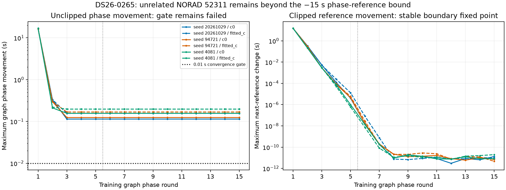

# Frozen ALGO03 rejection audit

All five longest remaining tracks were actually assessed by ALGO03. None was omitted by its eight-target limit or discovery budget. This audit reads frozen decisions, three randomized whole-block partitions, both matched c arms, inclusion trials, and exact orbit/owner replays. It changes no inference decision or source data. `audit.json` retains every tested candidate's compact fold diagnostics, exact failed gate slack ranges, trial completion checks, and SHA-256 source receipts.

| Track | Preferred conditional identity | Why it remained unassociated |
|---|---|---|
| DS26-0265, 120 points / 88.261 s | NORAD 66102 wins all six fold/arm comparisons; minimum score margin 686.742 | Training graph phase-refresh convergence fails in every comparison: 0.1141–0.1976 s versus 0.01 s. Held target RMS is only 86.18–178.42 Hz and elevation exceeds 32.24°. No inclusion trial ran. |
| DS26-0223, 80 / 86.190 s | NORAD 63595 wins all six; minimum margin 36.950 | Shared-family inclusion fails target residual lag-1 noise gate in both arms; control optimizers also stop with `no_accepted_damped_step`, which the worker does not accept as completion. |
| DS26-0050, 77 / 84.388 s | NORAD 63468 wins all six; minimum margin 222.511 | Shared-family inclusion fails target lag-1 gate in both arms; fitted-c control also stops with `no_accepted_damped_step`. |
| DS26-0251, 67 / 84.006 s | NORAD 67352 wins all six; minimum margin 95.792 | Shared-family inclusion fails target lag-1 gate in both arms. All control/addition optimizers stop at the iteration budget with north = −12.5 km, the regional box boundary. |
| DS26-0094, 46 / 80.472 s | Unresolved between NORAD 66365 and 58722 | First two partitions favor 66365 in both c arms with margins 8.75–8.92, below the required 10. Third favors 58722 with margins 13.46–13.64. No inclusion trial ran. |

These are conditional catalogue rankings given the frozen graph, incumbent identities and bounded competitor search. They do not establish satellite ground truth or calibrated identity probabilities. For 0265, the policy label `prediction_mismatch` conflates graph phase convergence with target prediction adequacy; the target frequency RMS itself passes.

A bounded continuation diagnoses 0265 more precisely. Exact reconstruction from the recorded five training endpoints reproduces every phase movement and training objective (objective difference exactly zero for all six fold/arm graphs). The offending family is **NORAD 52311**, a different graph family from target 66102: reference −15 s, actual phase −15.114089 to −15.197624 s. Its full-data incumbent support is `SCAN-RX2-CH8-T006-RF12459687500.000000`, 20 points. Target 66102's saved predictive phase is safely inside the box, −1.429 to −1.528 s, with zero boundary mass. No other family exceeds the phase movement gate; the second-largest movement at original round five is at most 1.30e-5 s.

Ten extra rounds per fold/arm, using the unchanged masks, priors, solver and bounds, complete in **30.13 s**. All six endpoints stay fixed, the 52311 excess remains 0.114089–0.197624 s, and clipped-reference movement falls to 4.7e-12–2.0e-11 s. This is a stable phase-reference boundary fixed point, not oscillation or a five-round truncation. No extra target score comparison is authorized by these graphs because the phase gate never passes. Frozen identity/inclusion decisions remain unchanged. Full traces are in `0265-continuation.json`, compact results in `0265-continuation-summary.json`, and the trajectories are shown below.

The three rejected inclusion trials have low profile RMS but correlated whitened residual innovations:

| Track | Profile RMS c0 / fitted-c, Hz | Absolute innovation lag-1 ACF c0 / fitted-c | Required ACF bound |
|---|---:|---:|---:|
| 0223 | 120.515 / 119.225 | 0.53950 / 0.53043 | 0.44721 |
| 0050 | 112.232 / 112.283 | 0.68948 / 0.68987 | 0.45584 |
| 0251 | 164.055 / 163.849 | 0.58155 / 0.58052 | 0.48868 |

The ACF values are reconstructed from exact replay's recorded `lag1` slack, `1 − |ACF|/(4/√n)`, with less than 6e-7 variation across family-orbit replacements. The only negative physical gate in any of these exact replays is the target's linear lag-1 gate. Incumbent curved gates, alias, bias, elevation, remaining noise gates and phase checks pass; there are zero incumbent/control ownership changes and zero lost points. Receiver coefficient change is zero. Correlation is evidence of model discrepancy or dependent residual structure; this audit does not identify its physical cause or prove a wrong satellite.

All c0/fitted-c comparisons use the same observations, partitions, candidate identities, priors and search budget. The fitted-c arm neither resolves 0094's identity ambiguity nor repairs the other gate failures. These frequency scores and fit diagnostics do not establish better localization; no geographic accuracy claim is made. ALGO03's numerical retry handles only new-family failures, so these shared-family rejections receive no automatic Powell retry.

The actual pipeline residual curves for 0223, 0050 and 0251 are available in each target's `trial/target_0.json`, under `arms[arm].target_diagnostics[0]`: `times_s`, `CFO_hz`, `predicted_CFO_hz`, `residual_hz`, `RMS_hz`, `bias_hz`. Their frozen full paths and source hashes are retained in `audit.json`. The trial endpoint is an individually rejected alternative, not the published selected scan endpoint.

Policy source: frozen `runtime-candidate/tools/algo03_shadow_worker.py`, `annotate_predictive_only.py`, `include_predictive_annotations.py`, `audit_shared_predictive_inclusion.py`; identity consensus in `src/leo/analysis/research/grouped_prediction.py`; physical residual gates in `probe_ds23_frequency_events.py` and `probe_algo03_feasible_recovery.py`.
