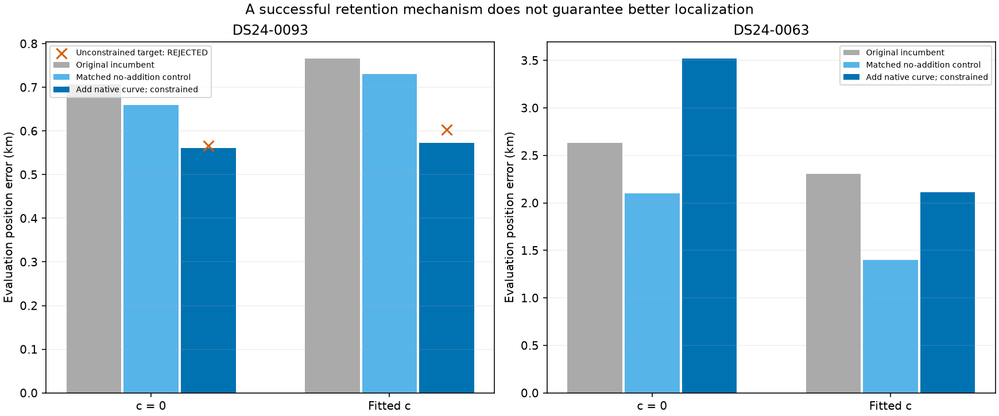
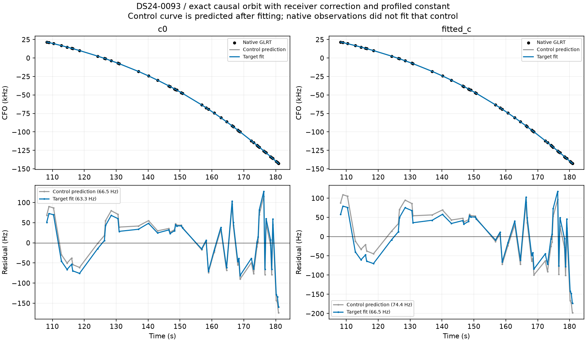
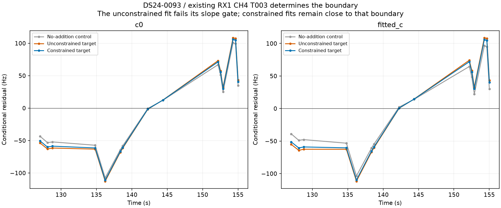
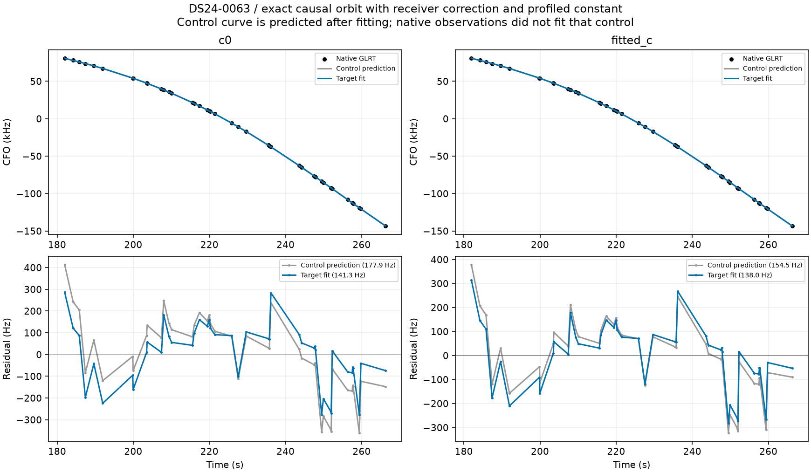
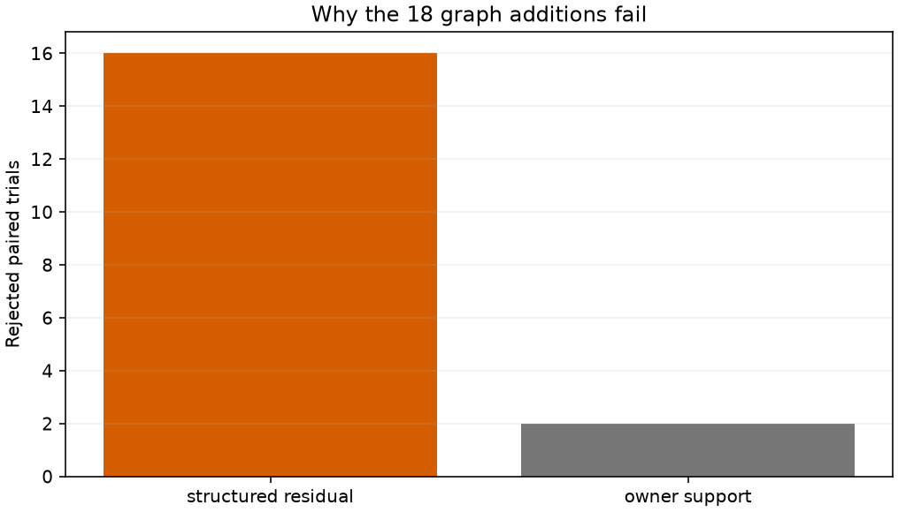

# Explicit shared phase: retaining native curves through position fitting

The constrained explicit-phase prototype retains DS24-0093's **49 native points** without losing any old association, and improves error relative to its matched no-addition control: **0.660 → 0.561 km (c=0)** and **0.731 → 0.572 km (fitted c)**. Exact orbit replay confirms every gate still passes. The unconstrained version fails the old RX1 CH4 T003 slope gate in both arms.

The contrast case prevents a general promotion: DS24-0063 retains **44 native points** and also passes exact gates, but worsens error relative to its matched control: **2.103 → 3.520 km (c=0)** and **1.401 → 2.115 km (fitted c)**. The same acceptance rule qualifies both cases. Selecting only the favorable GPS result would be evaluation leakage. Neither case changes the accepted cohort policy or production in this iteration.

This follows the [fixed-position shared-phase experiment](../2026_10_30_shared_phase_feasibility/README.md). DS24-0093 tests the identified optimizer limitation; DS24-0063 was chosen as the contrasting, previously investigated receiver/phase case before inspecting this trial's error.

## Matched results and point accounting

| scan | constrained | arm | passes | incumbent_error_km | control_error_km | target_error_km | position_shift_km | added | lost | before_associated_percent | after_associated_percent |
| --- | --- | --- | --- | --- | --- | --- | --- | --- | --- | --- | --- |
| DS24-0093 | False | c0 | False | 0.707 | 0.661 | 0.566 | 0.102 | 49 | 0 | 86.111 | 87.158 |
| DS24-0093 | False | fitted_c | False | 0.766 | 0.731 | 0.603 | 0.140 | 49 | 0 | 86.111 | 87.158 |
| DS24-0093 | True | c0 | True | 0.707 | 0.660 | 0.561 | 0.103 | 49 | 0 | 86.111 | 87.158 |
| DS24-0093 | True | fitted_c | True | 0.766 | 0.731 | 0.572 | 0.167 | 49 | 0 | 86.111 | 87.158 |
| DS24-0063 | True | c0 | True | 2.633 | 2.103 | 3.520 | 1.754 | 44 | 0 | 63.745 | 66.830 |
| DS24-0063 | True | fitted_c | True | 2.304 | 1.401 | 2.115 | 0.891 | 44 | 0 | 63.745 | 66.830 |

All rows retain the same causal identity hypotheses and original observations. Candidate counts in rejected unconstrained rows are provisional. The qualified constrained candidates change DS24-0093 from **4,030/4,680 (86.11%) to 4,079/4,680 (87.16%)**, and DS24-0063 from **909/1,426 (63.74%) to 953/1,426 (66.83%)**. These candidate points are not silently added to the retained research-policy totals. There were no earlier accepted native additions for these two scans in the latest 93-scan accounting. [Complete candidate IDs and ownership](candidate_memberships.json.gz) make the two proposals reviewable.

“Incumbent” is the previous accepted model. “Control” uses this new conditional model but adds no native observations. The distinction matters: changing the model alone moves DS24-0063 substantially. Comparing only the fitted-c incumbent (2.304 km) to the target (2.115 km) would conceal that adding the target actually worsens its matched 1.401 km control. Frequency fit and position accuracy are reported separately; there is no full-cohort performance claim from two cases.



## The model and what changed

The previous solver optimized position while setting satellite nuisance variables to posterior means. The new research solver exposes one **existing** shared satellite phase as a third optimizer coordinate, alongside east and north. It reconciles correlated existing fragment constants. Receiver coefficients, physical orbit coefficients and other satellites remain at their curved-data posterior means **at each position**. They can change as position changes, but native points do not directly recalibrate them at a fixed position. The independent exact replay reports receiver-coordinate changes of exactly zero.

Let `G` be the local curved-data Gaussian posterior precision, with Gamma noise precisions fixed at that position. Partition the free coordinates into phase `p` and this family's old fragment constants `B`, conditioning all remaining coordinates at their posterior means. Eliminating the correlated constants gives:

```text
Q = G_pp - G_pB inv(G_BB) G_Bp
delta_B = -inv(G_BB) G_Bp delta_p
-2 log phase_density = Q * delta_p^2 - log(Q) + log(2*pi)
```

The phase coordinate above is normalized by its existing prior scale. Predictive curves retain variance `2*sigma^2` and a correlated 300 Hz constant per curve. Their constants are integrated. The objective is the curved-data ELBO plus the **normalized conditional phase density** plus predictive density. Including `-log(Q)` matters because precision changes with position. A numerical integration test verifies that integrating the explicit phase recovers the matching conditional Gaussian predictive density.

This changes predictive uncertainty by conditioning excluded posterior coordinates rather than integrating them; it is an empirical conditional model, not the unchanged original Bayesian marginal likelihood. No prior widths, thresholds, polynomial degrees or orbital modes are added. Its scalar objective is authoritative; the legacy residual vector is explicitly not a factorization of that objective and is never used for Gauss–Newton optimization.

## Search, constraints and exact replay

Each control and target starts at the same accepted RF-only incumbent in the original 25 × 25 km box. A fixed 81-point phase initialization grid covers ±0.2 seconds around that incumbent phase, clipped to the existing ±15-second phase bounds. Both versions then use five phase-refresh rounds with at most 48 SLSQP iterations per round. Phase is scaled so the finite-difference step is 0.0001 seconds, while position steps are 0.001 km. This is a bounded local continuation, not a fresh cold-start catalogue or global localization search.

The constrained version includes every original profile, conditional-residual, alias, elevation, orbital-support and predictive gate. The unconstrained control uses the same objective and budgets without gate constraints. Final qualification additionally requires both c arms, phase-refresh agreement, exact shared-orbit replay and retention of every previously associated point. Objectives rebuild to 1e-5. A separate exact-orbit gate audit retains all fitted coefficients, substitutes the physical family orbit, and checks every gate again. The boundary passes remain narrow: this is mathematical compatibility under current checks, not proof of white noise or correct identity.

| scan | role | arm | paired_valid | error_km | native_RMS_hz | minimum_slack | exact_maximum_difference_hz | phase_refresh_change_s |
| --- | --- | --- | --- | --- | --- | --- | --- | --- |
| DS24-0093 | control | c0 | True | 0.661 | 66.500 | 0.065 | 0.000 | 0.000 |
| DS24-0093 | target | c0 | False | 0.566 | 62.504 | -0.036 | 0.000 | 0.001 |
| DS24-0093 | control | fitted_c | True | 0.731 | 74.349 | 0.043 | 0.000 | 0.000 |
| DS24-0093 | target | fitted_c | False | 0.603 | 65.087 | -0.043 | 0.000 | 0.001 |
| DS24-0093 | control | c0 | True | 0.660 | 66.493 | 0.065 | 0.000 | 0.000 |
| DS24-0093 | target | c0 | True | 0.561 | 63.296 | 0.000 | 0.000 | 0.001 |
| DS24-0093 | control | fitted_c | True | 0.731 | 74.354 | 0.043 | 0.000 | 0.000 |
| DS24-0093 | target | fitted_c | True | 0.572 | 66.487 | 0.000 | 0.000 | 0.000 |
| DS24-0063 | control | c0 | True | 2.103 | 177.859 | 0.001 | 0.001 | 0.000 |
| DS24-0063 | target | c0 | True | 3.520 | 141.253 | 0.000 | 0.000 | 0.000 |
| DS24-0063 | control | fitted_c | True | 1.401 | 154.504 | 0.030 | 0.000 | 0.000 |
| DS24-0063 | target | fitted_c | True | 2.115 | 138.010 | 0.022 | 0.000 | 0.000 |

The table includes the unconstrained DS24-0093 run as well as both constrained cases; [trial CSV](trial_results.csv) retains the unambiguous run identifier. [All exact gate slacks](exact_gate_slacks.csv) preserve the rejected results too. Incumbent membership is independently rebuilt, and every old point's satellite ownership is compared. Both constrained candidates preserve all old owners. The rejected unconstrained DS24-0093 target loses valid satellite ownership for 15 old points in each c arm (NORAD 58189 to unassigned), despite retaining their IDs in provisional counts. Point-count retention alone would miss that loss; these rejected counts are not accepted associations.

## DS24-0093: an optimizer limitation with a useful recovery

The unconstrained objective prefers a phase just beyond the old T003 slope threshold. Allowing phase to move independently lets the constrained optimizer choose a nearby phase and position that retain both the original curve and the recovered 49-point curve. No points are truncated or discarded.





The earlier randomized block experiment improved the native held RMS in six of six comparisons, but old same-family held RMS improved in only four. That experiment held position fixed after training-only calibration. It therefore does not independently validate the new three-coordinate position update or establish a false-association rate.

## DS24-0063: a passing recovery that pulls position the wrong way

The second case passes all current gates but makes a much larger position update and worsens error against its matched control. Its improved native fit is insufficient evidence that the added curve constrains the correct location. The causal ID remains a conditionally supported hypothesis; these results alone cannot distinguish residual orbital error, receiver-model error, a mistaken identity or biased nuisance/position tradeoffs.



[All old family residuals](family_gallery.md) show what the two recoveries cost the existing curves. A large position displacement is a possible RF-only diagnostic to investigate, not a cutoff justified by these two GPS outcomes. Do not tune a rejection threshold to retain DS24-0093 and exclude DS24-0063.

## Inventory progress and every graph inclusion failure

The original graph inventory advances from **868 to 900/1,630** assessed tracks. All 32 executions in this batch finish; classifications are `{'conditionally_supported_identity': 17, 'ambiguous_identity': 6, 'unstable_identity': 8, 'prediction_mismatch': 1}`. A supported identity here is conditional on the graph and candidate search, not verified satellite truth.

All 18 supported graph identities from the preceding batch receive matched original-model position trials. **None passes in both c arms.** Replayed failures classify as `{'structured residual': 16, 'owner support': 2}`. Residual-structure failures and missing independent receiver/channel support are distinct bottlenecks; neither is repaired by reporting a lower RMS alone. No graph points are counted as recovered in this batch.



[All 18 GLRT/orbit/residual plots](graph_gallery.md), [all graph trials](graph_trials.csv), [all gate failures](graph_gate_failures.csv), [updated ledger](annotation_ledger.csv), and [batch classifications](annotation_batch.csv).

## Next test and validation status

The next useful test is training-only position-and-phase fitting followed by prediction of withheld evidence from **other satellite families**, not merely the added curve at a fixed position. Keep random whole scan-wide blocks and guards, matched c arms, original priors, and every failed result. This tests whether a target-driven position change improves independent geometric evidence. Separately continue the inventory and causal identity alternatives for structured graph failures. No new ALGO promotion is justified by this two-case result.

Thirteen targeted tests pass for phase density normalization, exact Gaussian integration, conditional bias reconciliation, native position fitting and fixed-phase helpers. The on-disk endpoint audits cover all 12 control/target c-arm fits. GPS is evaluation-only; no future TLEs or RF collection are used. No production or retained cohort policy changes occur.

[Summary](summary.json), [source hashes](sources.json), [compact numerical evidence](evidence.json.gz).
