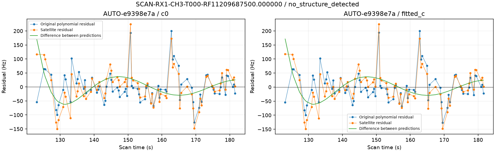
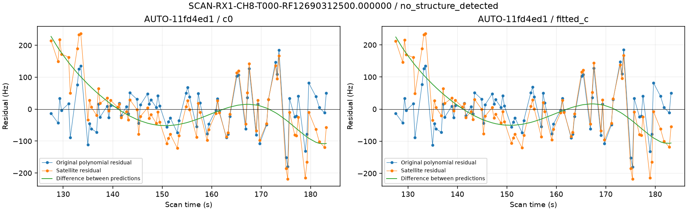
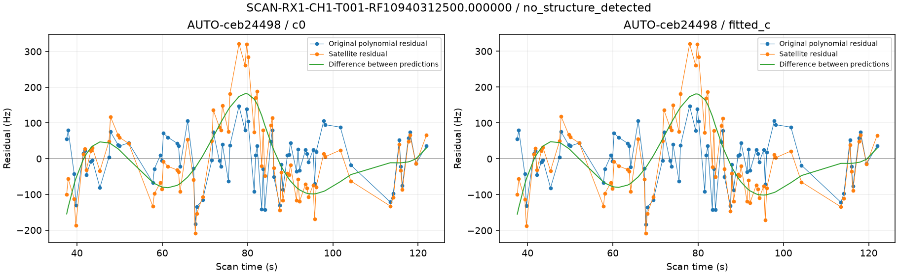
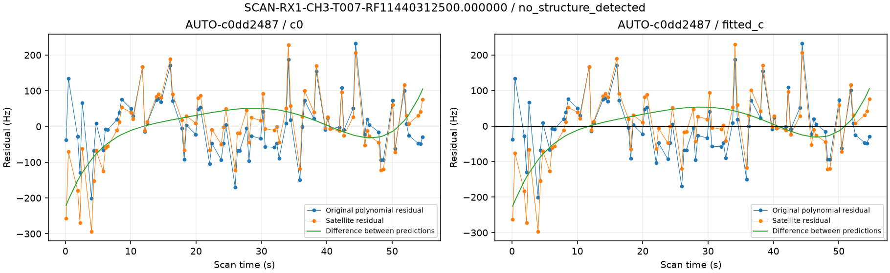
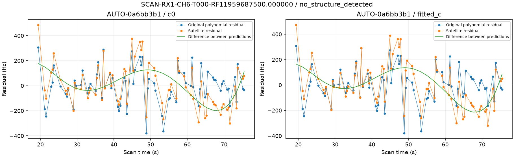
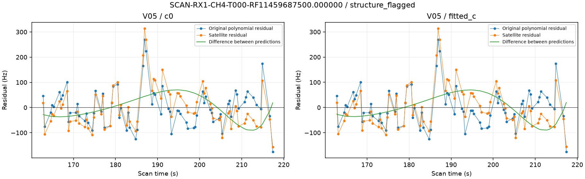
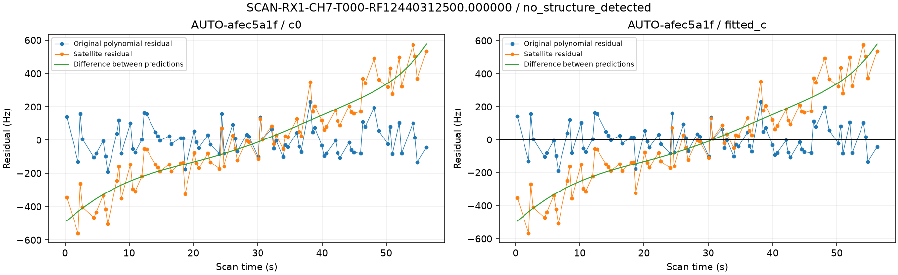

# Are new recovery failures already present in the graph measurements?

All supported identities in the third reassessment batch were audited, including every failed inclusion. The original graph polynomials are replayed on their exact point sets without refitting or deleting points. Differences between polynomial and satellite predictions help prioritize measurement versus physical-model investigations; they do not prove either cause.

| scan | component | points | pieces | degrees | graph_quality | polynomial_RMS_hz | orbit_RMS_hz | polynomial_orbit_correlation | model_gap_centered_RMS_hz |
| --- | --- | --- | --- | --- | --- | --- | --- | --- | --- |
| AUTO-e9398e7a | SCAN-RX1-CH3-T000-RF11209687500.000000 | 79 | 1 | 4 | no_structure_detected | 54.166 | 62.712 | 0.832 | 34.812 |
| AUTO-11fd4ed1 | SCAN-RX1-CH8-T000-RF12690312500.000000 | 78 | 1 | 4 | no_structure_detected | 68.478 | 97.666 | 0.712 | 68.575 |
| AUTO-ceb24498 | SCAN-RX1-CH1-T001-RF10940312500.000000 | 77 | 2 | 2 3 | no_structure_detected | 70.646 | 112.283 | 0.658 | 84.626 |
| AUTO-c0dd2487 | SCAN-RX1-CH3-T007-RF11440312500.000000 | 77 | 1 | 3 | no_structure_detected | 79.629 | 96.930 | 0.782 | 60.594 |
| AUTO-0a6bb3b1 | SCAN-RX1-CH6-T000-RF11959687500.000000 | 77 | 1 | 4 | no_structure_detected | 138.817 | 171.933 | 0.770 | 109.990 |
| V05 | SCAN-RX1-CH4-T000-RF11459687500.000000 | 77 | 1 | 4 | structure_flagged | 74.353 | 82.257 | 0.832 | 45.954 |
| AUTO-afec5a1f | SCAN-RX1-CH7-T000-RF12440312500.000000 | 77 | 1 | 4 | no_structure_detected | 87.979 | 265.354 | 0.326 | 250.865 |

The polynomial fits use these same observations and can absorb smooth receiver/orbit mismatch or source mixing. A low polynomial residual is not independent validation, and a multi-piece graph is not proof of an incorrect join. Every arm and source hash is preserved in [result.json](result.json). This audit changes no position, model or acceptance decision.
