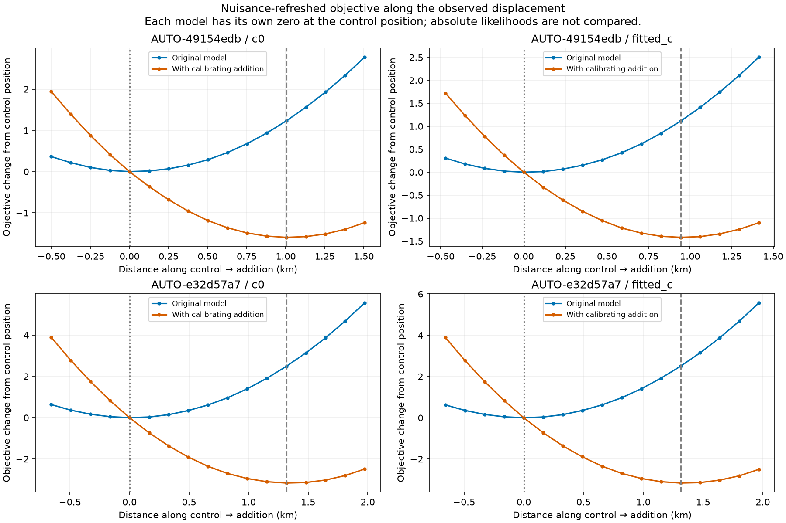
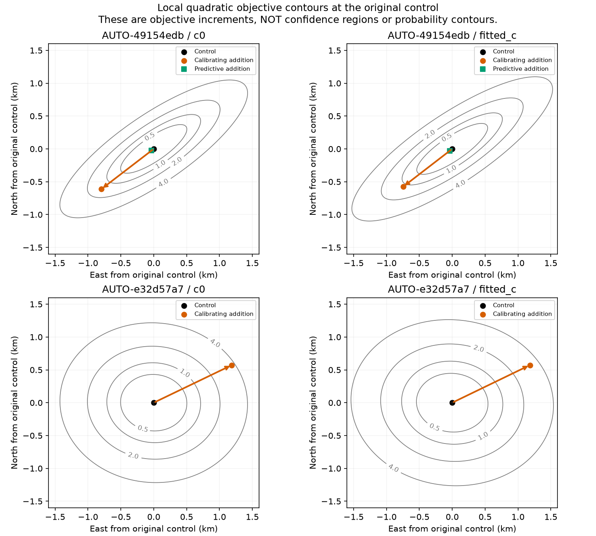
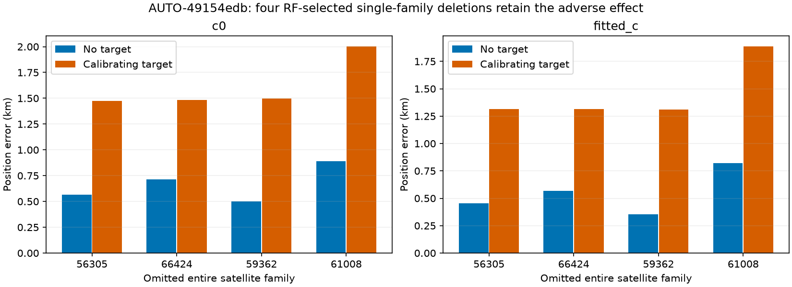
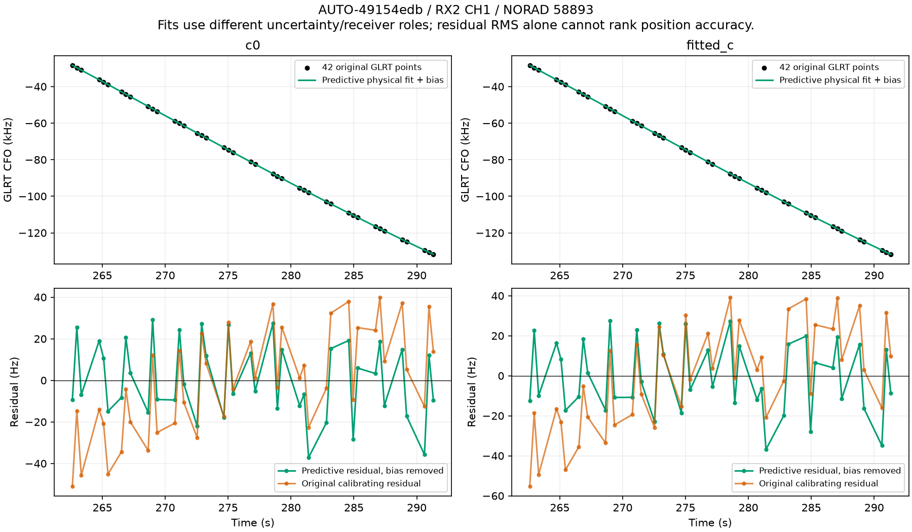
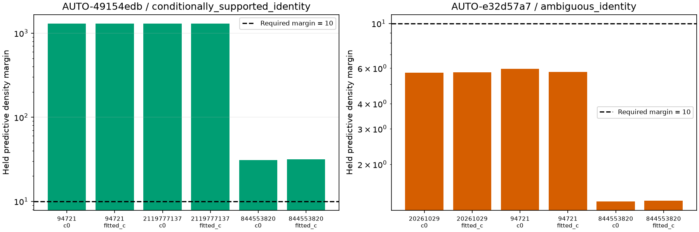

# Recovering a curve without over-weighting its positional information

The AUTO-49154edb 42-point RX2 CH1 curve remains conditionally supported as **NORAD 58893** under a fresh causal predictive search. Giving it a physical-orbit and receiver-uncertainty likelihood, while keeping it out of receiver calibration at a fixed position, recovers all 42 points with fitted-c position error **0.589 km**. The earlier calibrating addition gave **1.465 km**; the matched no-addition predictive control gives **0.548 km**. This mitigates an adverse position shift; it does **not** improve the no-addition baseline. Neither model is promoted here.

The contrasting AUTO-e32d57a7 recovery previously improved error substantially, but the predictive test cannot distinguish its preferred NORAD 67634 from 66322 strongly enough. That trial stops before inclusion. A good GPS outcome is not permission to accept a weak satellite identity.

## Experimental scope

These two diagnostic cases were selected because their previously reported position effects contrasted. GPS is used for evaluation and that declared diagnostic selection only, never candidate nomination, optimization or parameter tuning. Both use causal catalogues, a 25 × 25 km regional box centered at **37.906, −122.545**, and center-start position fits. Evaluation site: **37.849061591561885, −122.48574968092912**. Every trial includes matched c=0/fitted-c arms; candidate sets, observations, other priors and budgets match within that ablation.

The fresh annotation holds out random whole scan-wide **12-second blocks with 2-second guards**, with three distinct timestamp-selected target partitions. Simultaneous receiver/channel evidence shares each block assignment. The target never calibrates the receiver. Training uses fixed 150 Hz noise and unit powers, five rounds of 48 position steps, and the existing physical prior. Incumbent identities and graph construction remain fixed conditioning assumptions. Position and learned noise-precision uncertainty are not integrated: this is conditional predictive evidence, not calibrated satellite probability or an independent replication.

## The regressing fit moves in a weakly constrained direction

At frozen satellite identities, we refit nuisance quantities for five raw-checked phase-reference rounds at each of 17 positions along the original control-to-addition line. Finite differences at ±25 m estimate local objective curvature at the control endpoint. This is not a 2D full-pipeline restart grid, and it does not search new associations. Recorded source objectives replay within 1e-5.

| scan | arm | shift_km | weak_alignment | weak_curvature | strong_curvature | control_cost | addition_gain |
| --- | --- | --- | --- | --- | --- | --- | --- |
| AUTO-49154edb | c0 | 1.004 | 0.999 | 2.788 | 29.691 | 1.230 | 1.594 |
| AUTO-49154edb | fitted_c | 0.943 | 0.998 | 2.451 | 29.236 | 1.112 | 1.418 |
| AUTO-e32d57a7 | c0 | 1.316 | 0.867 | 3.925 | 5.418 | 2.484 | 3.161 |
| AUTO-e32d57a7 | fitted_c | 1.312 | 0.856 | 3.364 | 5.025 | 2.499 | 3.163 |

In AUTO-49154edb, the ~1 km shift aligns **0.998** with the weakest direction. The original model pays only **1.1–1.2 objective units** for moving there. The curvature ratio is about 11–12, compared with about 1.4–1.5 in the contrasting scan. This supports a position/nuisance tradeoff under this conditional model; it does not establish the global surface, prove the original position correct, or identify a unique physical hardware error. The plotted ellipses are local quadratic objective increments, not calibrated confidence regions.

NORAD 58893 has no other active calibration evidence. In the calibrating addition its phase is ~1.9 s with a 15 s prior width, but the singleton support policy supplies no physical orbit modes. The curve's nominal point noise is ~62 Hz, power 0.2, and fitted precision ~2.0. Low pointwise RMS therefore coexists with a strong positional pull. Receiver frequency means change by up to ~62 Hz and rates by ~1.35 Hz/s across old curves; these are model tradeoffs, not independently measured receiver drift.

## Four single-family deletions do not explain away the regression

We rank incumbent families by the absolute change in grouped weighted residual energy, summed across c arms, and delete the top four one at a time. No GPS error enters this ranking. Both curved and predictive observations of the selected family are removed from control and addition. Other observations, priors and five × 48-step budgets remain matched. Weighted residual energy is a diagnostic contribution, not the complete ELBO decomposition.

| omitted_norad | arm | control_error_km | addition_error_km | control_pass | addition_pass | remaining_old_points_lost |
| --- | --- | --- | --- | --- | --- | --- |
| 56305 | c0 | 0.566 | 1.476 | True | True | 0 |
| 56305 | fitted_c | 0.454 | 1.317 | True | True | 0 |
| 66424 | c0 | 0.714 | 1.484 | True | True | 0 |
| 66424 | fitted_c | 0.568 | 1.315 | True | True | 0 |
| 59362 | c0 | 0.498 | 1.499 | True | True | 0 |
| 59362 | fitted_c | 0.355 | 1.308 | True | True | 0 |
| 61008 | c0 | 0.890 | 2.003 | True | True | 0 |
| 61008 | fitted_c | 0.820 | 1.888 | True | True | 0 |

All four deletions retain the adverse effect in both arms; no remaining incumbent points are lost. Thus no one of these four families explains it. This does not rule out other families, multiple simultaneous mistakes, or a shared model bias. These are diagnostic fits, not accepted satellite deletions.

## Uncertainty-aware predictive recovery

The target's likelihood integrates shared receiver-coefficient uncertainty, conditioned once on existing predictive evidence, and three physical orbital modes. It integrates satellite phase on the existing ±15 s box rather than treating one fitted phase as exact. At fixed position it does not update receiver calibration; it still affects position, which can indirectly change the incumbent receiver fit. The family is eligible because its graph label has no active calibration or predictive observations.

The causal prior uses mean phase -0.000 s and width 15.000 s. Latest causal TLE age is 33.31 hours; the previous causal epoch gap is 7.82 hours. Historical disagreement gives radial/cross scales about **1.500 / 0.080 km**, mean-motion sigma **0.00505 rev/day**, inclination **0.000673°**, and RAAN **0.000841°**. The existing phase box contains **68.27%** of the Gaussian prior mass; this truncation is explicitly retained, not presented as full-prior integration. Target phase boundary mass is zero numerically. Existing predictive noise also includes a 300 Hz track-bias prior and twice nominal independent variance.

| method | arm | error_km | associated_points | associated_percent | added_points | lost_points | paired_gates |
| --- | --- | --- | --- | --- | --- | --- | --- |
| Original control | c0 | 0.665 | 3420 | 73.786 | 0 | 0 | True |
| Original control | fitted_c | 0.547 | 3420 | 73.786 | 0 | 0 | True |
| Calibrating addition | c0 | 1.638 | 3493 | 75.361 | 73 | 0 | True |
| Calibrating addition | fitted_c | 1.465 | 3493 | 75.361 | 73 | 0 | True |
| Predictive control | c0 | 0.666 | 3420 | 73.786 | 0 | 0 | True |
| Predictive control | fitted_c | 0.548 | 3420 | 73.786 | 0 | 0 | True |
| Predictive addition | c0 | 0.703 | 3462 | 74.693 | 42 | 0 | True |
| Predictive addition | fitted_c | 0.589 | 3462 | 74.693 | 42 | 0 | True |

The calibrating addition associates **73** extra points, including **31 incidental points elsewhere**; the predictive addition recovers only the **42 target points**. These are not identical associated sets across methods. Each method has its own refitted no-addition control. Full-data point noise/weights are retained within each method; fresh annotation has its separate fixed-noise validation policy. Absolute objective values and RMS must not be directly ranked across these changed likelihoods.

| arm | phase_map_s | RMS_hz | continuous_phase_s | continuous_RMS_hz | minimum_elevation_deg | noise_screen_pass |
| --- | --- | --- | --- | --- | --- | --- |
| c0 | 1.900 | 18.008 | 1.869 | 17.838 | 66.669 | True |
| fitted_c | 1.900 | 17.817 | 1.901 | 17.825 | 66.674 | True |

The target passes mean, slope, curvature, discontinuity and lag-one residual screens. A post-fit 0.1/0.05/0.025-second phase-grid comparison at the endpoint and ±25 m neighbors passes the existing local agreement guard in both arms. A separate replay reproduces objectives and memberships, preserves all incumbent and control satellite owners, and passes gates with each incumbent family's exact orbit substituted one at a time. The largest incumbent tangent/exact difference is below **0.002 Hz**. Continuously refining the target phase preserves its gates and ~18 Hz RMS. This replay does not refit position or change acceptance. The uncertainty-aware recovery is an RF-qualified research candidate, not a production deployment.

Several things change together relative to direct calibration: receiver role, physical orbit uncertainty, target noise/bias treatment and marginalization. This comparison does **not** isolate which one removes the harmful position pull. A matched factorial ablation is needed before attributing it specifically to TLE uncertainty.

## A useful negative result from the contrasting scan

| scan | seed | arm | norad | runner_up | margin | adequate |
| --- | --- | --- | --- | --- | --- | --- |
| AUTO-49154edb | 94721 | c0 | 58893 | 66518 | 1294.949 | True |
| AUTO-49154edb | 94721 | fitted_c | 58893 | 66518 | 1291.268 | True |
| AUTO-49154edb | 2119777137 | c0 | 58893 | 66518 | 1301.119 | True |
| AUTO-49154edb | 2119777137 | fitted_c | 58893 | 66518 | 1301.267 | True |
| AUTO-49154edb | 844553820 | c0 | 58893 | 56305 | 31.056 | True |
| AUTO-49154edb | 844553820 | fitted_c | 58893 | 56305 | 31.508 | True |
| AUTO-e32d57a7 | 20261029 | c0 | 67634 | 66322 | 5.701 | True |
| AUTO-e32d57a7 | 20261029 | fitted_c | 67634 | 66322 | 5.718 | True |
| AUTO-e32d57a7 | 94721 | c0 | 67634 | 66322 | 5.955 | True |
| AUTO-e32d57a7 | 94721 | fitted_c | 67634 | 66322 | 5.758 | True |
| AUTO-e32d57a7 | 844553820 | c0 | 67634 | 66322 | 1.310 | True |
| AUTO-e32d57a7 | 844553820 | fitted_c | 67634 | 66322 | 1.320 | True |

AUTO-e32d57a7 prefers 67634 in all six votes, but its margins are **1.31–5.96**, below the pre-existing threshold **10**. All six predictions pass the adequacy screen. This is insufficient discrimination from 66322, not failure to fit a curve. No predictive inclusion is run. The old calibrating addition's favorable position result (~2.48 to ~1.18 km) remains historical evidence under a different conditional model, not a reason to relax the threshold. The ledger preserves both states and sources without overwriting retained policy.

## Inventory and historical phase checks

All 32 jobs in annotation attempt 26 complete: **1055 / 1630** original inventory entries now have annotations. This batch yields `{'ambiguous_identity': 5, 'conditionally_supported_identity': 19, 'prediction_mismatch': 3, 'unstable_identity': 5}`. An annotation can be ambiguous, mismatched or unsupported; this count is not accepted GLRT coverage. Native overlapping branches remain separate.

The remaining **19 supported predictive-only DS24 annotations** replay their original training objective and every original candidate score. All 19 retain their identity-support status after replacing clipped phase-change metadata with the raw phase/reference gap. There are now **149** phase-audited entries and **0** currently supported DS24 entries without an audit. For existing shared-posterior predictions, the audit replaces the mean with exact orbit geometry but freezes covariance; it does not claim a full exact-posterior reranking. Exact phase-mixture cases already evaluate phase geometry directly. No historical fit is silently replaced.

## Next discriminating experiments

1. Freeze these observations, candidates, budgets and priors; ablate target-to-receiver feedback, physical orbit covariance and track-bias/noise treatment separately. Evaluate both c arms and independently held families. Determine which change suppresses spurious weak-direction information.
2. Apply the frozen predictive-identity and inclusion rules to the other two previously RF-verified recoveries, including all failures. Do not switch methods per scan according to GPS improvement.
3. Resolve ambiguous identities with independent curved evidence across receivers/channels when available. Keep receiver drift corrections shared and supported by other satellites; do not add a free per-track slope merely to pass residual gates.
4. Continue the remaining inventory with bounded batches. Retain distinctions between detection, identity support, valid physical fit and useful position information. High association percentage alone is not a promotion criterion.

No new ALGO version, dataset-wide localization gain or production-policy change is claimed. The evidence now shows why a plausible identity and clean residual are not sufficient: a curve can still inject unjustifiably strong information along a weak position direction.

## Reproduction and artifacts

Source tools: `diagnose_graph_position_pull.py`, `ablate_graph_position_families.py`, `annotate_predictive_only.py`, `include_new_predictive_family.py`, `audit_predictive_family_inclusion.py`, and `audit_predictive_annotation_phase.py`. This report is generated by `report_graph_position_information.py`. Protocols retain exact inputs, masks, seeds and budgets. The predictive inclusion now checks raw phase convergence rather than clipped-reference stagnation.

**20 targeted tests pass**, covering phase-reference/domain checks, randomized training masks, family deletion, finite-difference curvature, predictive covariance/phase integration, resolution guards and owner preservation. Immutable full numerical evidence stays under `/srv/bulk/leo/research/ch78-qualified-cohort-20261029`; this publication contains a compact hashed archive, including unsuccessful annotations and skipped inclusion.

[Summary](summary.json), [cumulative ledger](annotation_ledger.csv), [new annotation statuses](annotation_batch.csv), [phase audits](predictive_phase_audits.csv), [position geometry](position_geometry.csv), [position and coverage](position_comparison.csv), [family ablations](family_ablations.csv), [identity votes](predictive_identity_votes.csv), [residuals](recovery_residuals.csv), [independent replay](independent_replay.csv), [executions](executions.csv), [source hashes](sources.json), [compact evidence](evidence.json.gz), and [previous iteration](../2026_10_30_residual_witness_recovery/README.md).
