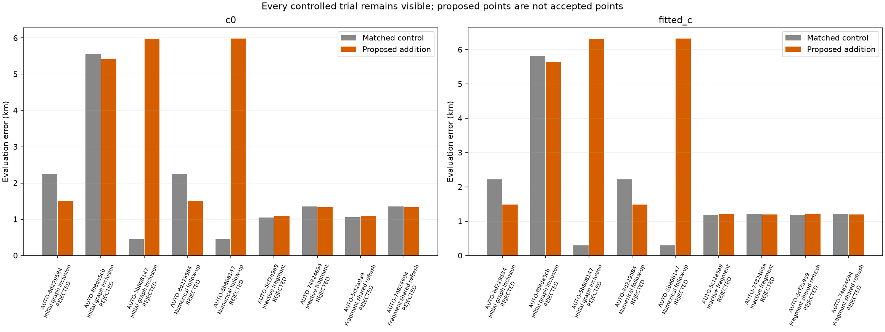
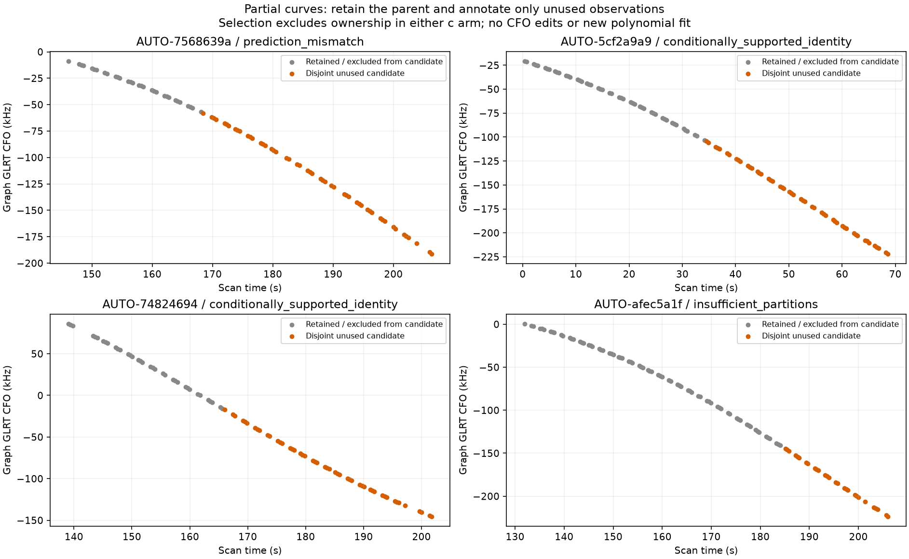
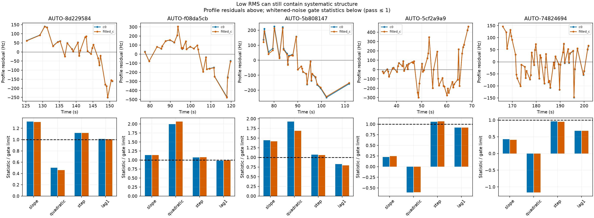

# Predictive transfer failures and disjoint partial-curve recovery

This iteration advances two parts of systematic recovery: run every newly supported whole-curve candidate from annotation attempt 34 through controlled position inclusion, and support partially retained graph curves without duplicating observations. Identity support and physical compatibility remain separate decisions. **No production change is made.**

## All three supported whole-curve candidates were tested

The selection is all three supported identities from the preceding 16-case predictive-role batch, with no GPS selection. NORAD 68397 and 48445 use new/uncalibrated-family causal phase mixtures with orbital and receiver uncertainty; 59155 uses its retained shared-family posterior. Every control and addition starts at the same 25 × 25 km regional-box center (37.906, −122.545), with five phase rounds and matched budgets. c=0 and fitted-c observations, candidates and other priors are matched. GPS (37.849061591561885, −122.48574968092912) enters only this report's error calculation.

| scan | variant | target_points | c0_control_km | c0_addition_km | fitted_c_control_km | fitted_c_addition_km | RF_qualified |
| --- | --- | --- | --- | --- | --- | --- | --- |
| AUTO-8d229584 | Initial graph inclusion | 28 | 2.245 | 1.510 | 2.215 | 1.488 | False |
| AUTO-f08da5cb | Initial graph inclusion | 28 | 5.565 | 5.420 | 5.824 | 5.647 | False |
| AUTO-5b808147 | Initial graph inclusion | 28 | 0.447 | 5.975 | 0.297 | 6.314 | False |
| AUTO-8d229584 | Numerical follow-up | 28 | 2.246 | 1.511 | 2.215 | 1.488 | False |
| AUTO-5b808147 | Numerical follow-up | 28 | 0.447 | 5.982 | 0.297 | 6.321 | False |
| AUTO-5cf2a9a9 | Inactive fragment | 50 | 1.053 | 1.093 | 1.185 | 1.208 | False |
| AUTO-74824694 | Inactive fragment | 49 | 1.351 | 1.332 | 1.214 | 1.199 | False |
| AUTO-5cf2a9a9 | Fragment shared refresh | 50 | 1.054 | 1.093 | 1.186 | 1.208 | False |
| AUTO-74824694 | Fragment shared refresh | 49 | 1.351 | 1.333 | 1.214 | 1.199 | False |

None of the three initial whole-curve additions passes full qualification. AUTO-8d229584 / 68397 improves apparent error by about 0.73 km, but its ~98 Hz target residual has a slope statistic near 3.95 (limit 3), step statistic near 4.48 (limit 4), and excessive lag correlation. A matched Powell follow-up resolves optimizer termination but leaves those physical residual failures. The apparent accuracy improvement does not authorize inclusion.

AUTO-f08da5cb / 59155 fails target slope, quadratic and step gates. AUTO-5b808147 / 48445 produces a large error regression, fails target and incumbent slope/structure checks, and leaves 16 incumbent owner entries missing. These are **missing owner records, not evidence of 16 confirmed reassignments**. Its 0.1 s phase quadrature also fails score/gradient agreement. A predeclared numerical follow-up uses Powell and 0.025 s quadrature for both control and addition; the local integration audit and residual checks still fail. That result remains numerically and physically unqualified. The immutable initial and follow-up evidence is preserved.

Each supervised stage has a 600 s cap. New-family fits allow 48 iterations / 240 objective calls per phase round. Shared-family fits retain the existing 48-step budget. Numerical follow-ups are triggered by optimizer or quadrature diagnostics, not by error against GPS. Raw objective comparisons between control and addition are not used as proof of localization improvement because their observation sets differ. [Arm-level results](position_trials.csv) separately report score, error, target additions, incidental extension additions, owner changes and qualification.

## Partial curves need a separate observation set

The inventory contains **39 distinct partially associated curves**. We freeze the three largest by unused-point count and the 28-point attempt-34 precondition failure. The new fragment view contains only parent observations unused by **both** c arms, including calibration and predictive ownership. Original graph tracks and calibration arrays remain unchanged. Times, CFO values, alias lifts and receiver basis rows are copied exactly by index; no new polynomial is fitted and no tail is cut by residual quality or position error.

| scan | unused_points | state | norad | minimum_margin |
| --- | --- | --- | --- | --- |
| AUTO-7568639a | 51 | prediction_mismatch | 59414 | 39.021 |
| AUTO-5cf2a9a9 | 50 | conditionally_supported_identity | 64004 | 66.622 |
| AUTO-74824694 | 49 | conditionally_supported_identity | 69450 | 333.566 |
| AUTO-afec5a1f | 28 | insufficient_partitions | None | None |

The 50-point fragment supports 64004 and the 49-point fragment supports 69450. The 51-point fragment has a prediction mismatch; the 28-point / 20.9 s fragment lacks enough independent random partitions. Annotation retains scanwide random 12 s blocks and 2 s guards, three distinct timestamp-selected holdouts, training-only nomination and no target-driven receiver calibration. Fragment labels remain conditional on the frozen parent graph and retained identities; they are not unconditional satellite probabilities.

Inclusion reconstructs the exact annotated fragment and rejects changed parent or ownership selections. It routes through the existing shared-family or new-family likelihood as appropriate. Both supported fragments are shared-family cases. Their first controlled inclusions retain all incumbent owners but fail the fragment residual-step gate (~4.2–4.3 versus 4). We then test the existing marginal shared-satellite refresh on both cases, preserving receiver means and unchanged gates. Every result is shown above; acceptance is determined by both c arms and independent exact-orbit/ownership replay, not RMS or coverage alone.

Shared refresh does not qualify either fragment. AUTO-5cf2a9a9 retains its target step failure. AUTO-74824694 passes the target's noise gates after refresh but fails conditional-mean gates on retained RX2 tracks. The matched shared-refresh controls also have conditional-mean failures, so this variant cannot support a clean inclusion claim. Neither the slight apparent error improvement for the latter scan nor the target-only pass overrides those control/incumbent failures.

## Audit correction and interpretation

The first fragment replay encountered an indexing error: an appended predictive fragment was traversed as an original graph track, although it has no entry in the original orbit-time index. The fit already used the original graph-only membership view. The audit now uses the same view while retaining the fragment in predictive entries. Original failed receipts/logs remain archived; a separately named replay-v2 runs on the **same saved fits without refitting**. It verifies the physical failures instead of treating an audit crash as a scientific result. Unit tests protect the graph view, unchanged original arrays, both-arm ownership exclusion and annotation reconstruction.

**39 targeted tests pass**, including six tests for partial-fragment selection and provenance, plus existing predictive ownership/routing, phase convergence, covariance, queue and feasible-inclusion checks. The scientific runs separately exercise actual shared-family fragment inclusion and exact replay. The new-family fragment reconstruction path is implemented, but these two supported fragments do not empirically exercise it; that path still needs a suitable supported new-family fragment case.

These trials show why high predictive identity margins do not guarantee usable localization evidence: a candidate can beat its nominated competitors under uncertainty while retaining structured residuals under the physical endpoint model. Low RMS does not establish noise-like errors. Conversely, fragment selection now handles a real representation gap without dropping the parent or counting observations twice. The next diagnostic question is whether the remaining step-like behavior is shared by other simultaneous receiver/channel evidence, or local to the fragment/family. A shared nuisance correction needs independent witnesses; a free correction per curve could hide a wrong identity or join. No thresholds are widened here.

## Reproducibility and remaining scope

The ledger now records **1340 / 1630** curves assessed in at least one role. Fragment results are separate columns and do not overwrite earlier whole-parent evidence. This iteration has 9 matched position trials and 0 fully qualified trials; qualification is not synonymous with accuracy improvement or production promotion. The other partially associated curves and remaining inventory entries still need assessment.

Use `annotate_predictive_only.py --inactive-fragment --uncalibrated-phase-mixture --distinct-partitions`; supported fragments then use the existing inclusion entry point, which reads their annotation provenance. Exact commands, terminal receipts and failed audit attempts are in [execution records](executions.csv). [The partial inventory](partial_inventory.json), [ledger](annotation_ledger.csv), [failed gates](failed_gates.csv), [source hashes](sources.json) and [compact scientific evidence](evidence.json.gz) preserve provenance. Current source hashes identify the report/replay implementation; original numerical trials predate the fragment route and remain preserved in their source paths. No future TLE, new RF recording, GPS-guided fit, production policy change or ALGO promotion is included.
