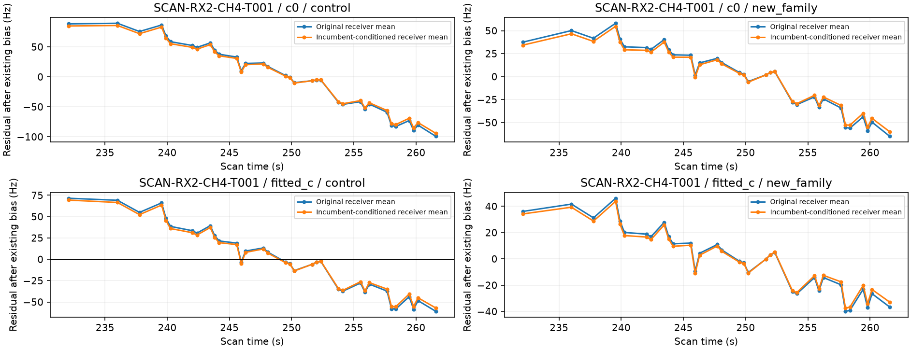
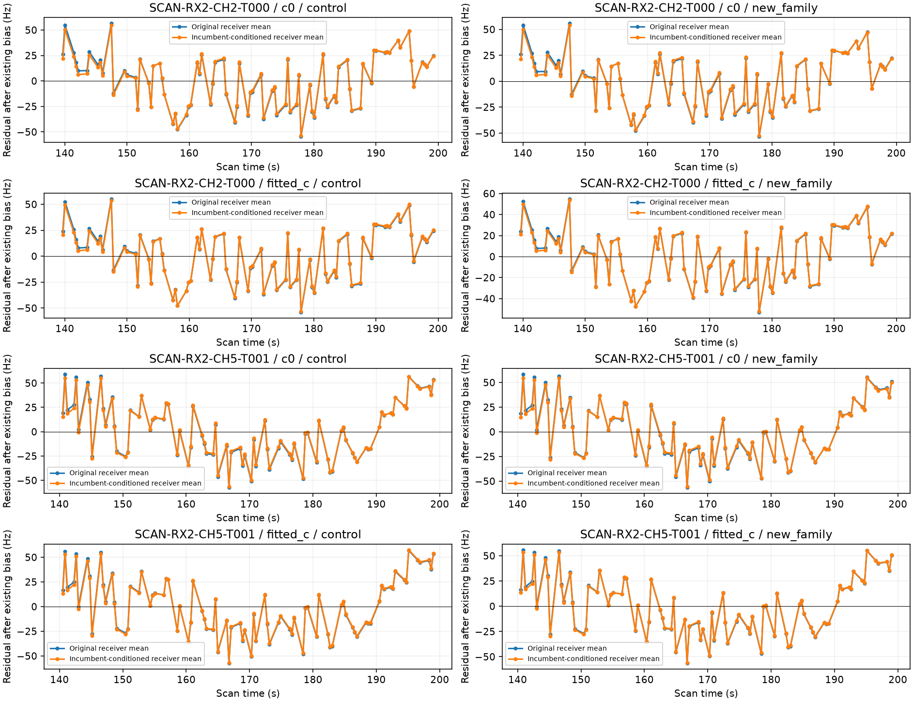

# Can other satellites explain the remaining receiver trend?

This diagnostic replays the saved controls and additions, then conditions the receiver coefficient distribution on incumbent predictive evidence only. Target observations never enter this conditioning. It applies the resulting receiver mean to the target with its saved orbit, phase and position fixed. The existing per-track bias is reprofiled in both variants. No association or acceptance is changed.

| case | component | points | arm | original_RMS_hz | transferred_RMS_hz | original_lag1 | transferred_lag1 | transferred_noise_pass |
| --- | --- | --- | --- | --- | --- | --- | --- | --- |
| AUTO-c1258263 | SCAN-RX2-CH4-T001-RF11459687500.000000 | 34 | c0 | 34.971 | 32.448 | 0.875 | 0.868 | False |
| AUTO-c1258263 | SCAN-RX2-CH4-T001-RF11459687500.000000 | 34 | fitted_c | 23.988 | 22.235 | 0.822 | 0.805 | False |
| V06 | SCAN-RX2-CH2-T000-RF11190312500.000000 | 83 | c0 | 24.784 | 24.177 | 0.388 | 0.360 | True |
| V06 | SCAN-RX2-CH5-T001-RF11940312500.000000 | 85 | c0 | 28.472 | 27.724 | 0.512 | 0.487 | False |
| V06 | SCAN-RX2-CH2-T000-RF11190312500.000000 | 83 | fitted_c | 24.494 | 24.202 | 0.375 | 0.361 | True |
| V06 | SCAN-RX2-CH5-T001-RF11940312500.000000 | 85 | fitted_c | 28.041 | 27.645 | 0.498 | 0.484 | False |

| case | component | arm | original_slope_hz_s | receiver_transfer_slope_hz_s | remaining_slope_hz_s | receiver_slope_sigma_hz_s |
| --- | --- | --- | --- | --- | --- | --- |
| AUTO-c1258263 | SCAN-RX2-CH4-T001-RF11459687500.000000 | c0 | -4.297 | -0.325 | -3.972 | 1.535 |
| AUTO-c1258263 | SCAN-RX2-CH4-T001-RF11459687500.000000 | fitted_c | -2.922 | -0.241 | -2.681 | 1.539 |
| V06 | SCAN-RX2-CH2-T000-RF11190312500.000000 | c0 | 0.020 | -0.040 | 0.060 | 0.599 |
| V06 | SCAN-RX2-CH5-T001-RF11940312500.000000 | c0 | -0.123 | -0.028 | -0.095 | 0.623 |
| V06 | SCAN-RX2-CH2-T000-RF11190312500.000000 | fitted_c | 0.042 | -0.041 | 0.083 | 0.599 |
| V06 | SCAN-RX2-CH5-T001-RF11940312500.000000 | fitted_c | -0.087 | -0.038 | -0.049 | 0.623 |

At control endpoints, position and receiver conditioning exclude the target. Addition endpoints use the previously target-informed position, so those comparisons are conditional diagnostics, not independent localization validation. The slope uncertainty is only the existing receiver posterior contribution; it excludes target measurement noise and orbital uncertainty. It cannot establish a calibrated probability of a bad association.

The production likelihood already conditions its receiver moments on incumbent predictive observations, while physical gates use the original calibration mean. These plots measure that difference without relaxing a gate or adding a target-specific drift. Source hashes, replay receipts, all residuals and both c arms are in [result.json](result.json); [metrics.csv](metrics.csv) includes control endpoints.
