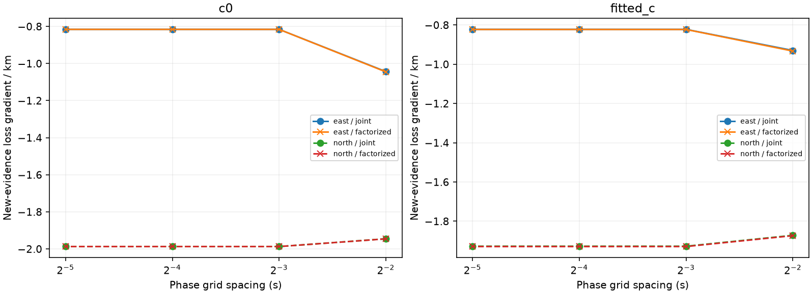
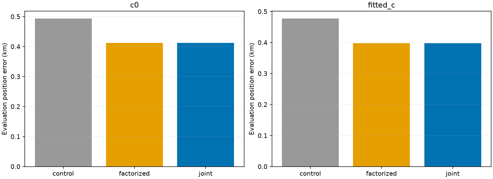
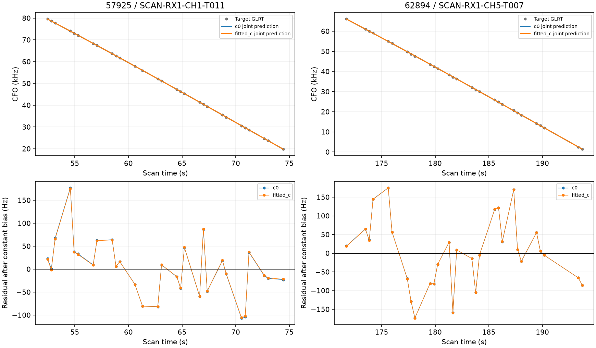

# Two recovered satellite families in one position fit

Two independently qualified curves in **AUTO-20cb1fdb**, containing **58 original GLRT points**, have now been fitted together from the regional-box center. Both joint-fit arms pass all recorded RF and numerical checks: **True**. The factorized comparison passes both arms: **True**. Qualification is conditional on the existing graph, causal candidate shortlist and incumbent associations; it is not a calibrated probability that the identities are correct or a production promotion.

| norad | component | points |
| --- | --- | --- |
| 57925 | SCAN-RX1-CH1-T011-RF10709687500.000000 | 29 |
| 62894 | SCAN-RX1-CH5-T007-RF11709687500.000000 | 29 |

## Why a joint likelihood is necessary

The two curves were tested individually in shifted batches three and four. Their individual point gains cannot be added to infer a combined position improvement. Both predictions depend on the same uncertain receiver calibration. The new likelihood stacks the observations and uses

`B = blockdiag(N1, N2) + H Sigma H.T`,

where `Sigma` is the receiver/coefficient posterior conditioned on incumbent evidence, `H` stacks each curve's receiver design, and each `N` contains measurement noise and the existing 300 Hz track-bias prior. Independent physical orbital modes add `blockdiag(U1 U1.T, U2 U2.T)`. The implementation integrates over the Cartesian product of the two causal phase priors, with six Gaussian orbital-mode coefficients integrated analytically. It retains the off-diagonal receiver covariance once. The factorized comparison discards that cross-family covariance by summing the two marginal likelihoods. Neither target updates the stored receiver calibration coefficients.

The numerical kernel is checked against a direct full Gaussian covariance oracle, including posterior orbital coefficients, phase marginals, family-order invariance, visibility mass and the independent-family limit. A further regression test verifies that single-phase physical replay preserves exactly three orbital modes and reproduces the corresponding full-grid geometry.

## Local phase-grid probe

At the saved RF incumbent in each c arm, the probe evaluates the center and four offsets of 100 m. These are gradients of the **new evidence contribution**, not the total localization loss. The original phase reference stays fixed. No GPS enters the stencil, candidate selection or fitting.

| arm | largest_cross_correlation | difference | seconds | phase_pairs |
| --- | --- | --- | --- | --- |
| c0 | 0.006 | -0.001 | 1.280 | 923521 |
| fitted_c | 0.016 | -0.003 | 1.140 | 923521 |

`difference` is joint minus factorized negative-twice-log density. The largest whitened cross-family correlation is approximately 0.006 for c=0 and 0.016 for fitted-c. Coupling is small for this pair; this does not prove it is small for other pairs. A 0.25 s phase grid distorts the local gradient. The 0.0625 and 0.03125 s results agree much more closely.

## Matched position experiment

All fits start at `[0,0]` in the existing 25 by 25 km regional box centered at 37.906, -122.545. Control, factorized addition and joint addition use the same incumbent observations, causal TLEs, physical priors, bounds and five phase-refresh rounds. The initial L-BFGS-B budget is 48 iterations / nominal 240 function evaluations per round. Both additions report abnormal optimizer termination in fitted-c while passing the physical, ownership and phase checks; their original results remain withheld. A numerical-only selector therefore reruns all six fits, including both controls, with Powell (48 iterations / 240 evaluations per round). It does not select using GPS error. Both c arms use both added curves. Every worker has a 600-second wall-clock cap. The phase-integration spacing is 0.0625 s; endpoint local audits compare it with 0.03125 and 0.015625 s. All twelve fits and final audits completed. The table shows the matched Powell experiment; the CSV retains both experiments.

| method | arm | error_km | reviewed_points | associated_percent | RF_qualified_arm | seconds |
| --- | --- | --- | --- | --- | --- | --- |
| control | c0 | 0.493 | 3632 | 67.913 | True | 22.194 |
| control | fitted_c | 0.477 | 3632 | 67.913 | True | 29.765 |
| factorized | c0 | 0.413 | 3690 | 68.998 | True | 52.489 |
| factorized | fitted_c | 0.398 | 3690 | 68.998 | True | 53.996 |
| joint | c0 | 0.413 | 3690 | 68.998 | True | 124.494 |
| joint | fitted_c | 0.398 | 3690 | 68.998 | True | 132.400 |

The denominator is 5348 original GLRT winners. Joint inclusion raises reviewed association from 3,632/5,348 (67.91%) to 3,690/5,348 (69.00%), with no lost incumbent points. In the matched Powell comparison, error decreases from 0.493 to 0.413 km for c=0 and from 0.477 to 0.398 km for fitted-c. The joint and factorized endpoints differ by less than 0.1 m here. Joint fitting takes about 125–132 seconds versus 53–54 seconds for the factorized fits in this execution; these are single-case process timings, not an embedded performance benchmark.

Position error uses 37.849061591561885, -122.48574968092912 **only in report generation**. Raw control and addition objectives use different observations and cannot establish better localization. The same-evidence joint and factorized contributions are recorded separately in [position_comparison.csv](position_comparison.csv). The likelihood definitions differ, so their normalization difference is not a position-quality score.

Audits rebuild each endpoint, replay every incumbent family's physical orbit, preserve incumbent observation ownership, and test target RMS, constant bias, alias, elevation and residual mean/slope/curvature/step/correlation. The joint target is checked at both its discrete joint MAP and a local continuously refined phase pair. Receiver coefficients remain unchanged by target evaluation. Grid boundary mass, optimizer completion, phase refresh and local score/gradient resolution must also pass. Unscored post-fit extensions are excluded from the reviewed membership and must not enter the fitted observations. Both c arms and both matched controls must qualify. [All check results](qualification.csv) and full residual diagnostics are archived.

## Failures, provenance and remaining scope

The first likelihood-probe attempt failed because an exclusive-write helper was asked to overwrite its progress file; the successful attempt uses separate point receipts. The first joint residual audit failed because the single-phase view retained the entire phase-grid mode bank. Its source and failed terminal receipts are preserved; the corrected view keeps exactly three modes and has a physical-geometry regression test. Neither failure is counted as scientific rejection or silently overwritten. The final audit reuses the completed position fits without changing their observations, endpoint or objective.

This pair was selected because it was the only scan with two distinct, individually qualified, broader-competition-checked new families in shifted batches three and four. It was not selected for GPS improvement. The scan remains a studied same-site case. This experiment establishes one checked joint-inclusion result, not cohort performance, exhaustive candidate search, transfer to another location, or recovery of all unassociated tracks.

[Shifted batch five](../2026_10_30_shifted_annotation_batch5/README.md) adds 32 complete annotations and 19 inclusion trials, with 15 individually qualified curves / 399 points (14 fast curves / 372 points; one adaptive curve / 27 points). Ten qualified trials improve fitted-c error and five worsen it. Six numerical-only retries preserve their original failures and use matched controls. These individual trials are not summed into joint scan accuracy. The two-family points here overlap earlier qualified recoveries and are not 58 additional inventory points.

The carried-forward ledger retains all previous ambiguity, native-IQ rejections and candidate-competition withholdings, adding this pair's joint status. **274 shifted-origin assessments and 821 older-role reassessments remain; the queues overlap.** Production is unchanged. Next, assess additional same-scan qualified families with the same joint checks, continue the inventory, and evaluate a frozen combined policy on a matched cohort before production promotion.
