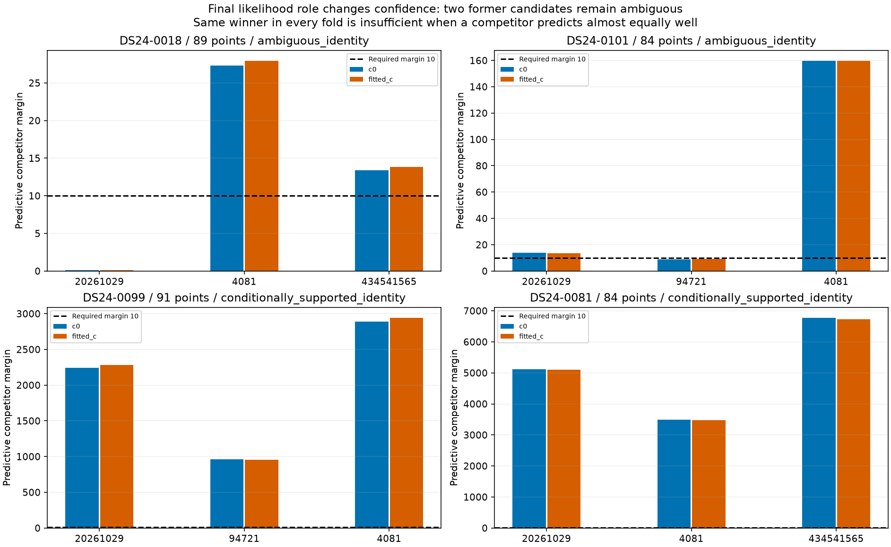
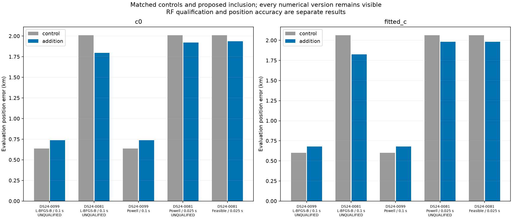
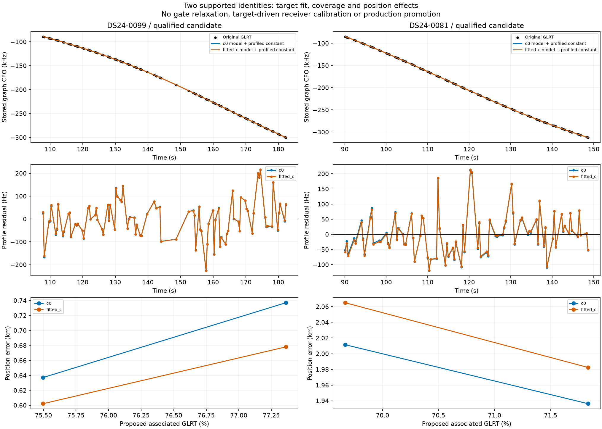

# Large DS24 curves: identity rechecks and controlled inclusion

This iteration applies the existing predictive recovery rule to the **four largest eligible supported DS24 graph curves on distinct scans**, totaling 348 points. Eligibility excludes recorded predictive rechecks/inclusions and earlier transfer claims. Selection uses point count and a deterministic track-ID tie break; no position error enters selection. The [frozen selection](selection.json) preserves all 102 eligible entries and source hashes. These are development cases from an already studied dataset, not an untouched generalization cohort.

## Identity must be checked in its intended likelihood role

The earlier inventory screen allowed an annotated curve's training points to participate in calibration. For this inclusion rule, the candidate is predictive: it must not calibrate the receiver. Recheck its identity with the same predictive role, causal phase/orbit uncertainty and conditional-target score that the proposed inclusion uses. Use three distinct random scanwide 12 s block partitions with 2 s guards, matched candidate sets across c arms, and training-only nomination/alias selection. The frozen graph and incumbent identities remain conditioning assumptions; the search is not an exhaustive catalogue evidence integral and the margins are not calibrated probabilities.

| scan | points | original_norad | predictive_norad | predictive_status | minimum_margin |
| --- | --- | --- | --- | --- | --- |
| DS24-0018 | 89 | 56781 | 56781 | ambiguous_identity | 0.109 |
| DS24-0101 | 84 | 60141 | 60141 | ambiguous_identity | 8.954 |
| DS24-0099 | 91 | 67921 | 67921 | conditionally_supported_identity | 955.184 |
| DS24-0081 | 84 | 69699 | 69699 | conditionally_supported_identity | 3470.825 |

DS24-0018 still favors 56781 in every fold, but one partition cannot distinguish it from 57883 (margin ~0.11). DS24-0101 still favors 60141, but one partition falls below the fixed margin-10 requirement against 66438 (~8.95). Both remain ambiguous and **do not enter the position fit**. We do not lower the threshold or pick their favored label because a curve is large. DS24-0099 supports 67921 and DS24-0081 supports 69699. Both are uncalibrated families under this scan's retained observation set, so inclusion integrates a causal phase mixture and orbital/receiver uncertainty.

This is a practical change in how the inventory must be read: a completed original assessment is not final authorization for every downstream likelihood. The ledger preserves original evidence and separately records predictive rechecks and inclusion decisions. The systematic workflow should validate the role in which a curve will actually be used.

## Controlled position trials and numerical follow-ups

The regional control and addition start at the center of the same 25 × 25 km box, **37.906, −122.545**, with five phase rounds and up to 48 position steps / 240 objective calls per round. The later feasible continuation starts from that regional control, as described below. The target does not enter receiver calibration normal equations. Preserve all existing observations, candidate sets, physical priors and original noise policy. Both c=0 and fitted-c are run. GPS **(37.849061591561885, -122.48574968092912)** is read only by this reporting tool to calculate error.

The initial DS24-0099 L-BFGS-B control reports abnormal termination despite passing exact residual/ownership replay. Repeat both control and addition with the already implemented Powell optimizer. The initial DS24-0081 run additionally fails the phase-integration score/gradient agreement check; repeat both arms with Powell and a 0.025 s phase grid instead of 0.1 s. These follow-ups are triggered by numerical diagnostics, not GPS improvement. Priors, observations and residual thresholds remain unchanged; the finer quadrature costs more per objective evaluation. Original failed runs remain visible.

| scan | variant | c0_control_km | c0_addition_km | fitted_control_km | fitted_addition_km | proposed_added | paired_fit_valid | exact_replay_valid | RF_qualified |
| --- | --- | --- | --- | --- | --- | --- | --- | --- | --- |
| DS24-0099 | L-BFGS-B / 0.1 s | 0.637 | 0.737 | 0.602 | 0.678 | 91 | False | True | False |
| DS24-0081 | L-BFGS-B / 0.1 s | 2.012 | 1.797 | 2.065 | 1.827 | 84 | False | False | False |
| DS24-0099 | Powell / 0.1 s | 0.637 | 0.737 | 0.602 | 0.678 | 91 | True | True | True |
| DS24-0081 | Powell / 0.025 s | 2.011 | 1.922 | 2.065 | 1.983 | 84 | False | False | False |
| DS24-0081 | Feasible / 0.025 s | 2.011 | 1.936 | 2.065 | 1.982 | 84 | True | True | True |

RF qualification requires both matched controls and additions to pass optimizer, phase, residual and ownership checks, plus independent exact-orbit endpoint replay. Total objectives with different observations are not treated as evidence that inclusion improves localization. [Every arm and role](position_trials.csv), [exact replays](exact_replays.csv), and any [failed incumbent gates](failed_incumbent_gates.csv) are recorded. Repeated occurrences of the same failed gate across family replays are deduplicated in the failure table.

The refined DS24-0099 trial adds the full 91-point curve without losing or relabeling existing points, but error increases by about 0.10 km in c=0 and 0.08 km in fitted-c. It is a research RF candidate, **not an accuracy improvement or production promotion**. The DS24-0081 curve fits well itself; its initial proposal improves error but fails numerical checks and narrowly pushes an existing RX1 CH8 T001 slope outside its gate in c=0. Finer quadrature reduces the apparent improvement to about 0.09 / 0.08 km, while leaving a normalized incumbent slope slack of approximately −0.017. A target's good residuals cannot override that incumbent failure.

## Feasible inclusion prototype

For DS24-0081, apply the existing RF-feasible SLSQP optimizer to the combined new-family likelihood, constrained by every incumbent curved and predictive residual slack. Start **both** the no-addition continuation and the addition continuation from the same exact-RF-qualified regional control. Both use five phase rounds, up to 48 SLSQP iterations per round, and a 600 s stage wall-clock cap; there is no separate objective-call cap for this continuation. This is a matched continuation test, not another independent regional initialization. Solver status and the best feasible visited point are recorded separately. Selection uses only the RF objective and unchanged gates.

The target's physical residual, phase-boundary and quadrature checks remain endpoint requirements; they are not replaced by solver success. After the fit, independently replay exact incumbent orbits, all old owners and the target's continuous-phase prediction. The feasible continuation passes in both arms, retains all **84 points**, and preserves every incumbent owner. Error changes **2.011 → 1.936 km** (c=0) and **2.065 → 1.982 km** (fitted-c). The c=0 solution is very close to the protected slope boundary: exact normalized slack is only **3.29 × 10⁻⁷**, versus 0.0106 at control. This is a qualified endpoint under the current gates, not a robust safety margin; perturbation/replication checks or a justified interior-margin policy are required before promotion. The prototype changes how the optimizer respects existing evidence, not the satellite catalogue, waveform measurements, priors or gate thresholds. It does not establish generalization beyond this case.

## Interpretation and next steps

There are distinct bottlenecks: identity ambiguity under the intended calibration model, numerical integration/optimization, and conflicts between new evidence and retained curves. More associated GLRT can increase or decrease position error. This experiment gives no basis to force ambiguous labels, relax residual thresholds, or promote an ALGO version.

For supported curves, preserve physical uncertainty and verify existing owners after inclusion. The feasible-continuation prototype should next be tested on additional supported cases with the same RF-only trigger, retaining failures and comparing matched c arms. If it still fails exact replay, investigate corroborated model corrections rather than widening gates. For genuinely ambiguous curves, a future hypothesis-mixture likelihood could retain uncertain identity without assigning a hard label, but it needs an explicit unmodeled-source alternative and false-association controls before use. Such a mixture is **not implemented or counted as recovery here**.

## Inventory and reproducibility

Attempt 33 outcomes: `{'insufficient_partitions': 18, 'conditionally_supported_identity': 24, 'unstable_identity': 14, 'ambiguous_identity': 5, 'prediction_mismatch': 3}`. Original assessments completed: **1324 / 1630**; historical separate phase audits: 149. These counts include ambiguous, unstable, mismatched and insufficient-partition outcomes. They are not final accepted associations or the count validated under the predictive inclusion role. This four-curve transfer yields **2 final RF candidate(s), 175 proposed points**, with zero production points added.

Use `test_predictive_graph_transfer.py` with the frozen four IDs, followed by the exact commands retained in the numerical follow-up protocols. `include_new_family_feasible.py` runs the matched constrained continuation; `report_large_predictive_transfer.py` generates this report. [Sources](sources.json), [compact raw receipts](evidence.json.gz), [ledger](annotation_ledger.csv), [batch](annotation_batch.csv) and [execution records](executions.csv) preserve outcomes, including rejected proposals. The [continuation budget receipt](continuation_budget.json) clarifies an inherited source-protocol field: the initial trial copied `maxfun=240`, but SLSQP enforced the iteration and wall-time budgets, not that objective-call cap. Its exact source is preserved; the current runner explicitly records `maxfun=null`. No fit result was overwritten. **23 targeted tests pass**: 21 existing tests for family routing, owner preservation, raw phase convergence, new-family prediction and covariance qualification, plus two tests requiring both verified control arms and protecting an incumbent constraint against a conflicting objective. The new continuation is research-only; production policy is unchanged.
