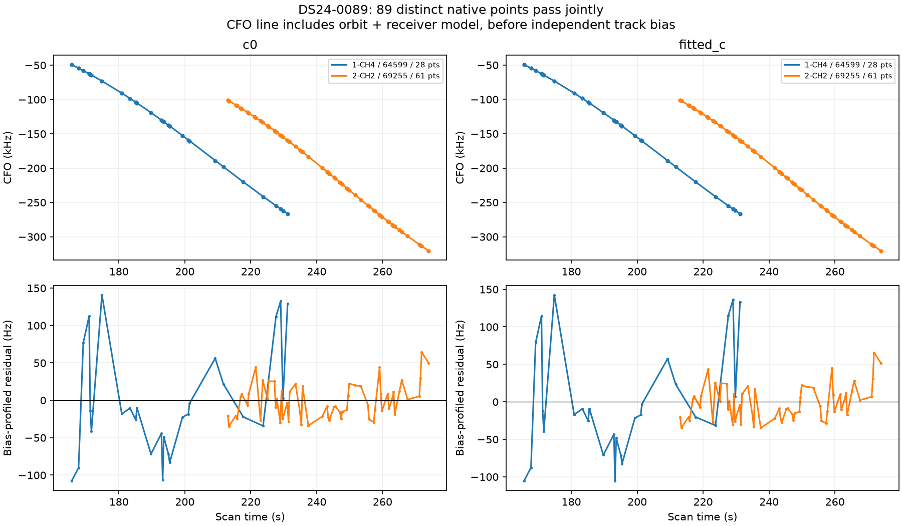
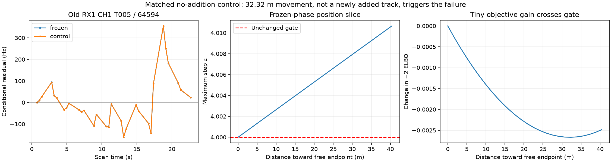
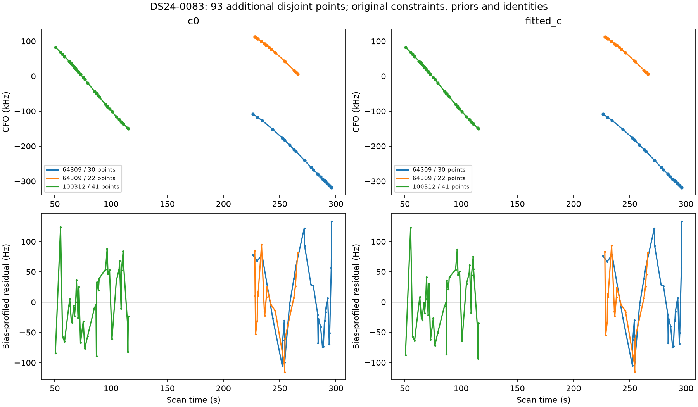

# DS24-0089 and DS24-0083: recovery refits dropped existing acceptance constraints

The previous iteration described three recovered curves as making an old CH1 track fail. **The matched no-addition control already failed.** Exact replay identifies a fitting-procedure mismatch: the accepted incumbent was gate-constrained, while the recovery experiment ran an unconstrained position optimizer. This finding supersedes the earlier causal interpretation. It does not establish that every remaining unassociated curve has this cause.

## Controlled experiment and result

Use the same causal catalogue, identities, alias choices, receiver/orbit priors, calibration observations, target observations, and acceptance checks. Compare the original regional unconstrained run with RF-incumbent continuations. The original unconstrained fitter uses bounded Gauss–Newton on its residual vector, whereas the constrained fitter uses SLSQP on negative twice ELBO. To separate optimizer/objective effects from the gate constraints, also run the exact SLSQP helper and objective with physical gate slacks replaced by the constant one. This third continuation retains the same start, phase refresh, bounds, finite-difference step and iteration limit. Each continuation has five phase refreshes and up to 48 optimizer iterations per refresh in both c arms. Actual objective-evaluation counts differ; receipts preserve them. The constrained solver retains its existing 1e-6 numerical interior, followed by independent final gates and the no-old-point-loss check. GPS is used only for error reporting, never candidate or optimizer selection. Continuations are not new blind regional acquisitions; their incumbent arose from the preceding 25×25 km RF analysis.

All three individual proposals pass under constrained continuation, and all fail under the original unconstrained continuation. The same-objective SLSQP no-addition control, two individual additions, and joint addition all fail their paired checks; these results are included in the CSV. The 43-point RX2 CH2 proposal is wholly contained in the 61-point proposal. A first joint assembly correctly rejected this overlap before fitting; its failed execution receipts remain archived. The valid joint experiment uses the full 61-point RX2 CH2 curve (69255) plus the disjoint 28-point RX1 CH4 curve (64599). **89 distinct points are added, with zero old points lost**, in both arms. No truncation, new nuisance coefficient, TLE change, or threshold relaxation was needed.

| arm | before_points | after_points | before_percent | after_percent | before_error_km | after_error_km | objective_cost_vs_same_data_free |
| --- | --- | --- | --- | --- | --- | --- | --- |
| c0 | 3766 | 3855 | 79.134 | 81.004 | 2.079 | 2.097 | 0.000 |
| fitted_c | 3766 | 3855 | 79.134 | 81.004 | 2.126 | 2.123 | 0.001 |

The coverage increase is material; the localization change is not: fitted-c improves about 2.7 m, while c=0 worsens about 18.4 m. Frequency scores are compared only between constrained and free fits of identical observations. Adding observations changes the likelihood dimension, so raw total scores before/after adding points are not a model-quality comparison. [All native controls and trials](native_trials.csv) include rejected results and phase convergence.

## Why 63 old points disappeared

The old RX1 CH1 T005 / 64594 has 31 active points. Its fitted-c step statistic is 3.999995859 at the frozen incumbent and 4.008525933 at the original unconstrained control, against the unchanged limit of 4. The control moves only 32.319 m and improves negative twice ELBO by approximately 0.004585. Exact objective, gate, and observation-membership replay succeeds in both c arms. Warm-starting the free optimizer still fails even after phase convergence; this is not explained by the regional starting point or a stale phase linearization.

When that track fails, 64594 has no compatible curved representative to nominate it during post-fit graph extension. Three other graph tracks lose their extension associations: RX2 CH1 T007 (13 points), RX1 CH3 T007 (23), and RX1 CH4 T010 (27). These are the 63 lost points. The active 31-point track remains in the calibration mask, but the whole trial is rejected; proposed membership counts in rejected trials are not accepted coverage.

The right two panels sample a one-dimensional position segment, using the frozen incumbent phase reference and re-profiling nuisance coefficients at each position. They are not full pipeline reruns or fully phase-refreshed two-dimensional loss surfaces. The left panel compares exact saved endpoint residuals. Borderline acceptance remains a scientific weakness: constrained fitting can preserve a threshold without establishing model correctness or identity. Independent prediction and false-association checks are still needed before promotion.

## Second case: DS24-0083

Auditing prior matched controls identifies one other scan with the same experimental defect: four DS24-0083 proposals pass their own target checks, but the no-addition control fails existing RX1 CH8 T002 in c=0. Select the maximal disjoint proposal set using observation IDs only: 30 RX1 CH2 points and 22 RX1 CH1 points assigned to 64309, plus 41 RX1 CH5 points assigned to 100312. The fourth, 26-point proposal is contained in the 30-point branch and is excluded to avoid duplication. This is a diagnostic follow-up selected by control failure, not an independent blind validation cohort.

Using the same SLSQP objective, start, bounds and budget, the unconstrained control and joint trial both fail, while the constrained control and joint trial both pass. **93 points are added, with zero old-point losses.** The old CH8 curve retains autocorrelation in the rejected free fit; its RMS is only about 58 Hz, illustrating why an RMS-only gate misses the problem. Original noise thresholds remain in force. Both c arms are required to pass.

| arm | before_points | after_points | before_error_km | after_error_km | objective_cost_vs_same_data_free |
| --- | --- | --- | --- | --- | --- |
| c0 | 3436 | 3529 | 0.210 | 0.200 | 0.011 |
| fitted_c | 3436 | 3529 | 0.308 | 0.356 | -0.000 |

Position changes again disagree across c arms: c=0 improves about 10 m, while fitted-c worsens about 48 m. Tiny negative objective differences in an inactive-constraint arm reflect numerical optimizer termination, not a claim that constraining an exact global optimum lowers its objective. The result supports the experimental repair but does not establish a localization benefit.

## Cohort accounting and remaining graph inventory

An accounting overlay on the preceding 93-scan native research policy adds the two measured joint results, totaling **182 points**; the other 91 scans reuse their previous results. This is not a new dataset-wide optimizer validation. Both scan baselines match the previous policy's point counts; no native recovery is overwritten. Nine unavailable exports remain excluded.

| arm | variant | points | associated_percent | mean_error_km | median_error_km | p90_error_km |
| --- | --- | --- | --- | --- | --- | --- |
| c0 | before | 155829 | 72.784 | 1.464 | 1.167 | 2.685 |
| c0 | after | 156011 | 72.869 | 1.464 | 1.167 | 2.685 |
| fitted_c | before | 155812 | 72.776 | 1.472 | 1.190 | 2.580 |
| fitted_c | after | 155994 | 72.861 | 1.473 | 1.190 | 2.580 |

The parallel graph annotation batch yields {'conditionally_supported_identity': 20, 'ambiguous_identity': 1, 'unstable_identity': 8, 'execution_timeout': 2, 'prediction_mismatch': 1}. **805 / 1630** frozen graph entries now have assessments. Native proposals and original graph entries are separate inventories and are never summed. [Full ledger](annotation_ledger.csv) and [batch outcomes](graph_annotation_batch.csv) include timeouts explicitly.

Twenty supported graph hypotheses from the preceding batch received original-model paired position trials. **1 / 20 pass.** The passing AUTO-e32d57a7 / 68560 trial adds 61 points, but error worsens from 2.486 to 2.749 km for c=0 and 2.478 to 2.738 km for fitted-c. This is separate automatic-recording evidence, not part of the DS24 native cohort overlay; it reinforces that coverage alone is not localization improvement. [Both-arm results](graph_trials.csv), [replayed failing gates](graph_gate_failures.csv), and [all CFO/residual plots](graph_gallery.md) preserve the failures as well as the pass.

## Reproduction and next decisions

`include_predictive_annotations.py --position-fit incumbent_unconstrained`, `--position-fit incumbent_elbo_unconstrained`, and `--position-fit incumbent_feasible` expose explicit research-only continuations. The default regional experiment is unchanged. The protocol archives exact commands, input paths and source hash. `audit_native_refit_boundary.py` verifies frozen and control replay; `report_native_feasible_refit.py` generates this report. The initial four continuation jobs and the additional objective control have 600-second caps; the two DS24-0083 jobs have 300-second caps. The graph queue uses 16 workers with 600-second per-case caps. No new RF collection or production deployment occurred.

The [prior native control audit](prior_native_control_audit.csv) checks 81 saved matched trials. Seven have failing no-addition controls despite passing target gates: the three DS24-0089 cases above and four DS24-0083 proposals. Both distinct scans now have matched constrained/free joint experiments. Audit counts are trials, not distinct scans or disjoint point totals.

Next, carry the incumbent fit procedure explicitly into recovery evaluation so failing no-addition controls are not attributed to new evidence. Separately test receiver/orbit mismatch for targets that fail their own predictive residual checks. Validate the exploratory identity score on difficult negative controls and separate recordings. Do not promote an ALGO solely from recovered point counts or gate-feasible endpoints. The full annotation/recovery objective remains open.

[Source hashes](sources.json), [compact numerical archive](evidence.json.gz), [cohort accounting](cohort_accounting.csv), and [summary](summary.json). Repetitive observation lists/history are compacted to hashes where supported; original files remain at the recorded paths.
