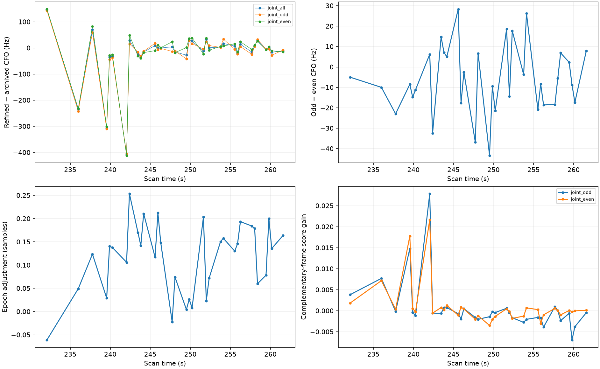
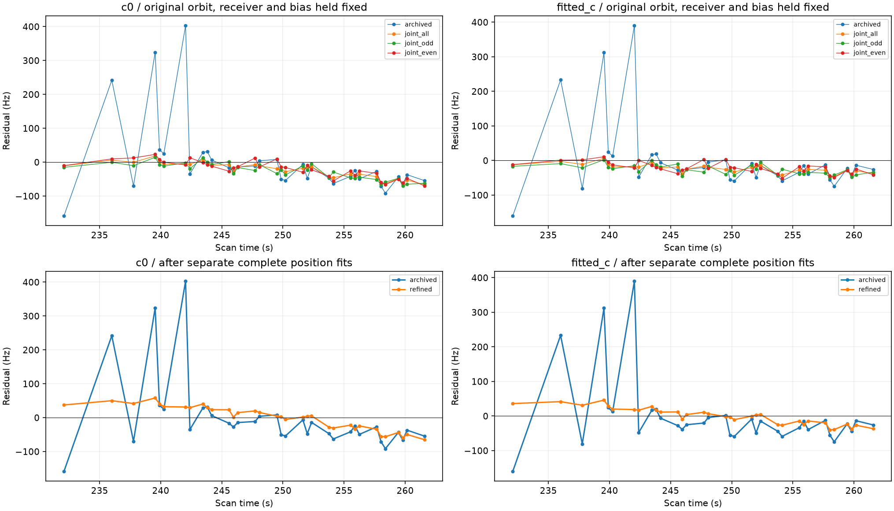
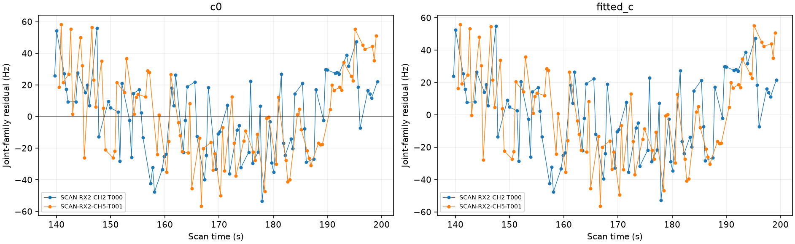

# Native IQ refinement resolves frequency excursions, but reveals residual model structure

The complete 34-point AUTO-c1258263 / RX2 CH4 / 60342 target was remeasured from its existing 2.5 MS/s fast recording. The local pilot fit corrects the three largest frequency excursions without using GPS, TLEs or orbital predictions. Fresh randomized identity validation still selects 60342. The refined full-position trial reduces error relative to the earlier raw-target inclusion, but fails residual correlation checks and remains rejected. No new accepted association points or production change are claimed.

## Raw authority and estimator

All **6756 source windows** were consumed through the verified ShortWindowReader, completing chunk and window hash checks. Their combined raw authority matches the archived GLRT source. All 34 target observations are exported, including quiet points; no point is selected or removed by residual. The estimator fits carrier frequency, sub-sample epoch and local code rate, with separate complex gains and DC per pilot frame. Search bounds remain ±800 Hz, ±0.75 samples and ±40 ppm, with one start and 16 optimizer iterations. Timing/code-rate variables describe the local waveform; they are not new satellite parameters or LNB drift calibration.

Odd and even pilot frames are independently fitted and scored on their complementary frames. They still share the original full-window detection/epoch nomination, so this is conditional cross-frame evidence, not fully independent acquisition. All four worker processes completed. IQ payloads remain local; compact evidence and hashes are published.

| time_s | joint_all_delta_hz | joint_odd_delta_hz | joint_even_delta_hz | odd_even_difference_hz |
| --- | --- | --- | --- | --- |
| 242.033 | -407.694 | -405.098 | -411.328 | 6.230 |
| 239.547 | -306.034 | -309.932 | -301.440 | -8.492 |
| 235.998 | -235.848 | -242.133 | -232.154 | -9.979 |

All joint fits stay inside their frequency, epoch and code-rate search bounds. Odd/even CFO disagreement is about **17.7 Hz RMS** across all 34 observations and approximately 6–10 Hz at the three largest corrected excursions. Both complementary-frame scores improve at each of those three points. Across the complete curve, improvement is less uniform: only **10/34 odd fits** and **18/34 even fits** improve their complementary scores over the archived parameters. This supports the large corrections but does not establish a universal gain from re-estimating every already-good point.

## Frequency agreement and fresh annotation

The following metrics hold the old orbit, receiver correction, position and track bias fixed; no new curve is fit to produce this comparison.

| method | points | RMS_hz | mean_hz | centered_scatter_hz | search_boundary_points |
| --- | --- | --- | --- | --- | --- |
| archived | 34 | 104.727 | -0.710 | 104.725 | 0 |
| fixed_epoch | 34 | 63.640 | -8.352 | 63.090 | 4 |
| joint_all | 34 | 26.906 | -23.837 | 12.478 | 0 |
| joint_odd | 34 | 30.056 | -26.658 | 13.880 | 0 |
| joint_even | 34 | 25.832 | -20.648 | 15.523 | 0 |

The full joint estimator reduces fixed-prediction RMS from about 105 to 27 Hz and centered scatter to about 12.5 Hz. The CFO-only fixed-epoch fit is less effective and reaches its search boundary at four points. The full refined measurements are independently renominated and validated with the same three distinct randomized 12-second block holdouts and 2-second guards. **60342 remains supported** in both c arms and every holdout. Observation IDs, timestamps, alias lifts and noise weights are unchanged. The refined target never enters receiver calibration; exact replay reconstructs the same measurement refinement from hashed worker outputs.

## Position result: improvement is not acceptance

| variant | arm | control_error_km | addition_error_km | RMS_hz | paired_valid | lag1 | lag1_limit |
| --- | --- | --- | --- | --- | --- | --- | --- |
| archived | c0 | 0.308 | 0.876 | 109.317 | True | -0.086 | 0.686 |
| archived | fitted_c | 0.090 | 0.937 | 104.727 | True | -0.174 | 0.686 |
| refined | c0 | 0.308 | 0.480 | 34.971 | False | 0.875 | 0.686 |
| refined | fitted_c | 0.090 | 0.538 | 23.988 | False | 0.822 | 0.686 |

The fitted-c addition improves from **0.937 to 0.538 km** after remeasurement; c=0 improves from **0.876 to 0.480 km**. Both remain worse than their matched no-target controls. Control objectives replay within 1e-5, confirming that only target measurements changed. Better radio measurements have exposed a remaining smooth model discrepancy: residual lag-one correlation is about **0.875 and 0.822**, above the unchanged limit **0.686**. The refined target fails both nominal and continuously refined exact-orbit checks. The earlier noisy raw-target pass must not be treated as sufficient evidence for promotion.

We keep the refined trial rejected. Adding arbitrary polynomial corrections, discarding inconvenient points or relaxing correlation thresholds would not explain this discrepancy. The next model test should measure shared receiver uncertainty using other satellites and compare it with family-specific orbital uncertainty, while retaining independent prediction checks.

## V06: independently supported identities are not enough to unite two curves

The next inventory batch independently nominates 69713 for V06 RX2 CH2 (83 points) and RX2 CH5 (85 points). A joint trial uses one phase/orbit correction, separate existing track biases and receiver uncertainty integrated once, with matched Powell controls and both c arms. It remains **joint_inclusion_rejected**; the common-residual audit also fails. This trial does not authorize combining the curves or counting 168 recovered points.

| arm | component | points | RMS_hz | lag1 | lag1_limit | noise_pass | control_error_km | joint_error_km |
| --- | --- | --- | --- | --- | --- | --- | --- | --- |
| c0 | SCAN-RX2-CH2-T000-RF11190312500.000000 | 83 | 24.784 | 0.388 | 0.439 | True | 0.279 | 0.393 |
| c0 | SCAN-RX2-CH5-T001-RF11940312500.000000 | 85 | 28.472 | 0.512 | 0.434 | False | 0.279 | 0.393 |
| fitted_c | SCAN-RX2-CH2-T000-RF11190312500.000000 | 83 | 24.494 | 0.375 | 0.439 | True | 0.265 | 0.393 |
| fitted_c | SCAN-RX2-CH5-T001-RF11940312500.000000 | 85 | 28.041 | 0.498 | 0.434 | False | 0.265 | 0.393 |

## Inventory progress and evidence

The [second predictive-role batch](../2026_10_30_predictive_role_reassessment_batch2/README.md) assesses 16 more large curves: six supported identities, three ambiguous, four unstable and three prediction mismatches. It runs all six supported position cases and retains every rejection. The individual V06 CH2 curve (83 points) passes RF checks but worsens location error; its separate status does not make the rejected joint fit acceptable. **953 older-role candidates remain**. The whole inventory goal is still open. The [updated ledger](annotation_ledger.csv) preserves the historical trials, marks 60342 withheld after the native-IQ review, and records the rejected V06 joint trial. No joint recovery or production acceptance is claimed.

[Per-point measurements](measurement_points.csv), [cross-frame evidence](cross_frame_validation.csv), [position results](position_trials.csv), [joint-family metrics](v06_joint.csv), source hashes and compressed scientific evidence accompany this report. Raw recordings and persisted GLRT contracts are unchanged. No future TLE, new RF acquisition or GPS-based model selection is used.

## Reproduction and checks

Use fresh output directories for each stage. `tools/export_native_target_iq.py` takes `--study`, the archived `--trial`, the acquisition `--inventory` and `--output`. Run `tools/refine_pulse_iq_panel.py run --output` on that frozen export. Annotate with `tools/annotate_predictive_only.py --predictive-member --uncalibrated-phase-mixture --distinct-partitions --measurement-refinement <export>/result.json`, retaining the inventory and target ID recorded in the source receipts. Feed that annotation to `tools/include_new_predictive_family.py`, using `--phase-step 0.025`, then run `tools/audit_predictive_family_inclusion.py`. The trial protocols record the remaining defaults and source paths.

The refinement adapter checks complete point coverage, original times and integer aliases, terminal worker hashes and their exact measurement rows. It rejects overlap with retained evidence and replays the same hashed receipt in inclusion and exact-orbit validation. The shared-family inclusion route explicitly rejects this optional refinement until equivalent replay support is implemented; it cannot silently substitute the archived CFOs.

Fourteen focused tests passed, covering native export, immutable measurement replacement, ownership, likelihood roles, family routing, phase replay selection and same-family grouping. Existing scientific fixtures were not changed.
