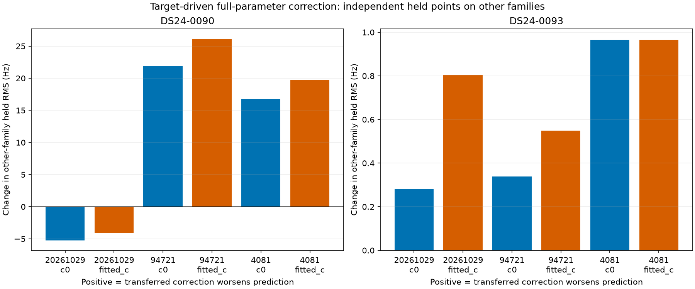
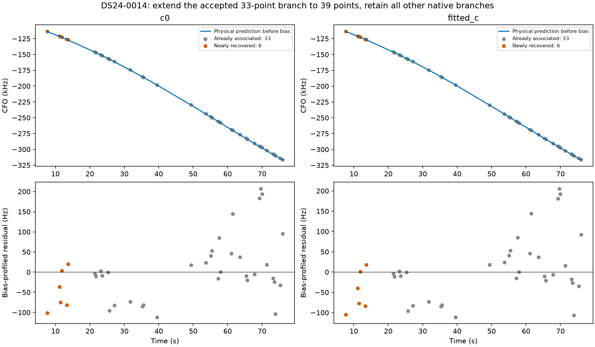

# Native residual failures: satellite, fragment bias, or receiver?

The conditional satellite/bias model does not qualify for recovery in these bounded trials. The original constrained model extends one already recovered DS24-0014 branch by six distinct points and improves its position error in both c arms. Separately, four original-model graph trials pass, adding 248 points across four automatic recordings; three improve position error and one worsens it.

This iteration follows the [matched recovery-fit audit](../2026_10_30_native_feasible_refit/README.md). It tests all four newly supported native proposals that still fail their own residual checks, plus both previously investigated native failures (DS24-0090 and DS24-0093). Selection uses failure class, not evaluation position error. It also advances the separate graph inventory and tests the preceding batch's supported identities.

## What the controlled parameter experiment means

The previous satellite-only moment projection could move a phase while leaving a correlated old fragment bias stale. For a coherent local Gaussian conditional diagnostic, partition parameters into free and fixed coordinates. Fix excluded coordinates at their original posterior means and use the **principal precision block** for the free coordinates; taking a principal covariance block would instead marginalize the allegedly fixed coordinates. Condition the free coefficients on the target using its existing measurement noise and 300 Hz constant-bias prior. No new drift, polynomial, orbital mode, threshold, or prior width is introduced.

Five diagnostic variants distinguish mechanisms: constant target bias only; existing satellite phase/orbit coordinates with old fragment biases fixed; those satellite coordinates plus their correlated old fragment biases; receiver coordinates only; and all existing coordinates. The last two can change receiver estimates and are **diagnostics only**. The proposed satellite/bias position model leaves receiver coefficients exactly unchanged at any fixed position. It changes predictive uncertainty by conditioning on excluded coordinates rather than integrating their uncertainty, so it is an empirical conditional model, not a recovered exact joint Bayesian posterior or a harmless plotting change.

The full-data diagnostic uses the saved RF-only endpoint and verifies its original objective to 1e-5. Its improvement alone is in-sample. Prediction checks refit calibration from the original regional center after withholding the same randomized 12-second blocks across **all receivers/channels**, with two-second guards. Target training points alone condition the new parameters and target constant bias. Three distinct timestamp-selected partitions and both c arms are retained. Training uses fixed 150 Hz noise, unit curve weights, and predictive variance multiplier two, matching the earlier validation protocol. Positions and Gamma noise precisions are plug-in estimates. Previously selected identities/graph assignments remain conditioning assumptions; this is model diagnosis, not independent validation of the joint identity-score rule.

| scan | original_RMS_hz | satellite_bias_RMS_hz | target_noise_pass | old_new_failures | held_RMS_wins | held_comparisons | minimum_held_score_gain | maximum_held_score_gain |
| --- | --- | --- | --- | --- | --- | --- | --- | --- |
| DS24-0010 | 91.038 | 90.381 | False | 0 | 6 | 6 | -0.014 | 0.059 |
| DS24-0063 | 153.604 | 137.011 | True | 0 | 5 | 6 | -0.168 | 2.370 |
| DS24-0069 | 177.241 | 165.498 | False | 0 | 6 | 6 | 0.136 | 0.819 |
| DS24-0014 | 80.225 | 77.622 | True | 1 | 0 | 6 | -0.050 | 0.006 |
| DS24-0090 | 139.708 | 135.355 | False | 0 | 6 | 6 | -0.237 | 3.233 |
| DS24-0093 | 104.684 | 66.418 | True | 0 | 6 | 6 | -0.116 | 2.205 |

RMS columns and old-witness failures above are fitted-c full-data diagnostics; the held counts cover three partitions × two c arms. A held score gain is improvement in conditional log-predictive density relative to constant-bias-only prediction. Overlapping folds are not pooled into evidence or a significance claim. [All parameter diagnostics](full_parameter_diagnostics.csv), [held target predictions](held_prediction.csv), [held witnesses](held_witnesses.csv), and [every diagnostic plot](diagnostic_gallery.md) preserve mixed outcomes.

## What transfers to other curves?

DS24-0093 is the strongest satellite/bias hypothesis: the fixed-position target falls from about 95–105 Hz RMS to 64–66 Hz, no previously passing conditional witness fails in that diagnostic, and held target RMS improves in all six comparisons. Held density does not improve uniformly, and some same-family held witnesses worsen. The explanation therefore still needs a complete joint acceptance test.

DS24-0090 demonstrates why a target-only fit can mislead. Updating all existing coordinates lowers its held target RMS substantially, yet worsens the aggregate held residuals of other satellite families on that receiver in four of six comparisons (roughly 17–26 Hz in those cases). These witness points were excluded from calibration and conditioning. This argues against treating that target-induced receiver change as a generally supported correction. It does not by itself prove a wrong satellite ID. DS24-0063 has more favorable other-family receiver transfer in five of six comparisons and remains a separate receiver-model investigation. DS24-0069 retains target structure even after the all-coordinate full-fit diagnostic. DS24-0014's satellite/bias update improves none of the six held target RMS comparisons.

Witness aggregation is within each partition and only over available qualifying same-receiver overlapping curves. It is not a whole-scan error estimate or independent repetition across folds. [Transfer measurements](held_transfer.csv) expose the exact rows and point counts.

## Complete position trials, including failures

Every one of the six cases receives both the original predictive model and the conditional satellite/bias model, with matched c=0/fitted-c observations, candidates, original priors and regional bounds. Both start at the accepted RF incumbent and use SLSQP with five phase refreshes ×48 iterations. A second matched pair applies the existing feasibility constraints to both models, so a rescue is not automatically credited to a new satellite model when constrained fitting alone could explain it. Gate thresholds are unchanged. Final acceptance requires all old and new gates, zero old-point loss, bounded phase and at most 1 Hz exact phase-linearization discrepancy for refreshed models. Original point counts in rejected fits are proposals, not recoveries.

Execution outcomes: {'complete': 24}; 24 complete control/target pairs; **native trials passing paired checks: 1**. Partial artifacts and execution timeouts remain explicit. Passing trials are individual prototypes relative to their frozen baseline; they are not automatically stacked with the newer native joint policy, which can contain overlapping points and shared-parameter interactions.

| scan | model | optimizer | passes | control_passes | target_pass | added | lost | before_error_km | after_error_km | target_RMS_hz |
| --- | --- | --- | --- | --- | --- | --- | --- | --- | --- | --- |
| DS24-0010 | original | free | False | True | False | 65 | 0 | 1.314 | 1.313 | 91.038 |
| DS24-0010 | conditional_satellite_bias | free | False | True | False | 65 | 0 | 1.265 | 1.265 | 90.448 |
| DS24-0063 | original | free | False | True | False | 44 | 0 | 2.304 | 2.425 | 153.605 |
| DS24-0063 | conditional_satellite_bias | free | False | True | True | 44 | 0 | 1.413 | 2.088 | 135.953 |
| DS24-0069 | original | free | False | True | False | 25 | 0 | 1.319 | 1.460 | 177.240 |
| DS24-0069 | conditional_satellite_bias | free | False | True | False | 25 | 0 | 1.526 | 1.660 | 164.570 |
| DS24-0014 | original | free | False | True | False | 39 | 0 | 0.509 | 0.476 | 80.225 |
| DS24-0014 | conditional_satellite_bias | free | False | False | True | 39 | 0 | 0.489 | 0.461 | 77.110 |
| DS24-0090 | original | free | False | True | False | 79 | 0 | 2.129 | 2.069 | 139.710 |
| DS24-0090 | conditional_satellite_bias | free | False | True | False | 79 | 0 | 2.174 | 1.871 | 120.225 |
| DS24-0093 | original | free | False | True | False | 49 | 0 | 0.766 | 0.744 | 104.685 |
| DS24-0093 | conditional_satellite_bias | free | False | True | True | 49 | 0 | 0.731 | 0.601 | 64.403 |
| DS24-0010 | original | feasible | False | True | False | 65 | 0 | 1.314 | 2.035 | 90.531 |
| DS24-0010 | conditional_satellite_bias | feasible | False | True | False | 65 | 0 | 1.265 | 2.014 | 89.959 |
| DS24-0063 | original | feasible | False | True | False | 44 | 0 | 2.304 | 6.427 | 139.639 |
| DS24-0063 | conditional_satellite_bias | feasible | False | True | True | 44 | 0 | 1.413 | 2.088 | 135.953 |
| DS24-0069 | original | feasible | False | True | False | 25 | 0 | 1.319 | 4.584 | 163.437 |
| DS24-0069 | conditional_satellite_bias | feasible | False | True | False | 25 | 0 | 1.526 | 4.583 | 153.323 |
| DS24-0014 | original | feasible | True | True | True | 39 | 0 | 0.509 | 0.467 | 79.399 |
| DS24-0014 | conditional_satellite_bias | feasible | False | True | True | 39 | 0 | 0.454 | 0.966 | 75.113 |
| DS24-0090 | original | feasible | False | True | False | 79 | 15 | 2.129 | 7.977 | 124.012 |
| DS24-0090 | conditional_satellite_bias | feasible | False | True | False | 79 | 15 | 2.174 | 5.010 | 107.970 |
| DS24-0093 | original | feasible | False | True | False | 49 | 0 | 0.766 | 2.790 | 96.112 |
| DS24-0093 | conditional_satellite_bias | feasible | False | True | True | 49 | 0 | 0.731 | 3.237 | 64.687 |

GPS is used only in this evaluation table after fitting. A better score or error in a rejected trial is not an accepted localization gain. Different predictive models condition on different uncertainty, so their raw scores cannot establish identity correctness. [Both-arm trial data](position_trials.csv), [execution receipts](execution.csv), and [every CFO/residual plot](position_gallery.md) contain the full comparison.

The new conditional model passes **none of its twelve complete native trials** (six scans × two optimizer variants). These bounded failures do not prove no feasible solution exists globally. The sole passing individual native trial is DS24-0014 under the original model with the existing constraints. Thus this iteration does not justify adding the conditional satellite/bias model to production.

## Stack the one supported recovery without counting overlaps

DS24-0014's passing 39-point proposal contains all 33 points of an already accepted native branch with the same satellite owner. Retain the other six native branches and replace only that branch. Run both the previous seven-branch configuration and this extended configuration with the same original-model constrained optimizer, priors and budget. Both pass in both c arms. Every prior point and native satellite owner is retained; the net recovery is **six points, not 39**.

| arm | before_points | after_points | net_added | before_error_km | matched_previous_error_km | after_error_km |
| --- | --- | --- | --- | --- | --- | --- |
| c0 | 4414 | 4420 | 6 | 0.537 | 0.537 | 0.512 |
| fitted_c | 4414 | 4420 | 6 | 0.471 | 0.471 | 0.458 |

The matched previous fit separates optimizer effects from adding the six observations. The 93-scan research-policy accounting changes only DS24-0014; the other 92 scans reuse previous results. This is not a dataset-wide rerun or validation of a new model. Nine unavailable exports remain excluded. [Joint extension](joint_extension.csv), [cohort accounting](cohort_accounting.csv), and [cohort metrics](cohort_metrics.csv) preserve this distinction.

| arm | variant | points | associated_percent | mean_error_km | median_error_km | p90_error_km |
| --- | --- | --- | --- | --- | --- | --- |
| c0 | before | 156011 | 72.869 | 1.464 | 1.167 | 2.685 |
| c0 | after | 156017 | 72.872 | 1.463 | 1.167 | 2.685 |
| fitted_c | before | 155994 | 72.861 | 1.473 | 1.190 | 2.580 |
| fitted_c | after | 156000 | 72.864 | 1.473 | 1.190 | 2.580 |

## Graph inventory and original-model inclusions

The annotation batch outcomes are {'unstable_identity': 10, 'conditionally_supported_identity': 16, 'prediction_mismatch': 4, 'execution_timeout': 1, 'ambiguous_identity': 1}. **836 / 1630** original entries now have assessments. Native alternatives do not change this denominator. [Full ledger](annotation_ledger.csv) and [batch outcomes](graph_annotation_batch.csv) retain uncertainty and timeouts.

The preceding batch supplies 20 original-model graph inclusion trials; **4 pass** in both c arms. These automatic-recording prototypes use their original models and do not depend on the new conditional satellite/bias model.

| scan | norad | added | lost | before_error_km | after_error_km |
| --- | --- | --- | --- | --- | --- |
| AUTO-d969e15a | 68713 | 57 | 0 | 1.239 | 0.944 |
| AUTO-181f6b0c | 63373 | 80 | 0 | 0.693 | 0.653 |
| AUTO-d9398a01 | 66532 | 56 | 0 | 2.219 | 2.190 |
| AUTO-a60b939e | 63282 | 55 | 0 | 0.936 | 0.956 |

[All graph trials](graph_trials.csv), [failed gates](graph_gate_failures.csv), and [all graph CFO/residual figures](graph_gallery.md) preserve the rejected cases as well. These results are not merged into the DS24 native cohort's coverage percentage.

## Reproduction and limits

`probe_native_parameter_consistency.py` implements exact replay, parameter diagnostics and scan-wide randomized block refits. `fixed_coordinate_prediction.py` contains the tested conditional Gaussian calculation. `conditional_satellite_refresh.py` uses an equivalent low-dimensional Gaussian elimination for position fits; dense and low-dimensional implementations agree in tests. `include_predictive_annotations.py --conditional-satellite-refresh` is opt-in and does not change default inference. Inference protocols contain the exact commands and source hashes.

The six diagnostic jobs and twelve unconstrained position jobs have 600-second caps. The twelve matched feasible position jobs have 180-second caps. Each pool uses four workers. The two stacked DS24-0014 jobs use two workers and 180-second caps. Graph annotation uses 16 workers and 600-second per-case caps; graph inclusion uses eight workers. No new RF collection, future TLE, production deployment, or ALGO promotion occurs. Conditional physical feasibility and predictive model comparisons do not certify satellite identity. Difficult negative controls and independently selected recordings remain required before promotion.

The next diagnostic for DS24-0093 is a shared-phase feasibility interval across old and new curves at a fixed RF-only position, with fragment biases reconciled. The current constrained solver varies position while nuisance means remain conditional posterior estimates; its failure does not prove that no other plausible phase realization can satisfy the curves together. For DS24-0063, test a receiver correction learned exclusively from other families before evaluating its transfer to the native target. Keep these hypotheses separate from the unresolved false-association calibration of the identity score.

[Summary](summary.json), [source hashes](sources.json), and [compact numerical evidence](evidence.json.gz). Repetitive observation IDs and optimizer histories are compacted to receipts; full originals remain at recorded paths. The complete annotation/recovery objective remains active.
