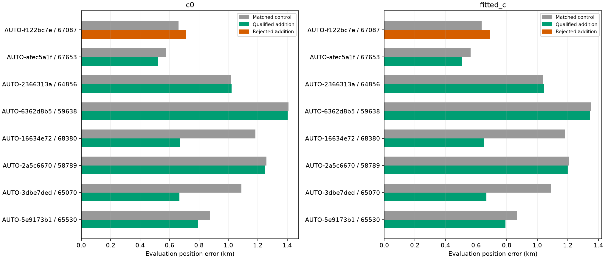
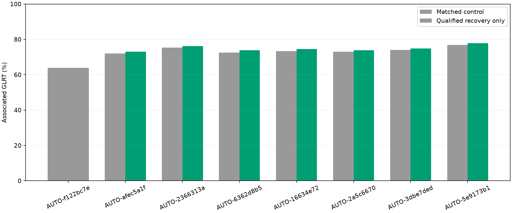
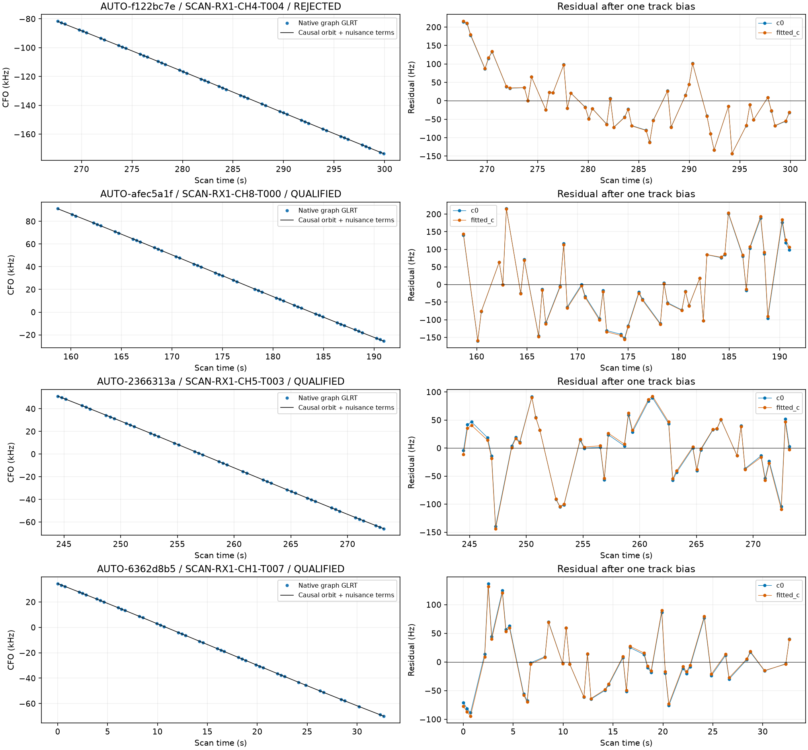
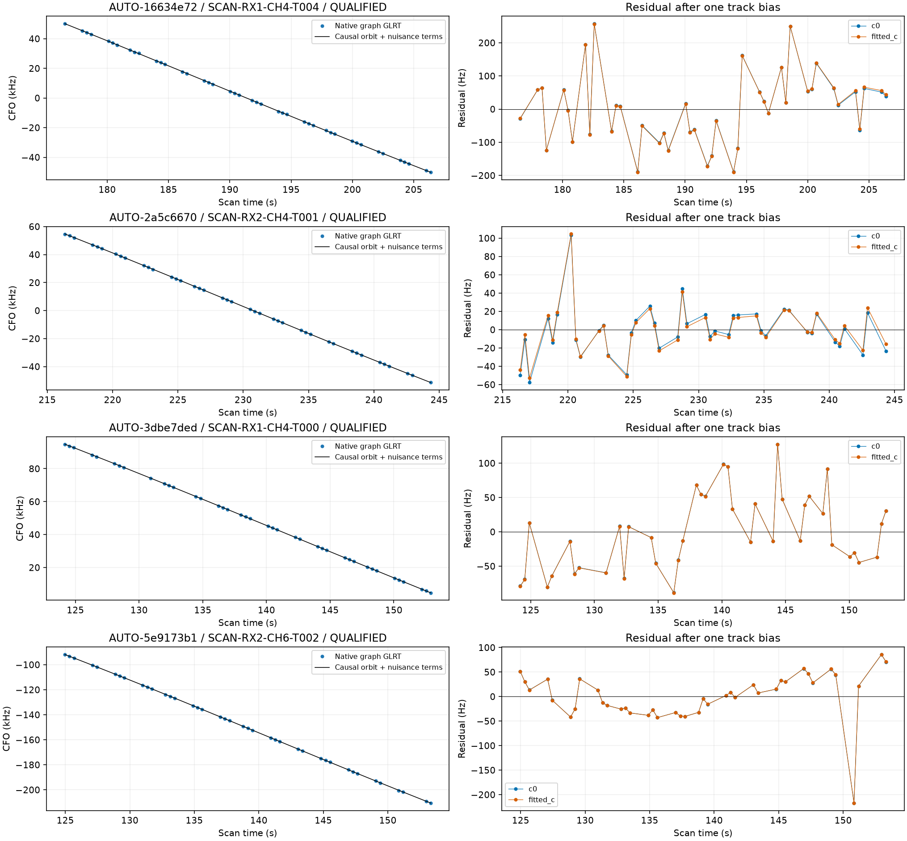

# Recovering predictive curves omitted by the calibration-engine queue

The source reconciliation exposed a routing error: the predictive inclusion batch reused a selector requiring `engine_member=True`. That excludes curves omitted from the calibration engine even when they have a supported predictive-only identity. We removed this requirement for the predictive queue while preserving it for the calibration-participating route. An omitted curve still has to pass identity, physical residual, ownership, phase and numerical checks.

Of the eight largest affected curves, **7 qualify**, recovering **295 distinct GLRT points** across separate scans. No curve is forced into receiver calibration, and no GPS position selects a candidate or retry. The full goal is incomplete; this report leaves **45 additional omitted curves** from this reconciliation queue for subsequent validation and position trials.

## Source inventory and exact scope

The registry scans 2886 study protocols and indexes 663 position outputs, linking them to 306 of the 1,630 inventoried curves by observation IDs or explicit legacy curve IDs. It distinguishes full-curve coverage from partial overlap and calibration-participating trials from predictive-only trials. A sibling replay is not accepted as evidence for another trial: its hash must cover that trial file.

Of the 63 supported primary annotations lacking an inclusion link, **10 already have predictive trials** and **53 have no full predictive trial in the recognized saved-output schemas**. All 53 are omitted from the calibration engine. This is an inventory of the specified study and schemas, not proof that no other historical experiment exists elsewhere. Reconciliation alone awards no association credit. [The 63-record source table](supported_reconciliation.csv) and compact trial registry evidence are retained.

All eight selected captures are **adaptive**, confirmed from raw tracking metadata. Six are 10 MS/s and two are 2.5 MS/s. Filenames and inherited inventory metadata are not reliable substitutes for capture metadata. Consequently these are research-corpus adaptive recoveries, **not a DS24-fast performance evaluation**. [annotations.csv](annotations.csv) records capture mode and sample rate per case.

## Validation correction before qualification

The old three random seeds gave only **two distinct target holdouts in every selected case**. Preliminary position tests using those identities remain immutable and receive no recovery credit in this report. We then reran causal candidate nomination and identity validation with three distinct randomized scanwide 12-second partitions and two-second guards. The partition schedule is selected using timestamps alone; receiver fits exclude held/guard observations. The report independently replays target masks and verifies three distinct holdouts and the saved schedule. All eight identities remain supported. These reused scans are research validation, not a fresh independent dataset-wide generalization test.

| scan | points | old_distinct_partitions | new_distinct_partitions | old_norad | new_norad | minimum_margin |
| --- | --- | --- | --- | --- | --- | --- |
| AUTO-f122bc7e | 47 | 2 | 3 | 67087 | 67087 | 38.260 |
| AUTO-afec5a1f | 45 | 2 | 3 | 67653 | 67653 | 99.847 |
| AUTO-2366313a | 43 | 2 | 3 | 64856 | 64856 | 1082.242 |
| AUTO-6362d8b5 | 43 | 2 | 3 | 59638 | 59638 | 97.047 |
| AUTO-16634e72 | 43 | 2 | 3 | 68380 | 68380 | 15.446 |
| AUTO-2a5c6670 | 41 | 2 | 3 | 58789 | 58789 | 16.951 |
| AUTO-3dbe7ded | 40 | 2 | 3 | 65070 | 65070 | 105.014 |
| AUTO-5e9173b1 | 40 | 2 | 3 | 65530 | 65530 | 702.793 |

[partitions.csv](partitions.csv) includes actual held indices, blocks, seeds and point counts. `engine_member=False` and `active_curvature=False` remain true for all eight: this work uses their predictions while preserving the rule that they must not calibrate receiver offsets or drifts.

## Position results with matched c ablation

Each control/addition and both c arms start at the same center of a 25 × 25 km region, use the same observations apart from the explicitly added target, causal catalogue, nuisance priors and budgets. New-family inclusion integrates phase at 0.025 s and physical orbital/receiver uncertainty; a shared-family target uses the existing receiver/family information. The target does not change receiver calibration at a fixed position. GPS is used only to calculate report-time error.

| scan | norad | points | qualified | c0_before_km | c0_after_km | fitted_c_before_km | fitted_c_after_km |
| --- | --- | --- | --- | --- | --- | --- | --- |
| AUTO-f122bc7e | 67087 | 47 | False | 0.660 | 0.710 | 0.636 | 0.691 |
| AUTO-afec5a1f | 67653 | 45 | True | 0.575 | 0.520 | 0.564 | 0.510 |
| AUTO-2366313a | 64856 | 43 | True | 1.020 | 1.022 | 1.041 | 1.043 |
| AUTO-6362d8b5 | 59638 | 43 | True | 1.408 | 1.404 | 1.354 | 1.346 |
| AUTO-16634e72 | 68380 | 43 | True | 1.185 | 0.672 | 1.180 | 0.654 |
| AUTO-2a5c6670 | 58789 | 41 | True | 1.258 | 1.246 | 1.209 | 1.200 |
| AUTO-3dbe7ded | 65070 | 40 | True | 1.089 | 0.668 | 1.089 | 0.668 |
| AUTO-5e9173b1 | 65530 | 40 | True | 0.873 | 0.792 | 0.869 | 0.792 |

The first refreshed pass qualifies four cases. Three further cases pass residual, phase-grid, ownership and exact-orbit checks but fail optimizer completion in c=0 (one also fails its control optimizer). They receive a separate **matched Powell retry** for control/addition and both c arms, preserving observations, identities, priors, five phase rounds and the declared 48-iteration/240-evaluation budget. Selection uses numerical failures alone. The 67087 residual failure is excluded from retries. Original L-BFGS-B results are retained in [all_position_trials.csv](all_position_trials.csv), including unsuccessful optimizers. Objective effects and position errors are separate columns; scores across different observation counts are not localization accuracy.

The largest observed gains are AUTO-16634e72 / 68380 (fitted-c **1.180 → 0.654 km**) and AUTO-3dbe7ded / 65070 (**1.089 → 0.668 km**). AUTO-2366313a / 64856 adds 43 points with a small roughly 2 m error increase. Additional associations are useful evidence, but do not guarantee a better location in every scan. These improvements are separate per-scan experiments, not additive shifts or a full-dataset performance claim.

| scan | points | baseline_percent | proposed_percent | credited_points |
| --- | --- | --- | --- | --- |
| AUTO-f122bc7e | 47 | 63.895 | 64.830 | 0 |
| AUTO-afec5a1f | 45 | 71.950 | 73.075 | 45 |
| AUTO-2366313a | 43 | 75.393 | 76.237 | 43 |
| AUTO-6362d8b5 | 43 | 72.498 | 73.928 | 43 |
| AUTO-16634e72 | 43 | 73.302 | 74.556 | 43 |
| AUTO-2a5c6670 | 41 | 73.030 | 73.885 | 41 |
| AUTO-3dbe7ded | 40 | 74.023 | 74.921 | 40 |
| AUTO-5e9173b1 | 40 | 76.819 | 77.772 | 40 |

The table exposes proposed coverage for rejected cases, while `credited_points` and the plotted accepted coverage remain zero/unchanged for them. Qualified additions preserve every incumbent point and exact owner; target observation sets are disjoint and checked against each control. No duplicate credit is awarded for the preliminary tests, the refreshed tests, or numerical retries.

## Native curves and residuals

The unrecovered AUTO-f122bc7e / 67087 track has only about 80–81 Hz RMS, but retains a trend (slope z ≈ 4.46), step (z ≈ 5.02), and serial correlation (≈ 0.63; limit ≈ 0.58). Low RMS and a stable identity alone do not make it consistent with the current receiver/orbit model. It is left unresolved; no drift adjustment or threshold relaxation is inferred from that target alone. [physical_checks.csv](physical_checks.csv) reports the residual tests for every final c arm.

## Reproduction and next work

The code change is in `run_supported_graph_inclusions.py` and `run_predictive_queue_inclusions.py`: predictive callers admit omitted curves, while the original calibration-only default remains. The bounded reconciled runner refreshes distinct identity validation before inclusion, and the numerical retry runner requires physical/exact checks to pass before changing optimizers. Run `reconcile_predictive_inclusion_sources.py`, then `run_reconciled_predictive_inclusions.py`, then `retry_predictive_numerical_failures.py` with the immutable study/output paths in the saved protocols. The report records the historical first pass separately from the current runner, which now requires distinct revalidation upfront.

The updated [1,630-row ledger](annotation_ledger.csv) links the eight fresh annotations and final trials without overwriting historical single-curve/group evidence. [remaining_omitted_candidates.json](remaining_omitted_candidates.json) freezes the next 45 candidates; they still require distinct identity validation, inclusion and exact replay. The older calibration-participating annotations remain a separate larger workstream. The remaining physical failure should be revisited with independent receiver/satellite witnesses, not repeated optimization.

Fourteen focused regression tests passed, including omitted-curve routing, partial-overlap exclusion, distinct-holdout validation and rejection of numerical retries when physical/ownership checks fail. No production deployment, new ALGO version, threshold relaxation or full-dataset benefit is claimed. [Execution receipts](executions.csv), [source hashes](sources.json), and [compact evidence](evidence.json.gz) accompany this iteration.
