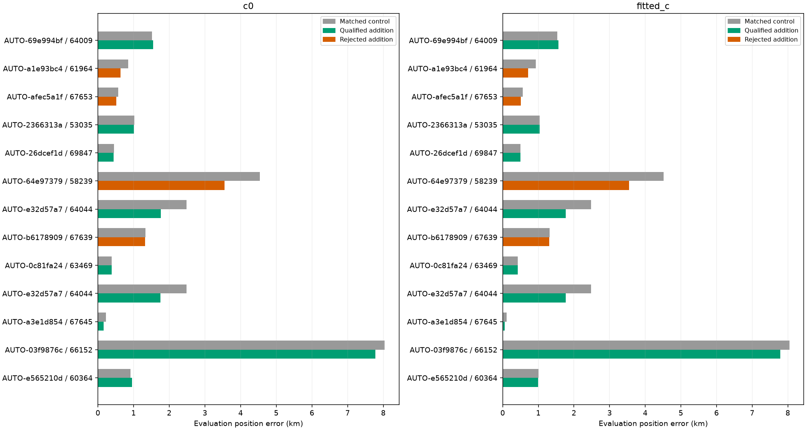
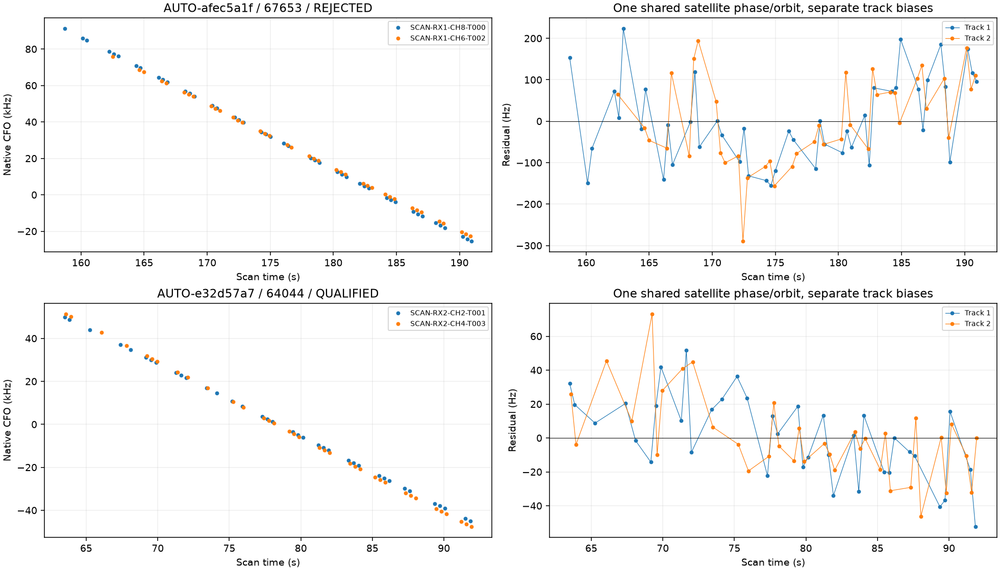
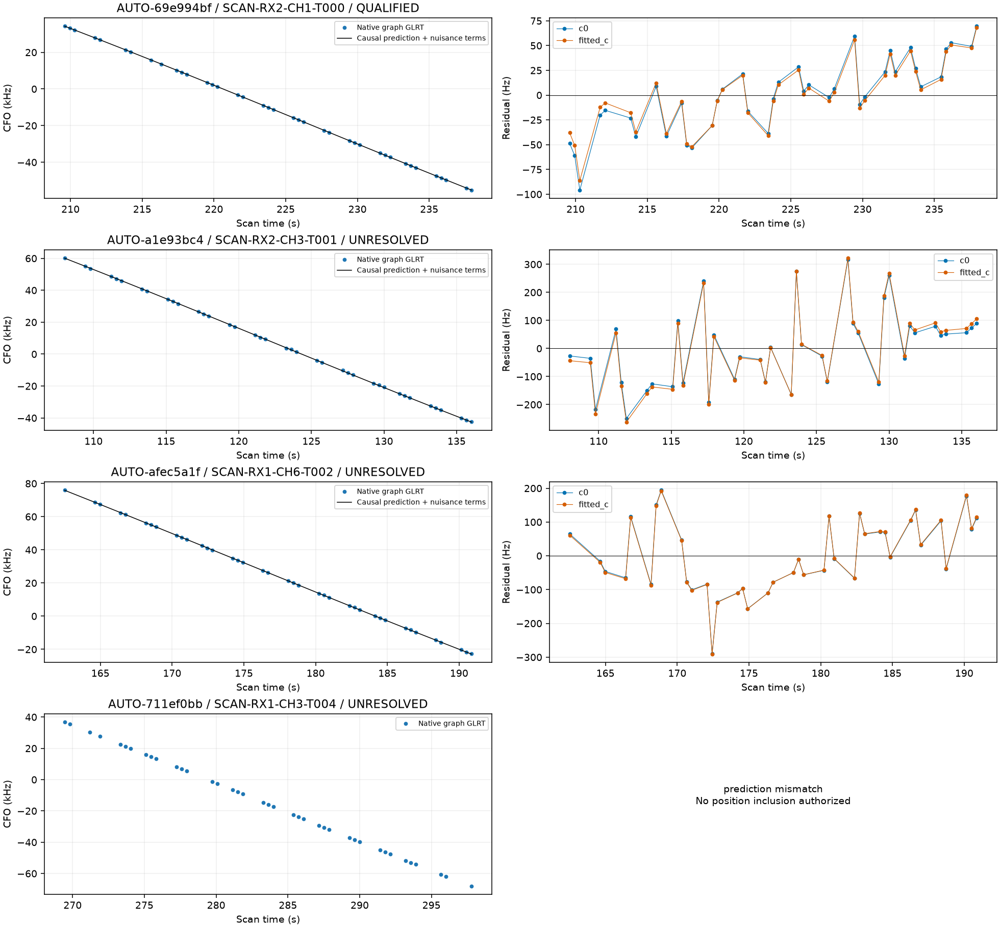
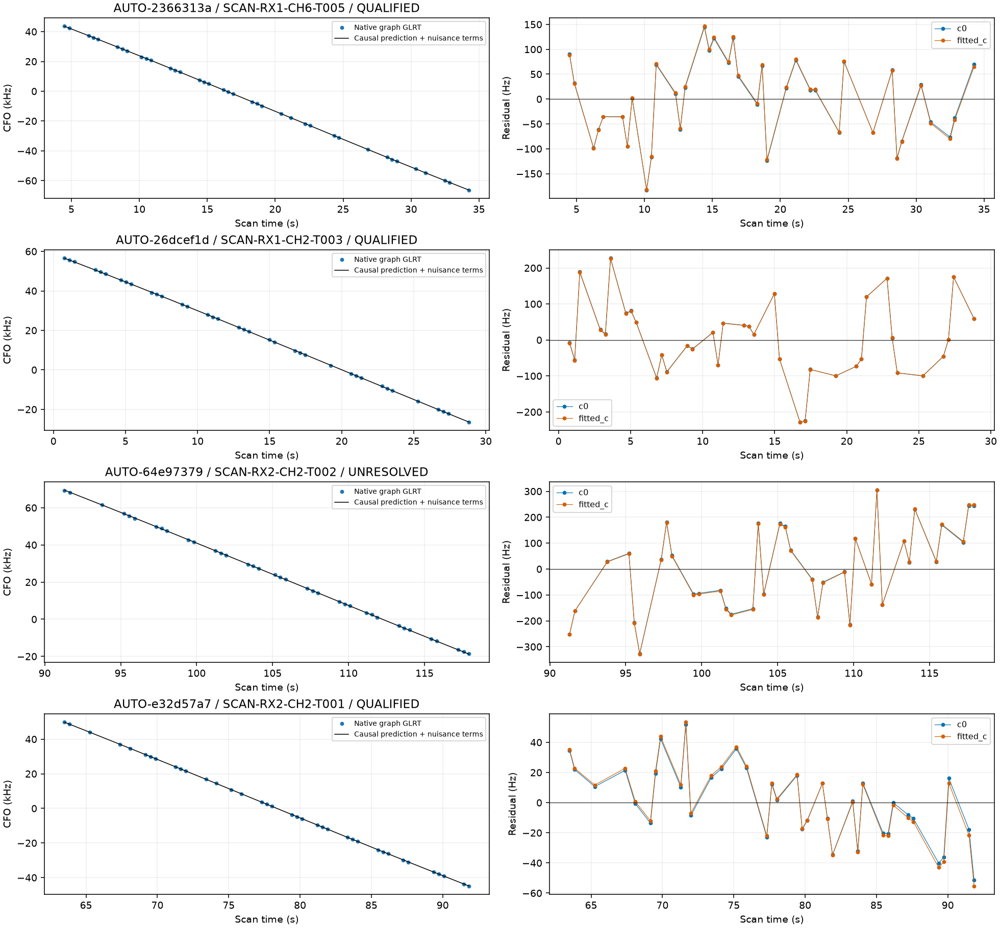
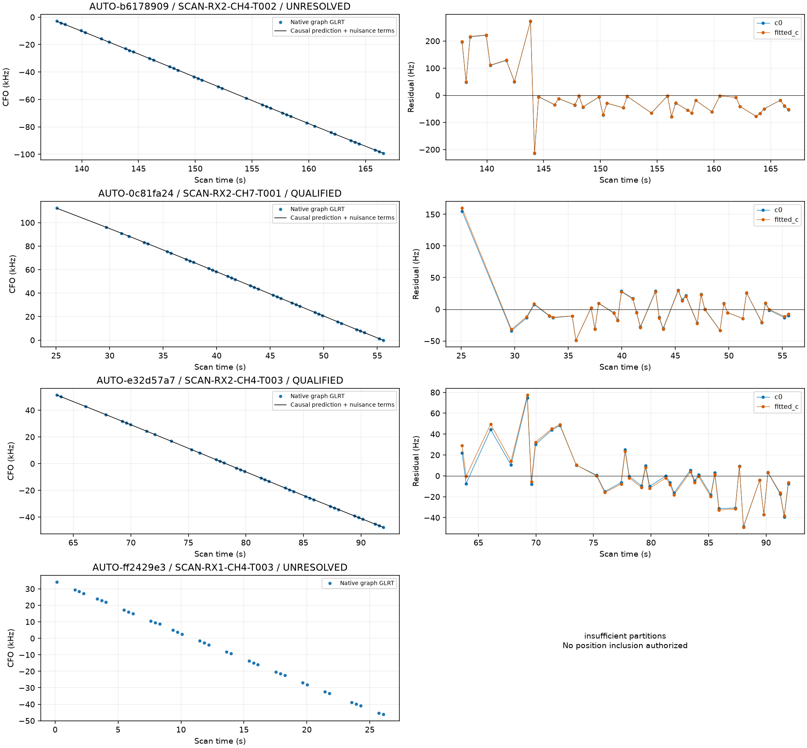
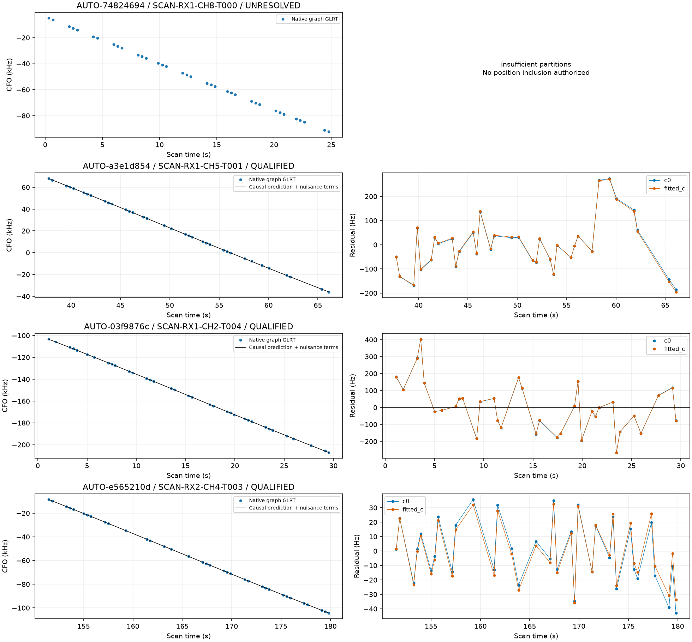

# Second omitted-curve batch and simultaneous same-satellite inclusion

**Capture-mode correction:** the all-adaptive interpretation below is superseded by the [acquisition-provenance audit](../2026_10_30_predictive_role_reassessment/README.md). Fast compatibility exports encode `capture_mode=adaptive`; this is not acquisition provenance. Across the full 53-curve queue, verified acquisition evidence gives 49 fast and four adaptive recordings. The linked 69-row provenance table supersedes this report's capture-mode fields. Scientific trial outputs and position errors are unchanged.

This iteration assesses the next **16 of 45** pending omitted curves. **10 pass individual inclusion gates (367 points)**, but joint residual review reveals a common discrepancy in one family. After withholding that family's current 39-point curve, **9 current candidates remain (328 points)**. Its earlier 45-point recovery is also flagged for review; neither is presently counted as ready for inclusion. Across the two omitted-curve batches, **578 points remain research candidates after this review**. **29 candidates remain** in the pending queue. The full 1,630-curve objective is incomplete.

## Validation and coverage of the work

The same causal predictive-only method is used. Targets cannot calibrate receiver offsets or drifts. Every supported identity must survive three distinct timestamp-selected random scanwide 12-second holdouts with two-second guards. Both c arms retain matched candidates, priors, observations and search budgets. GPS is only used for reporting error; the regional start is the 25 × 25 km box centered at 37.906, −122.545.

Fresh annotation outcomes are **{'conditionally_supported_identity': 13, 'prediction_mismatch': 1, 'insufficient_partitions': 2}**. A previously supported label can become prediction mismatch or lack enough distinct partitions. Insufficient partitions mean validation is unavailable, not that the detected curve is noise. Such cases receive no position inclusion. The [partition table](partitions.csv) records actual held indices and the [annotation table](annotations.csv) records all outcomes and margins.

Capture modes are **{'adaptive': 16}**, obtained from raw tracking metadata rather than filenames or inherited inventory fields. Actual and inventory sample rates are both recorded. These results must not be presented as a DS24-fast validation cohort.

## Individual position trials

All supported identities receive matched regional control/addition trials. New-family likelihoods integrate phase at 0.025 seconds and physical orbital/receiver uncertainty. Exact orbit replay, incumbent ownership, target residual and numerical checks remain unchanged. Only cases passing all physical/exact checks but failing optimizer completion receive a matched Powell retry for both controls and additions, both c arms, with five phase rounds and 48 iterations / 240 evaluations. Retry selection never uses GPS error.

| scan | norad | points | individual_gate_pass | qualified | status | c0_before_km | c0_after_km | fitted_c_before_km | fitted_c_after_km |
| --- | --- | --- | --- | --- | --- | --- | --- | --- | --- |
| AUTO-69e994bf | 64009 | 39 | True | True | RF_verified_research_candidate | 1.516 | 1.547 | 1.534 | 1.564 |
| AUTO-a1e93bc4 | 61964 | 39 | False | False | inclusion_rejected | 0.847 | 0.630 | 0.935 | 0.711 |
| AUTO-afec5a1f | 67653 | 39 | True | False | withheld_common_family_residual | 0.575 | 0.522 | 0.564 | 0.512 |
| AUTO-711ef0bb | 59304 | 39 | False | False | refreshed_identity_not_supported | None | None | None | None |
| AUTO-2366313a | 53035 | 38 | True | True | RF_verified_research_candidate | 1.020 | 1.013 | 1.041 | 1.033 |
| AUTO-26dcef1d | 69847 | 37 | True | True | RF_verified_research_candidate | 0.453 | 0.446 | 0.497 | 0.501 |
| AUTO-64e97379 | 58239 | 37 | False | False | inclusion_rejected | 4.539 | 3.546 | 4.518 | 3.545 |
| AUTO-e32d57a7 | 64044 | 37 | True | True | RF_verified_research_candidate | 2.487 | 1.763 | 2.479 | 1.766 |
| AUTO-b6178909 | 67639 | 37 | False | False | inclusion_rejected | 1.332 | 1.318 | 1.314 | 1.304 |
| AUTO-0c81fa24 | 63469 | 36 | True | True | RF_verified_research_candidate | 0.385 | 0.391 | 0.421 | 0.427 |
| AUTO-e32d57a7 | 64044 | 36 | True | True | RF_verified_research_candidate | 2.487 | 1.755 | 2.479 | 1.774 |
| AUTO-ff2429e3 | None | 36 | False | False | refreshed_identity_not_supported | None | None | None | None |
| AUTO-74824694 | None | 36 | False | False | refreshed_identity_not_supported | None | None | None | None |
| AUTO-a3e1d854 | 67645 | 35 | True | True | RF_verified_research_candidate | 0.225 | 0.159 | 0.106 | 0.061 |
| AUTO-03f9876c | 66152 | 35 | True | True | RF_verified_research_candidate | 8.038 | 7.781 | 8.046 | 7.794 |
| AUTO-e565210d | 60364 | 35 | True | True | RF_verified_research_candidate | 0.917 | 0.955 | 1.002 | 0.998 |

The two AUTO-e32d57a7 curves assigned to 64044 each improve position when added alone; they are two measurements in the **same scan**, not two independent location experiments. AUTO-03f9876c remains a large position-error case despite recovering evidence. Rejected trials may also reduce evaluation error; that does not override their RF failures. Objective values and accuracy are reported separately in [all_position_trials.csv](all_position_trials.csv). Objectives with different observation counts are not comparable measures of localization quality.

| scan | track_id | qualified | baseline_percent | proposed_percent | credited_points |
| --- | --- | --- | --- | --- | --- |
| AUTO-69e994bf | 39608c5cb92a83e6f092 | True | 41.596 | 42.486 | 39 |
| AUTO-a1e93bc4 | 4d79c47ee0a576e6d471 | False | 65.967 | 67.246 | 0 |
| AUTO-afec5a1f | 55c24b833d1aba1c0f4b | False | 71.950 | 72.925 | 0 |
| AUTO-2366313a | fef6bf3f676cce9a36f7 | True | 75.393 | 76.139 | 38 |
| AUTO-26dcef1d | 2dee426e06e31bef76f1 | True | 69.730 | 70.932 | 37 |
| AUTO-64e97379 | 4f3685543055de5c34df | False | 63.997 | 64.938 | 0 |
| AUTO-e32d57a7 | 6120359c326b259fae1b | True | 76.372 | 77.325 | 37 |
| AUTO-b6178909 | b3c367e034a548298d5e | False | 63.094 | 64.268 | 0 |
| AUTO-0c81fa24 | 9e27456e20a428a635bf | True | 71.985 | 72.804 | 36 |
| AUTO-e32d57a7 | d2d877d8185e8df888c5 | True | 76.372 | 77.300 | 36 |
| AUTO-a3e1d854 | 37d19e7140aa06bbaa16 | True | 72.948 | 73.912 | 35 |
| AUTO-03f9876c | 4d2518fe32d1a8741098 | True | 73.363 | 74.395 | 35 |
| AUTO-e565210d | a9efc200ccc1ca553d2f | True | 71.589 | 72.316 | 35 |

Proposed coverage is shown for transparency; rejected additions receive zero credited points. Qualified trials preserve all incumbent observation IDs and owners. Point sets are compared with the first omitted batch to avoid duplicate credit. Per-curve location improvements cannot be summed or treated as a dataset-wide error distribution, especially where multiple curves come from one scan.

## Joint inclusion: one satellite correction shared across tracks

Two pairs have independently validated identities for the same satellite in the same immutable scan: AUTO-afec5a1f / 67653 (the earlier 45-point CH8 recovery and a 39-point CH6 curve), and AUTO-e32d57a7 / 64044 (37-point CH2 and 36-point CH4 curves). We test each pair simultaneously, using one shared satellite phase/orbit distribution and the receiver uncertainty once. Each graph track retains its own 300 Hz bias prior. This is not a geometric merge and not a sum of independently marginalized likelihoods.

Both joint controls/additions use matched Powell fits, the same physical priors and 0.025-second phase integration. Every constituent target must pass nominal and continuously refined residual checks in both c arms; exact incumbent ownership is preserved. Satellite labels come from independent causal nomination, not a manual catalogue restriction. The grouping helper rejects repeated curves and never shares satellite corrections across different scans.

| scan | norad | arm | points | original_joint_gate_pass | common_residual_pass | qualified | control_error_km | addition_error_km |
| --- | --- | --- | --- | --- | --- | --- | --- | --- |
| AUTO-afec5a1f | 67653 | c0 | 84 | True | False | False | 0.575 | 0.512 |
| AUTO-afec5a1f | 67653 | fitted_c | 84 | True | False | False | 0.564 | 0.502 |
| AUTO-e32d57a7 | 64044 | c0 | 73 | True | True | True | 2.486 | 1.733 |
| AUTO-e32d57a7 | 64044 | fitted_c | 73 | True | True | True | 2.478 | 1.744 |

Visual inspection exposed a gap in the original joint acceptance rule: it checked each track separately but did not check common structure across their combined residuals. The added audit pools the same receiver's disjoint timestamps **without refitting biases**, in both Hz and RF-normalized units, using nominal and continuously refined predictions in both c arms. AUTO-afec5a1f / 67653 fails: normalized quadratic BIC gain is approximately **15.5–17.3** (limit 10), and step z is approximately **4.73–4.86** (limit 4). Both individual tracks had passed. Its apparent **0.564 → 0.502 km** location improvement therefore remains a rejected joint diagnostic, not an accepted 500 m result. The earlier 45-point and current 39-point individual passes remain preserved as historical results, but both are now withheld from inclusion pending explanation of their common bend.

AUTO-e32d57a7 / 64044 passes the combined audit and retains the 73-point joint recovery, with fitted-c error **2.478 → 1.744 km**. [joint_common_residuals.csv](joint_common_residuals.csv) records all checks. This additional check is a common-structure diagnostic, not a calibrated family-wise false-alarm probability: channels may carry correlated noise. It is sufficient reason to withhold a model with unexplained common structure; it does not establish that either satellite identity is wrong. Independent evidence from another satellite on this receiver, or this satellite on another receiver, is needed to distinguish receiver error from satellite-model error.

The new audit is now part of the joint runner. Original trial outputs and terminal receipts remain unchanged; this report distinguishes their original passes from reviewed qualification. Point overlap is explicit and no duplicate credit is awarded. These tests do not yet jointly combine different recovered satellite families in a scan, including the earlier 67634 recovery in AUTO-e32d57a7. That broader simultaneous inclusion remains necessary before claiming a final scan-wide recovered solution.

## GLRT curves and residual evidence for every case

Every selected curve appears, including unresolved identities. Residual panels use the final tested physical model. No fitted orbit is presented for a curve without an authorized identity. The saved per-arm table includes mean, slope, quadratic, step and serial-correlation diagnostics alongside RMS, phase closure and numerical status. Low RMS alone does not authorize inclusion.

The three physical rejections have specific remaining discrepancies. AUTO-a1e93bc4 / 61964 retains a fitted-c slope z of about 3.21 (limit 3), despite a passing c=0 slope. AUTO-64e97379 / 58239 is close to the trend boundary in both arms (about 3.03 and 3.07); its roughly 0.97 km evaluation-error reduction cannot override that failure. AUTO-b6178909 / 67639 retains both a trend (z ≈ 3.47) and a step (z ≈ 5.09, limit 4), despite only about 96 Hz RMS. These thresholds are unchanged. No independent receiver-event evidence was established in this batch, so these discrepancies are not converted into new drift parameters or automatic retries.

## State and next batch

The [updated 1,630-row ledger](annotation_ledger.csv) links fresh identities, individual trials and separate joint-family outcomes. [remaining_omitted_candidates.json](remaining_omitted_candidates.json) contains the next **29** unchanged candidates. [series_qualified_trials.json](series_qualified_trials.json) preserves individual gate-passing point sets and explicitly marks each with `reviewed_candidate`; the two withheld 67653 members have this flag false. It is not a production association catalogue or a list of simultaneous solutions. The larger older calibration-participating annotation workstream remains outstanding.

Position and annotation stages have terminal receipts in [executions.csv](executions.csv); the additional common audits have completed result artifacts in the compact evidence. Exact-replay and common-audit source hashes are verified. Every failed trial is retained. No future TLE, RF acquisition, relaxation of residual thresholds, GPS-based candidate selection or production deployment is introduced.

The targeted regression suite passed 16 tests, including unchanged pending-manifest selection, duplicate-curve and cross-scan protection, distinct holdouts, numerical-retry eligibility, and a synthetic common bend that passes individual screens but fails the combined screen.
