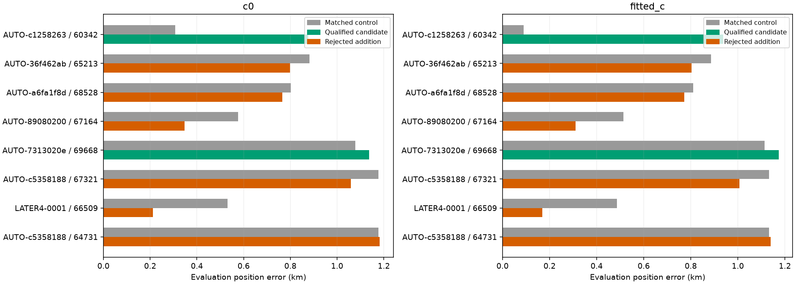
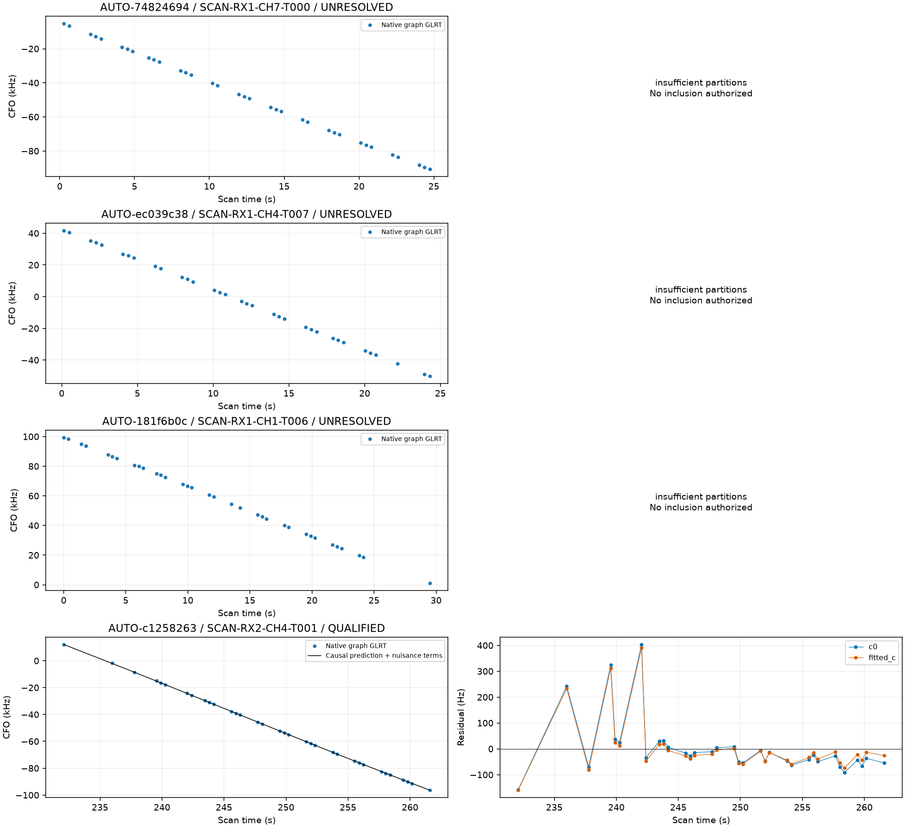
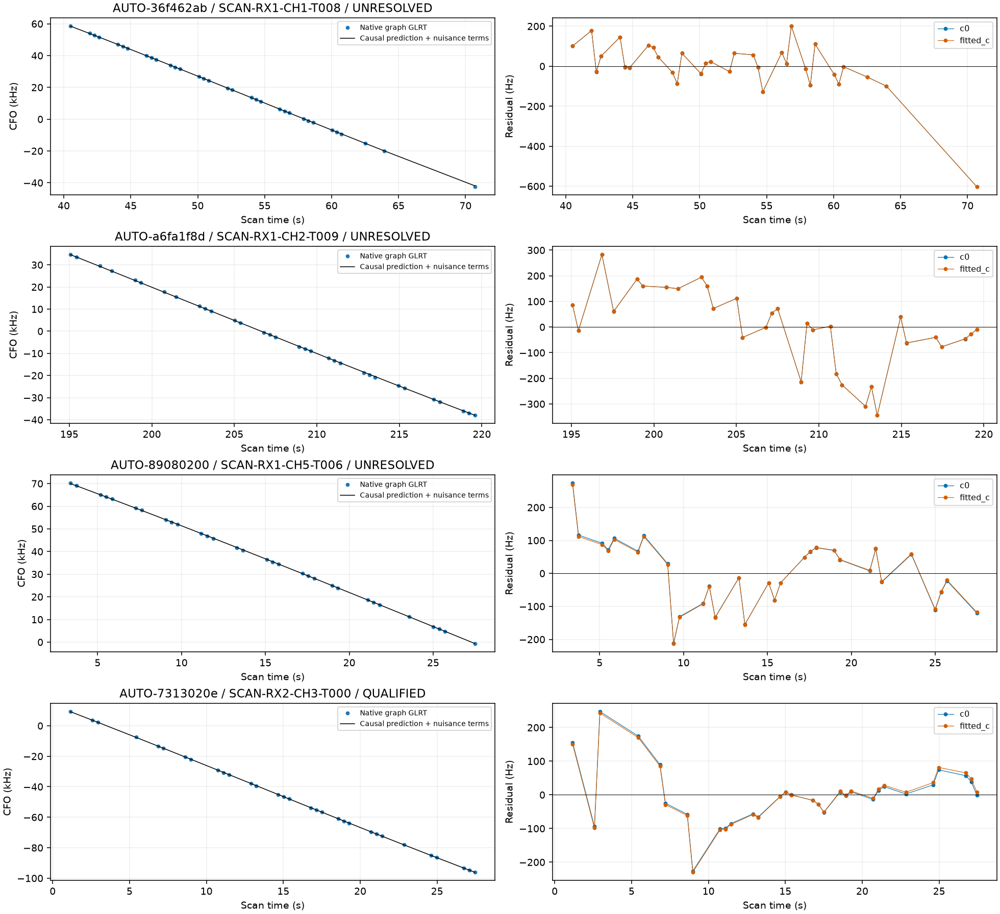
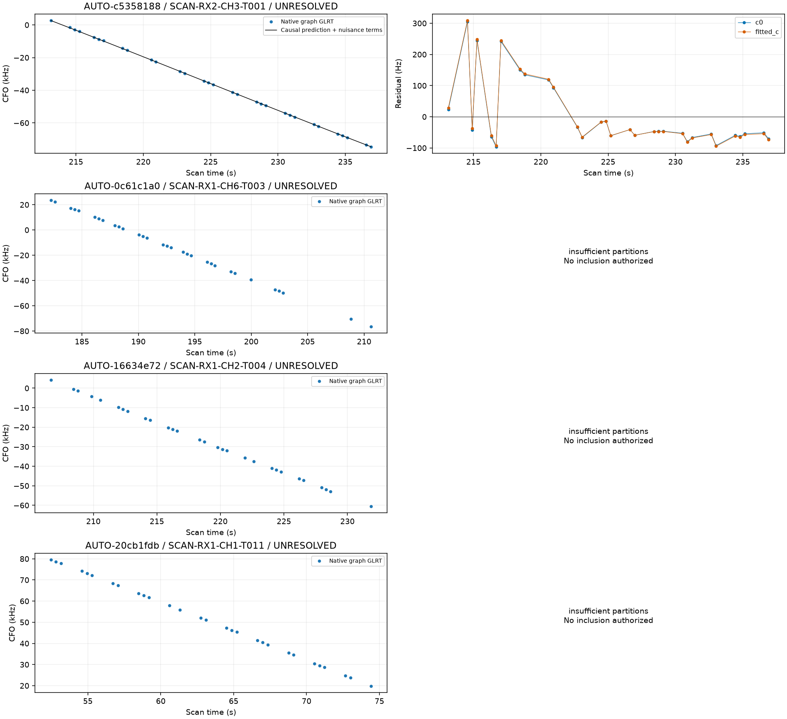
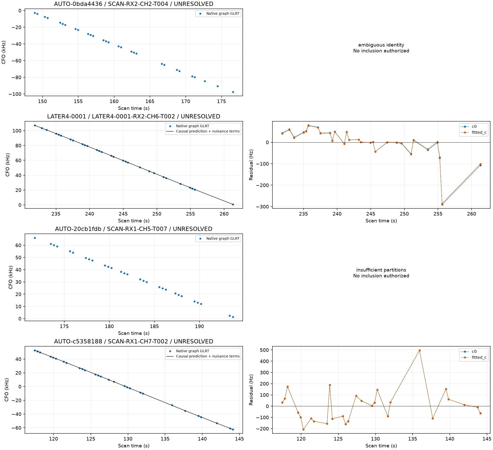
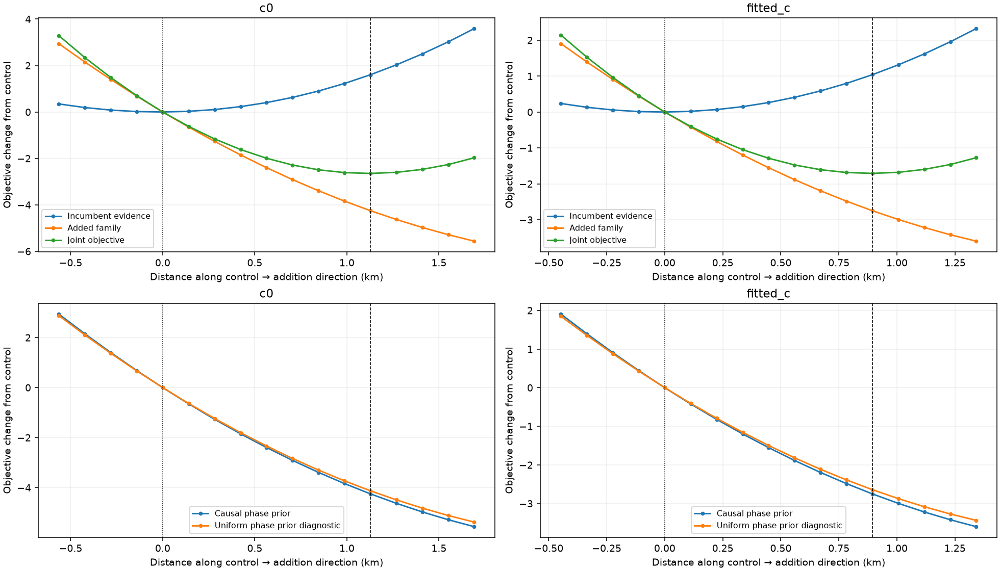
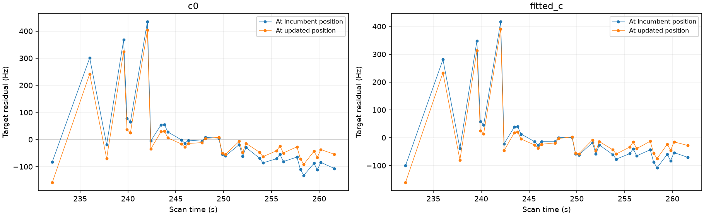

# Continuing omitted-track predictive recovery

**Capture-mode correction:** the all-adaptive interpretation below is superseded by the [acquisition-provenance audit](../2026_10_30_predictive_role_reassessment/README.md). Fast compatibility exports encode `capture_mode=adaptive`; this is not acquisition provenance. Across the full 53-curve queue, verified acquisition evidence gives 49 fast and four adaptive recordings. The linked 69-row provenance table supersedes this report's capture-mode fields. Scientific trial outputs and position errors are unchanged.

This batch processes **16** candidates from the previous immutable remaining manifest. **2 tracks / 65 distinct points** qualify under the current predictive checks; **65 points** are additional to the prior reviewed set. **13 candidates remain** in this omitted-curve queue. The full 1,630-curve objective and the larger calibration-participating annotation backlog remain unfinished.

## Validation, scope and model

Selection is by descending point count, without GPS error or satellite labels. Every supported identity is revalidated using three distinct timestamp-selected random scanwide 12-second holdouts and two-second guards. The report replays the held point sets and requires three distinct sets. Targets remain predictive evidence and do not calibrate receiver offsets or drift. Causal TLEs, physical nuisance priors, the 25 × 25 km regional start, and matched c=0/fitted-c data and budgets are retained. Evaluation GPS is used only to report error.

Annotation outcomes: **{'insufficient_partitions': 7, 'conditionally_supported_identity': 8, 'ambiguous_identity': 1}**. Capture modes from raw tracking metadata: **{'adaptive': 16}**. Filenames and inherited sample-rate fields are not used as capture-mode evidence. [annotations.csv](annotations.csv) records the mode, sample rate, identity and validation state for every curve. Insufficient partitions mean unavailable validation evidence, not a noise classification.

## Position inclusion and retained failures

New-family trials integrate causal phase at 0.025-second spacing and orbital/receiver uncertainty. Shared-family trials use existing family evidence. Controls and additions start at the same regional center. Only numerical-only failures passing physical, phase, ownership and exact-orbit checks receive a separate matched Powell retry in both c arms. The residual limits remain unchanged. Every original and retry result is retained in [all_position_trials.csv](all_position_trials.csv), with objectives, position errors and residual diagnostics reported separately.

| scan | norad | points | qualified | status | c0_before_km | c0_after_km | fitted_c_before_km | fitted_c_after_km |
| --- | --- | --- | --- | --- | --- | --- | --- | --- |
| AUTO-74824694 | None | 35 | False | refreshed_identity_not_supported | None | None | None | None |
| AUTO-ec039c38 | None | 34 | False | refreshed_identity_not_supported | None | None | None | None |
| AUTO-181f6b0c | None | 34 | False | refreshed_identity_not_supported | None | None | None | None |
| AUTO-c1258263 | 60342 | 34 | True | RF_verified_research_candidate | 0.308 | 0.876 | 0.090 | 0.937 |
| AUTO-36f462ab | 65213 | 33 | False | inclusion_rejected | 0.883 | 0.798 | 0.886 | 0.804 |
| AUTO-a6fa1f8d | 68528 | 32 | False | inclusion_rejected | 0.801 | 0.766 | 0.811 | 0.772 |
| AUTO-89080200 | 67164 | 31 | False | inclusion_rejected | 0.576 | 0.347 | 0.514 | 0.310 |
| AUTO-7313020e | 69668 | 31 | True | RF_verified_research_candidate | 1.078 | 1.138 | 1.114 | 1.174 |
| AUTO-c5358188 | 67321 | 31 | False | inclusion_rejected | 1.176 | 1.059 | 1.133 | 1.007 |
| AUTO-0c61c1a0 | None | 31 | False | refreshed_identity_not_supported | None | None | None | None |
| AUTO-16634e72 | None | 29 | False | refreshed_identity_not_supported | None | None | None | None |
| AUTO-20cb1fdb | None | 29 | False | refreshed_identity_not_supported | None | None | None | None |
| AUTO-0bda4436 | 58089 | 29 | False | refreshed_identity_not_supported | None | None | None | None |
| LATER4-0001 | 66509 | 29 | False | inclusion_rejected | 0.531 | 0.211 | 0.487 | 0.169 |
| AUTO-20cb1fdb | None | 29 | False | refreshed_identity_not_supported | None | None | None | None |
| AUTO-c5358188 | 64731 | 28 | False | inclusion_rejected | 1.176 | 1.182 | 1.133 | 1.139 |

| scan | qualified | baseline_percent | proposed_percent | credited_points |
| --- | --- | --- | --- | --- |
| AUTO-c1258263 | True | 77.410 | 78.799 | 34 |
| AUTO-36f462ab | False | 79.793 | 80.797 | 0 |
| AUTO-a6fa1f8d | False | 75.445 | 76.294 | 0 |
| AUTO-89080200 | False | 64.279 | 64.975 | 0 |
| AUTO-7313020e | True | 64.174 | 65.382 | 31 |
| AUTO-c5358188 | False | 74.227 | 75.068 | 0 |
| LATER4-0001 | False | 74.253 | 74.925 | 0 |
| AUTO-c5358188 | False | 74.227 | 74.986 | 0 |

Proposed coverage is shown for rejected trials but receives no credited points. Passing trials preserve all incumbent IDs and owners in exact orbit replay. More associated points do not necessarily improve location; evaluation error never selects a recovery or relaxes a gate. Scores for different observation counts are not directly comparable accuracy measures.

## Native curves and residuals

Every selected curve is shown, including unresolved cases. No fitted satellite orbit is shown when refreshed identity validation does not authorize inclusion. Low RMS alone is insufficient; residual mean, slope, quadratic structure, steps and serial correlation remain checked.

## A passing association can still worsen the location estimate

AUTO-c1258263 / 60342 passes identity, residual and exact-orbit checks, yet fitted-c evaluation error increases from roughly **0.090 to 0.937 km**. The c=0 arm also worsens. This is a substantial adverse result, retained rather than removed through GPS-based selection. It blocks treating the present RF acceptance tests as sufficient for production promotion. A passing satellite label and a useful, correctly weighted position constraint are different claims.

We decomposed the objective along the control-to-addition direction and used a centered 25 m finite-difference stencil at the control. Both c arms use the trial's actual 0.025 s phase grid, the same causal physical uncertainty model, and phase-reference closure checks. The endpoint objectives replay within about four millionths. This diagnostic does not optimize at the evaluation GPS position or refit a position with a different prior.

| arm | position_shift_km | incumbent_objective_change | target_objective_change | joint_objective_change | uniform_phase_target_change |
| --- | --- | --- | --- | --- | --- |
| c0 | 1.128 | 1.603 | -4.249 | -2.646 | -4.126 |
| fitted_c | 0.894 | 1.041 | -2.751 | -1.710 | -2.641 |

For fitted-c, the approximately **0.894 km** displacement costs the incumbent evidence only **1.041 objective units** while improving the added-family term by **2.751**, so the joint score prefers it by **1.710**. The displacement aligns about 0.814 with the weaker local curvature direction. The local curvature scales are about **0.987 and 0.666 km**; these are conditional diagnostics, not calibrated confidence intervals. The near-true original point estimate does not imply that the incumbent RF likelihood tightly fixes position.

Replacing only the added family's causal phase prior with a uniform prior in a fixed-position diagnostic retains **2.641** of the 2.751 target score improvement. Therefore the phase prior alone is not the main driver. This does not rule out other prior or receiver/orbit-model errors, nor prove the satellite identity wrong. It shows a modest target-frequency preference moving a position estimate through weakly constrained RF geometry.

At the incumbent position, the fitted-c target slope statistic is about **3.05**, just beyond the unchanged limit of 3; at the updated position it is about **1.89**. Target RMS falls from roughly **117 to 105 Hz** while location error grows. This illustrates why residual improvement alone cannot establish localization improvement. The next discriminating evidence is whether independent satellite families support the same displacement, and whether receiver-model discrepancies recur across families. A general influence or uncertainty rule must be evaluated across the cohort; it must not be tuned to retain this scan's fortunate baseline GPS error.

## Cumulative state and simultaneous-fit limits

The omitted-curve series contains **643 distinct reviewed candidate points** after this batch, compared with 578 before. Earlier review reversals are preserved: the two 67653 curves with a common residual bend remain withheld. The cumulative union rejects conflicting satellite ownership and avoids duplicate credit. It is an inventory of per-curve research candidates, **not a single simultaneous solution or dataset-wide location-accuracy result**.

[joint_family_work.json](joint_family_work.json) records same-scan/same-satellite groups and whether they already have an approved common-residual joint audit. **0 groups in this series still need such a joint check**. Different recovered families within a scan also require a simultaneous treatment of shared receiver uncertainty before a final combined scan result can be claimed. No earlier partial qualification is silently promoted.

The [updated 1,630-row ledger](annotation_ledger.csv), [remaining candidate manifest](remaining_omitted_candidates.json), and [reviewed series](series_qualified_trials.json) retain the next work and its provenance. [Execution receipts](executions.csv), exact-replay source hashes and compact evidence accompany the results. Production is unchanged; no future TLE, new RF acquisition, threshold relaxation or ALGO promotion is introduced.
