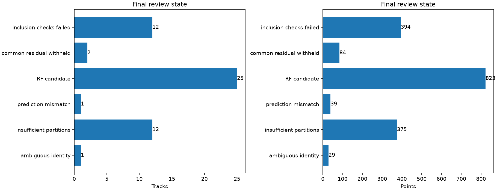

# Closing the 53-curve omitted-inclusion queue

**Capture-mode correction:** the all-adaptive interpretation below is superseded by the [acquisition-provenance audit](../2026_10_30_predictive_role_reassessment/README.md). Fast compatibility exports encode `capture_mode=adaptive`; this is not acquisition provenance. The 53 curves comprise **27 fast at 10 MS/s, 22 fast at 2.5 MS/s, and four adaptive at 10 MS/s**. The linked provenance table supersedes the capture-mode columns and summary counts saved with this report. Scientific trial outputs and position errors are unchanged.

All **53** frozen candidates now have terminal assessments and a linked review outcome. The original selector excluded these curves because they were absent from the calibration engine. The predictive route now assesses them without allowing them to calibrate receiver offsets or drift. This closes this particular queue; the full 1,630-curve annotation and inclusion objective remains incomplete.

| state | tracks | points |
| --- | --- | --- |
| inclusion_checks_failed | 12 | 394 |
| common_residual_withheld | 2 | 84 |
| RF_candidate | 25 | 823 |
| prediction_mismatch | 1 | 39 |
| insufficient_partitions | 12 | 375 |
| ambiguous_identity | 1 | 29 |

The reviewed series contains **823 distinct candidate GLRT points**. These are separate per-curve research inclusions, not one simultaneous solution or a dataset-wide association percentage. Capture modes verified from source metadata are **{'adaptive': 53}**. Do not describe this research inventory as a DS24-fast benchmark. The fourth batch explicitly maps its legacy DS24 aliases to their adaptive DS25 source cases.

Every retained candidate passes the same causal, predictive-role, randomized grouped holdout and paired c=0/fitted-c checks. Two earlier individual passes remain withheld because their joint residual has common structure. Insufficient partitions means insufficient independent validation evidence, not proof that a curve is noise or has no satellite source. Inclusion failures retain residual, ownership, phase and numerical evidence in the batch reports.

Among individual reviewed candidates, position error improves/worsens in **17/8** c=0 comparisons and **17/8** fitted-c comparisons. These paired trials reuse some scans and are not independent scan-level samples. Their controls can differ after numerical retries; no dataset median, combined recovery gain, or promotion claim is inferred. In particular, the 60342 addition worsens fitted-c error from 0.090 to 0.937 km despite passing RF checks.

## What remains

The [60342 influence audit](../2026_10_30_omitted_predictive_third_batch/README.md) shows weak position constraints and a target preference that persists under a uniform-phase diagnostic. The [residual-scale audit](../2026_10_30_predictive_residual_scale/README.md) identifies uneven residual scatter not represented by the radio uncertainty proxy. Both require further discrimination between measurement error, receiver effects and satellite-model discrepancy.

Next, test independently measured uncertainty and shared receiver discrepancies across satellite families, and combine recovered families using a single shared receiver-uncertainty model. Short curves lacking independent holdouts need genuinely independent supporting evidence; shortening guards or counting repeated target holds would not supply it. Reconcile older calibration-participating annotations into the predictive-only role before claiming inventory-wide completion. Ambiguous identities and physical failures remain explicit unresolved records.

## Evidence and reports

[all_candidates.csv](all_candidates.csv) has exactly one row per frozen candidate, with original batch results and final review state separately preserved. [sources.json](sources.json) hashes the inputs; the reporter rejects missing or duplicate coverage. Each batch contains native GLRT plots, residual plots, position comparisons, receipts, holdout assignments and exact-orbit replay evidence.

- [2026_10_30_omitted_predictive_recovery](../2026_10_30_omitted_predictive_recovery/README.md)
- [2026_10_30_omitted_predictive_second_batch](../2026_10_30_omitted_predictive_second_batch/README.md)
- [2026_10_30_omitted_predictive_third_batch](../2026_10_30_omitted_predictive_third_batch/README.md)
- [2026_10_30_omitted_predictive_fourth_batch](../2026_10_30_omitted_predictive_fourth_batch/README.md)

No GPS selects candidates or relaxes gates. No post-observation TLE or new RF acquisition is introduced. Production is unchanged.
