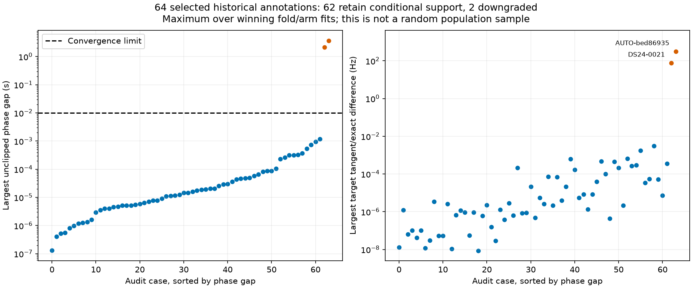
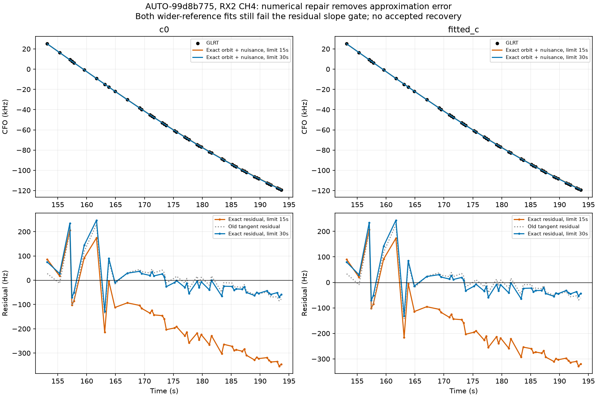
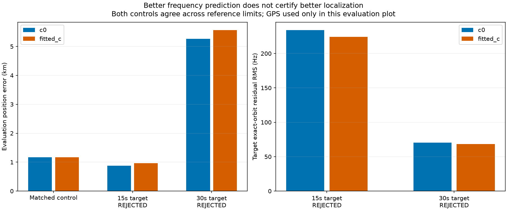

# Retrospective phase audit and bounded exact-orbit repair

Follow-up: [residual witnesses and recovery transfer](../2026_10_30_residual_witness_recovery/README.md) extends the audit, repairs a V08 background-phase failure, and tests four new graph additions through position and held-family prediction.

The wider audit confirms a specific numerical failure, not a general reason to discard large curves. Of **64 additional historical annotations, 62 retain conditional support and two are downgraded**. Of **12 previously paired-passing graph inclusion candidates in the audited batch directories, 10 pass the new exact-orbit/convergence/ownership checks and two fail**. One rejected candidate was identified in the previous report; AUTO-bed86935 is newly rejected here. No production or retained cohort policy changes.

This continues the [training-confidence and phase audit](../2026_10_30_training_confidence_phase_audit/README.md). Earlier provisional success for AUTO-bed86935, track `792ab1d56e2d2054283a`, is superseded by this exact-orbit failure. It must not be counted as a verified recovery.

## Why some apparent associations were misleading

The old research loop fitted a satellite phase beyond ±15 seconds, clipped the next linearization reference to that boundary, and measured change after clipping. Successive clipped values could agree even though the orbit approximation remained wrong. Convergence now requires the **unclipped fitted phase to agree with its reference within 0.01 seconds**. Exact orbit replay independently checks the selected family. These tests validate numerical consistency; they do not establish satellite identity by themselves.

The retrospective audit prioritizes previously paired-passing graph candidates, then larger DS24 curves, then other supported identities. This selected sample cannot estimate the population-wide defect rate. All stored candidate/fold/arm endpoints are replayed; the old observations, random scan-wide 12-second blocks with 2-second guards, priors, and candidate lists are preserved. No optimization or GPS-based ranking is performed. Scores are not reranked after removing a failed candidate; only convergence metadata is corrected before recomputing identity consensus.

| scan | norad | points | minimum_phase_s | maximum_phase_s | maximum_phase_gap_s | maximum_exact_difference_hz | corrected |
| --- | --- | --- | --- | --- | --- | --- | --- |
| AUTO-bed86935 | 57641 | 52 | -18.652 | -18.367 | 3.652 | 309.260 | prediction_mismatch |
| DS24-0021 | 66837 | 36 | -17.145 | -16.937 | 2.145 | 76.096 | prediction_mismatch |

Including the previous two audited annotations, **66 original annotations have now been audited, with 3 downgrades**. Conditional support still depends on the frozen graph and searched competitors. The exact mean replay does not recompute an exact marginalized posterior or certify unseen competitors.

The first pass of attempt 2 completed 31 cases and failed execution on DS24-0095: a losing NORAD 57949 hypothesis requested orbit times outside the cached bank. The follow-up records four out-of-domain competitor fold/arm endpoints explicitly and leaves DS24-0095's supported winner unchanged. It does not extrapolate the orbit, suppress the failed receipt, or turn an unavailable exact comparison into a passing result. All 64 selected cases now have completed diagnostic results; original execution outcomes remain in [the execution table](annotation_executions.csv).

## Previously passing graph additions

These are all paired-passing candidates found in the examined `graph-inclusion-batch*-v1` directories, not every historical manual prototype. Each candidate has four replayed endpoints: control/addition × c=0/fitted-c. Qualification below requires exact residual gates, unclipped phase convergence, unchanged incumbent satellite owners, and unchanged control owners. Exact replacement is for the nominated family; other families retain their original model and are checked for phase convergence and existing gates.

| scan | norad | added_c0 | added_fitted_c | verified | phase_gap_s | exact_max_difference_hz | minimum_exact_slack |
| --- | --- | --- | --- | --- | --- | --- | --- |
| AUTO-8e00ca4d | 67340 | 96 | 96 | True | 0.000 | 0.000 | 0.014 |
| AUTO-acd7c83d | 63468 | 65 | 65 | True | 0.000 | 0.000 | 0.051 |
| AUTO-e32d57a7 | 68560 | 61 | 61 | True | 0.000 | 0.000 | 0.026 |
| AUTO-a60b939e | 63282 | 55 | 55 | True | 0.000 | 0.000 | 0.009 |
| AUTO-d9398a01 | 66532 | 56 | 56 | True | 0.000 | 0.000 | 0.006 |
| AUTO-d969e15a | 68713 | 57 | 57 | True | 0.000 | 0.000 | 0.009 |
| AUTO-181f6b0c | 63373 | 80 | 80 | True | 0.000 | 0.000 | 0.081 |
| AUTO-bed86935 | 57641 | 52 | 52 | False | 3.550 | 291.505 | -7.673 |
| AUTO-afec5a1f | 59632 | 52 | 52 | True | 0.000 | 0.000 | 0.044 |
| AUTO-f7f4de11 | 68607 | 63 | 63 | True | 0.000 | 0.000 | 0.065 |
| AUTO-99d8b775 | 100486 | 46 | 46 | False | 3.135 | 269.928 | -8.313 |
| AUTO-f0255747 | 67957 | 46 | 46 | True | 0.000 | 0.000 | 0.010 |

Added counts in failed rows are **proposed**, not accepted. The ten verified candidates are research candidates, not ten newly deployed recoveries. Position errors for matched controls and targets are preserved separately in [graph_candidates.csv](graph_candidates.csv).

AUTO-bed86935 is RX2 CH8, 52 points at 160.9–208.7 seconds, tested against NORAD 57641 in a 10 MS/s recording. AUTO-99d8b775 is RX2 CH4, 46 points at 153.2–193.6 seconds, tested against NORAD 100486 in a 2.5 MS/s recording. Their distinct satellites and opposite phase directions show the clipping problem is not specific to one satellite. This is not a controlled sample-rate comparison.

## Can a wider numerical reference repair the rejected curve?

For AUTO-99d8b775, matched 15-second and 30-second reference-limit variants start from the same respective control/addition endpoints. Each receives five additional phase-refresh rounds with 40 constrained optimizer steps. Observations, satellite IDs, aliases, noise, weights, physical priors, search region, and budgets stay matched across both c arms. This changes the numerical linearization reference limit, **not the satellite phase prior**. The target phase prior remains mean −1.222 seconds and sigma 4.403 seconds.

Every updated reference is checked against the existing orbit bank, including a 0.05-second derivative margin and the predictive geometry. No new TLE, future TLE, bank extension, or extrapolation is used. The target observations occupy only part of the scan, so a phase beyond 15 seconds can remain inside the cached time support.

| reference_limit_s | role | arm | phase_converged | gates_pass | target_exact_RMS_hz | error_km |
| --- | --- | --- | --- | --- | --- | --- |
| 15 | control | c0 | True | True | None | 1.166 |
| 15 | control | fitted_c | True | True | None | 1.165 |
| 15 | target_0 | c0 | False | False | 233.826 | 0.876 |
| 15 | target_0 | fitted_c | False | False | 224.202 | 0.962 |
| 30 | control | c0 | True | True | None | 1.166 |
| 30 | control | fitted_c | True | True | None | 1.165 |
| 30 | target_0 | c0 | True | False | 70.587 | 5.267 |
| 30 | target_0 | fitted_c | True | False | 68.339 | 5.561 |

The 30-second reference converges: the remaining raw phase gaps are about 0.000005/0.000053 seconds and tangent/exact differences are below 0.000002 Hz. Exact target RMS improves from about 234/224 Hz to **70.59/68.34 Hz**. However, slope z-scores remain **3.702/3.299**, exceeding the original limit of 3. The step scores **3.531/3.511 pass their limit of 4**; slope is the remaining failed gate in both arms. Both targets remain rejected, with zero incumbent point losses. This bounded optimizer result does not prove that no feasible fit exists.

The apparently improved ~0.88/0.96 km positions under the clipped approximation were invalid fits. Numerically consistent target fits instead have errors **5.267/5.561 km**, compared with matched controls **1.166/1.165 km**. Better exact frequency fit does not establish better localization. These rejected endpoints are diagnostics, not algorithm performance claims. GPS at 37.849061591561885, −122.48574968092912 is used only to compute these errors; fitting remains in the original 25 × 25 km region centered at 37.906, −122.545.

## Inventory and next experiments

The new bounded annotation batch completes 31 of 32 jobs, with one timeout. It brings the inventory to **991 completed annotations / 1630 entries**. Batch states: `{'unstable_identity': 9, 'prediction_mismatch': 1, 'conditionally_supported_identity': 18, 'ambiguous_identity': 3, 'execution_timeout': 1}`. This measures annotation coverage, not accepted GLRT association percentage. The cumulative [ledger](annotation_ledger.csv) preserves original annotation sources, corrected audit sources and prior states; native overlapping branches remain a separate inventory.

The next work should separate three questions: whether a curve has a stable satellite identity; whether its exact orbit and receiver model explain the full residual; and whether adding it improves independent position information. Finish the retrospective consistency checks, then revisit affected hypotheses with valid references and the same causal competitors. For residual structure that survives the repair, compare shared receiver corrections against shared satellite corrections using independent curves and randomized block prediction. Do not relax slope gates merely to retain points. Neither lower training RMS nor a favorable GPS error is an acceptance rule.

## Reproduction and evidence

`run_annotation_phase_audit.py` records selection and supervises bounded replays. `audit_annotation_phase.py` reconstructs original training endpoints and records out-of-domain alternatives. `audit_graph_inclusion_owners.py` verifies objectives, memberships, ownership and selected-family exact residuals. `probe_graph_phase_domain.py` launches the two matched reference limits; re-audit both with `--include-unqualified` so rejected endpoints remain visible. `report_phase_reference_retrospective.py` builds this report from immutable receipts.

Component tests cover clipped false convergence, valid orbit support, batch propagation of reference limits, deterministic audit selection, grouped prediction, confidence learning, and held-family comparisons. [Summary](summary.json), [all endpoint metrics](reference_domain_trials.csv), [winning-fold checks](winning_fold_checks.csv), [source hashes](sources.json), and [compact numerical evidence](evidence.json.gz) accompany the figures. Repeated observation-ID arrays and optimizer histories are hashed in the compact archive; their immutable source paths and file hashes are retained. No ALGO promotion or dataset-wide position gain is claimed.
