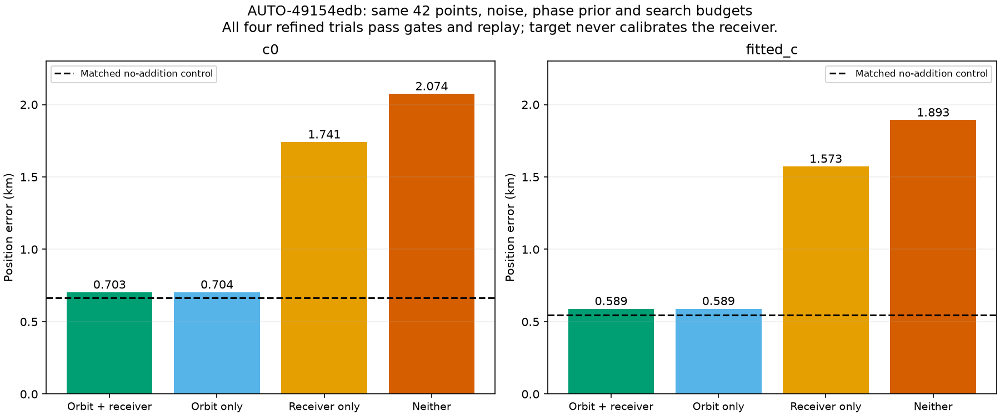
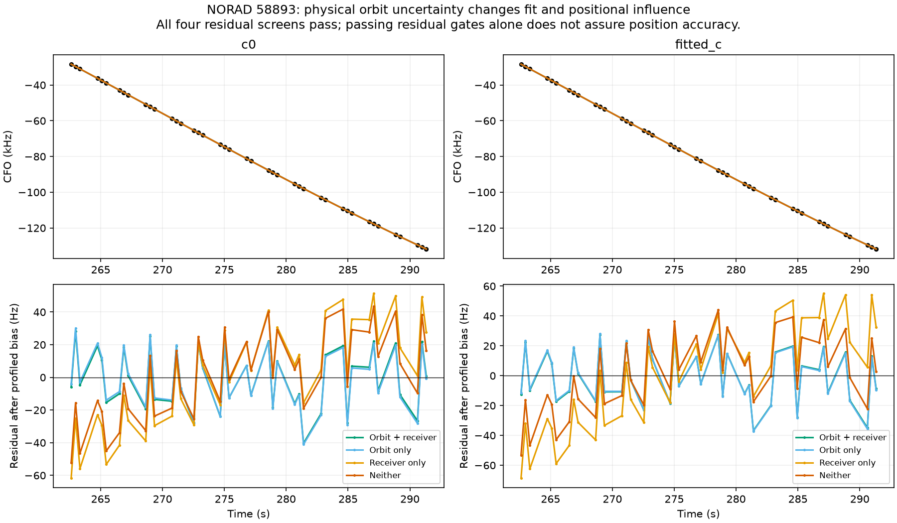
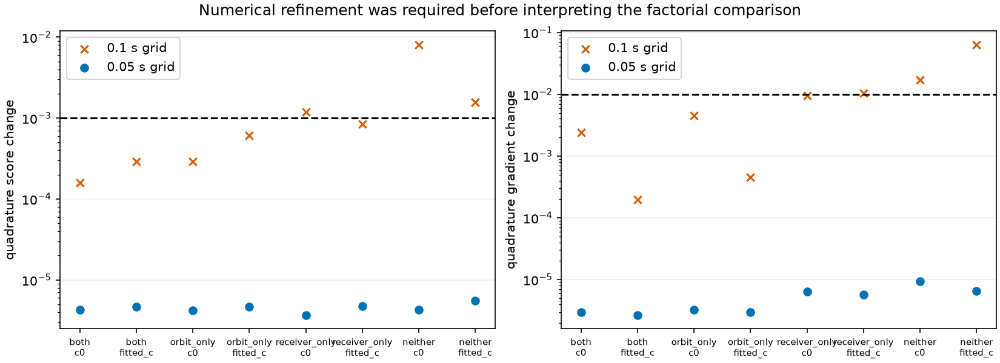
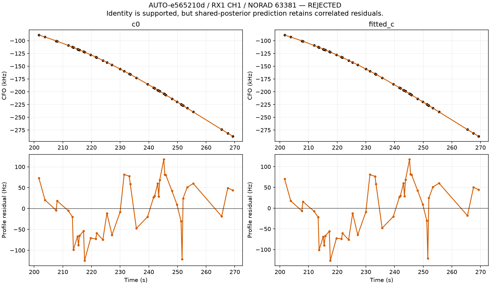

# Orbital uncertainty explains the adverse pull of one recovered curve

A matched four-way ablation isolates a major cause of the AUTO-49154edb regression: **omitting physical orbital uncertainty**. With the same 42 target points and no target-driven receiver calibration, fitted-c position error is **0.589 km** with orbital uncertainty, **1.573 km** with receiver uncertainty alone, and **1.893 km** with neither. The no-addition control is **0.548 km**. The new model mitigates a regression; it still does not improve that control.

The transfer experiment also limits the claim. Among all four previously RF-verified graph recoveries, the stricter predictive workflow gives one valid inclusion, two ambiguous identities and one supported identity whose shared-family residual fails. This is not a broadly validated replacement or new ALGO release.

## Controlled 2 × 2 experiment

The only factors are inclusion or removal of physical orbital covariance and shared receiver-coefficient covariance in the target predictive density. Every arm uses the same NORAD 58893, alias, 42 observations, full-data noise/weights, track-bias prior, causal phase prior, regional center start, 25 × 25 km box, five phase-reference rounds, and 48-step/240-evaluation optimizer limits. Every cell has matched c=0 and fitted-c arms. Receiver posterior means and conditioning on old predictive data are retained when receiver covariance is disabled. The target never updates receiver calibration at fixed position. It can still affect position and hence the incumbent calibration indirectly.

Physical orbital modes are removed together from the likelihood and physical prediction in the no-orbit cells. Their prior scales are fixed from the causal TLE history, not tuned against GPS. The three modes describe mean motion, inclination and RAAN perturbations, shared within the satellite family. The existing ±15 s phase box and 300 Hz bias prior are unchanged. The experiment does not vary sample rate, receiver pointing, noise policy or target/receiver feedback. Thus its result isolates orbital covariance **within this predictive model**, not every difference from the old calibrating method.

| variant | arm | control_error_km | error_km | added_points | target_RMS_hz | paired_gates | quadrature_pass | exact_owner_verified |
| --- | --- | --- | --- | --- | --- | --- | --- | --- |
| both | c0 | 0.666 | 0.703 | 42 | 17.980 | True | True | True |
| both | fitted_c | 0.548 | 0.589 | 42 | 17.817 | True | True | True |
| orbit_only | c0 | 0.666 | 0.704 | 42 | 18.105 | True | True | True |
| orbit_only | fitted_c | 0.548 | 0.589 | 42 | 17.880 | True | True | True |
| receiver_only | c0 | 0.666 | 1.741 | 42 | 30.594 | True | True | True |
| receiver_only | fitted_c | 0.548 | 1.573 | 42 | 33.602 | True | True | True |
| neither | c0 | 0.666 | 2.074 | 42 | 25.874 | True | True | True |
| neither | fitted_c | 0.548 | 1.893 | 42 | 24.833 | True | True | True |

All four refined variants retain the same **3,462 associated points**, adding exactly the 42 target IDs to the same 3,420-point control, with no owner changes or losses. Controls reproduce identical positions within 1e-8 km. With orbital uncertainty present, removing receiver covariance changes error by less than **one meter** in either c arm; without orbital uncertainty, receiver covariance still moderates the adverse effect by roughly **0.32–0.33 km**. This does not justify removing receiver covariance generally.

The earlier direct-calibration model gave fitted-c error 1.465 km. Its singleton support policy supplied no orbital modes for this family. The new ablation supports the explanation that a satellite model treated as too certain supplies excessive information along a weak position direction. It does not prove the actual TLE error vector, a global optimum, or the absence of shared receiver biases. The latest causal TLE is ~33.3 hours old; the physical prior was constructed from pre-observation TLE disagreement. No post-observation TLE or GPS enters fitting.

All refined target residual screens pass, including in the high-position-error cells. **Passing residual gates is necessary but not sufficient for accurate position.** Frequency RMS and predictive density are reported separately in [the full table](covariance_ablation.csv); lower residual RMS is not used as proof of localization improvement. The orbital posterior corrections in the retained full-uncertainty cell are below one prior standard deviation.

## Numerical resolution was checked before interpreting the comparison

The original 0.1 s phase grid fails the local score/gradient consistency guard in both no-orbit variants. Those results remain archived and rejected. We rerun **all four cells**, including their controls, on a 0.05 s grid with unchanged position-search budgets; the post-fit audit compares 0.05/0.025/0.0125 s integration at the endpoint and ±25 m neighbors. Every refined cell passes. Each is independently replayed for objective, original membership, unchanged satellite owners, raw phase convergence and physical gates; incumbent orbits are replaced one family at a time, and the target phase is also continuously refined as a diagnostic.

These are numerical checks, not new identity validation or a probability calibration. Phase truncation remains explicit: the 15 s-width Gaussian prior has 68.27% mass inside ±15 s. No grid or prior is chosen according to position error. The finer grid was triggered solely by numerical inconsistency.

## Complete transfer set: the same rule does not accept everything

| scan | norad | identity_status | minimum_margin | route | outcome |
| --- | --- | --- | --- | --- | --- |
| AUTO-49154edb | 58893 | conditionally_supported_identity | 31.056 | new family | RF_verified_candidate |
| AUTO-e32d57a7 | 67634 | ambiguous_identity | 1.310 | new family | identity_ambiguous |
| AUTO-e9398e7a | 63458 | ambiguous_identity | 4.636 | new family | identity_ambiguous |
| AUTO-e565210d | 63381 | conditionally_supported_identity | 87.354 | existing shared family | residual_lag_rejected |

The additional targets are the remaining two of the four earlier exact-owner-verified graph recoveries. This completes the set; they were not selected by whether the new model improved GPS error. The first two cases were deliberately contrasting diagnostics in the previous report, so this four-case set is not an untouched population benchmark.

Fresh predictive annotations use three distinct randomized scan-wide 12 s block partitions with 2 s guards; simultaneous channels/receivers remain grouped. The target never calibrates receiver parameters, and the winning identity must have held predictive density margin at least 10 in every fold and c arm. Candidate nomination uses the same causal catalogue. Graph construction and incumbent identities remain conditioning assumptions, and position/noise-precision uncertainty is not fully integrated.

AUTO-e9398e7a prefers 63458 in every fold but has minimum margin **4.64** against 55604. It remains ambiguous and no position inclusion is run. This joins the previously ambiguous AUTO-e32d57a7 case, minimum margin **1.31** against 66322. No favorable old GPS result overrides either rejection.

AUTO-e565210d strongly supports **63381**, minimum margin **87.35**, but that family already has active calibration observations. The initial new-family routine correctly raises an eligibility error; that failed execution is preserved. The routing code now uses the shared-family predictor for an active satellite rather than inventing an independent orbital correction. Inactive graph members may enter this branch only when all their calibration mask entries are false, their observations are not duplicated, and the validated alias is stable. The original graph and calibration mask remain unchanged.

## Shared identity succeeds; shared prediction still fails

| arm | control_error_km | target_error_km | added_proposed_points | accepted_recovery | RMS_hz | absolute_lag1 | lag1_limit |
| --- | --- | --- | --- | --- | --- | --- | --- |
| c0 | 0.917 | 0.925 | 42 | False | 61.741 | 0.646 | 0.617 |
| fitted_c | 1.002 | 1.013 | 42 | False | 62.192 | 0.652 | 0.617 |

The 42-point RX1 CH1 curve has ~62 Hz RMS, no old owner changes, and zero target-driven receiver-coefficient change at fixed position. Exact orbit discrepancies are below 0.000001 Hz. The failing gate is solely **lag-one correlation**: absolute innovation correlation is ~0.646/0.652 against the existing **4/√42 ≈ 0.617** threshold. The reported 42 proposed points are therefore **not accepted recovery**. Position changes only ~9/11 m in error, which does not authorize bypassing the residual gate. The initial wrong-route exception is an implementation eligibility issue; the subsequent correlation failure is scientific evidence about the shared prediction.

Next for this curve: compare residual structure with other observations of 63381 and simultaneous receiver/band witnesses. A shared satellite-posterior refinement may be justified if the discrepancy follows the satellite; a receiver correction needs independent families supporting it. Do not create a free per-track slope or relax the threshold simply to reach an association percentage.

## Inventory and systematic inclusion policy

Annotation attempt 27 yields `{'conditionally_supported_identity': 21, 'ambiguous_identity': 2, 'unstable_identity': 6, 'prediction_mismatch': 1, 'insufficient_partitions': 2}`, bringing assessed original entries to **1087 / 1630**. Annotation states include ambiguity and mismatch; assessed count is not accepted GLRT coverage. The cumulative ledger preserves **149** historical phase audits and alternate predictive outcomes without overwriting retained production policy.

The evidence supports this routing discipline:

1. Validate candidate identity under causal, random-block prediction; retain an unresolved candidate set when discrimination is inadequate.
2. For an absent or wholly uncalibrated family, integrate causal orbital and phase uncertainty even when there are too few curves to estimate a correction confidently. Use one shared family model for its evidence.
3. For an already active family, reuse its shared posterior and uncertainty. Additional fragments must not receive independent satellite corrections.
4. Separately require numerical convergence, physical residual gates, unchanged old ownership and a matched position-inclusion trial. Keep uncertainty and positional influence diagnostics alongside association percentage.

This is an emerging evidence-backed workflow, not yet a validated dataset-wide algorithm. Remaining work includes unresolved identity competition, shared-family residual structure, the unfinished inventory and independent generalization tests. The claim that every real curve must improve position remains unproven: a curve can constrain satellite uncertainty more strongly than receiver location.

## Reproduction

Run `run_predictive_covariance_ablation.py` with the frozen source inclusion and phase step 0.05 for the matched factorial trial. `test_predictive_graph_transfer.py` handles fresh identity validation and routes active versus absent families; `audit_shared_predictive_inclusion.py` independently checks the shared route. The predictive inclusion tools now measure phase convergence before clipping the numerical reference. The covariance switches default to the unchanged full-uncertainty model and are diagnostic only.

**20 targeted tests pass**, including dense Gaussian oracles for all four covariance combinations, phase mixture/resolution, role eligibility, routing, covariance isolation, ownership, grouped inventory claims and raw phase checks. Evaluation coordinates are **37.849061591561885, −122.48574968092912**; the search box remains centered at **37.906, −122.545**. GPS only evaluates errors. No production change or new ALGO promotion is made.

The compact archive retains all failing gates, minimum gate margins, numerical diagnostics and source hashes. Repetitive full owner/gate maps and observation/optimizer histories are represented by counts and hashes; the immutable full receipts remain at their recorded study paths.

[Summary](summary.json), [cumulative ledger](annotation_ledger.csv), [new annotation outcomes](annotation_batch.csv), [factorial results](covariance_ablation.csv), [matched controls](matched_controls.csv), [replays](covariance_replays.csv), [transfer set](transfer_summary.csv), [all identity votes](transfer_votes.csv), [shared-family rejection](shared_family_rejection.csv), [execution receipts](executions.csv), [source hashes](sources.json), [compact evidence](evidence.json.gz), [previous iteration](../2026_10_30_graph_position_information/README.md).
