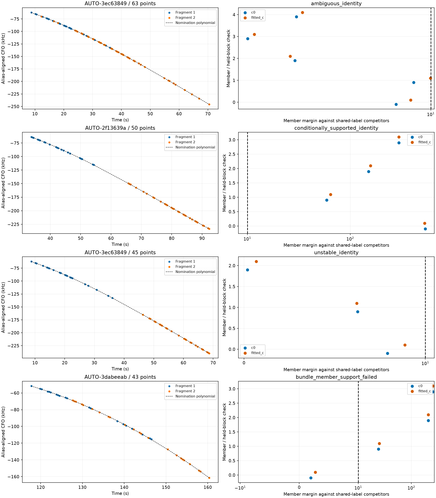
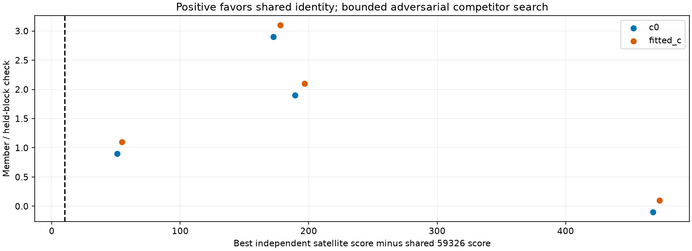
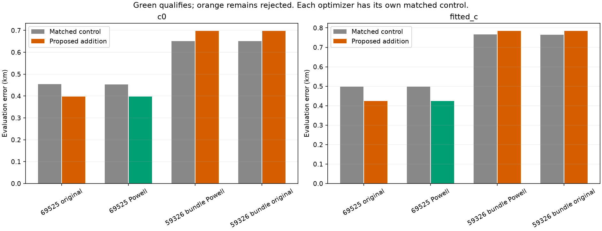
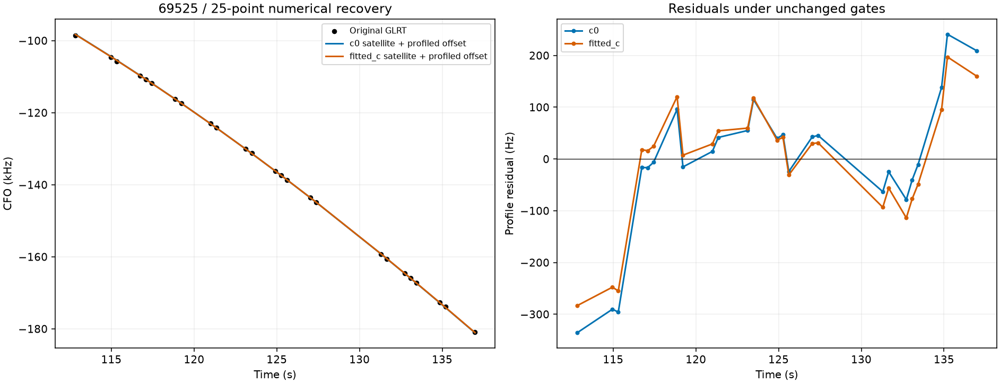
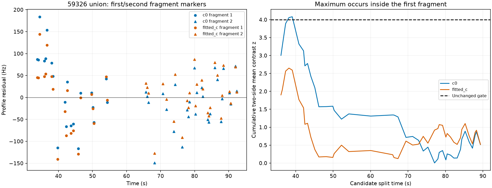

# Fragment bundles, independent-label challenges and numerical recovery

This iteration tests whether incomplete graph fragments can supply useful evidence together. Four same-lane pair hypotheses are frozen from 105 recently assessed curves lacking enough independent partitions. One 50-point bundle supports satellite **59326**, including an adversarial search for different labels on its two fragments, but remains **rejected for position inclusion**. Separately, a numerical-only retry recovers a **25-point curve assigned to 69525**, improving error in both c arms. No production promotion or gate relaxation.

## Grouping supplies missing time coverage without inventing observations

Pairs must share RX, channel and RF, have disjoint observation IDs and distinct timestamps, contain no points owned in either c arm, and overlap or be separated by at most 12 s. At least three 12 s timestamp blocks must be present in the union. Nomination fits order 1–4 polynomials, penalizes order with BIC using a fixed 150 Hz floor, and requires RMS below 250 Hz. Relative alignment changes only an integer multiple of the native alias period (1/4.4 microseconds); no continuous per-fragment frequency shift is fitted into the observations. The original graph, calibration rows, timestamps, IDs and receiver basis rows remain unchanged. The appended view is predictive-only.

The pair nomination uses the frozen graph's full CFO data. Subsequent evidence is therefore **conditional on that graph and nominated grouping**, not an independent validation of the grouping procedure. No satellite ID or GPS error selects the four pairs. Their overlapping memberships are explicit; counts cannot be added across configurations.

| scan | bundle | points | degree | nomination_RMS_hz | second_alias_lift | status | norad | member_checks_pass |
| --- | --- | --- | --- | --- | --- | --- | --- | --- |
| AUTO-3ec63849 | 458103885c5f1bc17564 | 63 | 3 | 85.016 | 0 | ambiguous_identity | 60351 | False |
| AUTO-2f13639a | 5f24814427ef8860cf0e | 50 | 3 | 118.956 | -1 | conditionally_supported_identity | 59326 | True |
| AUTO-3ec63849 | 9d39454002dc209dd358 | 45 | 3 | 100.544 | -1 | unstable_identity | None | False |
| AUTO-3dabeeab | 80027ceabed6c9de691c | 43 | 2 | 191.764 | 0 | bundle_member_support_failed | 100412 | False |

## A strong fragment must not hide a weak neighbor

Each union receives three distinct timestamp-selected random scanwide 12 s holdouts with 2 s guards. Receiver calibration and predictive distributions use training data only. The same causal candidates, priors and budgets are used in c=0 and fitted-c. In addition to pooled identity consensus, every member must have at least one held evaluation with four points in both arms. Every available member check must favor the common identity by at least 10 units of negative twice log predictive density, with held RMS at most 450 Hz. These are conditional comparisons under a common-label model, not posterior probabilities.

For AUTO-3dabeeab, pooling the 23-point and 20-point fragments supports 100412, but the short member's margins are only **1.94 / 2.73**, below 10. The member veto rejects this extension. It does not revoke the previous 23-point result or prove its satellite label wrong. The two AUTO-3ec63849 pairs remain unstable or ambiguous. Only AUTO-2f13639a, with **21 + 29 points** and one integer alias alignment, survives the member checks.

## Challenge the assumption that both fragments share one satellite

For the surviving 59326 bundle, each held member is also scored under independent satellite hypotheses, conditioning only on that member's training observations rather than on its partner. Receiver fits are reconstructed and shared predictive scores replay to tolerance. Six candidates per member are nominated from the causal bank over the existing regional search. This adversarial competitor screening **uses held frequencies**; it is explicitly model search, not an unbiased held-out performance estimate. Three integer aliases centered on the inherited alias are marginalized with equal prior weight rather than selected by held RMS. No GPS is used. The search remains bounded and does not prove exhaustive catalogue uniqueness.

All **8 member/arm/block comparisons** favor shared 59326 by at least **50.73** score units. The closest independent alternatives include 63670, 66344 and 58385. This strengthens the identity hypothesis; it does not remove the residual-model failure below. [Every comparison](split_identity.csv) and the candidate evidence are retained.

## Position inclusion separates numerical and physical failures

| variant | scan | points | c0_control_km | c0_addition_km | fitted_c_control_km | fitted_c_addition_km | RF_qualified |
| --- | --- | --- | --- | --- | --- | --- | --- |
| 69525 original | AUTO-26dcef1d | 25 | 0.454 | 0.398 | 0.497 | 0.424 | False |
| 69525 Powell | AUTO-26dcef1d | 25 | 0.453 | 0.397 | 0.497 | 0.424 | True |
| 59326 bundle Powell | AUTO-2f13639a | 50 | 0.651 | 0.698 | 0.766 | 0.785 | False |
| 59326 bundle original | AUTO-2f13639a | 50 | 0.651 | 0.698 | 0.765 | 0.784 | False |

The existing **69525 / AUTO-26dcef1d** candidate already passed exact replay, physical gates and phase-integration checks but its L-BFGS-B addition optimizer reported failure. Repeating both control and addition with Powell, from the same regional center and with unchanged 48-iteration / 240-evaluation limits per phase round, resolves that numerical failure. The qualified recovery adds 25 points, with no losses or incumbent owner changes. Error changes **0.453 → 0.397 km** for c=0 and **0.497 → 0.424 km** for fitted-c. This follow-up was selected by execution/gate evidence, not by GPS improvement.

The **59326 bundle** initially has an unsuccessful fitted-c control optimizer and a c=0 target residual failure. Powell resolves the control convergence issue but does not resolve the target structure. Both optimizer trials remain visible. The residual RMS is low, about **66 Hz / 60 Hz**, yet the c=0 maximum cumulative mean contrast is **4.080**, above the unchanged limit of 4. Fitted-c is about **2.649** and passes this statistic. Other retained-family exact slacks do not fail, and no observations or owners are lost. Thus this is a supported candidate identity with an unresolved shared-model discrepancy, not a reason to force acceptance.

The largest contrast separates the first eight points from the remaining 42, between **38.37 and 39.79 s**, about **118 Hz** in c=0. Those eight points all belong to the first fragment; the maximum is **not at the join between the two source fragments**. This weakens a simple bad-join explanation. The cumulative statistic does not prove an instantaneous receiver step; smooth model error or correlated residuals can also produce it. A new receiver or satellite correction needs independent evidence. We do not fit a correction merely to lower this statistic.

## Reproducibility and next work

All position controls/additions start at the same 25 × 25 km regional box center (37.906, −122.545). GPS 37.849061591561885, −122.48574968092912 is used only for error reporting. All inference uses causal TLEs. Exact replay substitutes one incumbent family at a time rather than jointly refitting all exact orbits. Each independent stage is bounded to 600 s. No collection or production setting changes. The new-family bundle route is exercised end to end here; bundle reconstruction for an already calibrated shared family is implemented but has not yet been exercised by a supported real-data bundle in this iteration.

The updated [1,630-entry ledger](annotation_ledger.csv) preserves individual annotation roles; bundle hypotheses are separate, so a pooled identity cannot silently overwrite a member's unresolved status. The numerical recovery updates only its own research-inclusion entry. [Trial metrics](position_trials.csv), [failed gates](failed_gates.csv), [execution receipts](executions.csv), [source hashes](sources.json) and [compact evidence](evidence.json.gz) accompany the figures. Passing inference checks alone does not establish dataset-wide localization improvement.

Next work should test consistent groups of more than two fragments, expand discovery beyond this 105-curve subset, retain independent-label challenges, and seek cross-family evidence for the 59326 residual discrepancy. The full goal remains incomplete: many short, ambiguous or model-mismatched curves still lack a justified inclusion. The targeted suite passes **63 tests**, including immutable reconstruction, owner protection, alias invariance, member veto and existing family/phase checks.
