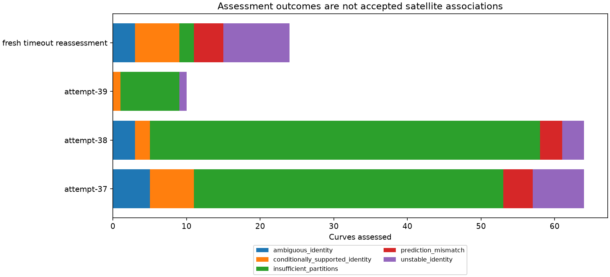
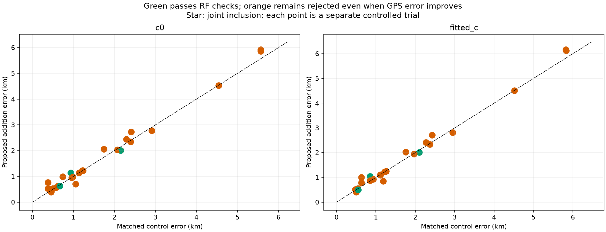
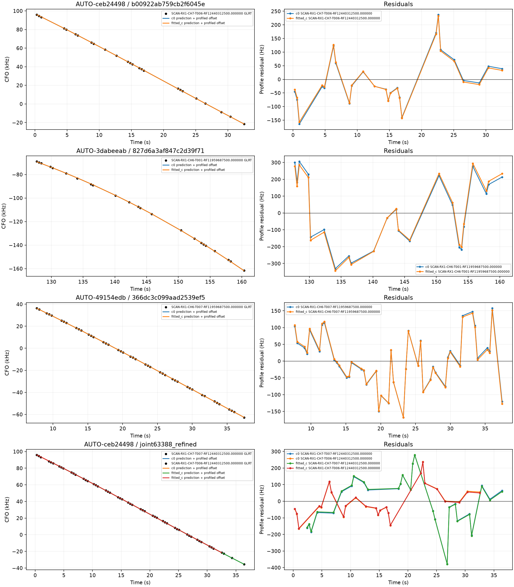
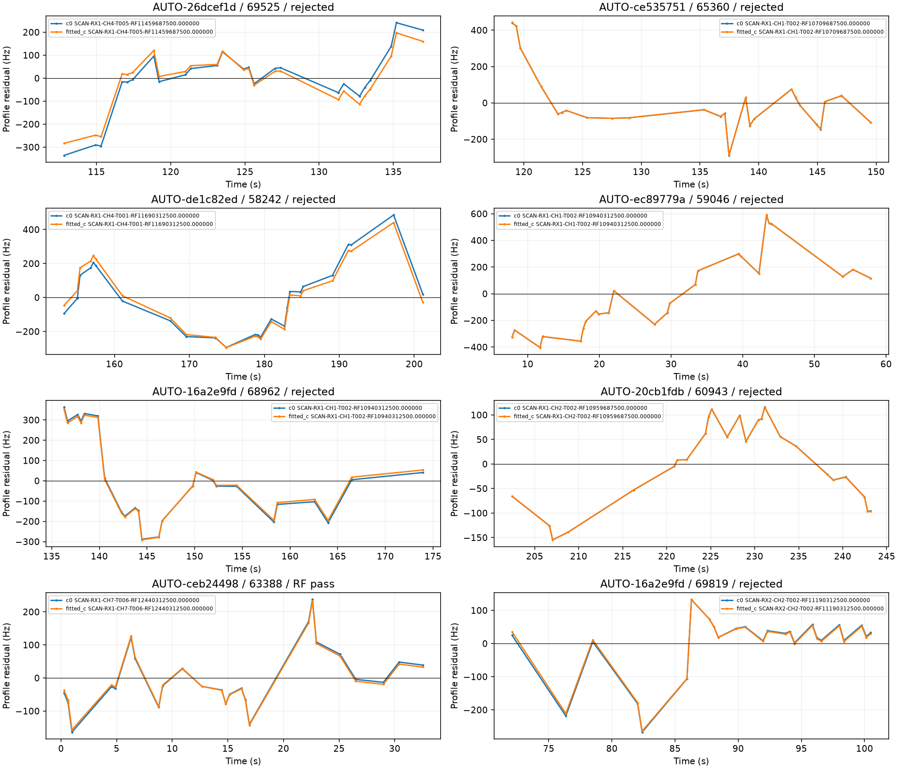
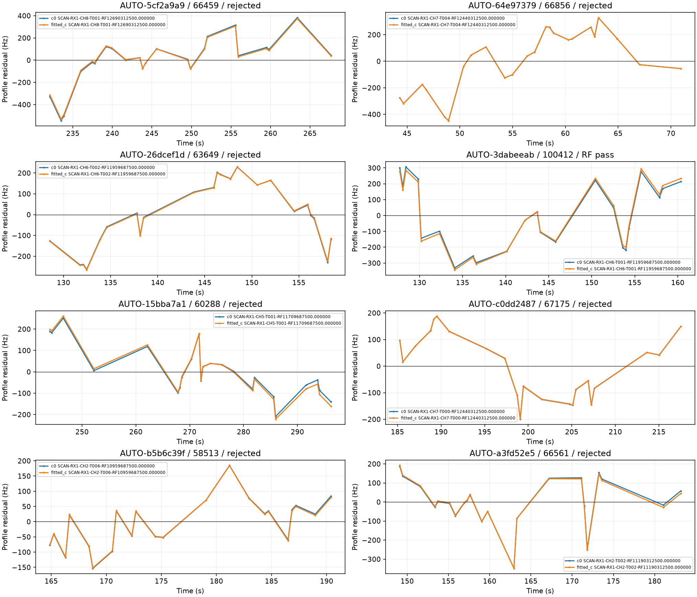
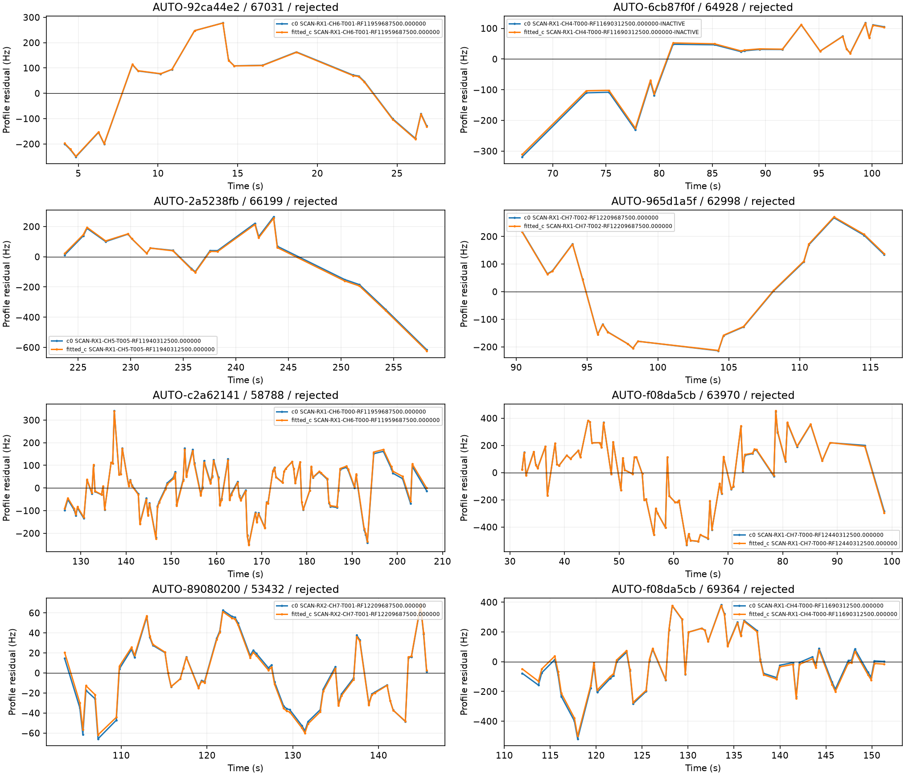
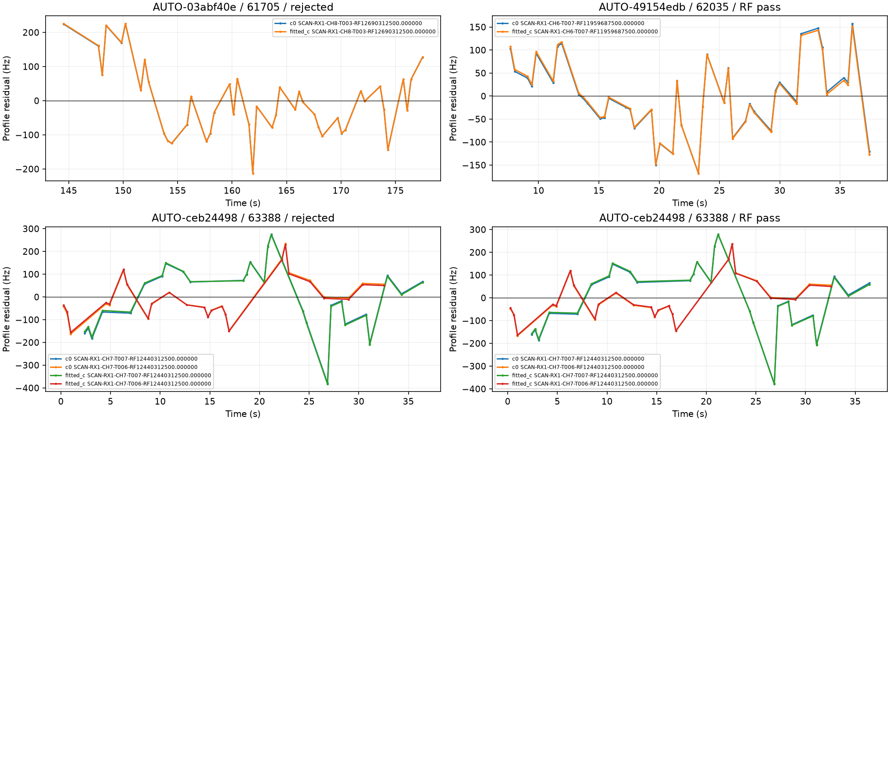

# Completing bounded predictive assessments and testing inclusion

The frozen inventory now has **1630 / 1630 curves assessed in at least one likelihood role**. This includes unresolved identities and curves with insufficient independent partitions. It does not mean that all curves are correctly identified, nor that all observations are usable for localization. There are **0 records without a completed assessment**. No production algorithm or acceptance threshold changes.

## What was tested

This iteration completes 162 fresh predictive assessments: the listed queue batches plus separate reassessments of the 24 earlier terminal timeouts. The old timeout receipts and partial outputs remain immutable and their hashes are verified. A timeout is an execution outcome, not evidence against a satellite. The predictive method fits receiver calibration without the target, then conditions satellite predictions on training target observations. It does not use the candidate curve to calibrate a receiver offset or drift. Validation uses reproducible random scanwide 12 s blocks with 2 s guards and distinct timestamp partitions. Short curves can lack enough partitions; this is insufficient validation evidence, not a claim that their GLRT signal is noise.

| status | count |
| --- | --- |
| insufficient_partitions | 105 |
| prediction_mismatch | 11 |
| ambiguous_identity | 11 |
| conditionally_supported_identity | 15 |
| unstable_identity | 20 |

The source ledger preserves earlier likelihood roles separately. Completing a first pass does not resolve ambiguous candidates, disagreement across partitions, or model mismatch. [Every annotation](annotations.csv), [the inventory ledger](annotation_ledger.csv), and [remaining assessments](remaining_assessments.csv) are included.

## Satellite identity is only the first test

Every supported identity in the specified inclusion batches receives a bounded position trial and exact-orbit replay. c=0 and fitted-c retain matched observations, candidates, priors and search budgets. The regional initialization is the 25 × 25 km box centered at 37.906, −122.545. Evaluation GPS (37.849061591561885, −122.48574968092912) does not select identities, corrections or trials. Only causal TLEs are used. Shared families retain their shared conditional model; new or uncalibrated families use a phase mixture with orbital and receiver uncertainty.

Each stage has a 600 s wall-clock cap. Passing requires both the control and proposed fit to qualify in both c arms, plus exact replay, phase checks, physical/residual gates and incumbent ownership checks. Exact replay replaces one family at a time; it is not a simultaneous exact-orbit refit of every family. A lower GPS error from a rejected trial is not an achieved improvement. Scores on different observation sets are not comparable localization evidence.

| scan | track_id | norad | target_points | c0_control_km | c0_addition_km | fitted_c_control_km | fitted_c_addition_km | RF_qualified |
| --- | --- | --- | --- | --- | --- | --- | --- | --- |
| AUTO-26dcef1d | 51e2e62b59ea4572676b | 69525 | 25 | 0.454 | 0.398 | 0.497 | 0.424 | False |
| AUTO-ce535751 | 63828e8957a3c1342a8e | 65360 | 25 | 1.218 | 1.218 | 1.219 | 1.221 | False |
| AUTO-de1c82ed | 844430a57d0aecf029e2 | 58242 | 25 | 1.744 | 2.050 | 1.760 | 2.022 | False |
| AUTO-ec89779a | 864ae7c033af310aa5e6 | 59046 | 25 | 2.291 | 2.437 | 2.269 | 2.408 | False |
| AUTO-16a2e9fd | a0eb49946a60b6037c0c | 68962 | 25 | 0.378 | 0.532 | 0.632 | 0.779 | False |
| AUTO-20cb1fdb | ae2ee338d878cdbd2911 | 60943 | 25 | 0.493 | 0.532 | 0.477 | 0.516 | False |
| AUTO-ceb24498 | b00922ab759cb2f6045e | 63388 | 25 | 2.145 | 2.007 | 2.100 | 2.015 | True |
| AUTO-16a2e9fd | c2a254b0347e02519c0a | 69819 | 25 | 0.379 | 0.767 | 0.633 | 1.008 | False |
| AUTO-5cf2a9a9 | 2a9255251491e720298d | 66459 | 24 | 1.053 | 0.698 | 1.185 | 0.853 | False |
| AUTO-64e97379 | b99d094e9d91ec994fc0 | 66856 | 24 | 4.539 | 4.532 | 4.518 | 4.512 | False |
| AUTO-26dcef1d | 09c5c4cffb161a15574d | 63649 | 23 | 0.454 | 0.456 | 0.497 | 0.411 | False |
| AUTO-3dabeeab | 827d6a3af847c2d39f71 | 100412 | 23 | 0.934 | 1.135 | 0.847 | 1.045 | True |
| AUTO-15bba7a1 | c836ea29f6f1aac81cdb | 60288 | 23 | 2.907 | 2.783 | 2.947 | 2.815 | False |
| AUTO-c0dd2487 | 0bd3a65d21b7f98f6962 | 67175 | 22 | 1.137 | 1.131 | 1.115 | 1.107 | False |
| AUTO-b5b6c39f | 3cfdfebb934665002eaa | 58513 | 22 | 0.630 | 0.625 | 0.543 | 0.552 | False |
| AUTO-a3fd52e5 | 5006518a3505137d8759 | 66561 | 22 | 1.230 | 1.220 | 1.258 | 1.251 | False |
| AUTO-92ca44e2 | 860859b3a546907caf7f | 67031 | 22 | 0.955 | 0.951 | 0.930 | 0.924 | False |
| AUTO-6cb87f0f | 5a3db4ff155b98905fe7 | 64928 | 21 | 2.409 | 2.731 | 2.421 | 2.708 | False |
| AUTO-2a5238fb | 75073868570d43ec8129 | 66199 | 21 | 0.736 | 0.983 | 0.853 | 0.868 | False |
| AUTO-965d1a5f | bedca6fe874f511d1b84 | 62998 | 20 | 2.069 | 2.037 | 1.971 | 1.943 | False |
| AUTO-c2a62141 | 658f40e78cfb4850c039 | 58788 | 102 | 0.980 | 0.982 | 1.115 | 1.095 | False |
| AUTO-f08da5cb | 459fef923b384f257cc4 | 63970 | 71 | 5.565 | 5.863 | 5.824 | 6.128 | False |
| AUTO-89080200 | 256709d9489a21f53dda | 53432 | 60 | 0.576 | 0.569 | 0.514 | 0.505 | False |
| AUTO-f08da5cb | b7b46104c284bd65d55d | 69364 | 55 | 5.563 | 5.916 | 5.822 | 6.159 | False |
| AUTO-03abf40e | 1d25c15236c3e6b185ee | 61705 | 44 | 2.389 | 2.346 | 2.370 | 2.332 | False |
| AUTO-49154edb | 366dc3c099aad2539ef5 | 62035 | 44 | 0.666 | 0.627 | 0.548 | 0.504 | True |
| AUTO-ceb24498 | joint63388 | 63388 | 52 | 2.145 | 2.036 | 2.100 | 2.023 | False |
| AUTO-ceb24498 | joint63388_refined | 63388 | 52 | 2.145 | 2.028 | 2.100 | 2.019 | True |

There are **4 qualified trial configurations out of 28 completed configurations**. These are research results, not distinct curves or additive gains. The joint 63388 experiment explicitly fits the two disjoint curves together; it is not the sum of their independently measured improvements. The earlier 27-point result and the new 25-point result use zero overlapping observations. The per-arm [position table](position_trials.csv) reports proposed coverage, target additions, incidental additions, losses, ownership changes, numerical checks, objective and evaluation error. Proposed coverage in rejected rows is not accepted coverage.

The first joint trial passes target residual gates and exact replay but fails the phase-integration accuracy check: the 0.1 s grid changes the local score by up to 0.0028 / 0.0043, above the unchanged 0.001 tolerance. The 0.05 versus 0.025 s comparison differs by only about 3–4 millionths. The separate refined trial therefore repeats the same regional fits with a 0.025 s phase grid. This follows numerical evidence, not GPS error, and retains the original failed trial. A phase integration step is a model computation setting, not the recording sample rate.

The refined joint fit qualifies: **52 added points**, no losses, and coverage **73.446% → 74.776%** (2,871 → 2,923 of 3,909 GLRT points). Error changes **2.145 → 2.028 km** for c=0 and **2.100 → 2.019 km** for fitted-c. These two CH7 fragments interleave along the same apparent curve: their observation IDs and exact timestamps do not overlap, and the nearest timestamps across fragments differ by at least 0.353 s. They are not two independent satellite passes. The shared-family fit is therefore essential; their individual error improvements cannot be summed.

The earlier-timeout recovery **AUTO-49154edb / 62035** qualifies with **44 points**. Error changes **0.666 → 0.627 km** for c=0 and **0.548 → 0.504 km** for fitted-c. This is one research scan result, not evidence that the whole dataset now reaches 500 m.

The qualified AUTO-3dabeeab addition increases evaluation error by about 0.20 km in both c arms. This is a direct counterexample to equating more associated GLRT with better position accuracy. The model can pass the current RF tests while still pulling the position away from ground truth. It remains visible as a research candidate, with no production promotion.

## Residual evidence and remaining work

[Failed gates](failed_gates.csv) distinguish target structure from conflicts with retained curves. Low RMS alone is insufficient: nonzero trend, curvature, steps or serial correlation can still make a candidate inconsistent with the model. The gate thresholds remain mean/slope z ≤ 3, quadratic BIC gain ≤ 10, maximum step z ≤ 4, and absolute lag-one correlation ≤ 4/sqrt(N), alongside physical and numerical checks. Passing those tests is evidence under this model, not proof of a perfect satellite identity.

The next priority is grouped evidence for short fragments and independent evidence for receiver events or satellite-model corrections, followed by simultaneous inclusion of compatible candidates. The goal remains incomplete: an assessment inventory is not an accepted association catalogue. No full-dataset position benefit or ALGO promotion is claimed. Source hashes, compact scientific evidence and terminal receipts accompany this report. The targeted regression suite passed 53 tests before this report was generated.
