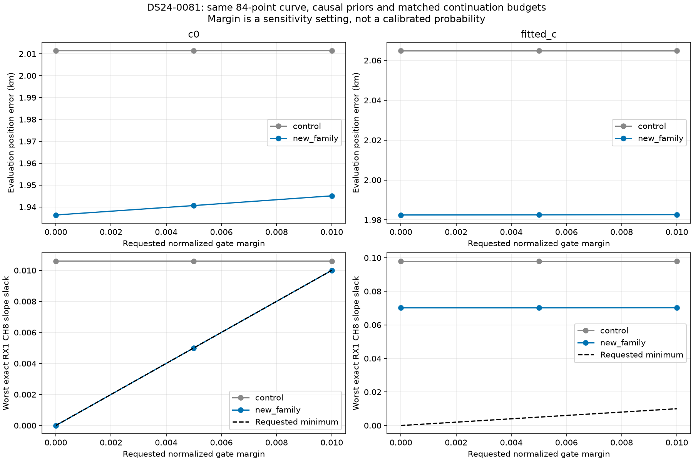
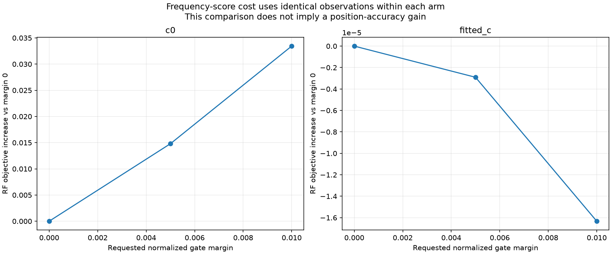

# DS24-0081 recovery: residual-margin sensitivity and role-consistent annotation

The previous feasible continuation recovered an 84-point curve associated with causal NORAD 69699, but an incumbent RX1 CH8 T001 residual-slope gate had almost no remaining margin. This iteration tests **two predeclared stricter margins, 0.005 and 0.01**, without changing identity, observations, physical priors, phase quadrature or target calibration role. Both no-addition control and addition use the same qualified regional-control starting point, five phase rounds and 48 SLSQP iterations per round. Each inclusion/replay stage has a 600 s wall-clock cap. There is no separate objective-call cap. This is a continuation sensitivity study, not a fresh regional or multi-start evaluation.

The normalized slope slack is `1 - slope_z / 3`. A margin of 0.01 therefore asks for `slope_z <= 2.97` instead of 3. Margins constrain every incumbent slack; other gates have their own normalizations. These settings are **sensitivity checks, not calibrated confidence levels or a selected production policy**. GPS is used only here to report error, never to fit or select a margin. Causal TLEs and the original 25 × 25 km regional control are retained. The target does not calibrate the receiver at a fixed position.

## Controlled results

| margin | c0_control_km | c0_addition_km | fitted_c_control_km | fitted_c_addition_km | c0_added | fitted_c_added | RF_qualified | exact_margin_met |
| --- | --- | --- | --- | --- | --- | --- | --- | --- |
| 0.000 | 2.011 | 1.936 | 2.065 | 1.982 | 84 | 84 | True | True |
| 0.005 | 2.011 | 1.941 | 2.065 | 1.983 | 84 | 84 | True | True |
| 0.010 | 2.011 | 1.945 | 2.065 | 1.983 | 84 | 84 | True | True |

Both tighter-margin trials pass in both c arms and retain all 84 proposed points with no incumbent ownership changes. At margin 0.01, error changes **2.011 → 1.945 km** (c=0) and **2.065 → 1.983 km** (fitted-c). Compared with the prior zero-margin addition, c=0 error changes by only about 9 m. This reduces concern that the recovery depends on barely passing the original gate. It remains a modest improvement on one scan. The c=0 optimizer still reaches the newly imposed slope boundary, so the underlying tension with retained CH8 evidence has not disappeared or been physically explained.

The proposed curve contains 84 points. A qualified result must retain all incumbent observations and owners, pass the target physical/noise and phase-quadrature checks, and pass independent exact-orbit replay. [Every arm and role](position_trials.csv) records the actual outcome, minimum exact slack, protected CH8 slope, optimizer status and ownership differences. Exact replay substitutes one incumbent family at a time; it is not a simultaneous exact-orbit refit. For duplicated gate keys, this report takes the **minimum over every replay**, not whichever value happened to be written last. A requested optimization margin and the independently replayed exact margin are reported separately; neither is silently substituted for the other.

The frequency-score comparison uses the same observations within each c arm. Control and addition have different observation sets, so their raw objectives are not interpreted as a localization comparison. Error against GPS is reported separately. All raw trials are preserved; no result is replaced by a more favorable run.

## Annotation pipeline correction

New graph-member assessments can now directly use `annotate_predictive_only.py --predictive-member --uncalibrated-phase-mixture`, so the candidate cannot calibrate the receiver that will later be used to predict it. Existing-family candidates use their retained shared posterior; new or uncalibrated families integrate the causal phase mixture. The inventory runner retains exclusive attempt claims and adds an explicit likelihood-role receipt. Default legacy behavior remains available for reproducibility.

Attempt 34 processes the next 16 pending graph curves in the existing frozen ordering. DS24 has no remaining pending graph rows in the original queue, so these are additional AUTO recordings from the wider inventory. They are not 16 new DS24 validations. Three distinct random scanwide 12 s block holdouts with 2 s guards are selected by timestamps; nomination and calibration use training observations only. Insufficient independent partitions remain an explicit outcome. Identity margins are candidate-comparison scores, not posterior probabilities. The frozen graph and incumbent identities remain conditioning assumptions.

Batch outcomes: **{'ambiguous_identity': 2, 'insufficient_partitions': 4, 'unstable_identity': 5, 'prediction_mismatch': 1, 'conditionally_supported_identity': 3, 'execution_failed': 1}**. The full inventory has **1339 / 1630** tracks assessed in at least one role, including 1324 original-role assessments. These counts include failures and ambiguity; they are not accepted coverage. The [ledger](annotation_ledger.csv) retains original assessments separately from [the direct predictive batch](annotation_batch.csv). This batch has not yet undergone position inclusion.

Of the 16 attempted curves, 15 produce scientific annotation results. AUTO-afec5a1f / RX1 CH4 T000 is rejected by the predictive-role precondition: the 28 unassociated points belong to a 102-point graph curve that already has active calibration observations. Treating the entire curve as new predictive evidence would duplicate retained evidence. Its original failed receipt/log remains archived; it is not counted as a completed identity assessment. It needs a separately identified inactive-tail target with disjoint observation ownership, while retaining the active portion. Its residual tail spans only 20.9 s and lacks active curvature, so independent partition support must also be checked before an inclusion trial. The three newly supported identities (68397, 59155 and 48445 on three separate AUTO recordings) are conditional identity candidates only.

## Limits and next work

This study only tests sensitivity to two small incumbent margins on one previously studied recovery. It does not establish that all 84 points independently improve position, validate a universal margin, or demonstrate generalization. The candidate identity and causal model remain conditional on the earlier random-block checks. Broader matched scan tests and uncertainty/perturbation checks are needed before changing production. Ambiguous identities must remain unresolved rather than being forced to meet a coverage target.

No production policy or ALGO version changes. Reproduce with `include_new_family_feasible.py --gate-margin 0.005` and `--gate-margin 0.01`, then `audit_predictive_family_inclusion.py`; exact commands and completion statuses are retained in [execution records](executions.csv). [Source hashes](sources.json) and [compact scientific evidence](evidence.json.gz) cover all reported runs. **33 targeted tests pass**, including positive margins, rejection of negative/nonfinite margins, matched-control requirements, predictive queue routing and conservative aggregation of duplicate exact-replay gates.
