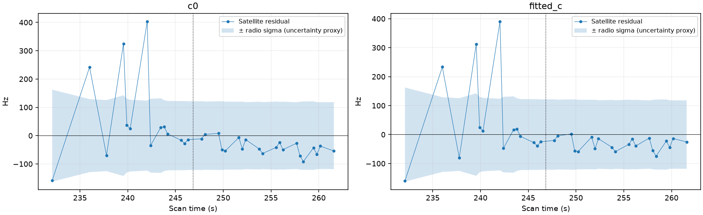

# Residual scale audit of the 60342 position regression

The [preceding inclusion and influence report](../2026_10_30_omitted_predictive_third_batch/README.md) found that AUTO-c1258263 / RX2 CH4 / NORAD 60342 passes the current RF checks while increasing fitted-c position error from 0.090 to 0.937 km. This follow-up identifies a possible weighting issue: the target's residual scatter varies much more over time than its assigned radio uncertainty does.

This is a descriptive audit of the saved inclusion fit, with no position optimization, point removal, new association, revised weight, or GPS-based selection. The sample was selected for investigation after observing its regression; it is not an independent validation case. The plot uses the saved inclusion prediction rather than the separate continuously refined phase diagnostic, so sub-Hz differences from that diagnostic are expected.

We divide the target at its timestamp midpoint (246.833 s), without choosing a split to maximize a residual difference. The machine-readable evidence also includes every fixed scanwide 12-second block. Scatter below is sample standard deviation after subtracting each half's mean; the actual fit and plotted residuals have only the original fitted track bias removed.

| Arm | Interval | Points | Residual mean (Hz) | Residual scatter (Hz) | Residual RMS (Hz) | Median assigned radio sigma (Hz) |
| --- | --- | ---: | ---: | ---: | ---: | ---: |
| c=0 | First half | 14 | 55.48 | 156.76 | 160.93 | 126.18 |
| c=0 | Second half | 20 | -39.30 | 26.01 | 46.77 | 119.80 |
| fitted-c | First half | 14 | 44.48 | 155.72 | 156.51 | 126.18 |
| fitted-c | Second half | 20 | -32.34 | 21.80 | 38.70 | 119.80 |

The fitted-c scatter ratio is about **7.14**, while the assigned radio-sigma ratio is **1.05**. The current radio uncertainty proxy already permits heteroscedasticity: its floor-plus-inverse-GLRT-margin model has BIC gain 4.184 over constant noise, a 99.46 Hz floor, and 1,667 training noise samples. Thus this is not simply a missing heteroscedasticity switch. Its uncertainty floor and GLRT-margin relationship may fail to represent this track's changing precision, or the discrepancy may contain an unmodeled physical effect.

These residuals also share fitted orbital/receiver parameters and are correlated. Their scatter is **not an independent measurement-noise estimate**. The shaded radio sigma omits the likelihood's additional shared receiver/orbit uncertainty and its factor of two on independent radio variance; it is not a predictive confidence interval. This comparison does not establish that the early points are erroneous or that changing their weights will improve location.

## Discriminating next tests

1. Check the early high-residual GLRT points against their native polynomial residuals, competing peaks, signal margins, and within-window time/frequency information. This separates a measurement problem from a smooth satellite-model discrepancy without using GPS to select observations.
2. Check whether contemporaneous tracks on the same receiver show the same discrepancy. Agreement across independent satellite families supports a receiver effect; agreement across receivers for one satellite supports an orbital/model effect.
3. If measurement-quality evidence supports revised uncertainties, fit that rule on random grouped training observations, then compare held-out prediction and matched c=0/fitted-c location errors across the cohort. Keep the existing rule as the control and retain all regressions. Do not estimate weights from the same satellite residuals and then claim independent validation.

No acceptance gate or production behavior changes. This result is a model-audit lead, not a recovered location improvement.

## Reproduction and validation

`tools/diagnose_predictive_residual_scale.py` reconstructs the original noise proxy and checks native observation ordering and timestamps. [result.json](result.json) records both arms, per-point residuals/scales, fixed temporal groups, noise-model metadata, and SHA-256 hashes of the source inventory and trial. The source trial is `/srv/bulk/leo/research/ch78-qualified-cohort-20261029/omitted-predictive-distinct-inclusion-v3/c2d4137494f1b3e28340/trial`.

Four focused tests passed: fixed-time scatter comparison, invalid noise-scale rejection, preservation of reviewed-point withholding/ownership, and reconstruction of the original phase-grid and uncertainty options. The two new diagnostic tests reside in `tests/analysis/test_predictive_residual_scale.py`.
