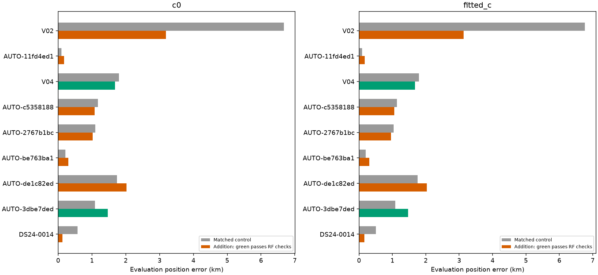
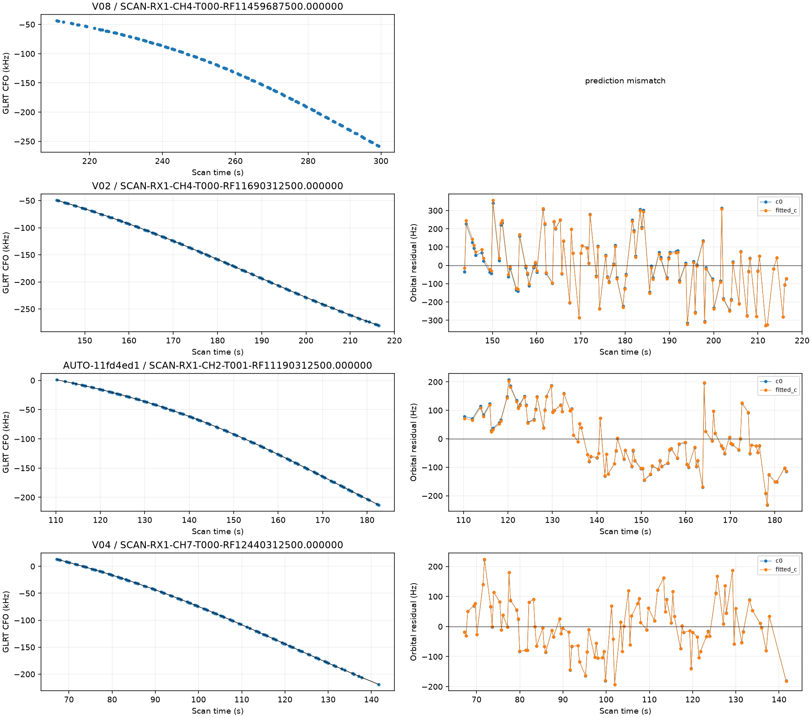
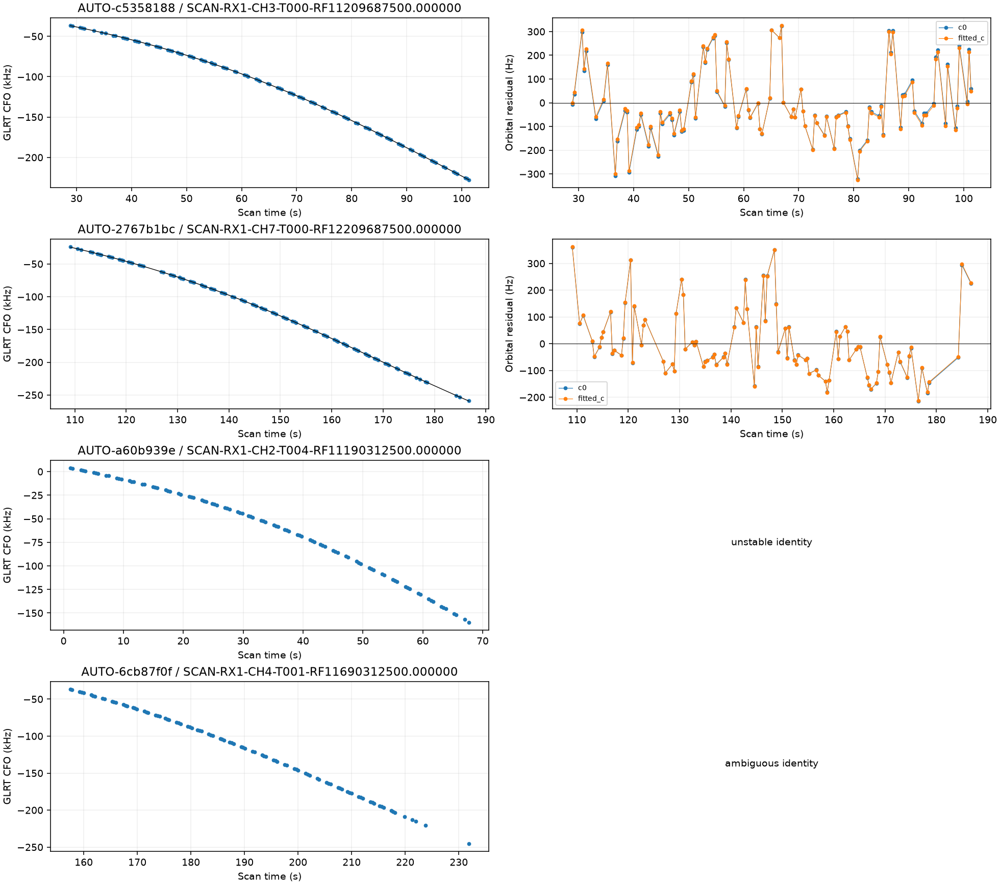
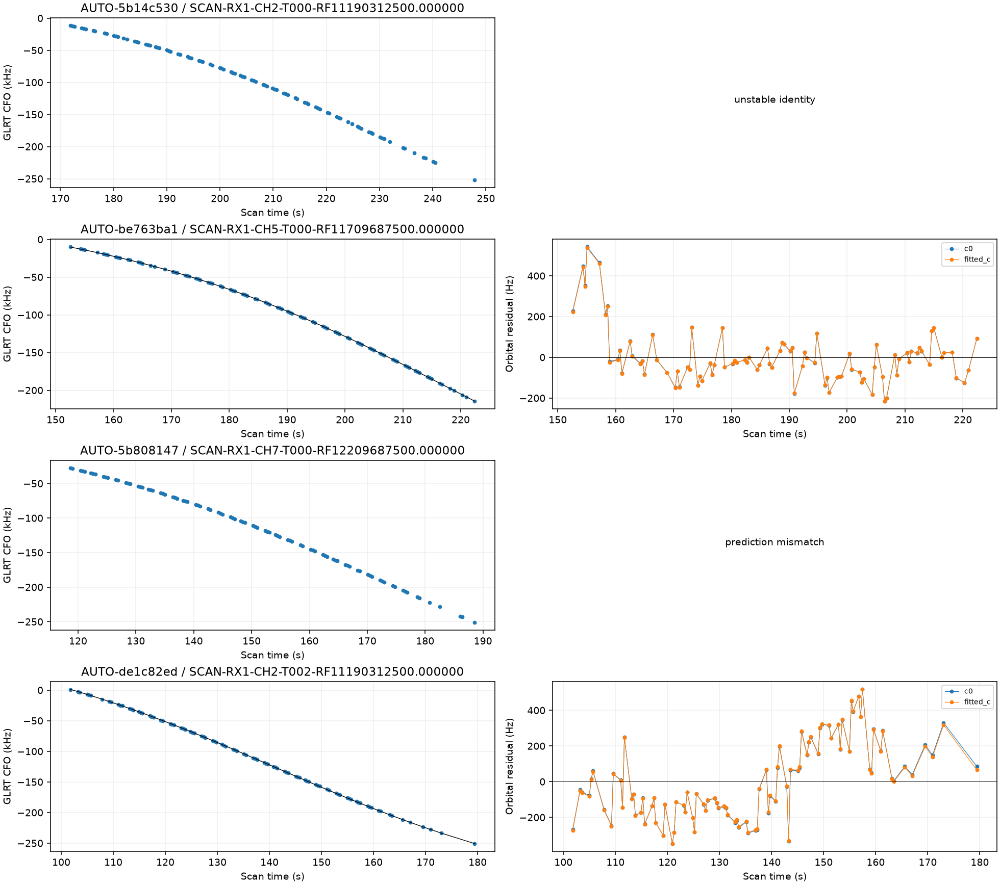
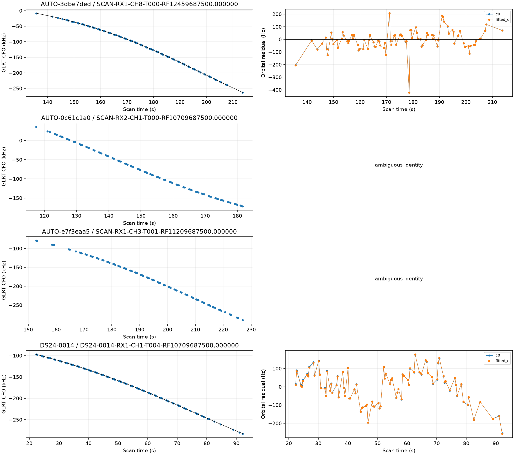
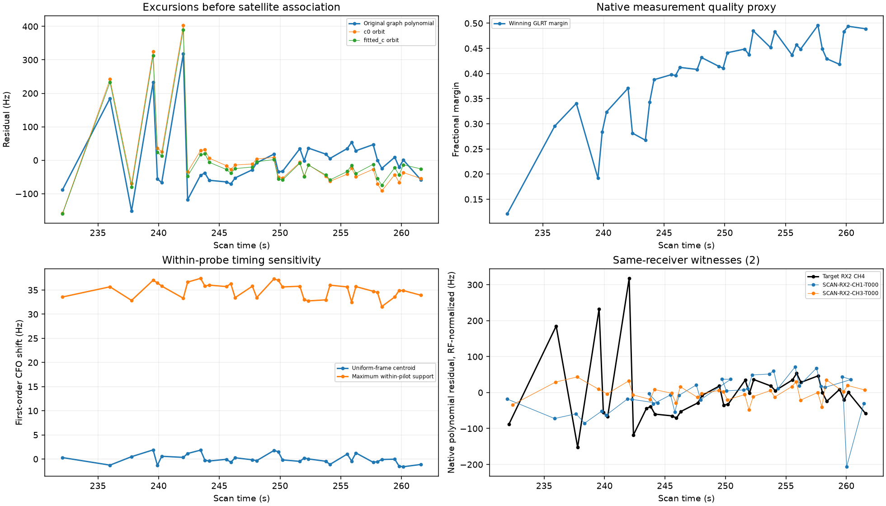

# Predictive-role reassessment, native measurement evidence, and capture-mode correction

We reconciled the 985 older-role primary annotations against saved predictive-only annotation protocols in the study. None had an exact-target match in the recognized predictive schema. This is a source-scope finding, not proof that no historical experiment exists elsewhere. The 16 largest were reassessed without allowing target observations to calibrate the receiver. **969 remain** in this role queue; the full 1,630-curve goal remains incomplete.

[The 985-row source reconciliation](role_source_reconciliation.csv) preserves the original assessments, scan IDs and exact-target source search outcomes. Eleven focused tests passed for predictive-role matching, phase-grid routing, native polynomial replay, acquisition provenance, review reversals, and numerical-retry eligibility.

## Capture provenance correction

Earlier omitted-queue reports incorrectly treated `source.capture_mode` in fast compatibility exports as acquisition provenance. The adapter writes `adaptive` into this field for fast scans. The previous 53 curves actually comprise **49 fast and 4 adaptive** recordings: **27 fast at 10 MS/s, 22 fast at 2.5 MS/s, and four adaptive at 10 MS/s**. This correction supersedes their all-adaptive statements and capture-mode columns. The four legacy DS24 aliases mapped to DS25 remain adaptive. The 16 new cases are all fast: 13 at 10 MS/s and three at 2.5 MS/s.

[capture_provenance.csv](capture_provenance.csv) covers all 69 curves. For fast exports, the audit matches the input inventory's canonical digest, verifies every segment manifest digest and window count, and checks acquisition versus tracking sample rates. Direct scanner tracking records remain distinguished from compatibility wrappers. The current diagnostic reporter flags unverified fast wrappers instead of trusting the compatibility field. No persisted contract, measurement, satellite label, or saved position output was changed.

## Independent-role annotation results

The same causal catalogue and physical priors are used in both c arms. Three distinct random scanwide 12-second block partitions with 2-second guards are selected from timestamps alone. The report replays the held point sets. GPS is used only to report position error. Older labels and assessments remain separately recorded.

| scan | points | old_status | status | norad | margin |
| --- | --- | --- | --- | --- | --- |
| V08 | 120 | conditionally_supported_identity | prediction_mismatch | 66102 | 611.413 |
| V02 | 102 | conditionally_supported_identity | conditionally_supported_identity | 65894 | 1274.344 |
| AUTO-11fd4ed1 | 100 | conditionally_supported_identity | conditionally_supported_identity | 64172 | 257.380 |
| V04 | 99 | conditionally_supported_identity | conditionally_supported_identity | 63124 | 44.312 |
| AUTO-c5358188 | 99 | conditionally_supported_identity | conditionally_supported_identity | 59092 | 48.021 |
| AUTO-2767b1bc | 98 | conditionally_supported_identity | conditionally_supported_identity | 63635 | 3029.524 |
| AUTO-a60b939e | 93 | unstable_identity | unstable_identity | None | 0.160 |
| AUTO-6cb87f0f | 93 | unstable_identity | ambiguous_identity | 67954 | 2.316 |
| AUTO-5b14c530 | 91 | unstable_identity | unstable_identity | None | 0.934 |
| AUTO-be763ba1 | 91 | conditionally_supported_identity | conditionally_supported_identity | 66562 | 14.410 |
| AUTO-5b808147 | 91 | prediction_mismatch | prediction_mismatch | 63573 | 1837.160 |
| AUTO-de1c82ed | 91 | unstable_identity | conditionally_supported_identity | 65208 | 60.513 |
| AUTO-3dbe7ded | 90 | ambiguous_identity | conditionally_supported_identity | 69520 | 38.131 |
| AUTO-0c61c1a0 | 88 | unstable_identity | ambiguous_identity | 67928 | 2.341 |
| AUTO-e7f3eaa5 | 88 | ambiguous_identity | ambiguous_identity | 66977 | 0.538 |
| DS24-0014 | 87 | unstable_identity | conditionally_supported_identity | 59733 | 1125.985 |

The outcomes are **{'prediction_mismatch': 2, 'conditionally_supported_identity': 9, 'unstable_identity': 2, 'ambiguous_identity': 3}**. A confident candidate comparison can still fail absolute predictive agreement: V08 and AUTO-5b808147 illustrate this. Identity margins are not calibrated posterior probabilities. No ambiguous or unstable label is forced into position estimation.

## Matched position inclusion

All nine supported identities receive control/addition tests with matched c=0/fitted-c settings and 0.025-second phase integration for new families. One numerical-only failure receives a matched Powell retry; all original trials remain in [comparisons.csv](comparisons.csv). Exact replay and ownership checks are retained. No physical gate is loosened because position error improves.

| scan | norad | points | qualified | c0_before_km | c0_after_km | fitted_c_before_km | fitted_c_after_km |
| --- | --- | --- | --- | --- | --- | --- | --- |
| V02 | 65894 | 102 | False | 6.677 | 3.188 | 6.763 | 3.135 |
| AUTO-11fd4ed1 | 64172 | 100 | False | 0.098 | 0.171 | 0.092 | 0.173 |
| V04 | 63124 | 99 | True | 1.798 | 1.680 | 1.791 | 1.672 |
| AUTO-c5358188 | 59092 | 99 | False | 1.176 | 1.079 | 1.133 | 1.058 |
| AUTO-2767b1bc | 63635 | 98 | False | 1.097 | 1.019 | 1.034 | 0.954 |
| AUTO-be763ba1 | 66562 | 91 | False | 0.214 | 0.304 | 0.197 | 0.310 |
| AUTO-de1c82ed | 65208 | 91 | False | 1.743 | 2.021 | 1.760 | 2.032 |
| AUTO-3dbe7ded | 69520 | 90 | True | 1.089 | 1.466 | 1.089 | 1.467 |
| DS24-0014 | 59733 | 87 | False | 0.573 | 0.130 | 0.508 | 0.161 |

**2 curves / 189 points** pass the current RF checks. These remain per-curve research candidates; they are not production changes or a simultaneous combined solution. Passing frequency tests does not guarantee better localization. [position_trials.csv](position_trials.csv) separates coverage, frequency-fit objectives, RMS and position errors. [failed_replay_gates.csv](failed_replay_gates.csv) preserves failing replay constraints, while compact raw evidence retains target noise gates and optimizer outcomes.

V02's 102-point target substantially reduces position error but still fails its fitted-c residual slope (z≈4.05 > 3) and step statistic (≈4.34 > 4), despite RMS≈163 Hz. It remains rejected. This is a useful next model investigation rather than an accepted recovery.

## 60342: excursions are already present in the native curve

The previous 60342 inclusion passed RF checks but moved fitted-c position error from 0.090 to 0.937 km. This audit exactly replays all archived winning observations and verifies that graph values differ only by integer aliases. The original graph itself had an adjacent-residual-correlation flag; it was not a uniformly clean measurement curve.

| time_s | original_polynomial_residual_hz | fractional_margin | eligible_candidates | maximum_support_timing_shift_hz |
| --- | --- | --- | --- | --- |
| 242.033 | 317.680 | 0.371 | 1 | 33.303 |
| 239.547 | 232.628 | 0.192 | 1 | 37.025 |
| 235.998 | 184.987 | 0.296 | 1 | 35.671 |
| 237.771 | -151.894 | 0.341 | 1 | 32.850 |
| 242.389 | -117.861 | 0.282 | 1 | 36.640 |

The strongest original-polynomial excursion is about 318 Hz at 242.033 s, with a maximum first-order within-pilot timing effect of about 33 Hz. It is the only exported candidate passing the margin gate. Polynomial-versus-orbit residual correlations are **0.824 (c=0)** and **0.861 (fitted-c)**. Thus much of the irregular residual behavior exists before satellite association. This favors testing the measurement against its existing IQ before adding orbital or receiver flexibility. A polynomial residual does not prove measurement error: source mixing and approximation error remain possible.

Two same-RX native polynomial witnesses have 34 and 31 one-to-one pairs within 1.5 s and residual correlations of approximately -0.001 and 0.278. They do not show strong common excursions under this diagnostic. They are in-sample, and their polynomial fits can absorb shared smooth errors, so this does not rule out a shared receiver drift. The timing figures use the original polynomial derivative and pilot sample support; they are not absolute-clock validation or actual IQ-weighted centroid estimates.

## Next steps and reproducibility

Remeasure the complete 34-point 60342 target from existing IQ, with independent frame consistency and complementary-frame prediction, rather than removing its worst points. Keep the frequency estimator independent of GPS/TLE predictions. Investigate V02's residual structure with the same native-measurement and cross-family checks. Continue bounded reassessment of the remaining 969 older-role candidates; keep ambiguity, insufficient evidence, and physical model failures explicit.

[The updated 1,630-row ledger](annotation_ledger.csv), [remaining role candidates](remaining_role_candidates.json), [native evidence](native_measurements.json), [partition assignments](partitions.csv), [execution receipts](executions.csv), [source hashes](sources.json), and compressed scientific evidence accompany the report. No new RF was collected. Production and acceptance thresholds are unchanged.
