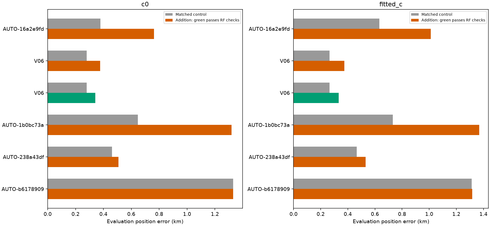
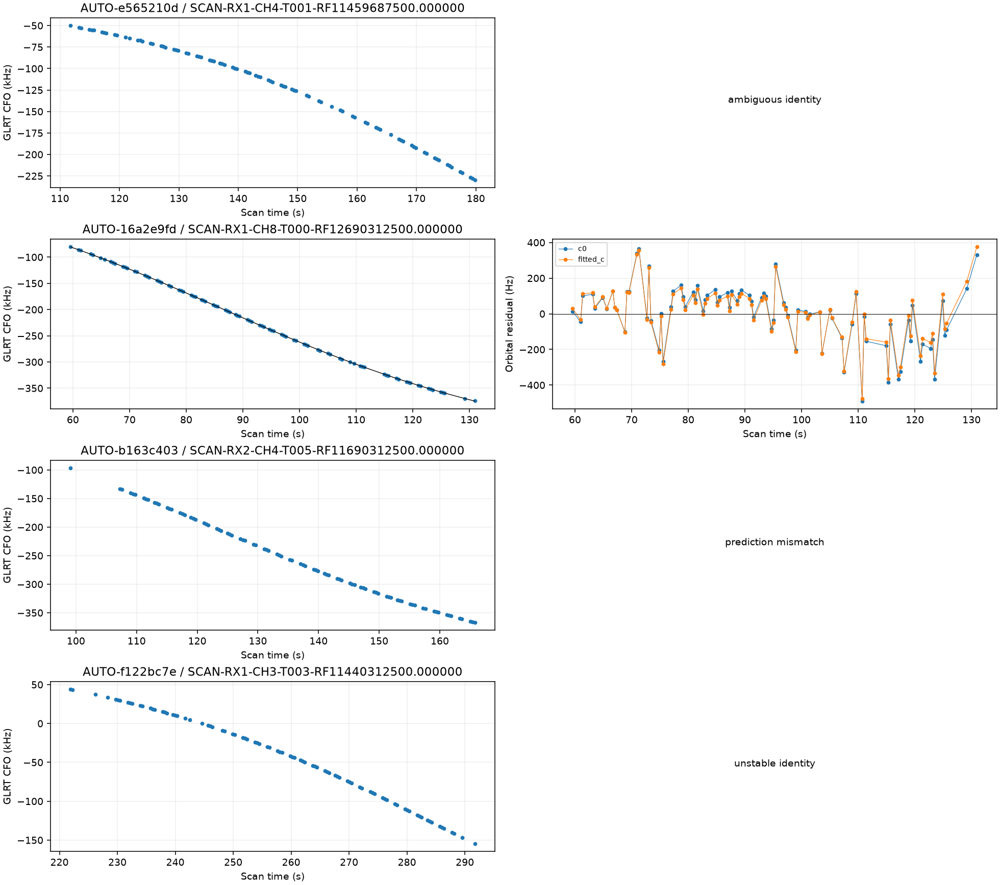
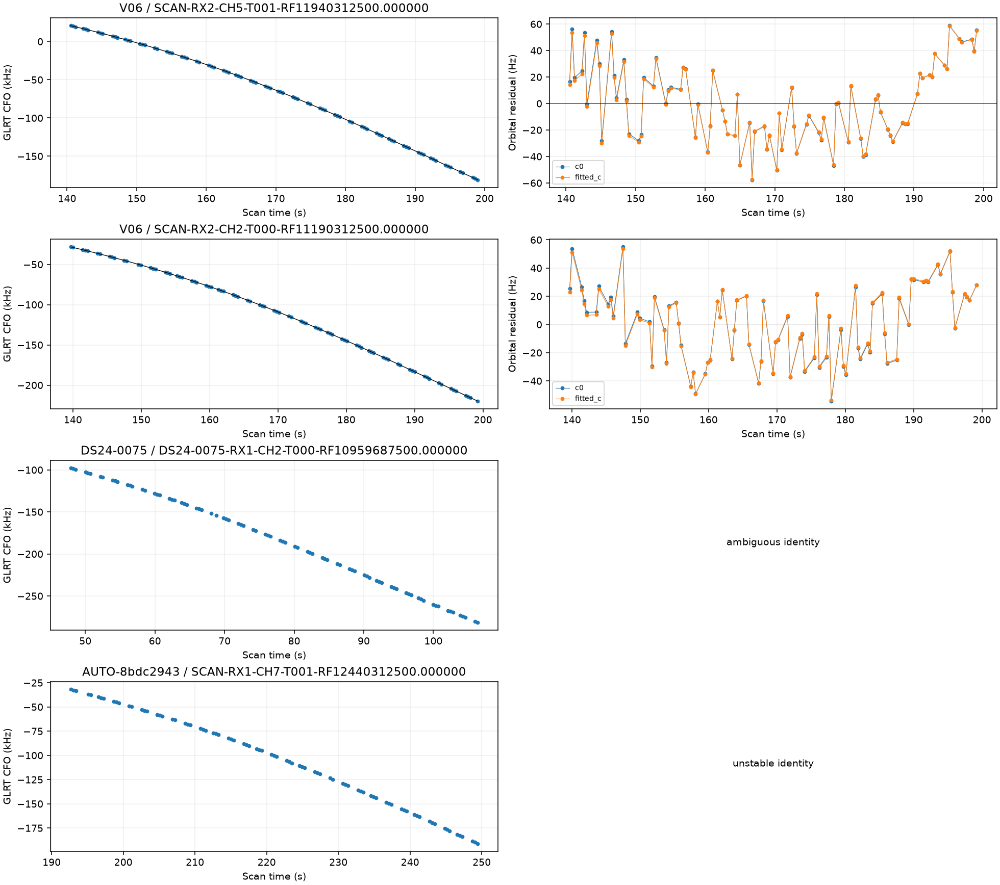
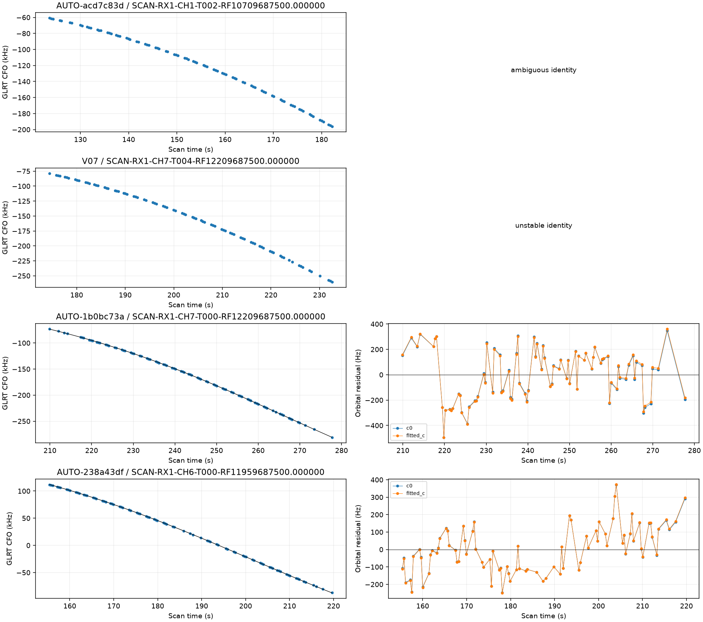
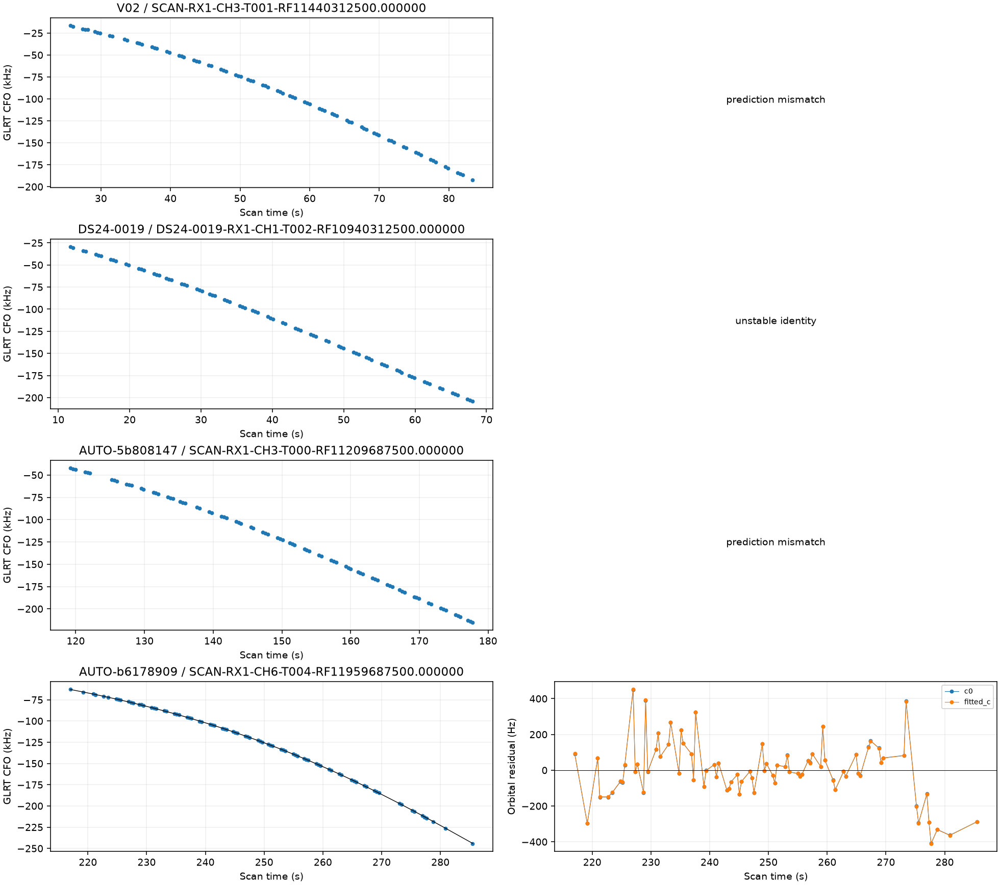

# Predictive-role reassessment batch 2

The next **16** curves from the frozen older-role queue have terminal predictive-only assessments. **953 remain**. The full 1,630-curve goal is incomplete. Selection follows descending point count without GPS-based ranking; no supported label is forced into inclusion.

## Identity and provenance

| scan | points | old_status | status | norad | margin |
| --- | --- | --- | --- | --- | --- |
| AUTO-e565210d | 87 | conditionally_supported_identity | ambiguous_identity | 58222 | 7.110 |
| AUTO-16a2e9fd | 87 | conditionally_supported_identity | conditionally_supported_identity | 68772 | 119.406 |
| AUTO-b163c403 | 86 | unstable_identity | prediction_mismatch | 69652 | 2883.129 |
| AUTO-f122bc7e | 86 | unstable_identity | unstable_identity | None | 196.890 |
| V06 | 85 | conditionally_supported_identity | conditionally_supported_identity | 69713 | 12.355 |
| V06 | 83 | conditionally_supported_identity | conditionally_supported_identity | 69713 | 11.772 |
| DS24-0075 | 83 | unstable_identity | ambiguous_identity | 66226 | 3.256 |
| AUTO-8bdc2943 | 83 | ambiguous_identity | unstable_identity | None | 1.849 |
| AUTO-acd7c83d | 83 | ambiguous_identity | ambiguous_identity | 63481 | 1.536 |
| V07 | 82 | conditionally_supported_identity | unstable_identity | None | 1.268 |
| AUTO-1b0bc73a | 82 | conditionally_supported_identity | conditionally_supported_identity | 59494 | 55.565 |
| AUTO-238a43df | 82 | conditionally_supported_identity | conditionally_supported_identity | 63198 | 102.200 |
| V02 | 81 | conditionally_supported_identity | prediction_mismatch | 61851 | 15.145 |
| DS24-0019 | 81 | unstable_identity | unstable_identity | None | 8.222 |
| AUTO-5b808147 | 81 | conditionally_supported_identity | prediction_mismatch | 63573 | 1009.779 |
| AUTO-b6178909 | 80 | conditionally_supported_identity | conditionally_supported_identity | 62922 | 45.426 |

Outcomes: **{'ambiguous_identity': 3, 'conditionally_supported_identity': 6, 'prediction_mismatch': 3, 'unstable_identity': 4}**. Every supported identity has three distinct randomized scanwide 12-second held block sets, with two-second guards. The report replays the physical point sets. Targets do not calibrate the receiver. Capture modes are **{'fast': 16}**, verified from the acquisition provenance rather than the fast adapter's compatibility label; [capture_provenance.csv](capture_provenance.csv) retains the authorities and sample rates.

## Position trials

| scan | norad | points | qualified | c0_before_km | c0_after_km | fitted_c_before_km | fitted_c_after_km |
| --- | --- | --- | --- | --- | --- | --- | --- |
| AUTO-16a2e9fd | 68772 | 87 | False | 0.379 | 0.763 | 0.633 | 1.012 |
| V06 | 69713 | 85 | False | 0.280 | 0.376 | 0.266 | 0.375 |
| V06 | 69713 | 83 | True | 0.280 | 0.343 | 0.266 | 0.333 |
| AUTO-1b0bc73a | 59494 | 82 | False | 0.647 | 1.318 | 0.733 | 1.368 |
| AUTO-238a43df | 63198 | 82 | False | 0.462 | 0.508 | 0.465 | 0.532 |
| AUTO-b6178909 | 62922 | 80 | False | 1.332 | 1.331 | 1.314 | 1.316 |

**1 individual curves / 83 points** pass the current RF checks. These are separate research trials, not a simultaneous solution or a production change. Controls/additions and c=0/fitted-c arms use matched observations, candidate sets, priors and budgets; additions differ only by their specified targets. New-family phase integration uses 0.025-second spacing. Numerical retries, if any, preserve the physical gates. All original and retry outputs, including regressions and rejections, remain in [comparisons.csv](comparisons.csv) and [position_trials.csv](position_trials.csv). Exact replay failures are in [failed_replay_gates.csv](failed_replay_gates.csv).

Two V06 curves independently nominate the same satellite. Their individual outcomes do not establish joint consistency; consult the linked joint audit before combining them. No union of individual position improvements is claimed.

## Remaining work and evidence

[The updated ledger](annotation_ledger.csv), [remaining candidates](remaining_role_candidates.json), [holdout point assignments](partitions.csv), [receipts](executions.csv), and source-hashed compact evidence preserve the next work. The separate [native IQ investigation](../2026_10_30_native_iq_recovery/README.md) reports the complete 60342 remeasurement and the V06 joint-family trial. No future TLE or evaluation GPS enters inference; GPS is used only for error reporting. Production is unchanged.
