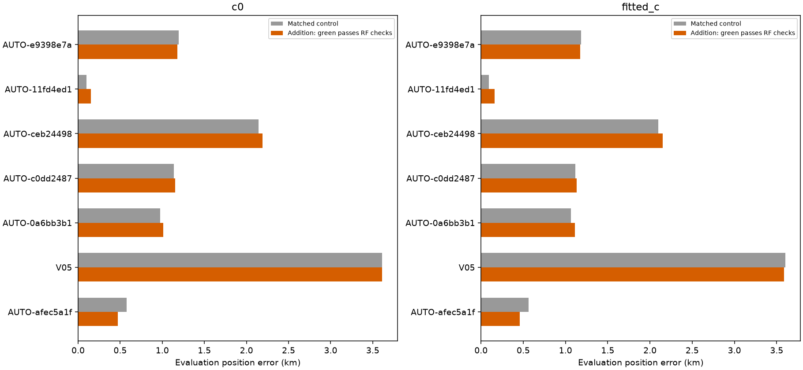
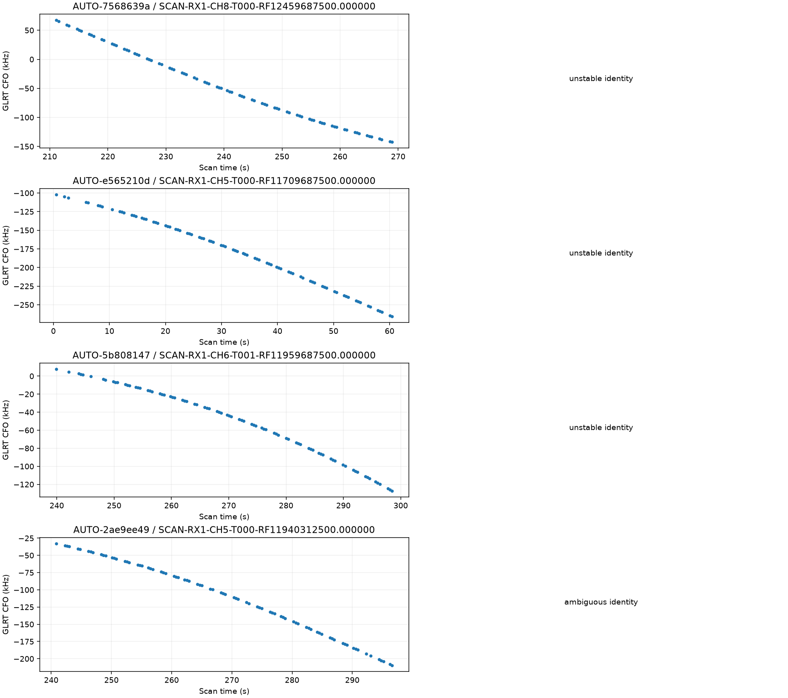
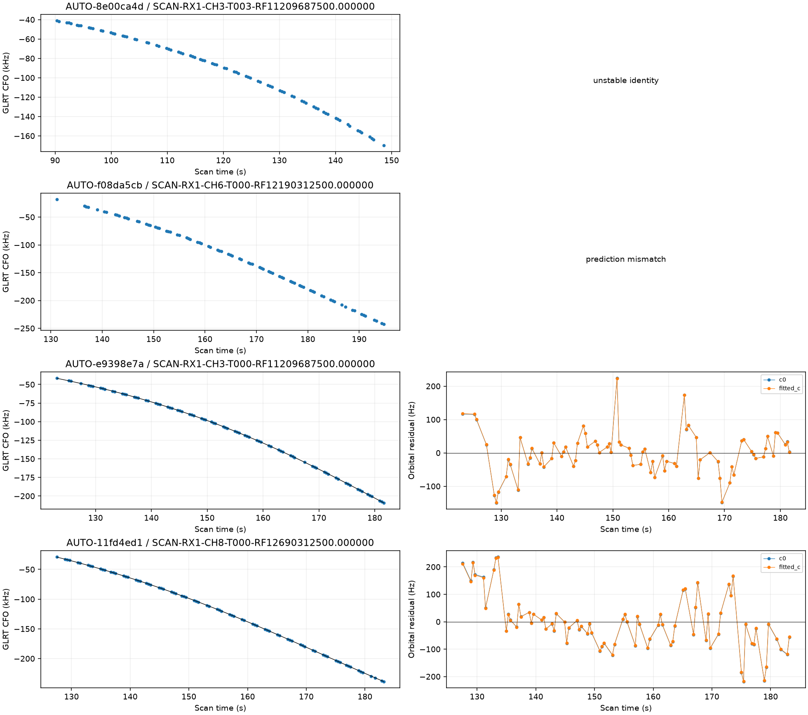
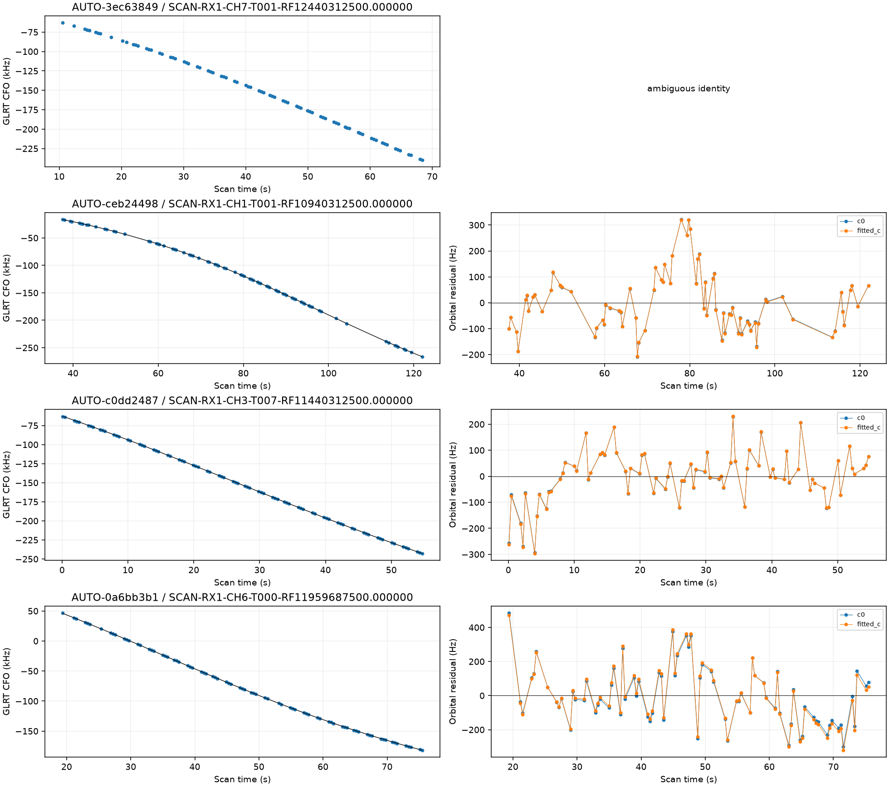
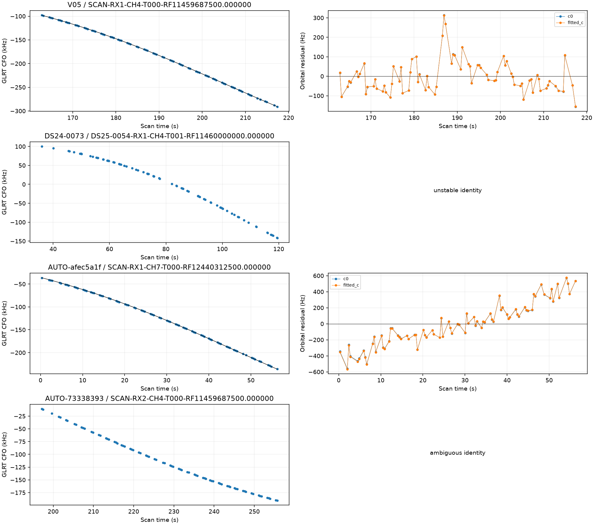

# Predictive-role reassessment batch 3

The next **16** curves from the frozen older-role queue have terminal predictive-only assessments. **937 remain**. The full 1,630-curve goal is incomplete. Selection follows descending point count without GPS-based ranking; no supported label is forced into inclusion.

## Identity and provenance

| scan | points | old_status | status | norad | margin |
| --- | --- | --- | --- | --- | --- |
| AUTO-7568639a | 80 | prediction_mismatch | unstable_identity | None | 525.774 |
| AUTO-e565210d | 80 | unstable_identity | unstable_identity | None | 0.356 |
| AUTO-5b808147 | 80 | prediction_mismatch | unstable_identity | None | 2.106 |
| AUTO-2ae9ee49 | 80 | conditionally_supported_identity | ambiguous_identity | 63838 | 1.614 |
| AUTO-8e00ca4d | 79 | unstable_identity | unstable_identity | None | 1.883 |
| AUTO-f08da5cb | 79 | prediction_mismatch | prediction_mismatch | 65744 | 399.762 |
| AUTO-e9398e7a | 79 | conditionally_supported_identity | conditionally_supported_identity | 100427 | 72.859 |
| AUTO-11fd4ed1 | 78 | conditionally_supported_identity | conditionally_supported_identity | 64172 | 317.207 |
| AUTO-3ec63849 | 78 | unstable_identity | ambiguous_identity | 60351 | 3.745 |
| AUTO-ceb24498 | 77 | conditionally_supported_identity | conditionally_supported_identity | 63468 | 114.720 |
| AUTO-c0dd2487 | 77 | conditionally_supported_identity | conditionally_supported_identity | 69493 | 57.454 |
| AUTO-0a6bb3b1 | 77 | conditionally_supported_identity | conditionally_supported_identity | 68295 | 205.185 |
| V05 | 77 | conditionally_supported_identity | conditionally_supported_identity | 66887 | 2221.858 |
| DS24-0073 | 77 | conditionally_supported_identity | unstable_identity | None | 0.142 |
| AUTO-afec5a1f | 77 | conditionally_supported_identity | conditionally_supported_identity | 59632 | 27.857 |
| AUTO-73338393 | 76 | ambiguous_identity | ambiguous_identity | 56701 | 3.712 |

Outcomes: **{'unstable_identity': 5, 'ambiguous_identity': 3, 'prediction_mismatch': 1, 'conditionally_supported_identity': 7}**. Every supported identity has three distinct randomized scanwide 12-second held block sets, with two-second guards. The report replays the physical point sets. Targets do not calibrate the receiver. Capture modes are **{'fast': 15, 'adaptive': 1}**, verified from the acquisition provenance rather than the fast adapter's compatibility label; [capture_provenance.csv](capture_provenance.csv) retains the authorities and sample rates.

## Position trials

| scan | norad | points | qualified | c0_before_km | c0_after_km | fitted_c_before_km | fitted_c_after_km |
| --- | --- | --- | --- | --- | --- | --- | --- |
| AUTO-e9398e7a | 100427 | 79 | False | 1.196 | 1.180 | 1.186 | 1.174 |
| AUTO-11fd4ed1 | 64172 | 78 | False | 0.098 | 0.153 | 0.092 | 0.160 |
| AUTO-ceb24498 | 63468 | 77 | False | 2.144 | 2.193 | 2.098 | 2.152 |
| AUTO-c0dd2487 | 69493 | 77 | False | 1.137 | 1.152 | 1.115 | 1.131 |
| AUTO-0a6bb3b1 | 68295 | 77 | False | 0.974 | 1.012 | 1.063 | 1.111 |
| V05 | 66887 | 77 | False | 3.613 | 3.613 | 3.601 | 3.588 |
| AUTO-afec5a1f | 59632 | 77 | False | 0.575 | 0.474 | 0.564 | 0.457 |

**0 individual curves / 0 points** pass the current RF checks. These are separate research trials, not a simultaneous solution or a production change. Controls/additions and c=0/fitted-c arms use matched observations, candidate sets, priors and budgets; additions differ only by their specified targets. New-family phase integration uses 0.025-second spacing. Numerical retries, if any, preserve the physical gates. All original and retry outputs, including regressions and rejections, remain in [comparisons.csv](comparisons.csv) and [position_trials.csv](position_trials.csv). Exact replay failures are in [failed_replay_gates.csv](failed_replay_gates.csv).

Individual outcomes do not establish joint consistency. The earlier V06 joint audit illustrates this limitation; no union of individual position improvements is claimed. The failed-gate table distinguishes target from incumbent evidence and includes both nominal and continuously refined new-family target screens.

## Remaining work and evidence

[The updated ledger](annotation_ledger.csv), [remaining candidates](remaining_role_candidates.json), [holdout point assignments](partitions.csv), [receipts](executions.csv), and source-hashed compact evidence preserve the next work. The separate [native IQ investigation](../2026_10_30_native_iq_recovery/README.md) reports the complete 60342 remeasurement and the V06 joint-family trial. No future TLE or evaluation GPS enters inference; GPS is used only for error reporting. Production is unchanged.
