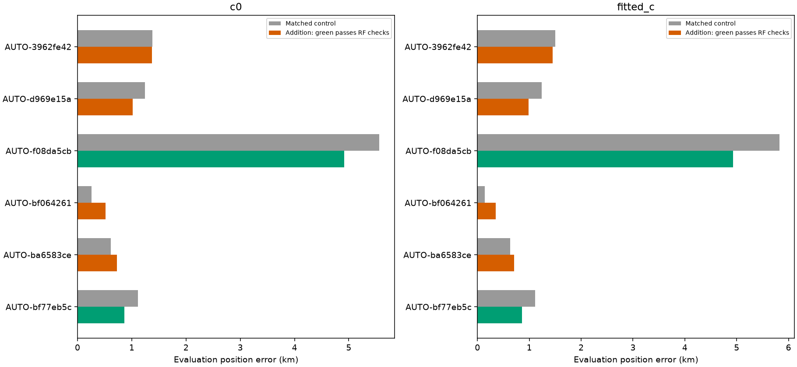
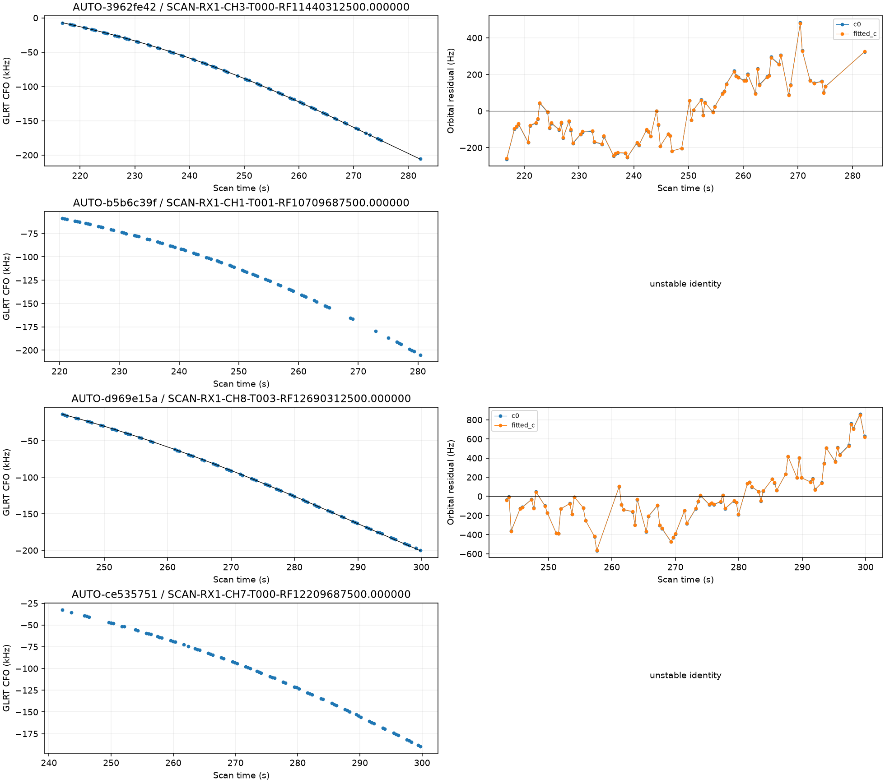
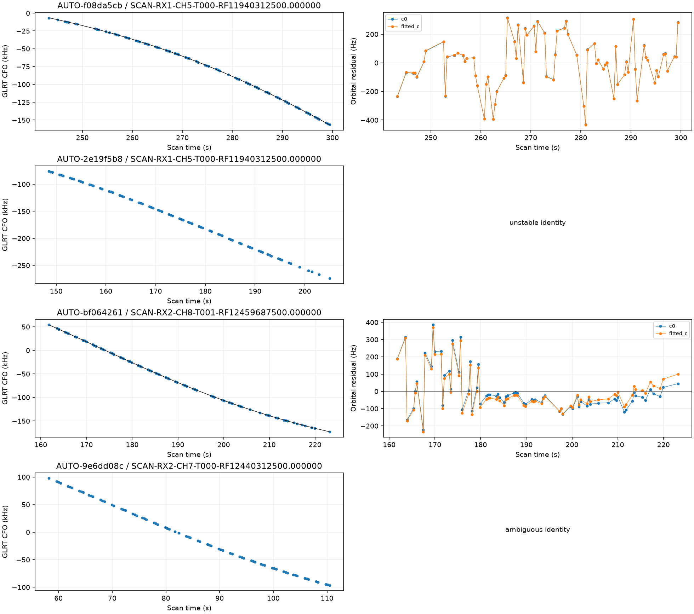
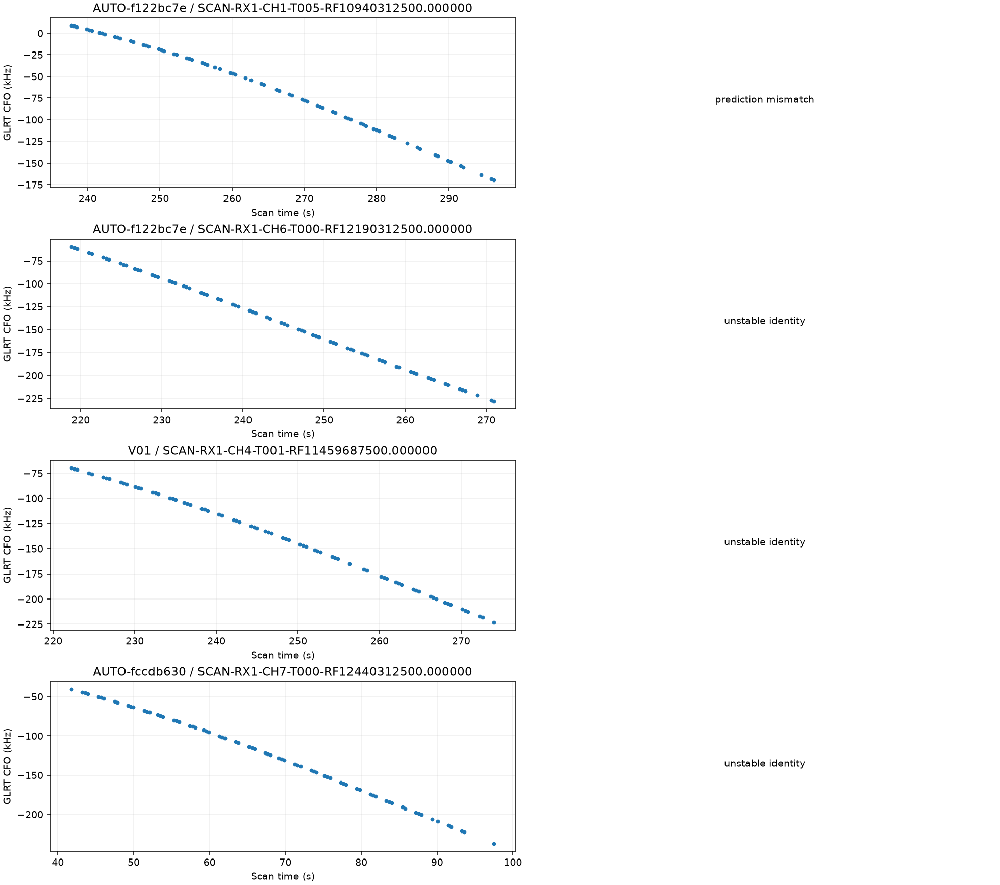
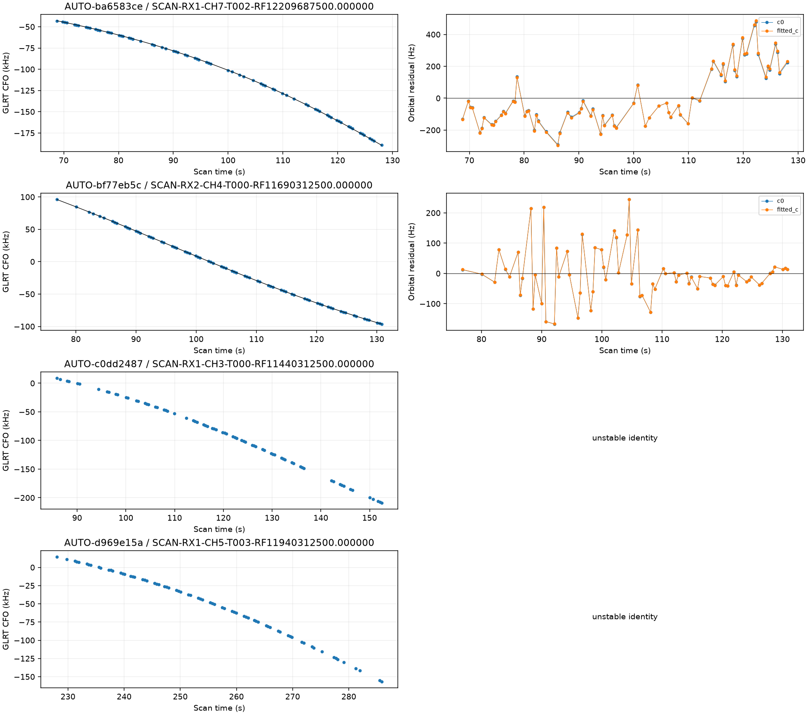

# Predictive-role reassessment batch 4

The next **16** curves from the frozen older-role queue have terminal predictive-only assessments. **921 remain**. The full 1,630-curve goal is incomplete. Selection follows descending point count without GPS-based ranking; no supported label is forced into inclusion.

## Identity and provenance

| scan | points | old_status | status | norad | margin |
| --- | --- | --- | --- | --- | --- |
| AUTO-3962fe42 | 76 | conditionally_supported_identity | conditionally_supported_identity | 61863 | 69.100 |
| AUTO-b5b6c39f | 76 | conditionally_supported_identity | unstable_identity | None | 0.469 |
| AUTO-d969e15a | 76 | ambiguous_identity | conditionally_supported_identity | 66619 | 23.997 |
| AUTO-ce535751 | 75 | prediction_mismatch | unstable_identity | None | 0.870 |
| AUTO-f08da5cb | 75 | conditionally_supported_identity | conditionally_supported_identity | 63906 | 25.960 |
| AUTO-2e19f5b8 | 75 | ambiguous_identity | unstable_identity | None | 0.591 |
| AUTO-bf064261 | 74 | conditionally_supported_identity | conditionally_supported_identity | 53409 | 583.448 |
| AUTO-9e6dd08c | 74 | unstable_identity | ambiguous_identity | 59414 | 0.333 |
| AUTO-f122bc7e | 73 | prediction_mismatch | prediction_mismatch | 65283 | 773.314 |
| AUTO-f122bc7e | 73 | unstable_identity | unstable_identity | None | 670.489 |
| V01 | 73 | unstable_identity | unstable_identity | None | 3.139 |
| AUTO-fccdb630 | 73 | unstable_identity | unstable_identity | None | 0.384 |
| AUTO-ba6583ce | 72 | conditionally_supported_identity | conditionally_supported_identity | 66321 | 55.070 |
| AUTO-bf77eb5c | 71 | conditionally_supported_identity | conditionally_supported_identity | 59362 | 193.315 |
| AUTO-c0dd2487 | 71 | conditionally_supported_identity | unstable_identity | None | 1.123 |
| AUTO-d969e15a | 71 | unstable_identity | unstable_identity | None | 0.012 |

Outcomes: **{'conditionally_supported_identity': 6, 'unstable_identity': 8, 'ambiguous_identity': 1, 'prediction_mismatch': 1}**. Every supported identity has three distinct randomized scanwide 12-second held block sets, with two-second guards. The report replays the physical point sets. Targets do not calibrate the receiver. Capture modes are **{'fast': 16}**, verified from the acquisition provenance rather than the fast adapter's compatibility label; [capture_provenance.csv](capture_provenance.csv) retains the authorities and sample rates.

## Position trials

| scan | norad | points | qualified | c0_before_km | c0_after_km | fitted_c_before_km | fitted_c_after_km |
| --- | --- | --- | --- | --- | --- | --- | --- |
| AUTO-3962fe42 | 61863 | 76 | False | 1.379 | 1.373 | 1.499 | 1.450 |
| AUTO-d969e15a | 66619 | 76 | False | 1.247 | 1.016 | 1.240 | 0.987 |
| AUTO-f08da5cb | 63906 | 75 | True | 5.565 | 4.912 | 5.824 | 4.927 |
| AUTO-bf064261 | 53409 | 74 | False | 0.257 | 0.519 | 0.145 | 0.351 |
| AUTO-ba6583ce | 66321 | 72 | False | 0.611 | 0.723 | 0.628 | 0.710 |
| AUTO-bf77eb5c | 59362 | 71 | True | 1.111 | 0.861 | 1.112 | 0.861 |

**2 individual curves / 146 points** pass the current RF checks. These are separate research trials, not a simultaneous solution or a production change. Controls/additions and c=0/fitted-c arms use matched observations, candidate sets, priors and budgets; additions differ only by their specified targets. New-family phase integration uses 0.025-second spacing. Numerical retries, if any, preserve the physical gates. All original and retry outputs, including regressions and rejections, remain in [comparisons.csv](comparisons.csv) and [position_trials.csv](position_trials.csv). Exact replay failures are in [failed_replay_gates.csv](failed_replay_gates.csv).

Individual outcomes do not establish joint consistency. The earlier V06 joint audit illustrates this limitation; no union of individual position improvements is claimed. The failed-gate table distinguishes target from incumbent evidence and includes both nominal and continuously refined new-family target screens.

Scoped membership: reported association percentages count the matched control plus the independently validated target. Unscored automatic extension discoveries remain separate and unvalidated; raw and reviewed counts are both recorded in position_trials.csv. Audits: [AUTO-f08da5cb scope audit](membership_scopes/b7c6003c563acefeef96.json).

## Remaining work and evidence

[The updated ledger](annotation_ledger.csv), [remaining candidates](remaining_role_candidates.json), [holdout point assignments](partitions.csv), [receipts](executions.csv), and source-hashed compact evidence preserve the next work. The separate [native IQ investigation](../2026_10_30_native_iq_recovery/README.md) reports the complete 60342 remeasurement and the V06 joint-family trial. No future TLE or evaluation GPS enters inference; GPS is used only for error reporting. Production is unchanged.
