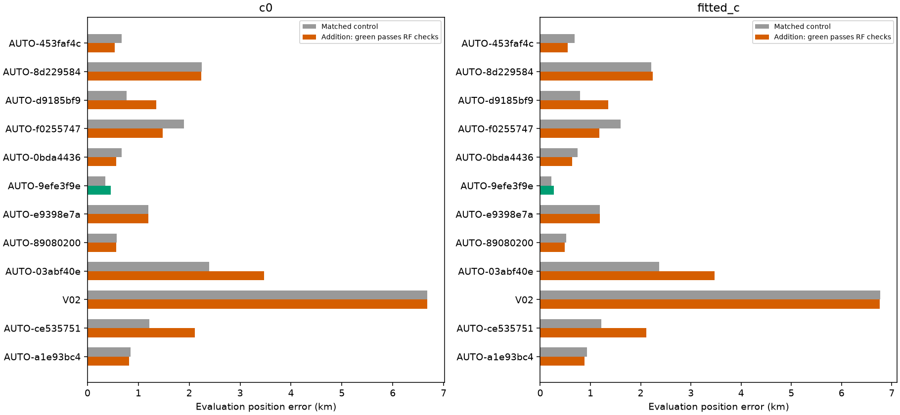
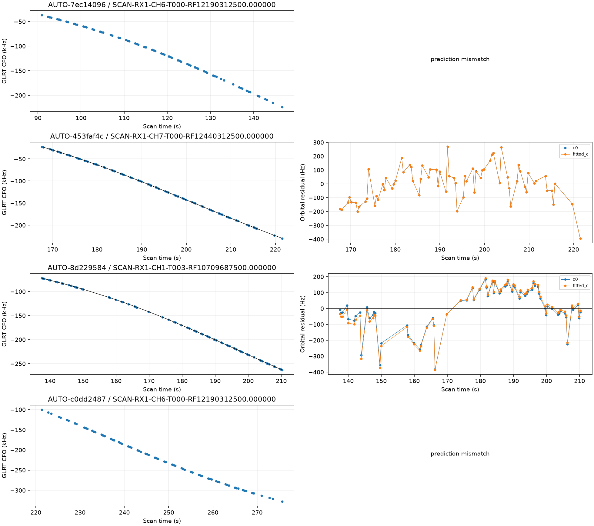
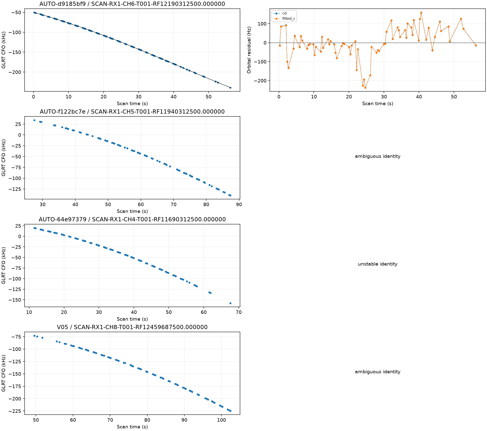
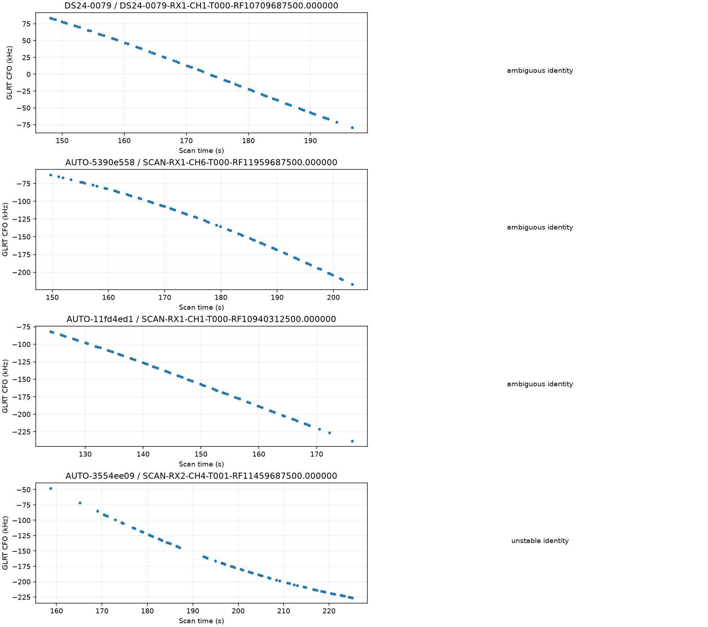
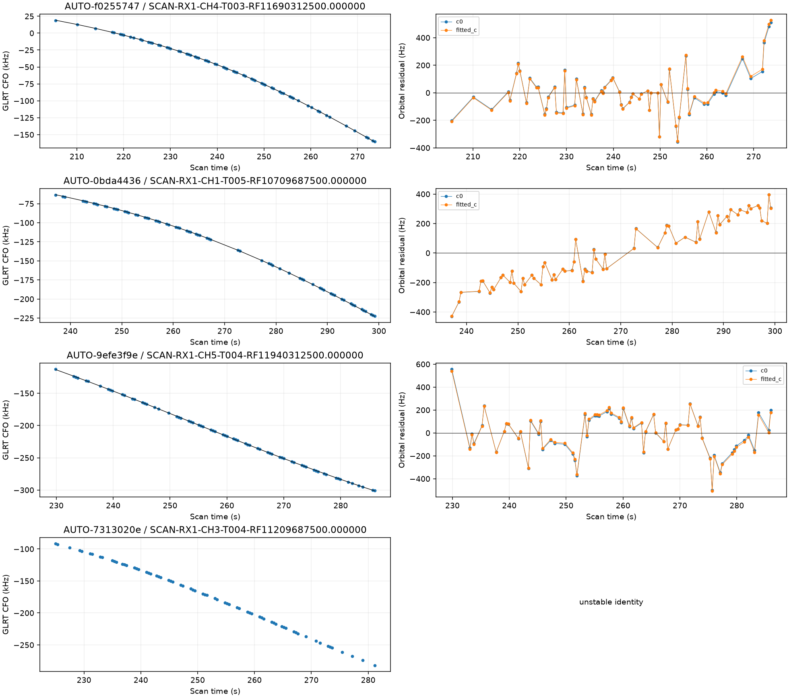
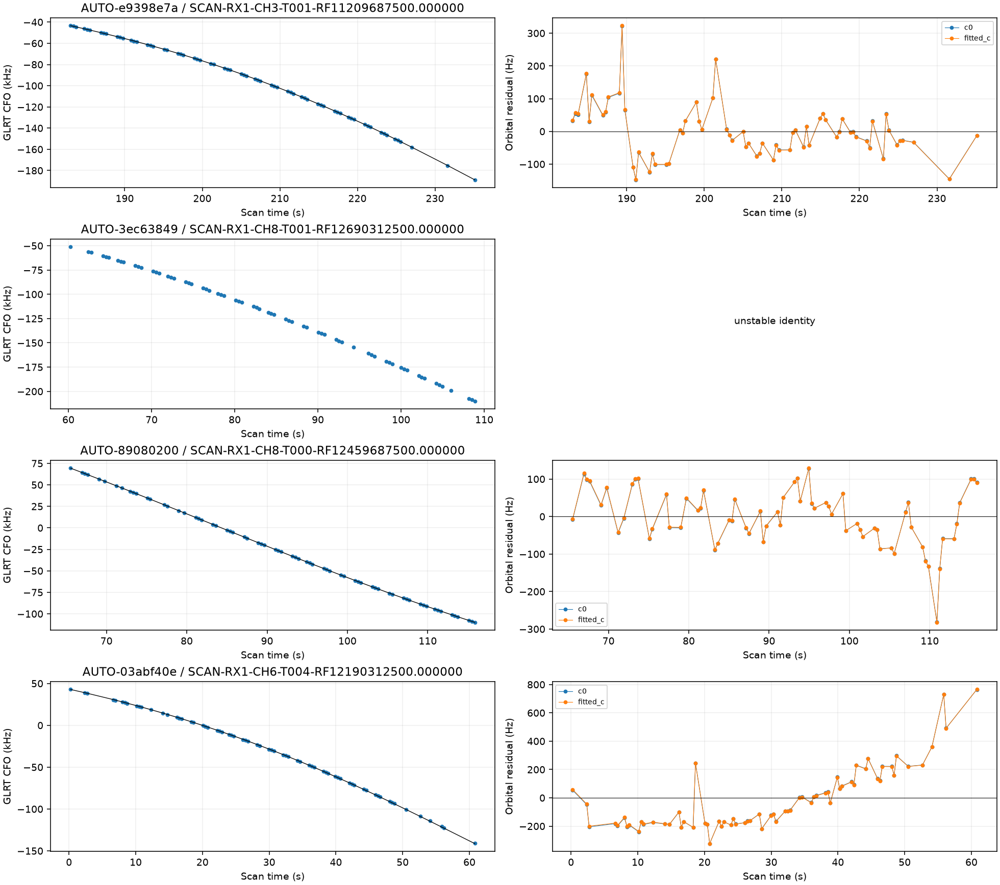
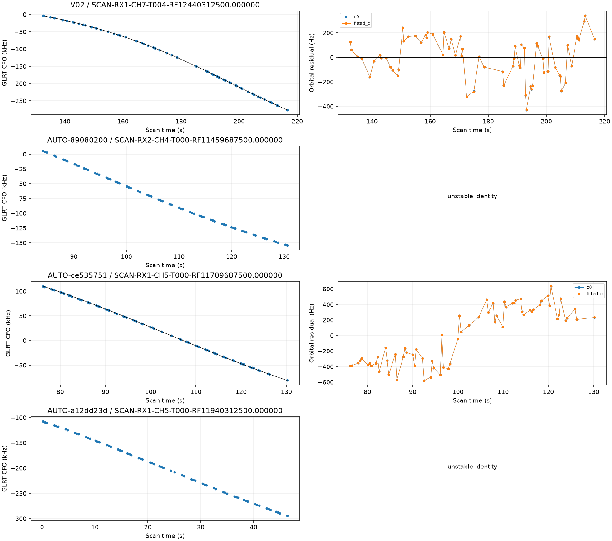
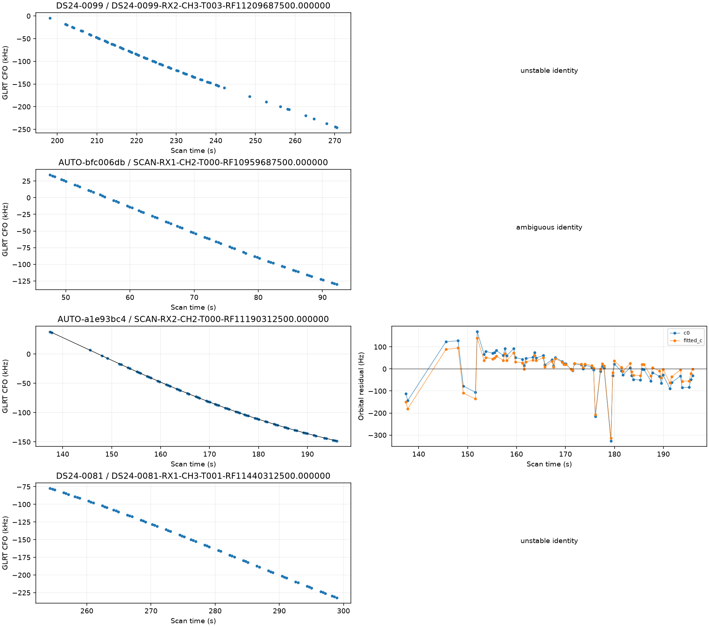
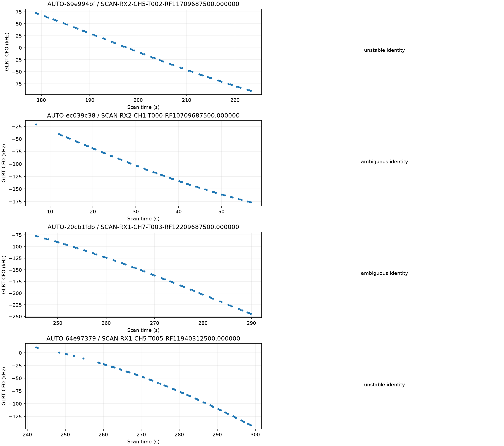

# Predictive-role reassessment batch 5

The next **32** curves from the frozen older-role queue have terminal predictive-only assessments. **889 remain**. The full 1,630-curve goal is incomplete. Selection follows descending point count without GPS-based ranking; no supported label is forced into inclusion.

## Identity and provenance

| scan | points | old_status | status | norad | margin |
| --- | --- | --- | --- | --- | --- |
| AUTO-7ec14096 | 71 | conditionally_supported_identity | prediction_mismatch | 59835 | 1085.180 |
| AUTO-453faf4c | 71 | conditionally_supported_identity | conditionally_supported_identity | 55455 | 151.797 |
| AUTO-8d229584 | 71 | conditionally_supported_identity | conditionally_supported_identity | 100017 | 42.436 |
| AUTO-c0dd2487 | 70 | prediction_mismatch | prediction_mismatch | 48327 | 266.188 |
| AUTO-d9185bf9 | 70 | conditionally_supported_identity | conditionally_supported_identity | 63863 | 23.258 |
| AUTO-f122bc7e | 70 | unstable_identity | ambiguous_identity | 63885 | 4.634 |
| AUTO-64e97379 | 70 | ambiguous_identity | unstable_identity | None | 0.285 |
| V05 | 69 | ambiguous_identity | ambiguous_identity | 67342 | 0.115 |
| DS24-0079 | 68 | conditionally_supported_identity | ambiguous_identity | 63043 | 1.034 |
| AUTO-5390e558 | 68 | unstable_identity | ambiguous_identity | 66969 | 0.413 |
| AUTO-11fd4ed1 | 68 | conditionally_supported_identity | ambiguous_identity | 64310 | 8.975 |
| AUTO-3554ee09 | 68 | unstable_identity | unstable_identity | None | 0.137 |
| AUTO-f0255747 | 68 | conditionally_supported_identity | conditionally_supported_identity | 63480 | 56.665 |
| AUTO-0bda4436 | 68 | conditionally_supported_identity | conditionally_supported_identity | 67628 | 543.116 |
| AUTO-9efe3f9e | 68 | conditionally_supported_identity | conditionally_supported_identity | 100165 | 465.410 |
| AUTO-7313020e | 67 | unstable_identity | unstable_identity | None | 0.365 |
| AUTO-e9398e7a | 67 | conditionally_supported_identity | conditionally_supported_identity | 66889 | 567.722 |
| AUTO-3ec63849 | 67 | conditionally_supported_identity | unstable_identity | None | 1.087 |
| AUTO-89080200 | 67 | conditionally_supported_identity | conditionally_supported_identity | 100316 | 84.858 |
| AUTO-03abf40e | 67 | prediction_mismatch | conditionally_supported_identity | 58109 | 601.662 |
| V02 | 67 | conditionally_supported_identity | conditionally_supported_identity | 67352 | 87.182 |
| AUTO-89080200 | 67 | prediction_mismatch | unstable_identity | None | 220.794 |
| AUTO-ce535751 | 67 | conditionally_supported_identity | conditionally_supported_identity | 59671 | 98.130 |
| AUTO-a12dd23d | 66 | unstable_identity | unstable_identity | None | 1.730 |
| DS24-0099 | 66 | unstable_identity | unstable_identity | None | 178.367 |
| AUTO-bfc006db | 66 | conditionally_supported_identity | ambiguous_identity | 69140 | 5.695 |
| AUTO-a1e93bc4 | 66 | conditionally_supported_identity | conditionally_supported_identity | 58882 | 10.251 |
| DS24-0081 | 66 | unstable_identity | unstable_identity | None | 102.088 |
| AUTO-69e994bf | 66 | prediction_mismatch | unstable_identity | None | 23.328 |
| AUTO-ec039c38 | 66 | unstable_identity | ambiguous_identity | 66793 | 4.098 |
| AUTO-20cb1fdb | 65 | unstable_identity | ambiguous_identity | 65082 | 0.519 |
| AUTO-64e97379 | 65 | unstable_identity | unstable_identity | None | 16.869 |

Outcomes: **{'prediction_mismatch': 2, 'conditionally_supported_identity': 12, 'ambiguous_identity': 8, 'unstable_identity': 10}**. Every supported identity has three distinct randomized scanwide 12-second held block sets, with two-second guards. The report replays the physical point sets. Targets do not calibrate the receiver. Capture modes are **{'fast': 32}**, verified from the acquisition provenance rather than the fast adapter's compatibility label; [capture_provenance.csv](capture_provenance.csv) retains the authorities and sample rates.

## Position trials

| scan | norad | points | qualified | c0_before_km | c0_after_km | fitted_c_before_km | fitted_c_after_km |
| --- | --- | --- | --- | --- | --- | --- | --- |
| AUTO-453faf4c | 55455 | 71 | False | 0.669 | 0.531 | 0.685 | 0.549 |
| AUTO-8d229584 | 100017 | 71 | False | 2.245 | 2.238 | 2.215 | 2.237 |
| AUTO-d9185bf9 | 63863 | 70 | False | 0.770 | 1.352 | 0.791 | 1.357 |
| AUTO-f0255747 | 63480 | 68 | False | 1.899 | 1.476 | 1.602 | 1.180 |
| AUTO-0bda4436 | 67628 | 68 | False | 0.670 | 0.564 | 0.745 | 0.635 |
| AUTO-9efe3f9e | 100165 | 68 | True | 0.352 | 0.453 | 0.222 | 0.268 |
| AUTO-e9398e7a | 66889 | 67 | False | 1.196 | 1.196 | 1.186 | 1.187 |
| AUTO-89080200 | 100316 | 67 | False | 0.576 | 0.562 | 0.514 | 0.487 |
| AUTO-03abf40e | 58109 | 67 | False | 2.389 | 3.475 | 2.370 | 3.467 |
| V02 | 67352 | 67 | False | 6.681 | 6.679 | 6.768 | 6.763 |
| AUTO-ce535751 | 59671 | 67 | False | 1.218 | 2.109 | 1.219 | 2.108 |
| AUTO-a1e93bc4 | 58882 | 66 | False | 0.847 | 0.817 | 0.935 | 0.881 |

**1 individual curves / 68 points** pass the current RF checks. These are separate research trials, not a simultaneous solution or a production change. Controls/additions and c=0/fitted-c arms use matched observations, candidate sets, priors and budgets; additions differ only by their specified targets. New-family phase integration uses 0.025-second spacing. Numerical retries, if any, preserve the physical gates. All original and retry outputs, including regressions and rejections, remain in [comparisons.csv](comparisons.csv) and [position_trials.csv](position_trials.csv). Exact replay failures are in [failed_replay_gates.csv](failed_replay_gates.csv).

Individual outcomes do not establish joint consistency. The earlier V06 joint audit illustrates this limitation; no union of individual position improvements is claimed. The failed-gate table distinguishes target from incumbent evidence and includes both nominal and continuously refined new-family target screens.

The first numerical follow-up was interrupted because excessive BLAS threading made it inefficient. Its terminal failure and protocol remain in executions.csv and hashed evidence. A fresh output repeats the same scientific settings and stage cap with OPENBLAS_NUM_THREADS=1 and OMP_NUM_THREADS=1; no gate or data changes.

## Remaining work and evidence

[The updated ledger](annotation_ledger.csv), [remaining candidates](remaining_role_candidates.json), [holdout point assignments](partitions.csv), [receipts](executions.csv), and source-hashed compact evidence preserve the next work. The separate [native IQ investigation](../2026_10_30_native_iq_recovery/README.md) reports the complete 60342 remeasurement and the V06 joint-family trial. No future TLE or evaluation GPS enters inference; GPS is used only for error reporting. Production is unchanged.
