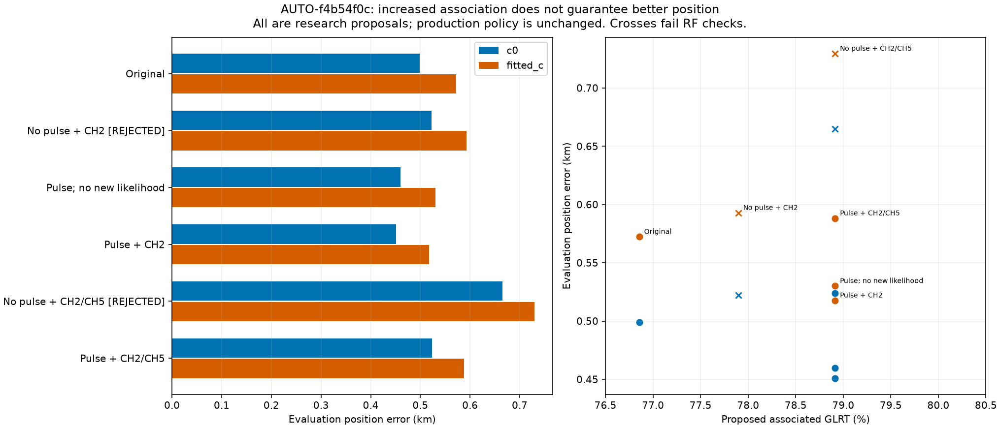
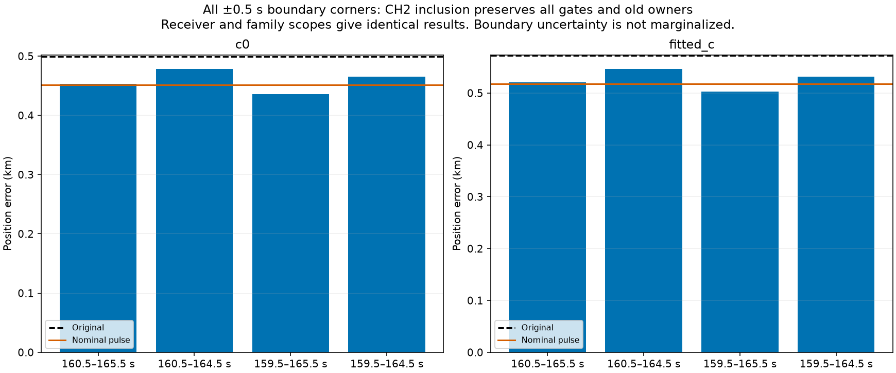
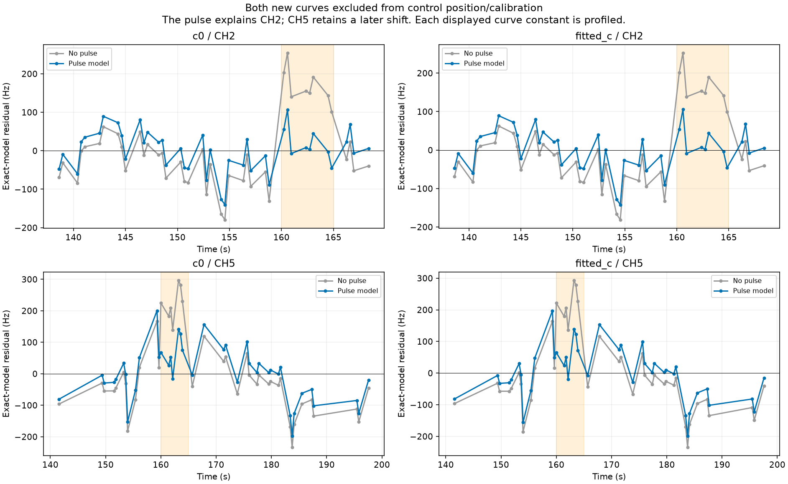
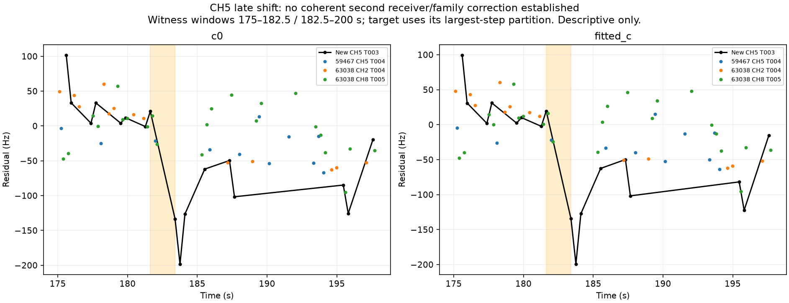

# Shared pulse recovery propagated to position

The [previous diagnostic](../2026_10_30_shared_transient_validation/README.md) identified a shared 160–165 s frequency excursion in AUTO-f4b54f0c (`fast8-auto-20261026-021217-3c1e1fc4-1-upper`). This iteration propagates it through the full shared calibration/position model. It recovers a **42-point CH2 curve** with an improvement in position error, supports an additional **41-point CH5 curve's identity** through a fresh causal search, and shows that adding both curves to the likelihood **does not improve localization**. No production policy or ALGO version is promoted.

## Controlled position comparison

All trials use the original observations, aliases, causal catalogue, noise policy, family powers and physical priors. All searches start at the center of the same 25 × 25 km regional box and use five phase rounds with 48 position steps per round. Both c arms are always run. The event has one Gaussian amplitude coordinate with a fixed zero-mean 150 Hz prior; its amplitude uncertainty is propagated jointly with existing coefficient covariance. Boundaries come from the previous target-excluded c0 witness diagnostic and are frozen at 160 and 165 s. The new curves remain excluded from receiver/event calibration normal equations; as predictive likelihoods they can affect position, which in turn changes calibration. This is a selected-case hypothesis, not an independently validated event detector.

| variant | c0_error_km | fitted_c_error_km | proposed_associated | proposed_percent | paired_RF_qualified |
| --- | --- | --- | --- | --- | --- |
| Original | 0.499 | 0.572 | 3098 | 76.854 | True |
| No pulse + CH2 | 0.522 | 0.593 | 3140 | 77.896 | False |
| Pulse; no new likelihood | 0.460 | 0.530 | 3181 | 78.913 | True |
| Pulse + CH2 | 0.451 | 0.518 | 3181 | 78.913 | True |
| No pulse + CH2/CH5 | 0.665 | 0.729 | 3181 | 78.913 | False |
| Pulse + CH2/CH5 | 0.524 | 0.588 | 3181 | 78.913 | True |

There are **4,031 total GLRT points**. Original association is 3,098 / 76.85%; the pulse model proposes 3,181 / 78.91%. The same 83 points are already recovered through post-fit extension in the pulse control, so adding CH2 or CH2+CH5 to the likelihood does not increase that count again. It changes how the recovered evidence constrains position. Rejected no-pulse rows are attempted fits, not usable solutions. “RF qualified” means every current gate and owner-preservation check passes; it does not prove truth or a localization improvement.

The pulse model itself changes fitted-c error from 0.572 to 0.530 km. Letting CH2 constrain position changes its **matched pulse control** from 0.530 to 0.518 km (c=0: 0.460 to 0.451 km). Do not attribute the entire baseline-to-target improvement to 42 new points. Adding both curves gives 0.588 km (c=0: 0.524 km), worse than both the pulse control and the original. Without the pulse, the two-curve fit is rejected and reaches 0.729 km / 0.665 km.

## Receiver versus satellite scope is not identifiable here

All four combinations—receiver/satellite scope and additive-Hz/fractional-frequency scaling—were tested, with matched control and CH2 addition for each. Full results, objectives, residual RMS and gate margins are in [all_position_trials.csv](all_position_trials.csv). Compare objective values only between models with the same likelihood observations; controls and additions have different observation counts.

Receiver and satellite designs are **exactly equal on every observation used by the nominal likelihood**, not merely statistically similar. The control has 16 event-active observations and the two-column scope design has rank one. Their maximum elementwise difference is zero in all replayed variants. This scan cannot identify which physical system produced the pulse. Additive-Hz and fractional scaling have slightly different scores but nearly identical positions (~0.518 km fitted c). There is no evidence here to claim a transmitter fault or an RX1 fault specifically. A common upstream measurement artifact also remains possible.

The additive pulse amplitude is about 190.4–190.8 Hz, with conditional posterior SD ~23.3 Hz at the control endpoint. This SD conditions on fitted position, Gamma noise precisions and fixed event boundaries; it is not full uncertainty over event existence, origin or timing. [Scope receipts](scope_identifiability.csv) retain exact design equality and conditional amplitude SD for every fit.

## Boundary sensitivity and exact replay

All four ±0.5 s boundary corners were tested for **both** additive-Hz scopes, without selecting the best according to GPS. Every trial preserves all existing owners, all exact-orbit gates and the same 83 proposed new points. CH2 addition fitted-c errors range from about 0.503 to 0.546 km; c=0 from 0.436 to 0.478 km. This is sensitivity evidence, not marginalization of timing uncertainty and not independent validation on another recording.

All 60 endpoints across nominal, boundary and two-curve experiments were independently rebuilt from saved references. Objectives and complete proposed owner maps replay identically. Event-aware graph extension applies the family contribution at each track's RF, including the event end; exact-orbit checks replace only the orbit and preserve the pulse. A zero-amplitude event reproduces the no-event objective and residual at the same endpoint. Every active family's orbit is substituted exactly, one at a time, for gate verification. No original point is reassigned or lost in the pulse proposals. Raw phase gaps are required to be ≤0.01 s; no clipped convergence flags are substituted.

## The second curve: correct-looking identity, incomplete residual model

The newly proposed curves are RX1 CH2 T002 (42 points) and RX1 CH5 T003 (41 points), both assigned to **59467**. CH5 was rerun through the causal predictive identity search without adding the pulse model. It selects 59467 in all three distinct scanwide block partitions and both c arms, with minimum competitor margin **287.01**. The held-block design remains 12-second random blocks plus 2-second guards; incumbent graph/identities remain conditioning assumptions. The margin is a conditional score, not a calibrated identity probability, and the shortlist is not an exhaustive evidence integral over all catalogue identities.

The pulse control predicts CH2 at ~54 Hz RMS and CH5 at ~84–85 Hz RMS. CH2 has comfortable residual margins. CH5 passes the step gate narrowly: c=0 step z **3.99335** versus a threshold of 4, and fitted-c z **3.92540**. Its index-based lag-one residual correlation is about 0.54. A gate pass is not proof of white noise.

CH5's largest remaining step divides the curve between **181.63 and 183.41 seconds**: the c=0 innovation means are about +29.6 and −100.1 Hz, with 32 and 9 points. An already retained same-satellite CH5 curve (T004) changes by only about −16.5 Hz across nearby descriptive windows. Another satellite's CH2 curve shifts ~−87 Hz, but that satellite's CH8 curve shifts only ~−7 Hz. These are limited descriptive witnesses with unequal sampling, not a corroborated second shared step. They do not justify blindly adding another receiver or satellite correction.

This explains why the extra CH5 curve must not be declared useful for positioning just because its identity and current gates pass. The next check is its native GLRT peak/graph-piece provenance, especially the late portion and its overlap with CH5 T004. Candidate explanations include a track join or peak-selection error, an inadequately modeled frequency effect, or overconfident weighting of a residual discrepancy. None is established yet. Keep the whole curve and its evidence in the inventory; do not truncate it or adjust its weight using GPS improvement.

## Systematic annotation status and decision

Attempt 30 states: `{'execution_timeout': 1, 'unstable_identity': 8, 'prediction_mismatch': 2, 'conditionally_supported_identity': 18, 'insufficient_partitions': 2, 'ambiguous_identity': 1}`. Completed inventory assessments now total **1181 / 1630**, with **149** historical separate phase audits. One case hits the 600 s cap; its claim and terminal receipt are preserved for diagnosis rather than silently retried. Counts include ambiguous, unstable and insufficient-partition outcomes, not just accepted satellite associations. The CH5 predictive recheck and both pulse research candidates are recorded in the cumulative [ledger](annotation_ledger.csv) without replacing older evidence.

The systematic workflow gains a new candidate mechanism: a target-excluded, multiply witnessed transient can explain strong curves rejected by a smooth model, and its uncertainty can be carried through position inference. The full result also reinforces a required distinction: **annotation, residual-model qualification, and useful position information are separate claims**. At present CH2 is a promising research recovery; CH5 needs further diagnosis, and the event's physical scope remains unidentified. No dataset-wide improvement or production acceptance is claimed.

GPS **37.849061591561885, −122.48574968092912** is used only for evaluation. The regional box is centered at **37.906, −122.545**. All TLE evidence is causal. No RF collection occurs.

## Reproduction and validation

`test_shared_pulse_inclusion.py run` produces all four scope/scaling combinations and a null control. `--boundary-sensitivity` produces all additive-Hz boundary corners. `one --extra-validation ...` verifies the second curve's supported identity/alias before joint inclusion. `audit_shared_pulse_inclusion.py` reconstructs all endpoints and records scope identifiability and exact new-curve residuals. `report_pulse_position_recovery.py` produces this report. Source hashes are in [sources.json](sources.json), compact raw scientific receipts in [evidence.json.gz](evidence.json.gz), and terminal statuses in [executions.csv](executions.csv).

**29 targeted tests pass**, including pulse onset/offset, receiver versus family scope, RF scaling, original step semantics, exact-orbit replay preserving a family event, phase convergence checks, ownership loss/relabel guards, and existing covariance/receiver-ramp/block validation tests. These tests and selected-case results do not replace independent false-recovery controls or validation across unused scans before promotion.
