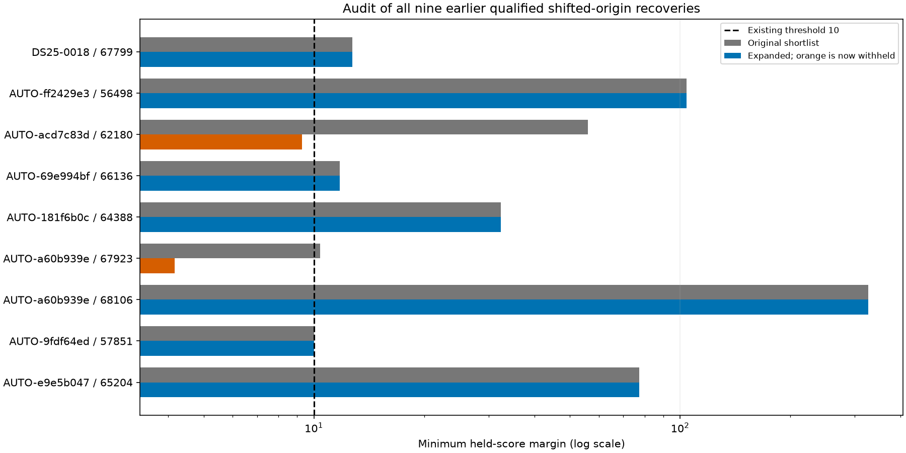
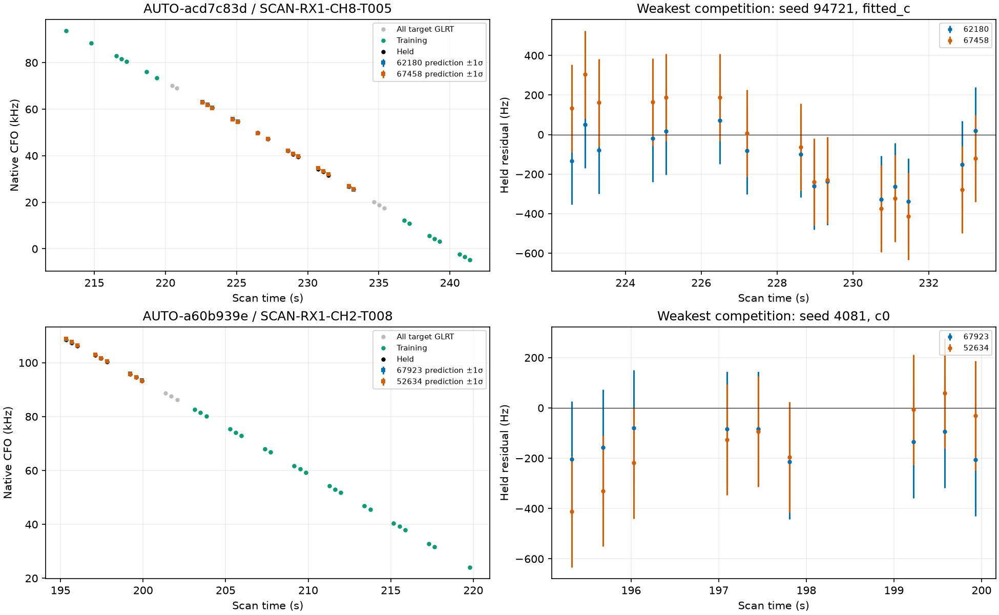
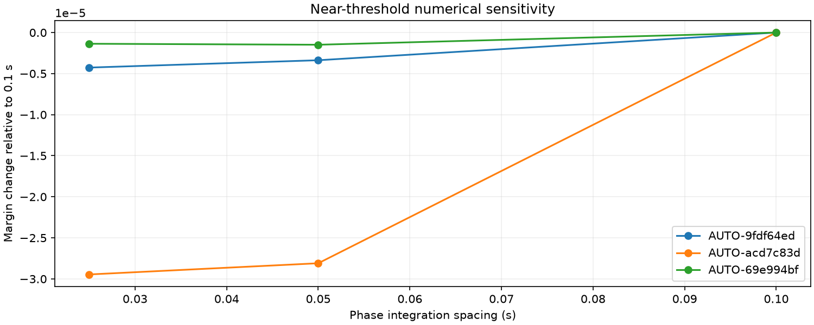

# Rechecking qualified recoveries against competing satellites

All **nine RF-qualified recoveries / 310 points** from shifted batches one and two were rechecked, including their position regressions. Broader causal competition retains **7 curves / 241 points** and returns **2 curves / 69 points** to the withheld set. Clean residuals and a successful optimizer do not by themselves establish a unique satellite identity. The original experiments remain historical evidence; they are not erased or relabeled as successful current recoveries.

## Matched competition and position evidence

The candidate cap increases from three to twelve while observations, priors, training budgets, aliases and random physical holdouts remain unchanged. Every original candidate's held score is replayed. Candidates come from the existing causal geometry nomination procedure; this is not exhaustive all-catalogue marginal-likelihood evaluation. GPS is evaluation-only. The three randomized 12-second partitions, with two-second guards, overlap and are not independent replications.

| Scan | NORAD | Points | Minimum margin, original → reviewed | Current status | Historical fitted-c error, km |
| --- | --- | --- | --- | --- | --- |
| DS25-0018 | 67799 | 38 | 12.720 → 12.720 | retained | 2.493 → 1.914 |
| AUTO-ff2429e3 | 56498 | 36 | 104.013 → 104.013 | retained | 1.053 → 0.977 |
| AUTO-acd7c83d | 62180 | 35 | 55.970 → 9.269 | withheld | 1.142 → 1.499 |
| AUTO-69e994bf | 66136 | 35 | 11.779 → 11.779 | retained | 1.534 → 1.437 |
| AUTO-181f6b0c | 64388 | 34 | 32.357 → 32.357 | retained | 0.693 → 0.669 |
| AUTO-a60b939e | 67923 | 34 | 10.395 → 4.171 | withheld | 0.936 → 0.959 |
| AUTO-a60b939e | 68106 | 33 | 326.295 → 326.295 | retained | 0.936 → 0.958 |
| AUTO-9fdf64ed | 57851 | 33 | 10.007 → 10.007 | retained | 1.271 → 1.240 |
| AUTO-e9e5b047 | 65204 | 32 | 77.232 → 77.232 | retained | 1.271 → 1.101 |

62180 now faces closer competition from **67458**, and 67923 from **52634**. Both original identities still rank first in every partition and c arm, but their minimum margins fall below the existing threshold of ten. Neither runner-up is asserted to be the true identity. [Both c=0 and fitted-c historical position comparisons](qualified_review.csv) are retained. No positions were refitted in this retrospective check. Withholding is based on RF competition, not whether a fit happens to move toward the known evaluation site.

These panels use each withheld target's weakest competition fold, selected by RF margin. Grey denotes all target GLRT, green training observations, and black held observations. Coloured squares and one-sigma bars show training-conditioned predictions at held timestamps only, including physical and calibration uncertainty. Residuals replay the archived predictions exactly. The bars are predictive standard deviations, not confidence intervals for satellite identity. Only independent evidence can resolve the remaining ambiguity; choosing the lower-RMS curve alone is insufficient.

## Phase-integration check near the threshold

Every expanded identity with a margin in **[8,12]** was evaluated at 0.05 s and 0.025 s phase spacing, including both sides of the fixed threshold. Candidate sets, aliases, physical partitions and training calibration replay exactly. Across these three curves, the maximum margin change is **0.00002946**. No classification changes. In particular, the approximately 10.007 margin is numerically stable in this test, but remains weakly separated from alternatives; it is not a calibrated correctness probability.

## Continuing systematic coverage

[Shifted batch four](../2026_10_30_shifted_annotation_batch4/README.md) evaluates **32** further curves. All initially supported identities receive broader competition before full inclusion. It yields **7 curves / 196 points** passing the recorded RF, residual, ownership and numerical checks in separate matched position trials. The report retains every rejection and position regression, both c arms, acquisition provenance, GLRT curves and residual plots. These individual trials must not be summed into a claimed joint scan-level position improvement.

The updated ledger preserves prior native-IQ and shared-family withholdings and records the two new competition withholdings. **306 shifted-origin cases and 828 older-role cases remain; the queues overlap.** Research eligibility is not production promotion. All-source annotation and joint inclusion remain unfinished.

The next steps are to continue the remaining inventory, extend competition checks to older qualified recovery series, and test mutually consistent recoveries together. For ambiguous cases, seek cross-channel/receiver family evidence or independent native-peak evidence before adding flexibility to receiver or orbit models. No new RF was collected and production remains unchanged.
