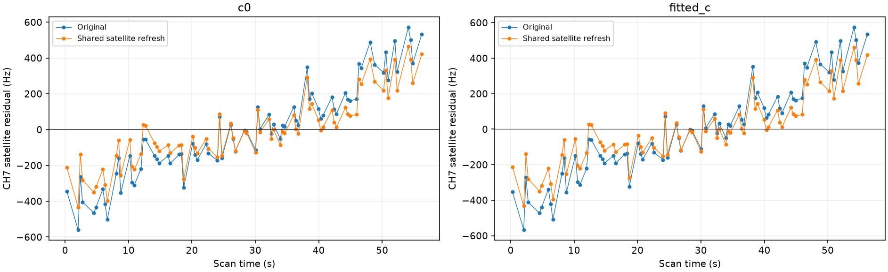

# Recovery diagnosis: independent receiver transfer and shared-family consistency

This iteration advances the full large-track inventory and tests two concrete explanations for rejected curves. Neither tested correction justifies a new recovery. No production model, prior or acceptance threshold is changed.

## Other satellites do not supply the missing 60342 trend

The [receiver-transfer audit](../2026_10_30_independent_receiver_transfer/README.md) uses incumbent observations only to predict a receiver correction. At the refined 60342 inclusion endpoint, the fitted-c residual slope is **−2.922 Hz/s**. Incumbents supply **−0.241 Hz/s**, leaving **−2.681 Hz/s**. RMS changes from **23.99 to 22.23 Hz** and lag-one correlation from **0.822 to 0.805**, still above **0.686**. At the target-excluded control endpoint, the discrepancy is larger: **−4.975 Hz/s**, versus **−0.256 Hz/s** supplied by incumbents. V06 CH5 also retains its correlation failure.

Thus the difference between the gate's original receiver mean and the likelihood's incumbent-conditioned receiver mean is insufficient to explain these failures. This does not prove an orbital error or rule out receiver-model inadequacy. The projected receiver trend uncertainty is about 1.54 Hz/s for 60342, conditional on the existing empirical model; it is not independently calibrated confidence. No target-driven receiver posterior is adopted.

## Seven more supported identities still fail physical inclusion

The [third predictive-role batch](../2026_10_30_predictive_role_reassessment_batch3/README.md) finishes 16 more curves: **seven supported identities, five unstable identities, three ambiguous identities and one prediction mismatch**. All seven supported cases receive matched c=0/fitted-c position trials and exact replay. Every original control passes; every addition fails target residual checks. Three additions improve GPS error despite failing RF checks, so error improvement is not used to accept them. The batch comprises 15 fast curves and one adaptive curve according to verified acquisition provenance, not the compatibility export's capture-mode label. **937 older-role cases remain**.

The failed-gate CSV now includes nominal and continuously refined new-family target screens. Previously this report's helper collected incumbent/shared-family failures only; the omitted target failures remained in the raw replay evidence and qualification decisions were already correct. The corrected report preserves the full failure inventory.

## The largest smooth mismatch: AUTO-afec5a1f RX1 CH7, 77 points

The [original-polynomial audit](../2026_10_30_graph_orbit_residuals/README.md) compares all seven supported curves without refitting their polynomials. This CH7 curve has **88 Hz polynomial RMS**, but **265 Hz satellite RMS** and about **251 Hz centered RMS difference between the predictions**. It is one original degree-four polynomial piece. That makes it a useful physical-model or identity challenge, but an in-sample polynomial cannot rule out source mixing or prove an identity.

The predictive annotation selects **59632** in every random partition and both c arms, with minimum margin about **27.9** over its tested competitor. This is conditional evidence, not proof of family consistency. We applied the existing shared-satellite refresh prototype, which exposes the satellite posterior from predictive evidence while keeping receiver means unchanged. Both c arms, all points, priors, search budgets and the 25 × 25 km regional initialization are retained; no new free drift or arbitrary polynomial correction is introduced.

| variant | arm | control_error_km | addition_error_km | target_RMS_hz | control_paired_valid | addition_paired_valid | exact_replay_pass |
| --- | --- | --- | --- | --- | --- | --- | --- |
| Original | c0 | 0.575 | 0.474 | 262.476 | True | False | False |
| Original | fitted_c | 0.564 | 0.457 | 265.354 | True | False | False |
| Shared satellite refresh | c0 | 0.575 | 0.473 | 194.649 | False | False | False |
| Shared satellite refresh | fitted_c | 0.564 | 0.456 | 193.329 | False | False | False |

The refresh reduces fitted-c target RMS from **265 to 193 Hz**, but the target still fails slope, curvature, step and correlation checks. It also breaks residual consistency on existing RX1 CH6 and RX2 CH6 evidence. Even the refresh control fails conditional-mean gates. Receiver coefficient changes are exactly zero at fixed position; phase linearization errors are below 0.000001 Hz, so this is not a stale-phase approximation failure. The 456 m position result is rejected. The original 457 m inclusion was also rejected. No 77-point recovery is claimed.

## Next investigation and evidence

For this CH7 case, challenge the identity and the shared-family model jointly against the existing CH6 evidence. A correction that improves CH7 but damages the family is insufficient. For measurement-dominated cases, use the existing IQ refinement with independent-frame checks before widening satellite priors. Continue the frozen inventory in bounded batches; do not force ambiguous labels.

The [latest 1,630-row ledger](annotation_ledger.csv) preserves the 60342 withholding decision, V06 joint rejection and this CH7 refresh rejection. [Position trials](position_trials.csv), [failed gates](failed_gates.csv), source hashes and compressed evidence preserve the experiments. An initial launch used an incorrect inventory path and failed before loading data; its terminal receipt is retained, and the completed run derives the path from the authoritative source protocol. Eight focused tests passed for receiver-trend projection, exact polynomial coverage, complete gate reporting, measurement ownership and inclusion routing. No future TLE or evaluation GPS enters inference. The full goal remains incomplete.
