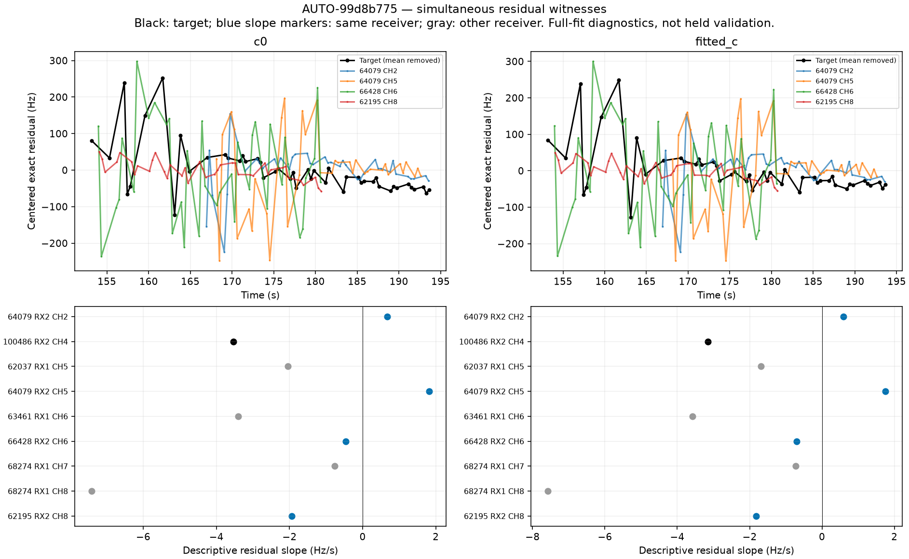
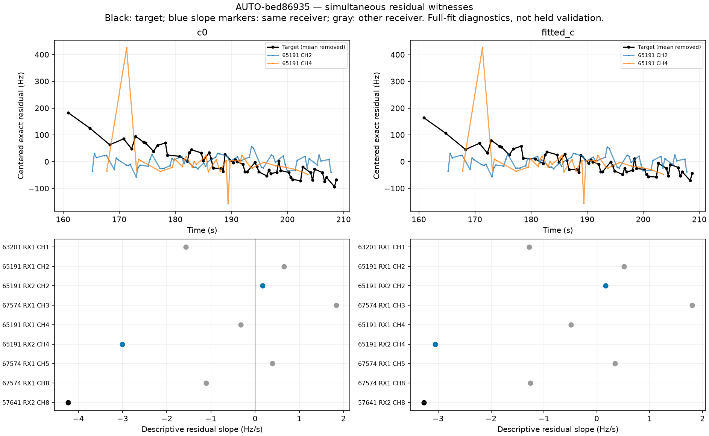
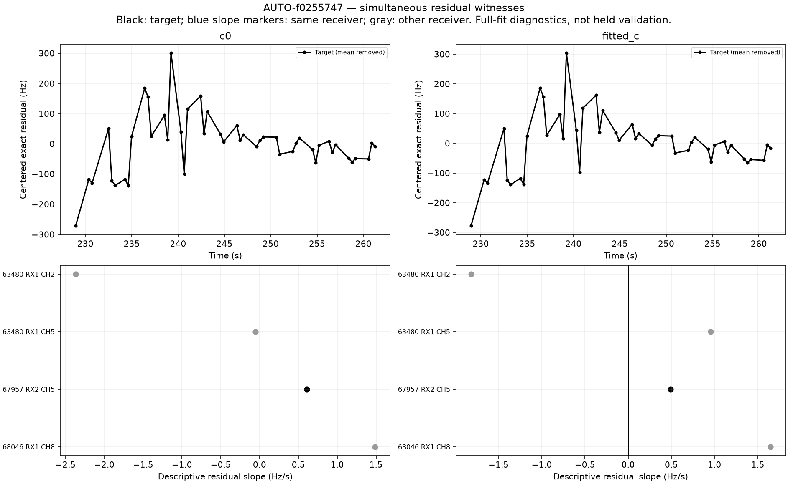
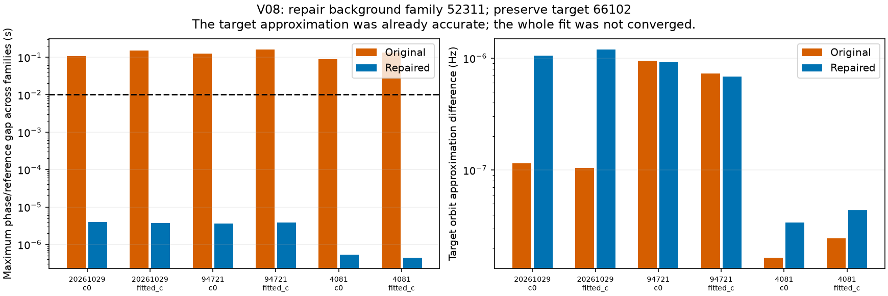
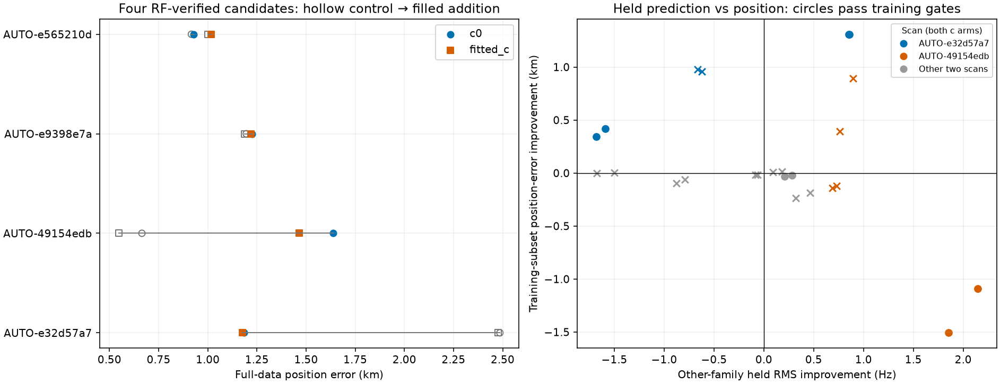

# Residual witnesses, annotation repair, and recovery transfer

This iteration separates numerical correctness, identity support, residual compatibility, and position usefulness. **Four of 18 new graph additions pass exact-orbit, convergence, and ownership checks**, but their position effects differ. A separate 120-point V08 annotation is restored after repairing a background satellite's phase reference. Two previously rejected curves still lack sufficient simultaneous evidence to justify an extra receiver or satellite correction.

This follows the [phase-reference retrospective](../2026_10_30_phase_reference_retrospective/README.md). All inference uses causal orbit inputs, matched c=0/fitted-c experiments, and the original 25 × 25 km region centered at 37.906, −122.545. GPS at 37.849061591561885, −122.48574968092912 is evaluation-only. Production and retained cohort policy remain unchanged.

## Does the residual error follow a receiver or a satellite?

The new diagnostic reconstructs saved full-fit endpoints, verifies their objectives, and replaces each active curved fragment's orbit mean with exact causal geometry. It examines other curves **inside the target's time interval**, requiring at least four points and a span of at least half the target span or five seconds, whichever is larger. Receiver groups exclude the entire target satellite family. Satellite groups exclude the target curve. Each other family gets one median vote, so repeated channels do not dominate. Both absolute-Hz and RF-proportional rate hypotheses are recorded.

These are descriptive residual comparisons after a full-data fit, not independent validation or formal confidence intervals. Position and nuisance parameters are already conditioned on the target. Free affine removal supplies only a diagnostic lower bound and cannot authorize an association.

| scan | arm | group | distinct_families | witness_curves | target_rate_hz_s | predicted_rate_hz_s |
| --- | --- | --- | --- | --- | --- | --- |
| AUTO-99d8b775 | c0 | same_receiver | 3 | 4 | -3.539 | -0.462 |
| AUTO-99d8b775 | c0 | same_receiver_band | 1 | 1 | -3.539 | 0.667 |
| AUTO-99d8b775 | fitted_c | same_receiver | 3 | 4 | -3.154 | -0.698 |
| AUTO-99d8b775 | fitted_c | same_receiver_band | 1 | 1 | -3.154 | 0.590 |
| AUTO-bed86935 | c0 | same_receiver | 1 | 2 | -4.236 | -1.418 |
| AUTO-bed86935 | c0 | same_receiver_band | 0 | 0 | -4.236 | None |
| AUTO-bed86935 | fitted_c | same_receiver | 1 | 2 | -3.272 | -1.446 |
| AUTO-bed86935 | fitted_c | same_receiver_band | 0 | 0 | -3.272 | None |
| AUTO-f0255747 | c0 | same_receiver | 0 | 0 | 0.610 | None |
| AUTO-f0255747 | c0 | same_receiver_band | 0 | 0 | 0.610 | None |
| AUTO-f0255747 | fitted_c | same_receiver | 0 | 0 | 0.490 | None |
| AUTO-f0255747 | fitted_c | same_receiver_band | 0 | 0 | 0.490 | None |

AUTO-99d8b775 needs approximately −3.54/−3.15 Hz/s removed from its RX2 CH4 residual, but three other families on RX2 give only −0.46/−0.70 Hz/s. The sole same-band witness has the opposite sign. There is no overlapping same-satellite witness. This does not support a simple common RX2 drift as the explanation. An apparent similar slope on the *other* receiver is not evidence for an RX2 correction.

AUTO-bed86935 needs about −4.24/−3.27 Hz/s on RX2 CH8. Its two same-receiver witnesses belong to **one** other satellite, and there are no qualifying same-receiver high-band or same-satellite witnesses. The model is underconstrained for distinguishing a high-band receiver error from a satellite error during this interval. The good AUTO-f0255747 candidate has a much smaller residual slope (~0.61/0.49 Hz/s) without needing an extra rate parameter; absence of witnesses alone is not a rejection criterion.

## Repairing the CH8 numerical reference does not recover the track

AUTO-bed86935 repeats the matched reference-limit experiment on its 52-point RX2 CH8 curve, NORAD 57641. Both controls and additions receive five rounds of 40 constrained steps from corresponding saved endpoints. The 15/30-second limits change the numerical reference only: observations, IDs, alias, physical priors, noise, weights and budget are unchanged. Every updated reference, including derivative support, must stay inside the existing orbit bank.

| reference_limit_s | role | arm | qualified | phase_gap_s | target_exact_RMS_hz | error_km |
| --- | --- | --- | --- | --- | --- | --- |
| 15 | control | c0 | True | 0.000 | None | 4.896 |
| 15 | control | fitted_c | True | 0.000 | None | 4.860 |
| 15 | target_0 | c0 | False | 3.530 | 193.525 | 4.610 |
| 15 | target_0 | fitted_c | False | 3.550 | 192.900 | 4.626 |
| 30 | control | c0 | True | 0.000 | None | 4.896 |
| 30 | control | fitted_c | True | 0.000 | None | 4.860 |
| 30 | target_0 | c0 | False | 0.000 | 56.717 | 2.245 |
| 30 | target_0 | fitted_c | False | 0.000 | 46.490 | 2.448 |

The wider reference eliminates the ~290 Hz approximation discrepancy. It leaves target RMS **56.7/46.5 Hz**, but slope and lag-one structure still fail, with additional failures on old curves. Error improves to **2.245/2.448 km** from controls **4.896/4.860 km**; those are rejected endpoints, not accepted localization improvements. Removing a fitted affine trend would reduce target RMS to about 22 Hz, but the available witnesses do not justify that freedom. All failed gates are retained in [ch8_phase_repair.csv](ch8_phase_repair.csv).

## A different failure: the target is accurate but the background fit is not

The next 64 historical phase audits find one initial downgrade: **V08, RX1 CH4, 120 points, NORAD 66102**. Its target phase approximation differs from exact geometry by less than 0.000001 Hz. Instead, background NORAD **52311** wants phase −15.09 to −15.16 seconds while its reference is stuck at −15. The whole training fit therefore fails convergence. This is not evidence that 66102 is the wrong target identity.

Refitting every original candidate in every original fold with a domain-checked 30-second reference restores conditional support for 66102. Candidate IDs, aliases, random blocks, priors and 5 × 48-step budgets remain frozen; nomination is not rerun and no future TLE is introduced. Exact replay verifies the revised endpoints. The maximum winning-fit phase gap is below 0.000004 seconds and target tangent/exact discrepancy below 0.000002 Hz. The smallest winning margin stays about **237.1**. This repairs annotation support, not full-scan position inclusion. The ledger preserves the original source, the initial failed audit, and the repaired source.

## Four new full-model inclusion candidates

Every supported curved-model identity in annotation attempt 24 receives a refitted no-addition control and a full addition trial. Eighteen trials complete. Four retain all incumbent/control satellite owners and pass exact selected-family orbit, existing residual gates, and unclipped phase convergence. Each target contains 42 points; additional accepted-by-gates points elsewhere in the scan explain larger coverage changes.

| scan | arm | norad | added | control_percent | target_percent | control_error_km | target_error_km |
| --- | --- | --- | --- | --- | --- | --- | --- |
| AUTO-e32d57a7 | c0 | 67634 | 54 | 76.372 | 77.763 | 2.486 | 1.184 |
| AUTO-e32d57a7 | fitted_c | 67634 | 54 | 76.372 | 77.763 | 2.478 | 1.177 |
| AUTO-49154edb | c0 | 58893 | 73 | 73.786 | 75.361 | 0.665 | 1.638 |
| AUTO-49154edb | fitted_c | 58893 | 73 | 73.786 | 75.361 | 0.547 | 1.465 |
| AUTO-e9398e7a | c0 | 63458 | 173 | 71.051 | 73.999 | 1.196 | 1.224 |
| AUTO-e9398e7a | fitted_c | 63458 | 173 | 71.051 | 73.999 | 1.186 | 1.220 |
| AUTO-e565210d | c0 | 63381 | 42 | 71.589 | 72.461 | 0.917 | 0.928 |
| AUTO-e565210d | fitted_c | 63381 | 42 | 71.589 | 72.461 | 1.002 | 1.016 |

AUTO-e32d57a7 improves both position arms substantially. AUTO-49154edb worsens both despite passing RF checks. The other two change position little. These candidates are not promoted using GPS outcomes. They are separate trials against each scan's retained policy; an earlier recovery in the same scan is not automatically stacked into the new trial. [All 18 CFO/residual plots](graph_gallery.md), [every trial](graph_trials.csv), and [rejected-gate details](graph_rejections.csv) preserve failures as well as successes.

## Does a recovered curve improve independent-family prediction?

All four RF-verified candidates enter a second test, without selecting on position error. Three frozen randomized **scan-wide 12-second block partitions with 2-second guards** are reused per candidate. Every held observation is excluded from training. Both control and addition use the same nominated satellite and alias for the target row; the control excludes its values. Training starts at the regional center, uses fixed 150 Hz noise and unit family powers, and performs five rounds of 48 steps. This is a curved-only conditional-model validation; old predictive rows are excluded and full-data noise/weight policies are not reused. Graph selection, incumbent identities and prior choices remain conditioning assumptions, so this is not independent satellite identification.

Held comparison uses identical original observations from **other satellite families**, with at least four training points per evaluated curve. Constants and other nuisance parameters are learned from training only. Exact plug-in mean residuals are scored; uncertainty is not integrated and overlapping partitions are not independent replicates. Training qualification is reported separately.

| scan | seed | arm | control_qualified | target_qualified | RMS_gain_hz | control_error_km | target_error_km |
| --- | --- | --- | --- | --- | --- | --- | --- |
| AUTO-e32d57a7 | 20261029 | c0 | True | True | -1.679 | 1.929 | 1.586 |
| AUTO-e32d57a7 | 20261029 | fitted_c | True | True | -1.592 | 1.982 | 1.564 |
| AUTO-e32d57a7 | 94721 | c0 | True | True | 0.851 | 2.065 | 0.757 |
| AUTO-e32d57a7 | 94721 | fitted_c | True | True | 0.858 | 1.934 | 0.625 |
| AUTO-e32d57a7 | 844553820 | c0 | False | False | -0.663 | 1.604 | 0.627 |
| AUTO-e32d57a7 | 844553820 | fitted_c | False | False | -0.622 | 1.476 | 0.520 |
| AUTO-49154edb | 94721 | c0 | False | False | 0.731 | 1.700 | 1.824 |
| AUTO-49154edb | 94721 | fitted_c | False | False | 0.688 | 1.885 | 2.025 |
| AUTO-49154edb | 2119777137 | c0 | False | False | 0.895 | 1.420 | 0.527 |
| AUTO-49154edb | 2119777137 | fitted_c | False | False | 0.761 | 0.956 | 0.562 |
| AUTO-49154edb | 844553820 | c0 | True | True | 2.146 | 0.552 | 1.646 |
| AUTO-49154edb | 844553820 | fitted_c | True | True | 1.854 | 0.298 | 1.805 |
| AUTO-e9398e7a | 94721 | c0 | False | False | -0.064 | 1.713 | 1.730 |
| AUTO-e9398e7a | 94721 | fitted_c | False | False | -0.082 | 1.739 | 1.754 |
| AUTO-e9398e7a | 2119777137 | c0 | False | False | 0.462 | 0.891 | 1.080 |
| AUTO-e9398e7a | 2119777137 | fitted_c | False | False | 0.318 | 0.885 | 1.120 |
| AUTO-e9398e7a | 844553820 | c0 | False | False | -0.875 | 0.966 | 1.062 |
| AUTO-e9398e7a | 844553820 | fitted_c | False | False | -0.790 | 0.887 | 0.950 |
| AUTO-e565210d | 20261029 | c0 | False | False | 0.184 | 1.335 | 1.321 |
| AUTO-e565210d | 20261029 | fitted_c | False | False | 0.090 | 1.231 | 1.224 |
| AUTO-e565210d | 94721 | c0 | True | True | 0.282 | 0.999 | 1.021 |
| AUTO-e565210d | 94721 | fitted_c | True | True | 0.210 | 1.018 | 1.049 |
| AUTO-e565210d | 4081 | c0 | False | False | -1.498 | 0.857 | 0.856 |
| AUTO-e565210d | 4081 | fitted_c | False | False | -1.673 | 0.915 | 0.917 |

The completed comparisons show that improved other-family RMS can coexist with worse position. In the qualified AUTO-49154edb partition, both c arms improve held RMS while position deteriorates. Conversely, AUTO-e32d57a7 can improve position while its held RMS worsens in another partition. Therefore neither target fit nor aggregate other-family RMS is sufficient as a promotion rule under this model. The next useful step is to inspect family-level directional information and nuisance/position tradeoffs, with the [per-family held scores](held_family_comparison.csv), rather than tuning a scalar threshold against GPS.

The first validation batch hit a technical error: exact replay assumed predictive rows existed in a curved-only model. Its 12 failed executions remain archived. The wrapper now handles an empty predictive set, a regression test verifies correct residual replacement and restoration, and the repaired batch is recorded separately. These execution failures are not satellite evidence.

## Inventory and reproducibility

Annotation attempt 25 completes all 32 jobs, bringing coverage to **1023 / 1630 original large-track entries**. Its statuses are `{'unstable_identity': 10, 'conditionally_supported_identity': 15, 'ambiguous_identity': 3, 'prediction_mismatch': 4}`. Annotation coverage is not accepted GLRT coverage. **130 historical annotations now have phase audits.** All previously supported DS24 curved-model annotations have been checked; **19 supported predictive-only DS24 annotations** still need their separate replay path. Native overlapping branches remain a separate inventory.

Run `diagnose_graph_residual_witnesses.py` for frozen simultaneous residual context; `probe_graph_phase_domain.py` and `audit_graph_inclusion_owners.py` for the CH8 reference comparison; `refit_annotation_phase_domain.py` and `audit_annotation_phase.py` for the V08 repair; and `validate_graph_inclusion_blocks.py` for the matched training/held experiments. This report is generated by `report_residual_witness_recovery.py`.

**19 targeted tests pass**, covering grouped holdouts, training masks, family exclusion and balancing, RF rate scaling, empty predictive-set exact replay, confidence learning, phase convergence, domain checks, and identical held observation sets. Ledger counts, source hashes, archive readability and all report/gallery links are also verified.

[Summary](summary.json), [cumulative ledger](annotation_ledger.csv), [new annotations](annotation_batch.csv), [phase audits](phase_audit.csv), [residual witness metrics](residual_witnesses.csv), [held comparisons](held_comparison.csv), [execution receipts](validation_executions.csv), [source hashes](sources.json), and [compact numerical evidence](evidence.json.gz) accompany this report. Repeated observation IDs and optimizer histories are hashed in the archive, with immutable source paths retained. No new ALGO version or dataset-wide position improvement is claimed.
