# All 18 graph trials

Tangent-model plots; the four qualifying candidates additionally pass exact replay. Rejected fits are not accepted evidence.

### AUTO-de1c82ed

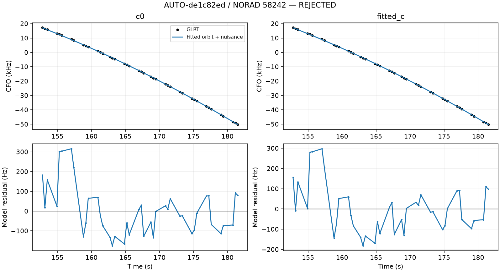

### AUTO-238a43df

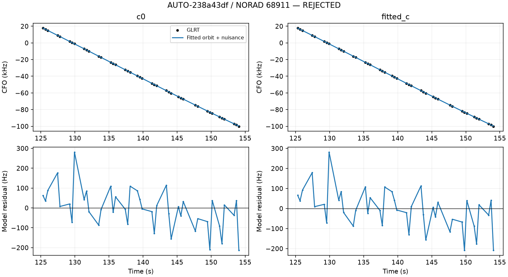

### AUTO-68de2bf0

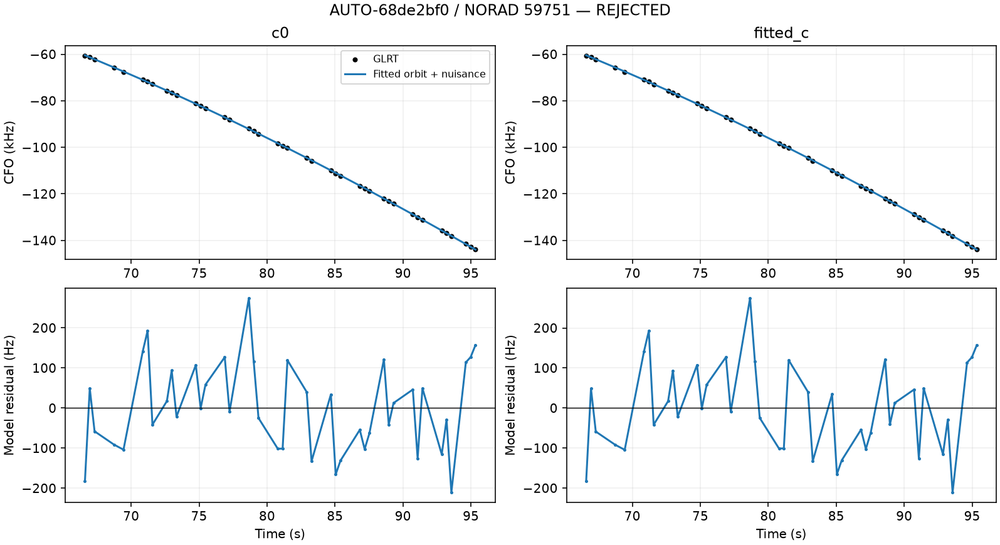

### AUTO-e32d57a7

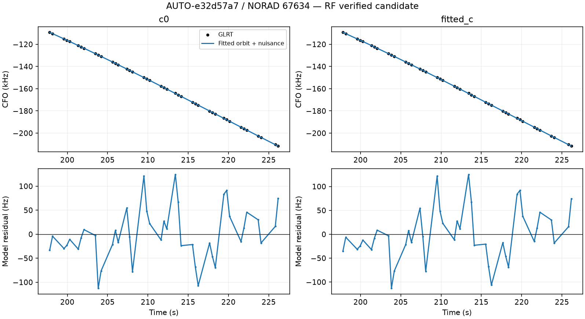

### AUTO-9fdf64ed

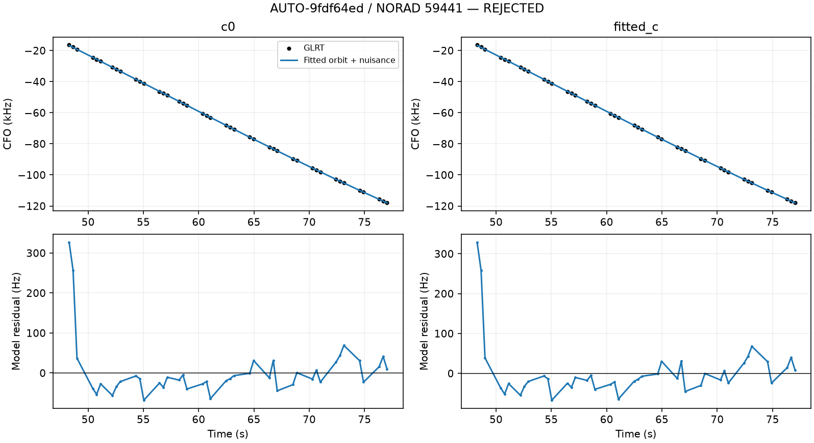

### AUTO-2f13639a

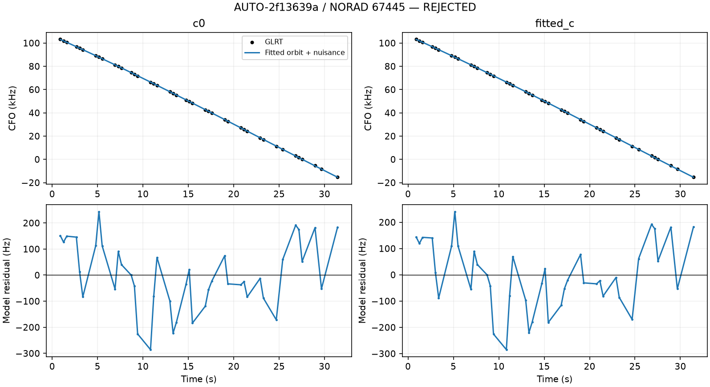

### AUTO-45194d97

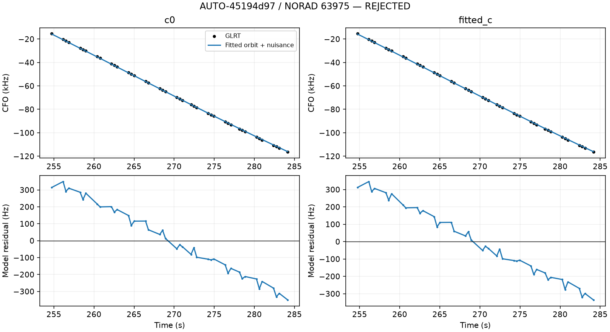

### AUTO-49154edb

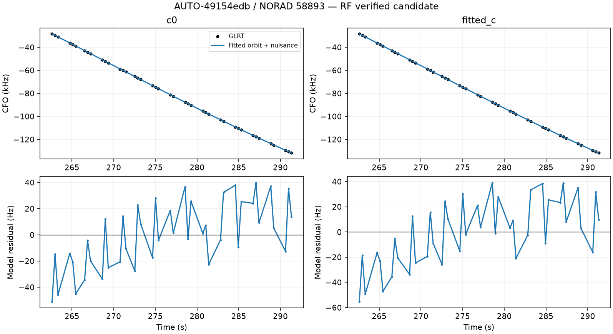

### AUTO-b1277aa8

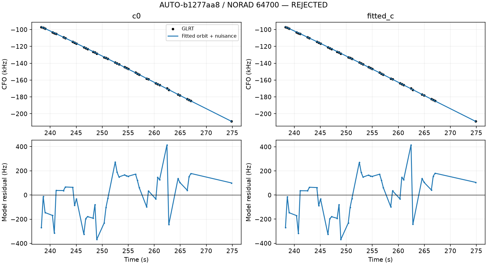

### AUTO-e9398e7a

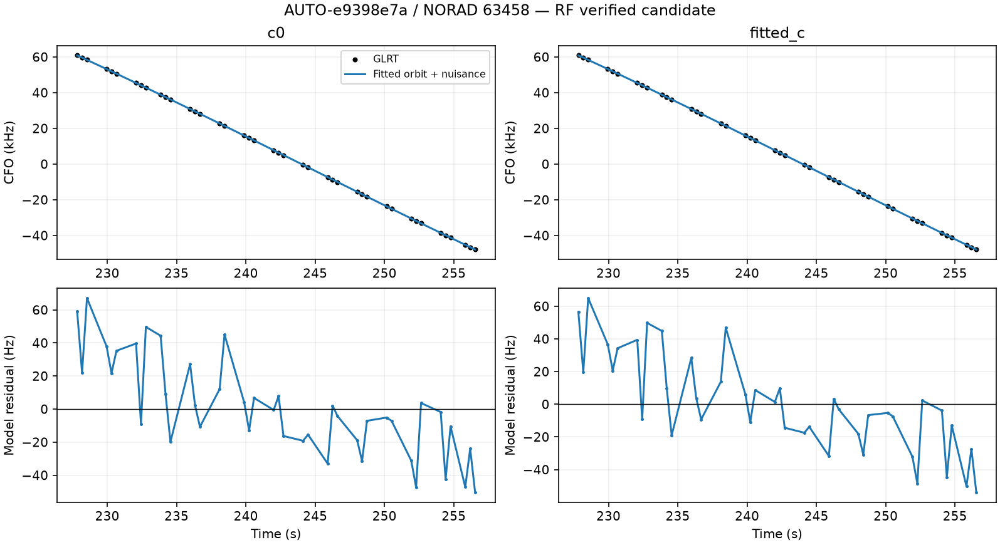

### AUTO-b7c32db9

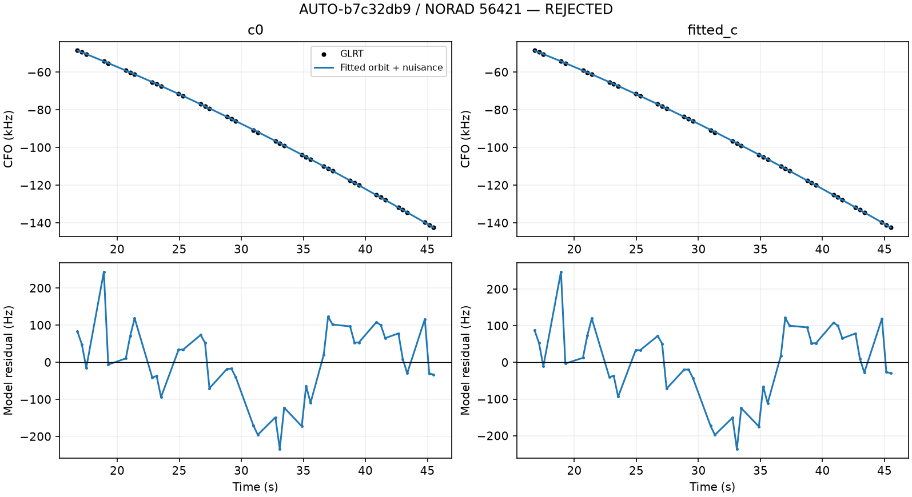

### AUTO-2f13639a

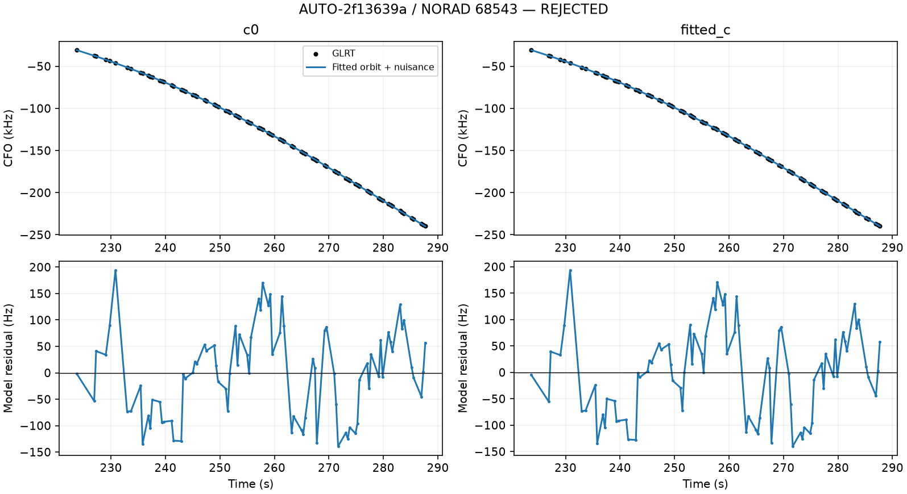

### AUTO-ec039c38

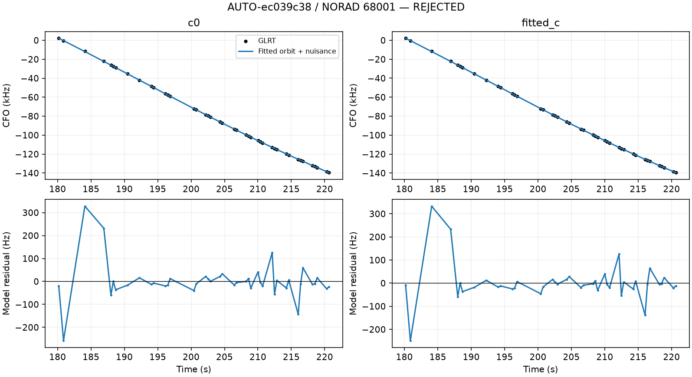

### AUTO-e565210d

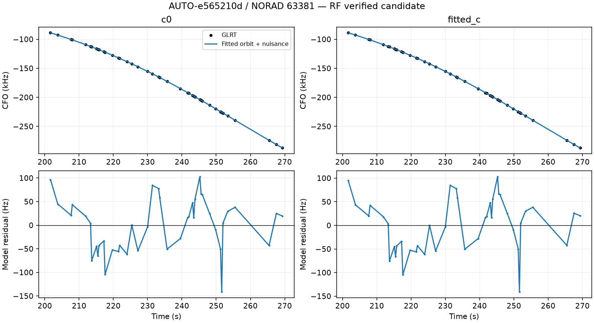

### AUTO-6cb87f0f

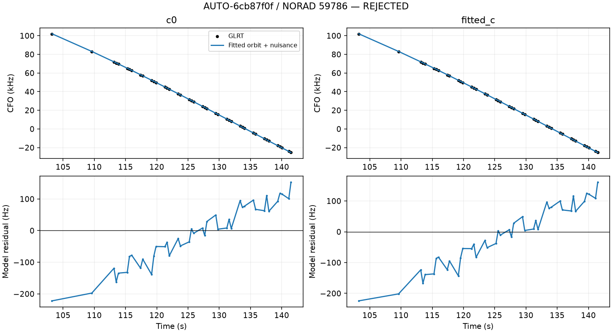

### AUTO-16a2e9fd

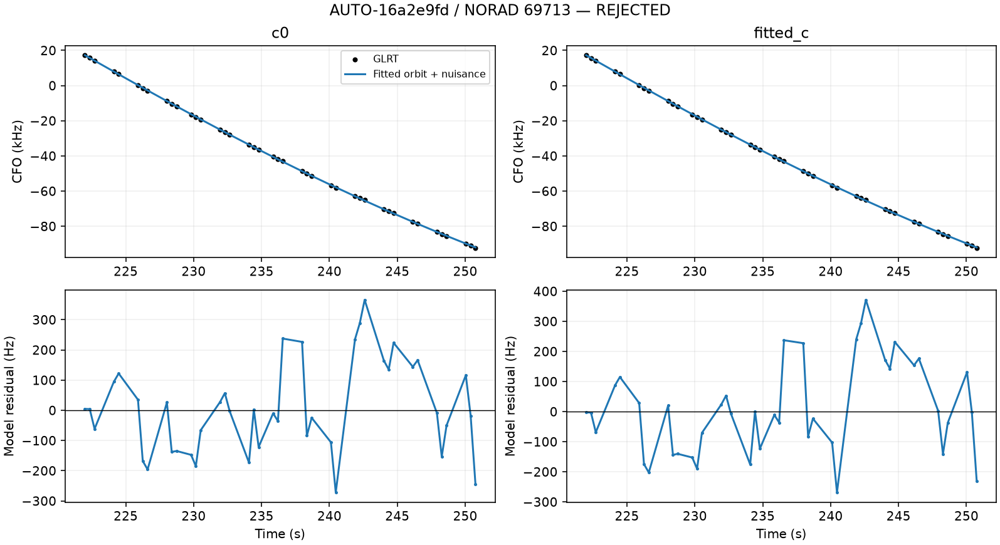

### AUTO-03f9876c

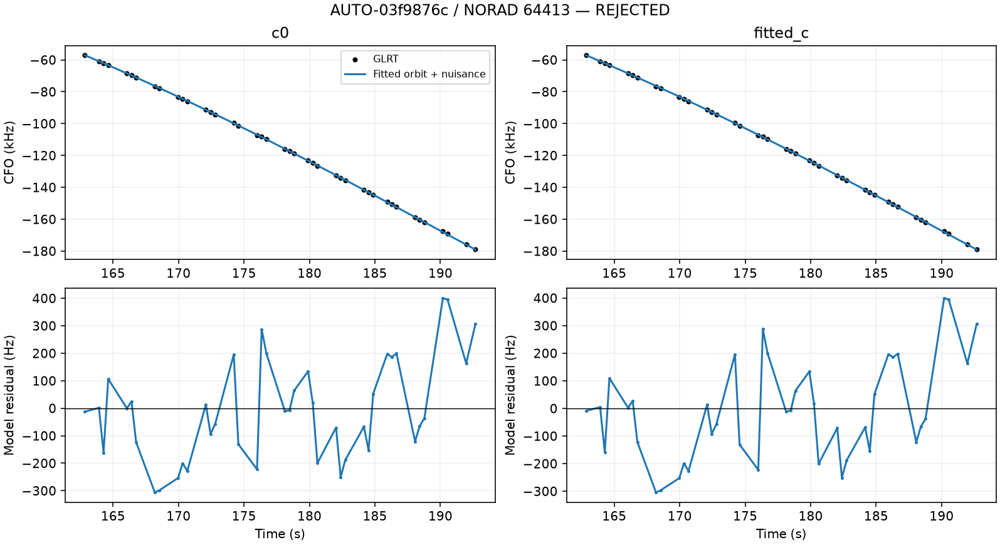

### AUTO-b845d6a4

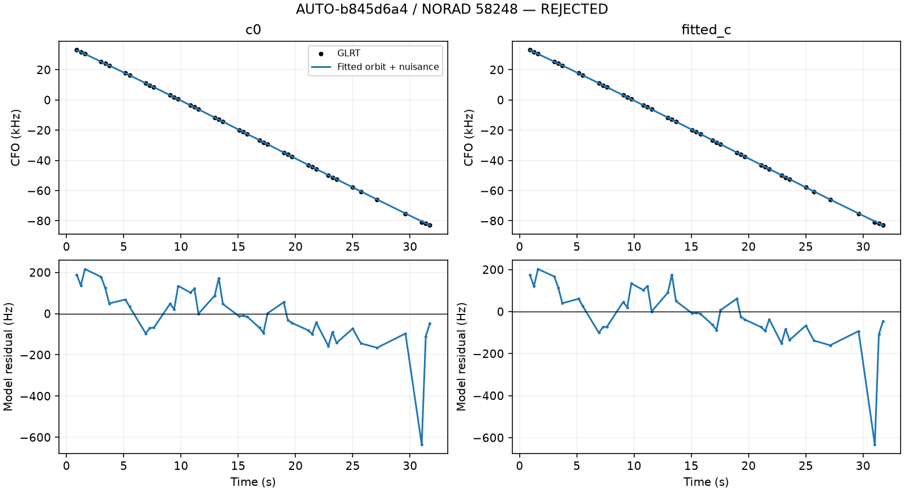
