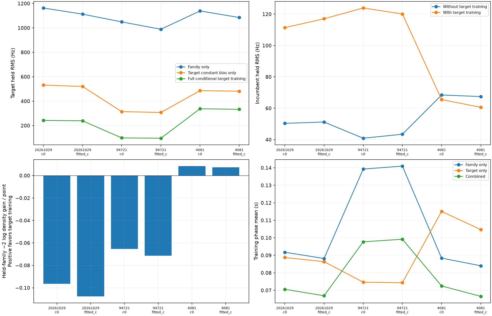
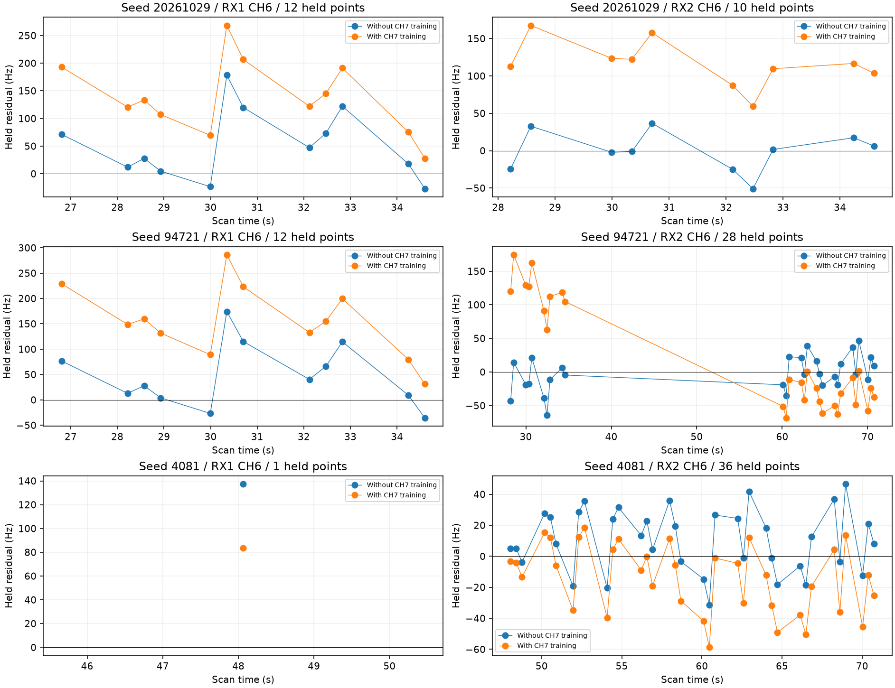

# Shared-family prediction: target self-prediction is insufficient

The 77-point AUTO-afec5a1f RX1 CH7 curve still favors satellite **59632** among the nominated causal candidates. A new bidirectional test exposes why that does not justify inclusion: target training improves its own prediction while degrading held observations on both receivers in two of three randomized partitions. The third partition improves. This is evidence of unresolved shared-model tension, not proof that the target or an incumbent identity is wrong.

## Receiver and position are trained without the challenged family

All 59632 observations are excluded from receiver and position calibration. All predictive-only rows are excluded from calibration as well. Each arm starts at the same 25 × 25 km regional box center and uses only other families' training blocks, fixed 150 Hz noise, unit confidence powers and existing causal priors. Graph construction and other family identities remain frozen conditioning assumptions. The same three distinct randomized scanwide 12-second block holdouts, with two-second guards, are replayed from the target annotation. This is conditional model validation, not a fresh end-to-end acquisition benchmark or a new position-error comparison.

One shared phase/orbit distribution and one receiver covariance connect the retained family observations; every track retains its own existing 300 Hz constant-bias prior. Target training may condition this joint predictive distribution but never changes the independently fitted calibration output. Held values enter scoring only.

| component | points | role | start_s | end_s |
| --- | --- | --- | --- | --- |
| SCAN-RX1-CH6-T004-RF12190312500.000000 | 26 | incumbent_calibration | 26.802 | 48.064 |
| SCAN-RX2-CH6-T001-RF12190312500.000000 | 82 | incumbent_calibration | 28.219 | 86.324 |
| SCAN-RX1-CH2-T007-RF11190312500.000000 | 21 | incumbent_predictive | 41.863 | 55.680 |
| SCAN-RX2-CH2-T003-RF11190312500.000000 | 22 | incumbent_predictive | 41.863 | 60.995 |
| SCAN-RX2-CH3-T008-RF11440312500.000000 | 17 | incumbent_predictive | 59.268 | 71.668 |
| SCAN-RX2-CH4-T004-RF11690312500.000000 | 21 | incumbent_predictive | 27.068 | 41.598 |
| SCAN-RX2-CH4-T005-RF11690312500.000000 | 19 | incumbent_predictive | 87.298 | 101.468 |
| SCAN-RX1-CH7-T000-RF12440312500.000000 | 77 | target | 0.277 | 56.255 |

## Bidirectional held prediction

| seed | target_held_points | incumbent_held_points | target_bias_only_RMS_hz | combined_target_RMS_hz | incumbent_before_RMS_hz | incumbent_after_RMS_hz | incumbent_density_gain |
| --- | --- | --- | --- | --- | --- | --- | --- |
| 20261029 | 33 | 35 | 520.437 | 239.045 | 51.210 | 117.053 | -3.766 |
| 94721 | 32 | 69 | 307.437 | 96.270 | 43.444 | 120.133 | -4.928 |
| 4081 | 27 | 79 | 481.481 | 333.209 | 67.450 | 60.612 | 0.582 |

Without any CH7 training, family-to-target RMS is about 1 kHz, much of it a constant offset; it must not be interpreted wholly as shape error. A diagnostic projection lets only the existing target constant bias update from target training values, leaving shared means and phase weights unchanged. Its fitted-c held RMS remains **520, 307 and 482 Hz**, versus **239, 96 and 333 Hz** with full conditional updates. This restricted projection is a diagnostic, not a normalized predictive density or an acceptance rule.

Full target conditioning worsens held-family RMS from **51→117 Hz** and **43→120 Hz** in the first two folds; the third improves **67→61 Hz**. Joint held-family density changes have the same signs in both c arms. Their magnitudes are modest and the folds share data, so no significance or calibrated false-association probability is claimed. Per-track scores are diagnostic marginals and are not summed as independent evidence.

The first two folds degrade CH6 prediction on both receivers. The third fold has only one held RX1 CH6 point, which limits that comparison. This pattern does not isolate a receiver-specific fault. A target-only held score can look adequate because target training estimates correlated nuisance terms; joint held-family prediction detects the resulting tradeoff.

## Candidate and numerical challenges

Raising the candidate cap from 3 to 12 yields **[3, 5, 4] candidates per fold**, with union **[53750, 58112, 59632, 66236, 100199]**. The nominator did not produce twelve distinct candidates in each fold; this is not exhaustive enumeration of every satellite. 59632 remains the winner in every fold and c arm, with minimum margin **27.86**. Candidate 53750 remains the nearest tested challenger. A broader cap alone does not resolve the family inconsistency.

Halving phase spacing from 0.1 to 0.05 s preserves the partitions and conclusions. The largest change in total held density score is **0.0111** and the largest held RMS change is **0.374 Hz**. This is a sensitivity check, not a global numerical-error bound. Both runs and the wider search completed within their 600-second stage budgets.

## Inventory progress and scoped recovery

The [fourth predictive-role batch](../2026_10_30_predictive_role_reassessment_batch4/README.md) assesses another 16 curves: six supported identities, eight unstable, one ambiguous and one prediction mismatch. All acquisitions in this batch are verified fast recordings. All six supported curves receive full position trials. Two curves totaling **146 target points** qualify in separate matched trials; this is not one simultaneous solution or a dataset-wide gain. One otherwise-valid trial requires a matched Powell retry; all original outcomes are preserved. **921 older-role cases remain**.

The other qualifying curve is AUTO-bf77eb5c / 59362, with **71 points**. Its error improves **1.111→0.861 km (c=0)** and **1.112→0.861 km (fitted-c)**, with no unvalidated incidental point gain. Every qualified and rejected comparison is preserved in [batch_position_comparisons.csv](batch_position_comparisons.csv).

The 75-point AUTO-f08da5cb / 63906 target passes RF, phase and exact ownership checks after that retry. Matched position errors improve **5.565→4.912 km (c=0)** and **5.824→4.927 km (fitted-c)**, still far from the localization goal. At the fitted-c endpoint, the standard extension step also discovers 28 RX2 CH4 points labeled 58528. Those points never entered the fit and have not received this target's independent annotation. The [membership-scope audit](target_membership_scope.json) therefore reports **75 validated candidate points in each arm**, retaining those 28 as unvalidated discoveries. No measurements, position objective or saved raw trial are changed. No 103-point validated recovery is claimed.

The [latest ledger](annotation_ledger.csv) preserves previous rejections and marks CH7's shared-family consistency unresolved. Both recoveries are research candidates, not production promotion or a dataset-wide accuracy gain. Next work should test independently supported channel/receiver model corrections and challenge incumbent family identities jointly; it should not loosen gates merely because a target predicts itself.

Nine focused tests pass, covering held-data isolation, family exclusion, exact point scope, Gaussian prediction and gate reporting. Source hashes, compressed evidence, grid changes and all c-arm metrics accompany this report. No future TLE or evaluation GPS enters these fits. The full annotation-and-inclusion goal remains active.
